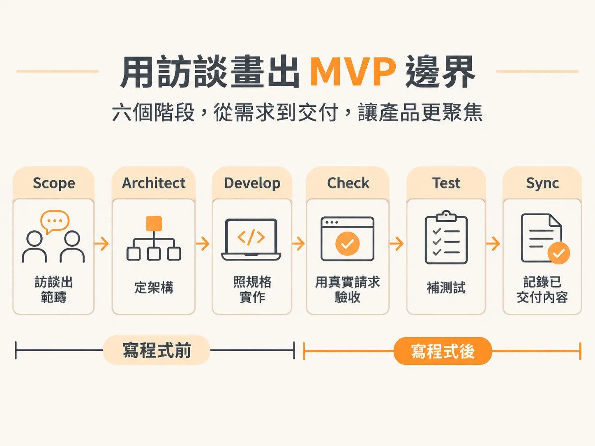
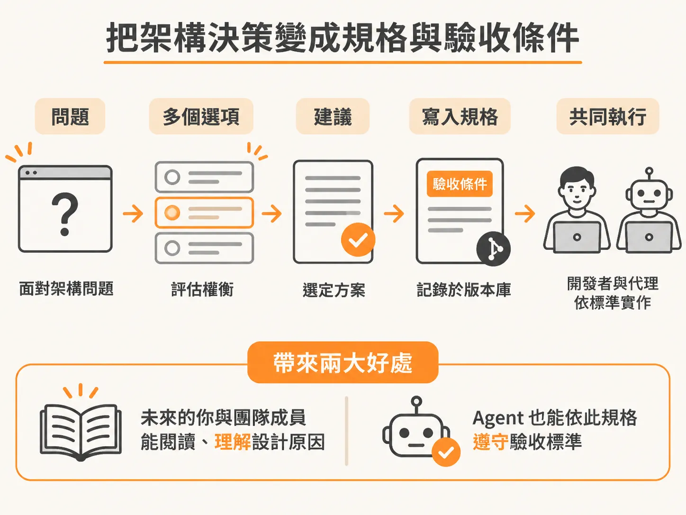
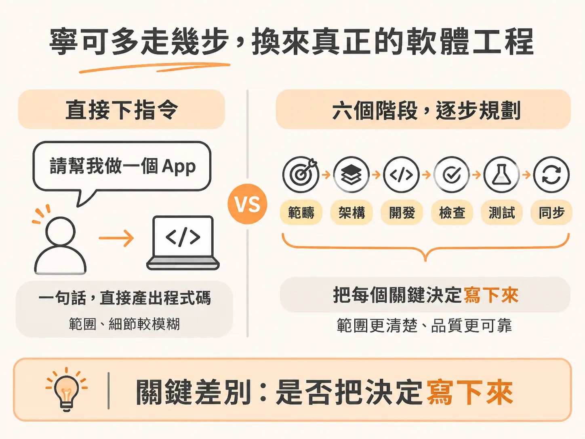

# 打造具備工程思維的 AI 工作流程：在寫程式前先做好決定

看過隨興敲提示詞、讓 AI 一路狂奔寫完整包專案的「vibe coding」之後，你可能會好奇：如果要用具備工程思維（agentic engineering）的方式來打造軟體，流程到底長什麼樣子？

這裡先概述整套核心流程的骨架。後續章節會將每個技能拆解開來詳細說明，但現在最重要的，是掌握「在動手寫程式之前，先把決策定下來」的整體工作節奏。

整套流程由六個核心技能組成：Scope、Architect、Develop、Check、Test，最後以 Sync 收尾。

---

## 1. Scope：用訪談畫出 MVP 邊界

流程從 Scope 技能開始。面對完全相同的需求提示詞：

> 「幫我做一個電影推薦 App。使用者可以登入、匯入 Letterboxd 的 CSV 評分檔，或是透過滑動電影卡片來完成初始設定；接著能看到附帶推薦理由的個人化動態牆，並支援氛圍搜尋（vibe search）。」

此時，Agent 不會立刻開始噴程式碼，而是回過頭來像產品經理一樣對你進行訪談：
* MVP 的最小可行邊界在哪裡？
* 這個產品是做給誰用的？
* 有哪些功能是明確「這次不做」的？

訪談結束後，Scope 會將規劃整理成實體檔案存入專案。這份清單會將所有功能排好順序，並且**基礎設施優先**——在列出任何具體功能之前，就先確定好技術堆疊（stack decision）、資料模型（data model）與設計系統（design system）。

這就像蓋房子一樣：先把地基整好，才開始砌牆。

---

## 2. Architect：把架構決策變成規格與驗收條件

接下來進入最關鍵的環節：Architect 技能。

當我們將 Architect 對準資料系統時，它不會自己瞎猜或發明方案，而是一次拋出一個問題，附上具體的技術選項與建議解法。

以「快取機制（caching）」這個決策為例：在隨興編寫的 vibe build 裡，AI 會在一整份幾百行的肥大檔案深處，靜悄悄地替你做出每次呼叫只要 0.35 美元的架構決定；而在這裡，問題、權衡取捨（trade-offs）與選項會清清楚楚列在螢幕上，由你拍板定案。

當你做出選擇，這個決定就會轉化為規格文件中的**驗收條件（acceptance criteria）**，並以實體檔案寫入版本庫（repo）。這份記錄帶來兩個直接好處：
1. 未來的你與團隊成員隨時都能閱讀、理解當初為何這樣設計。
2. 後續負責實作的 Agent 也能讀取這份規格，並依此受到驗收標準的約束。

在架構階段，有時還能搭配 Review 技能，由另一個 Agent 來交叉審查目前的規格，確保邏輯沒有疏漏。

---

## 3. Develop：按圖施工，絕不擅自替未決事項做主

接著啟動 Develop 技能。

Develop 的職責非常純粹：照著 Architect 規劃出的規格進行實作。在整個開發過程中，Agent 負責推進進度，但專案的主導權始終握在你的手中。

它絕不會自行發明尚未決定的架構或商業邏輯——因為未經深思、擅自補齊空白，正是 vibe coding 最嚴重的弊病。

---

## 4. Check：啟動真實環境驗收功能

程式碼寫好之後，進入 Check（或稱 Check Verify）技能。

它會把實際的應用程式啟動起來，以真實的請求（real requests）對照規格書上的驗收條件逐一驗證。如果環境中設定了 Playwright MCP，Agent 甚至可以直接開啟瀏覽器執行端對端測試，確認功能運作無誤。

---

## 5. Test：針對變更補齊測試套件

確認功能正常後，Test 技能會針對這次開發過程中有變動的程式碼，撰寫完整的測試套件（test suite），確保未來的改動不會破壞現有行為。

---

## 6. Sync：同步交付紀錄，讓下一次對話更聰明

最後是 Sync 技能。它負責將本次工作階段已交付的進度記錄下來。

當下一次打開編輯器開始新的任務時，Agent 就能讀取這些紀錄、無縫接軌，聰明地從正確的進度點繼續往下做。

---

## 寧可多走幾步，換來真正的軟體工程

整套「Scope → Architect → Develop → Check → Test → Sync」的流程，比起直接輸入一句「請幫我做一個 App」然後不問任何問題，步驟確實多了不少。

但正是這些步驟，把程式碼背後的架構選擇、資料模型與邊界限制從隨機生成變成明確紀錄。相同的需求功能，會因為這兩種做法產出截然不同的工程品質。
