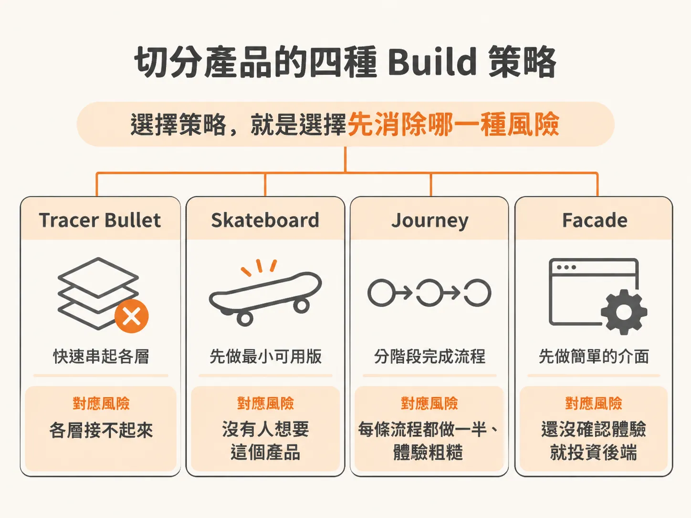
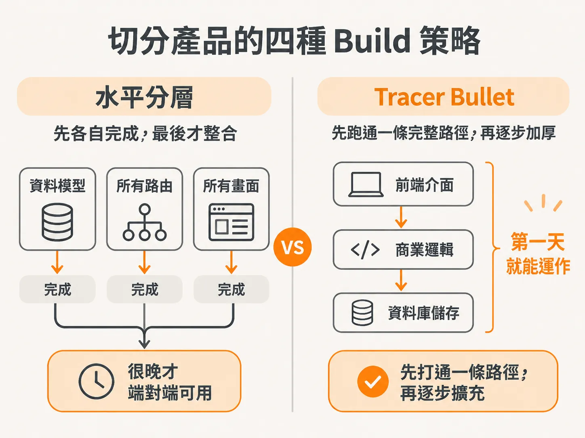
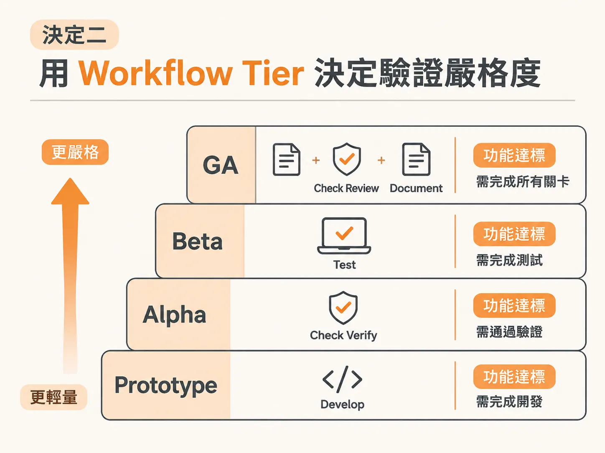
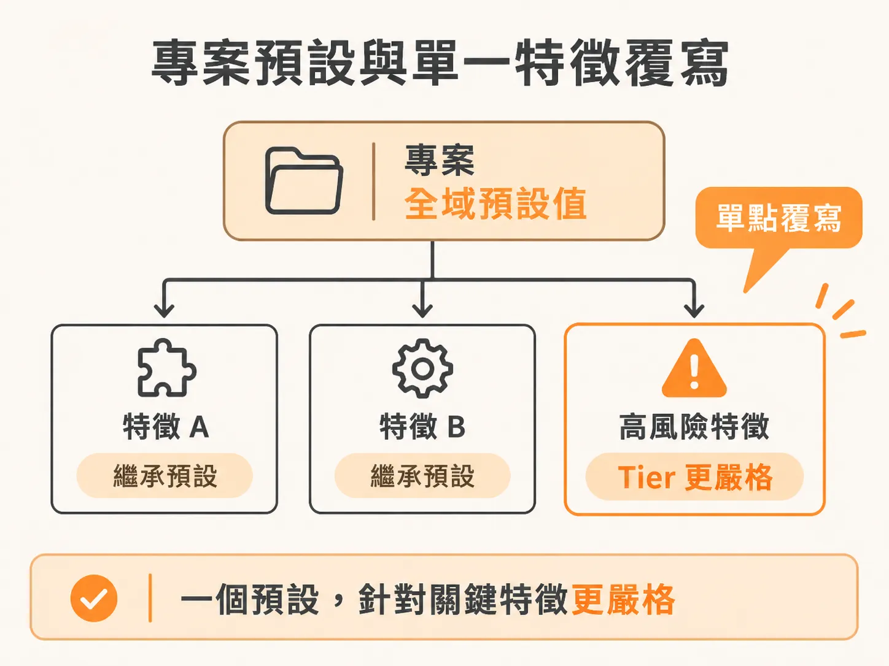

# 依風險決定 Build 策略與 Workflow Tier

把想法收斂成 MVP 邊界與「不做清單」之後，還有兩個決定要當場拍板：怎麼切、每個切片要做到多嚴謹。

交給 AI Agent 開發專案時，如果完全不給約束，它往往會照著扁平的水平架構切分：先把所有的資料模型寫完，再把所有路由開好，最後才開始畫前端畫面。這樣做的後果是整個系統要到極後期才能真正端對端（end-to-end）跑起來。

在規劃階段（`/scope`），你必須在動工寫程式前做出兩個核心決定：**這款產品要怎麼切分（Build Approach）**，以及**每個功能需要通過多少關卡的驗證才能算完成（Workflow Tier）**。

---

## 決定一：切分產品的四種 Build 策略

工具會根據專案潛藏的風險類型，推薦以下四種長年存在於軟體工程中的切分策略之一：



### 1. Tracer Bullet（曳光彈）
這個概念源自《The Pragmatic Programmer》（旗標譯為《專案開發聖經》或《敏捷開發實踐》）。就像曳光彈在黑暗中照亮彈道一樣，Tracer Bullet 的做法是貫穿整個系統打出一條極細但完整運作的垂直路徑（從前端介面、商業邏輯到資料庫儲存）。



* **核心風險**：技術架構串不起來。例如客戶在即時預覽頁面釘選一則留言，該留言是否能順利跨頁面並同步回後台儀表板？如果這個往返流程不通，周邊做再多畫面都沒有意義。
* **適用情境**：正式的正式產品（production build）、沒有急迫死線、或者演算法/推薦迴圈必須在真實資料端對端運作下才能看出效果時。Tracer Bullet 能及早消除架構不確定性，後續再沿著這條真實運作的路徑逐步增厚（thicken）。

### 2. Skateboard（滑板）
源自 Henrik Kniberg 的敏捷開發比喻（從滑板、腳踏車到汽車）。它不是做一個半成品的汽車底盤，而是先做出一個最簡陋但「真實可用」的完整產品（MVP）。

* **核心風險**：市場根本沒有人想要這個產品。
* **適用情境**：需要以最快速度把東西推到使用者面前驗證核心假設，代價是隨著產品成長，後續需要進行較多重構與打掉重練。

### 3. Journey（完整旅程）
在進入下一個路徑前，先把單一條完整的使用者路徑（User Path）從頭到尾做完。

* **核心風險**：功能做得很廣，但每個流程都缺漏狀態，體驗粗糙。
* **適用情境**：核心轉換漏斗或特定流程本身就是產品核心時。它不只做快樂路徑（happy path），還會把這條路徑上的載入狀態、空白狀態、錯誤處理與邊界案例全部做完，讓單一體驗達到真正成品的標準。

### 4. Facade（門面）
先用假資料（mock/placeholder data）把所有主要畫面與點擊動線刻出來，暫時不碰後端資料庫或真實驗證。

* **核心風險**：在還沒確認介面互動與視覺體驗前，就投入高昂成本開發後端基礎架構。
* **適用情境**：需要儘快向利害關係人展示、測試感受並取得核准的點擊原型（Prototype-grade）。在後端尚未接上真實資料前，這類專案明確屬於原型階段。

---

## 動態載入策略與基礎優先原則

當你在規劃對話中選定某個策略（例如 Tracer Bullet）之後，Agent 才會去讀取該策略專屬的說明檔案（例如 `.agents/` 目錄下的 `tracerbullet.md`，通常只有數十行）。在選取之前，它並不會載入該規則。

此外，Agent 開發本質上具有非確定性（non-deterministic），每次對話提出的細部問題或用詞可能會有些微差異（例如有的情況用 demo，有的情境問是否為 beta 專案）。對話中可能也會詢問是否需要附上參考資料（references/links）。如果只是單純的想法實作，可以選擇不加參考資料以保持 scope 精簡；若面對需要驗證套件最新版本或合規標準的企業級專案，則可附上網路來源連結。

但無論選擇哪一種 Build 策略，都必須遵守**基礎優先原則（Foundations First）**：
在開始切任何功能切片之前，必須先建立底層地基——包含技術堆疊（Tech Stack）、架構設計、程式碼規範、開發工具、資料模型與 UI 基礎系統。有了這些支撐，後續的切片才不會淪為隨興拼湊的程式碼。

---

## 決定二：用 Workflow Tier 決定驗證嚴格度

第二個決定是產品預設的嚴格度等級（Rigor Tier / Workflow Depth）。這決定了一個功能在開發（`/develop`）完成後，後面還要串接多少流程才能標記為完成。

四個等級由淺入深遞增：



| Tier | 包含流程 | 關卡關閉條件（Done） | 適用情境 |
| :--- | :--- | :--- | :--- |
| **Prototype** | 僅 `/develop` 自行檢查 | `/develop` 結束即標記完成 | 拋棄式實驗、Spike 探索、個人小工具 |
| **Alpha** | `/develop` → `/check verify` | 通過真實應用的行為驗證 | 低風險功能、希望確認有動起來的內部工具 |
| **Beta** | `/develop` → `/check verify` → `/test` | 完整測試套件跑過 | 一般正式上線的產品預設值（保護未來改動不壞） |
| **GA** (General Availability) | `/develop` → `/check verify` → `/test` → 換模型 `/check review` → `/document` | 測試通過，且經獨立模型審查與文件化完成 | 涉及金流、登入驗證、權限、法規或團隊共用模組 |

在 GA 等級中，寫出該段程式碼的 AI 模型**不能作為唯一把關者**，系統會調用一個全新、乾淨的獨立模型來審查程式碼，防止原本模型的盲點。

### Workflow Tier 不只影響事後驗證

這個等級設定實際上同時主導三件事：
1. **開發前的設計深度**：等級越高（如 Beta、GA），越容易被判定為需要先寫規格（`Needs spec: yes`），系統會自動啟動跨模型審查來批判規格設計。在進入開發前，架構閘門（`/architect`）會強制把關任何重大決策。
2. **開發後的事後檢驗**：決定了 `/develop` 之後是完全不跑額外檢查、跑畫面驗證、加跑測試套件，還是進入換模型審核與文件產出。
3. **完成條件（What closes done）**：只有通過該層級規定的最後一道驗證，功能狀態才會變成 `done`。

---

## 專案預設與單一特徵覆寫（Per-Feature Overrides）

在 `/scope` 產出的檔案（如 `scope.md`）表頭中，會記錄專案的全域預設值：

<!-- derived -->
```markdown
Build approach: Tracer Bullet (prove the whole pipe works end to end)
Workflow: Beta
```

但現實專案中，不同特徵的風險截然不同。不需要為了單一重要模組，把整個專案的所有小功能都拖進繁瑣的審查流程中。



你可以讓個別特徵覆寫全域等級。未標註標籤的功能直接繼承預設值；若某個功能風險特別高，直接在標題旁掛上標籤即可：

<!-- derived -->
```markdown
### 7. 金流整合 (Payments) · GA
```

這樣一來，一個預設為 Prototype 或 Beta 的專案，其一般介面可以保持快速迭代，而涉及金錢交易、身分驗證或法規遵循的關鍵模組，則會被強制推到 GA 等級，接受最嚴格的測試與跨模型雙重審查。流程既能兼顧開發速度，又能在高風險處守住品質。
