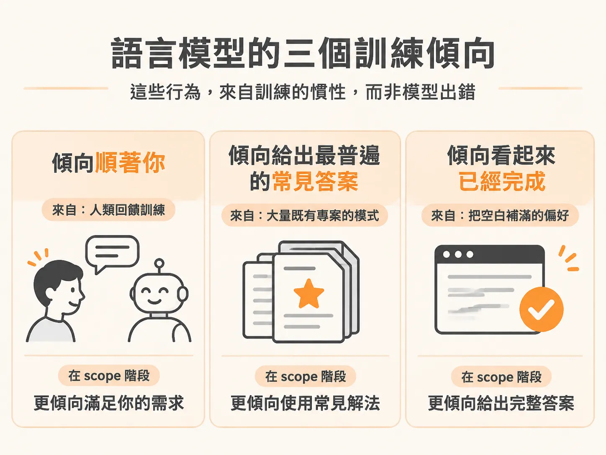
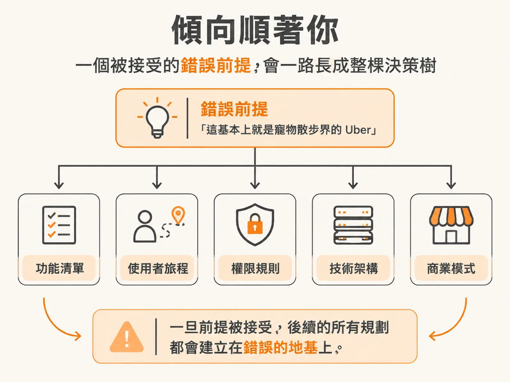
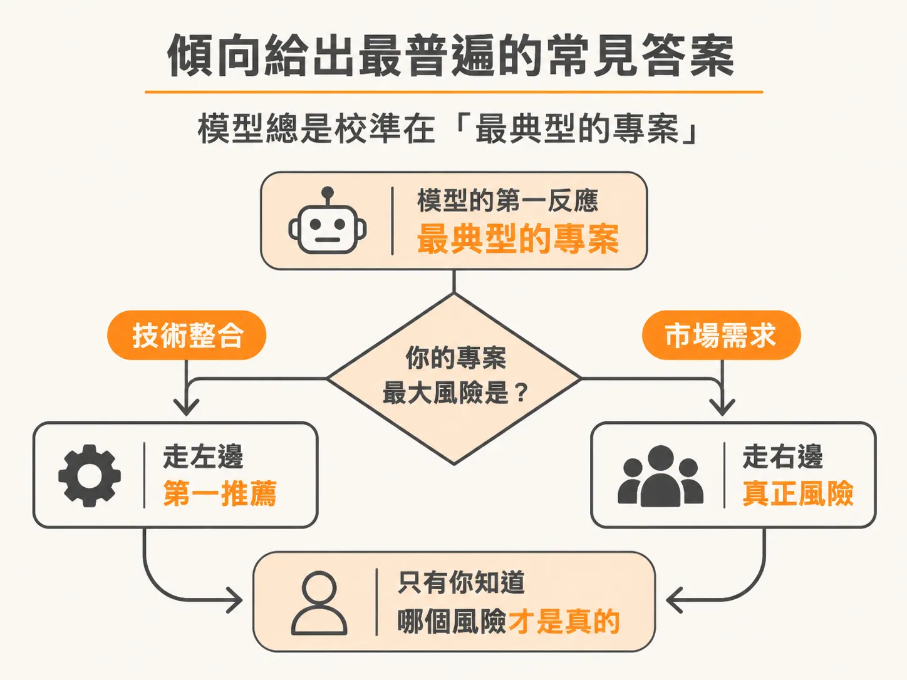
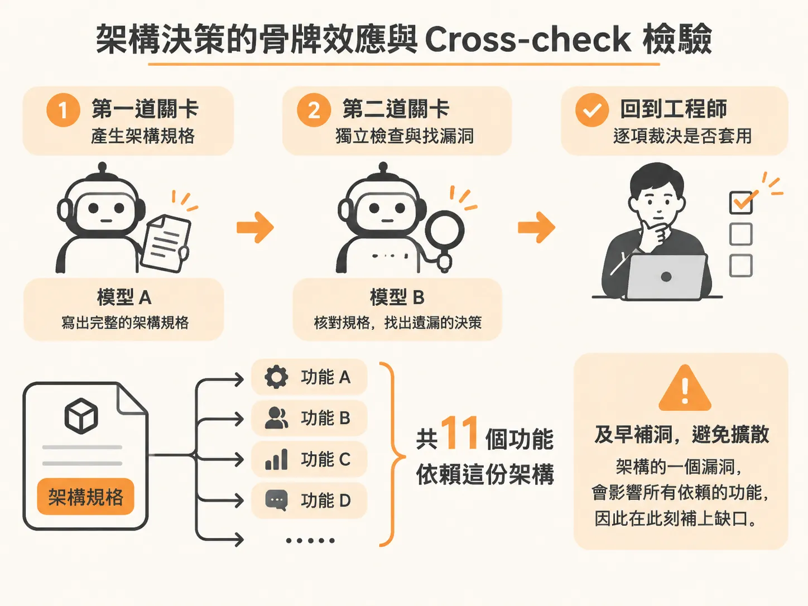

# 帶著 Agent 的三個訓練傾向檢查 Scope：開工前的四項自檢

`scope.md` 寫好、下一步也標出來了，並不代表計畫沒有盲點。

把自己的軟體想法丟給 AI 跑完 `/scope`，看到終端機輸出一份排版整齊、架構分明的規劃文件時，很容易讓人產生一種錯覺：所有的盲點都已經被排除了，現在可以直接交給程式碼生成工具開工。

然而，這種「看起來完全沒問題」的規格文件，往往才是最危險的陷阱。AI agent 不是客觀中立的工程顧問，它的運作方式受限於語言模型的訓練方式。如果不知道這些訓練痕跡如何影響輸出，你很容易拿到一份看似合理、實則充滿妥協與漏洞的計畫。

在進入開發階段之前，你必須先看清 agent 的三個內建傾向，並透過嚴格的決策檢驗與開工自檢，守住軟體的核心邊界。

## 語言模型的三個訓練傾向

語言模型在對話時表現出的行為，大多來自對齊訓練（alignment）與預訓練資料的分佈。在定義專案範疇（scope）時，這會轉化成三個明確的慣性：

### 1. 傾向順著你（Wants to agree with you）

模型在微調階段大量依賴人類回饋，而給予回饋的人天然更喜歡合作、態度友善且符合自己既有認知的回答。這讓 agent 養成了一種本能：傾向接受你的前提假設，而不是質疑你。

如果你在起頭時給出導向式的描述，例如「這基本上就是寵物散步界的 Uber」，agent 很容易直接圍繞 Uber 的既有模式規劃功能，而忽略這項比喻其實掩蓋了你這款產品真正關鍵的差異。一旦前提被接受，後續的所有使用者旅程、權限規則、技術架構都會建立在錯誤的地基上。

當工作流程中的 `/architect` 質疑你的需求前提時，它其實是在對抗這個討好使用者的本能。切換到 `/scope` 階段時也是如此，當它詢問產品細節時，務必給出真實的限制與狀況，不要為了盡快結束對話而挑選最輕鬆的選項。

### 2. 傾向給出最普遍的常見答案（Reaches for the common answer）

模型是從海量的既有程式碼與專案資料中學習模式，因此它的第一反應永遠校準在「最典型的專案」。

標準預設值通常很實用，但它瞄準的是中位數專案，而不是你的真實情境。Agent 能讀懂你輸入的字面意義，但它無法替你感受商業風險、團隊技術缺口、交付時程壓力，或是真正讓你夜不能寐的未知數。

在 `/scope` 選擇建構路徑時，這個現象最明顯。模型很可能預設推薦「曳光彈」（Tracer Bullet），因為從頭到尾打通一條薄薄的技術鏈路確實是典型的最佳實踐；但如果你最大的風險根本不是系統整合，而是市場到底有沒有人要用這個功能，「滑板」（Skateboard，做出最小可運作並能交付價值的型態）才是對的選擇。這種關於主要風險的判斷，必須由你帶入決策。

### 3. 傾向看起來已經完成（Wants to look finished）

一份完整乾淨的規格，在直覺上遠比充滿問號的草稿更有說服力。因此，模型會本能地抹平不確定性，把空白填補成看似有條理的規劃。

如果在專案訪談中你含糊帶過，agent 不會停下來留下一個明顯的破洞，而是會塞入合理的預設假設，然後裝作這項決策已經敲定。一段極短、毫無摩擦就結束的訪談反而是警訊。特別是存取權限、資料所有權、隱私法規、服務異常時的降級行為與生命週期規則，這些在第一版展示時看似不起眼的跨領域問題，只要在規格中留白，後續的程式碼生成就會被迫自己捏造邏輯。

## 架構決策的骨牌效應與 Cross-check 檢驗

在定義完業務 scope 後，緊接著進入架構規格的擬定。這份決策規格是整套應用的「單一事實來源」（source of truth）。它會產出紀錄總結決策、建議技術堆疊與後續追蹤的 `index.md`，以及記錄全端選項優缺點與網路查證依據的 `rationale.md`。此時文件不應包含具體的建構計畫或驗收標準，因為實作鷹架步驟屬於開發技能的職責。

架構是所有功能的基石。如果一項系統背後有 11 個功能要依賴這個架構，基礎架構規格中的一個漏洞就會直接向下擴散感染所有功能。為了防止原模型對自己的假設產生盲點，可以在審查前引入另一組模型進行交叉檢查（cross-check），它的核心任務是驗證「決策完整性」（decision completeness），揪出那些如果不在此刻拍板、後續建構時程式碼就必須憑空腦補的空白。

在實際工程案例中，原模型完成規格後，第二個模型僅花 17 秒就揪出六項隱蔽的正式環境缺口（silent production gaps）：

1. **Row Level Security (RLS) 防護完全失效**：規格寫明了三處資料庫行級安全防護，但 Supabase 的安全策略依賴每筆請求由客戶端帶入的 JWT claim 讀取 `Auth UID`。然而應用程式採用 Drizzle ORM 直接連線資料庫，根本不會設定這個 claim，導致 `Auth UID` 永遠判定為 null，安全政策形同虛設。解法是維持 RLS 開啟，但改為預設全數拒絕（deny by default），讓前端外洩的 public anonymous key 無法讀取任何資料，改由後端伺服器連線專責控制資料存取。
2. **連線池規則只做半套**：規格採用了連線池，但 Supabase 的 transaction pooler 不支援伺服器端 prepared statements，而底層 Postgres driver 預設會啟用 prepare。這在本地測試無法重現，但在高併發負載下會拋出 `prepared statement already exists` 的崩潰錯誤。解法是在 driver 明確設定 `prepare: false`。
3. **Session 串接僅有斷言卻未指名做法**：宣稱有維護 session，但未寫出具體實作機制。
4. **驗證信件服務評估過度誇大**：原先選擇 Supabase Auth 的理由是「能自帶發信功能」，但其預設的信箱服務有嚴格的發信速率限制，官方明確標註不可用於正式環境。選型結論雖然依舊成立，但論據過度誇張，必須補上自訂 SMTP（如 Resend）的依賴並修正評估理由。
5. **資料攝取（Ingest）連線方式未被處理**。
6. **向量距離計算指標（Vector distance metric）未命名**。

這六個發現全部屬於承重決策（load-bearing decisions）。一旦確認並套用修改，技術堆疊才算真正穩固：Next.js 16（TypeScript）、搭配 pgvector 的 Supabase Postgres（負責電影相似度搜尋）、透過 Ingest 背景任務處理耗時匯入、並部署於 Vercel。

要注意的是，在最一開始定義 `/scope` 階段，當 agent 詢問是否要搜尋外部參考資料（references）時，通常可以直接回答不需要，保持 scope 本身乾淨。因為 scope 是你要打造的產品想法本身，不依賴外部技術，只有在後續架構技術選型時，才需要聯網拉取特定技術最新版本的參考。同時，agent 開發本身具有非確定性（non-deterministic），每個人拿到的提問可能略有不同——例如當專案缺乏金流或法規監管等大型系統時，它可能將情境辨識為一般測試專案（beta）而非正式全面發布（GA）。

## 開工前的四項自檢

當架構與範疇初步擬定完成，在真正交給下一階段的開發技能（`/develop`）之前，請用以下四個問題檢驗你的規劃：

1. **建構路徑是否直擊最大風險？**
   選擇的開發推進方式（例如 Tracer Bullet 或 Skateboard），究竟是在解決眼前最危險的不確定性，還是單純照單全收 agent 的第一項預設推薦？
2. **工作流程層級（workflow tier）是否誠實對應專案規模？**
   對於這項專案的定位是否坦白？這是一個週末實驗、內部自用工具，還是有外部用戶高度依賴的正式產品？這決定了你需要多少驗證強度。
3. **是否真正理解每個架構選型的背後原因？**
   規格書裡的每一項技術推薦與替代方案，你是否清楚它解決了什麼問題，還是僅僅因為工具名稱聽起來耳熟就放行通過？
4. **規格中的所有數值、狀態與權限是否有明確來源？**
   文件所描述的資料欄位、狀態機、權限邊界與異常行為，是否都有定義具體的輸入來源？還是描述依然含糊，導致後續寫程式時必須由 AI 自己捏造商業邏輯？

跑完這套檢查後，你的硬碟上應該留下兩份互為表裡的檔案：一份清晰定義產品邊界與活化計畫的 `scope`，以及一份承接架構細節、沒有暗藏漏洞的決策規格（`spec`）。這時，你才是真正在主導工具，而不是被工具牽著走。
