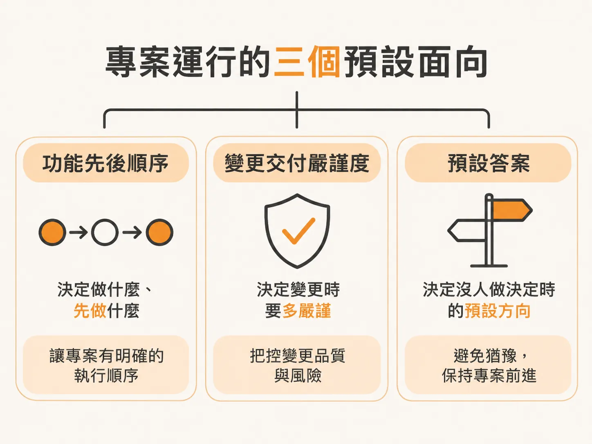
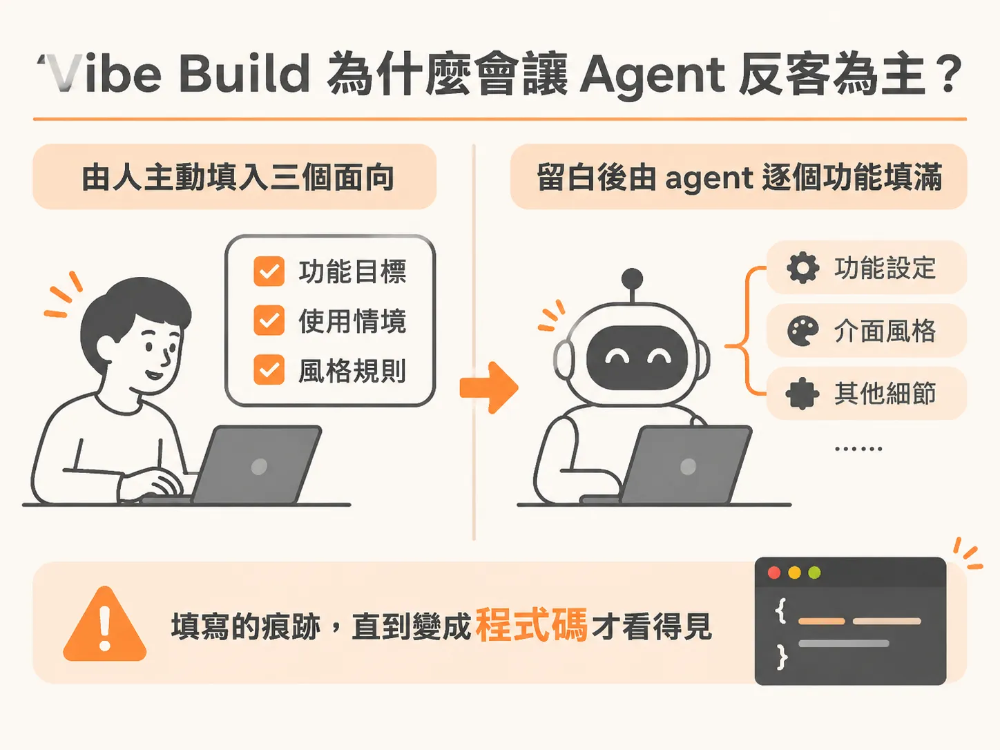

# 別讓 Agent 默默替你決定：專案預設的三個面向

當你把任務丟給 AI agent，靠著感覺直接開始開發（也就是所謂的 vibe build），幾輪提示詞下來，畫面和功能好像很快就長出來了。但多數人在這個階段會突然發現，專案長出來的樣子和自己預期的差很多：有些核心功能還沒著落，邊角細節卻做了一大堆；看似寫好的模組，一測才發現完全經不起考驗。

這並不是因為 agent 不會寫程式，而是因為任何專案在運作時，背後都存在著一組「預設值」（defaults）。

## 專案運行的三個預設面向

無論你有沒有明講，每個專案都依賴三個關鍵的預設值在推進：

1. **功能打造的先後順序**：哪一個功能該先做、哪一個該殿後。
2. **每次變更交付前的嚴謹程度**：每個改動在合併或上線前，需要經過多少把關與照顧。
3. **還沒有人做決定時的預設答案**：當某個細節懸而未決時，系統或團隊會如何應對。

這三個預設值只有兩種產生方式：要嘛是你深思熟慮後主動訂下來；要嘛就是沒有人管，讓 agent 順手抓到什麼，就一個功能接著一個功能替你默默做主。

## Vibe Build 為什麼會讓 Agent 反客為主？

這正是 vibe build 最常踩到的陷阱。當你沒有事先定義清楚規則，agent 就會依照系統預設直接替你填空：

* **沒有人決定順序**：agent 就順著當下最容易拿到或最直覺想到的東西先做。
* **沒有人決定哪些東西超出範圍（out of scope）**：結果就是沒有任何東西被排除，什麼邊邊角角都一起塞進專案裡。
* **沒有人決定一個功能在算作「完成」之前需要多少證明**：agent 就會自動選擇成本最低、最省事的答案——那就是完全不需要任何證明，程式碼寫出來就算交差。

最危險的地方在於，這一切從頭到尾都沒有經過任何討論，也沒有被白紙黑字寫下來。在這些決策真正變成程式碼之前，你根本看不見它們已經被定案。

這些無形的決定，最終就變成了專案實質上的預設走向。要避免這種失控的情況，就必須在敲下任何一行程式碼之前先做好範疇界定（scope），主動把這三個面向的選擇權拿回自己手中。
