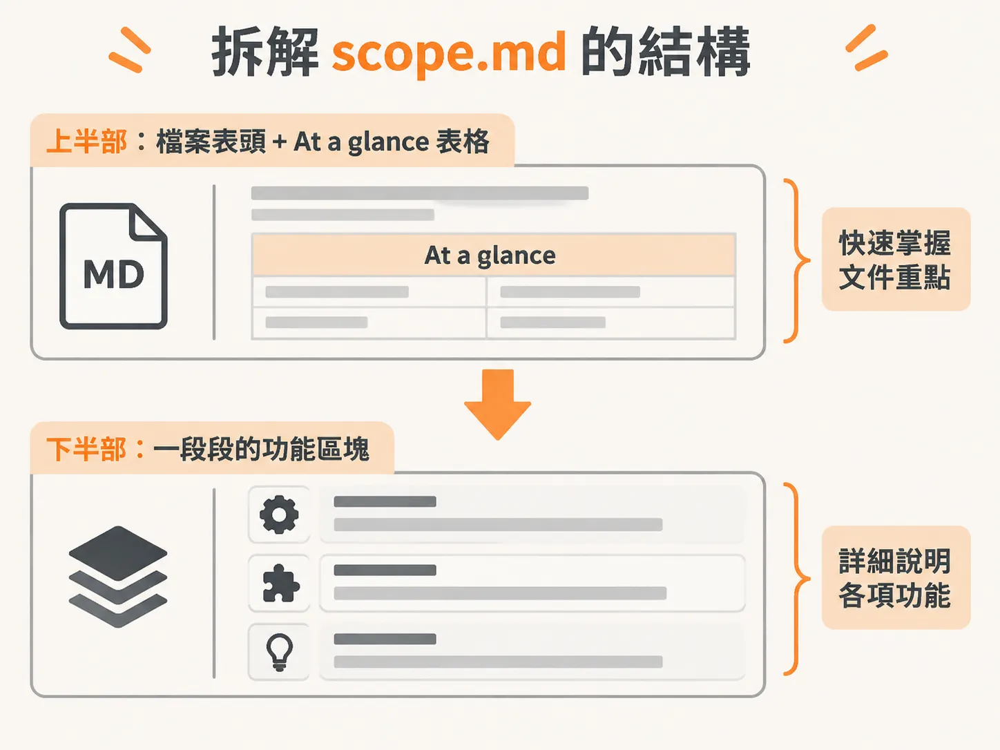
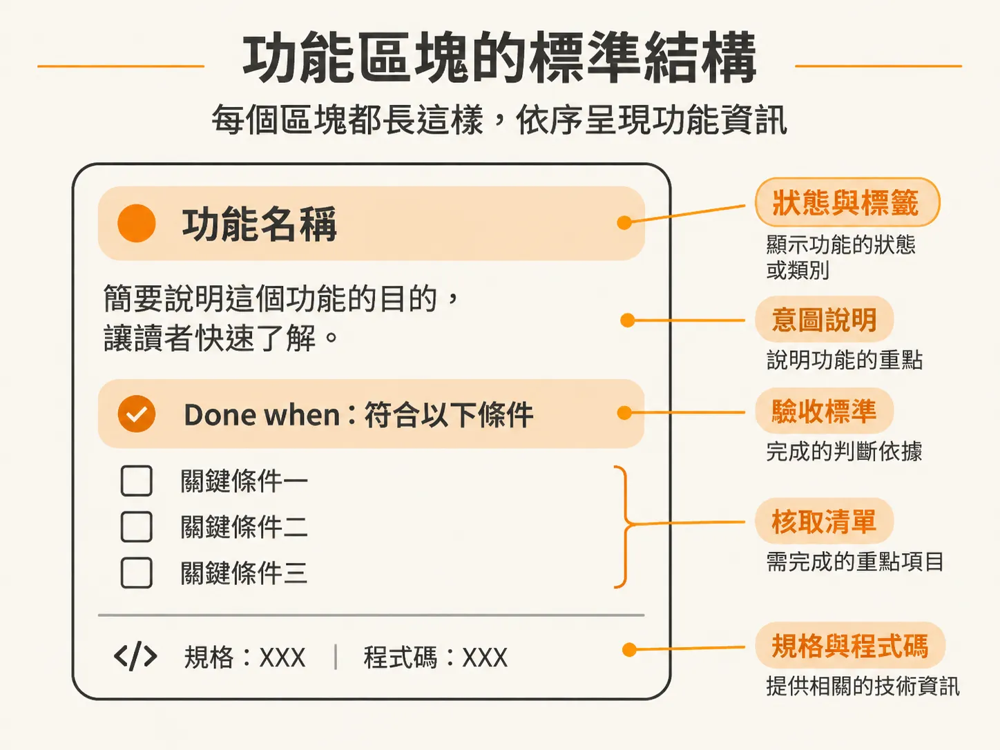
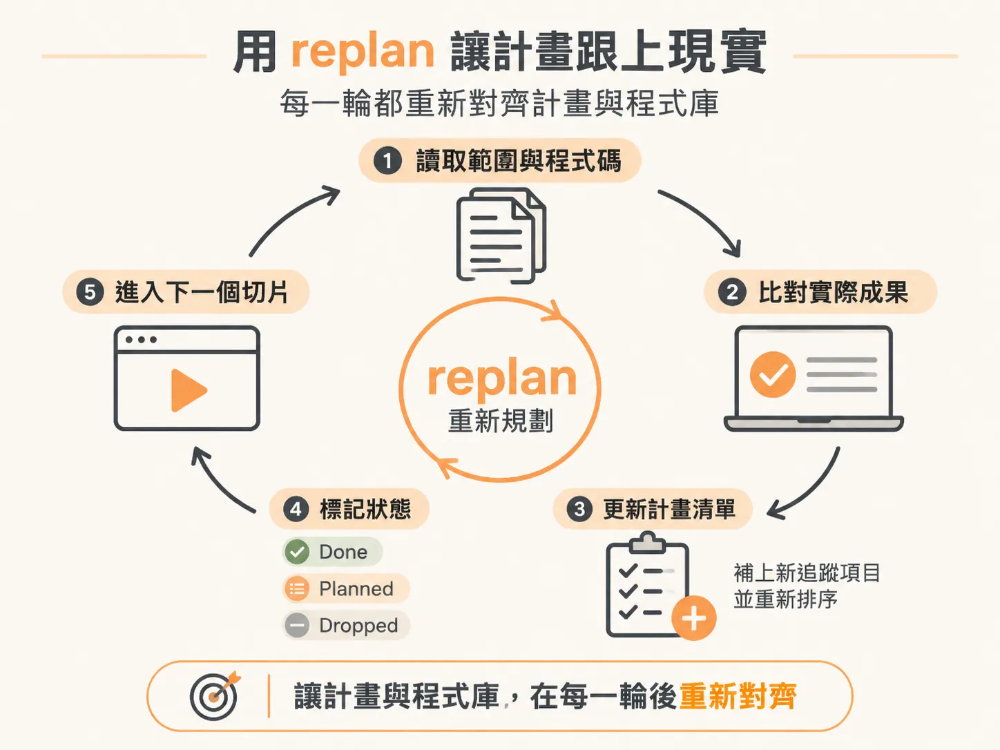

# 讀懂 scope.md 並用 replan 對齊開發進度

建置策略與 workflow tier 一旦定案，就會被寫進 `docs/scope/scope.md`。這份文件能不能在幾週後還說實話，取決於你有沒有讀懂它、有沒有在交付後 replan。

把產品想法交給 AI 規劃後，最怕產出一大堆雜亂的規格文件，幾天後程式碼改了，文件卻停在第一天，最後誰也不知道下一步該做什麼。

在規格驅動的開發流程中，規劃成果會集中寫入單一檔案：`docs/scope/scope.md`。它不是死板的技術規格書，而是一份會隨開發進度同步演進的活文件。只要讀懂它的結構，並在每次交付後執行重新規劃（replan），就能確保計畫隨時反映程式碼的真實狀況。

## 拆解 scope.md 的結構

在 VS Code 中開啟 `docs/scope/scope.md`，按下 `Cmd + Shift + V`（Windows 為 `Ctrl + Shift + V`）開啟 Markdown 預覽，整份文件由上至下主要分為兩個核心部分：

### 1. 頂部總覽與 At a glance 表格

檔案開頭會用一到兩句話說明產品本質與服務對象，接著標註專案的整體策略：

- **建置策略（Build approach）**：例如選擇 Tracer Bullet（曳光彈），代表先用一條細線打通端到端流程，再把各模組補齊。
- **工作流程等級（Workflow tier）**：專案預設的驗證嚴謹度（如 Beta 代表在 `/develop` 之後，必須跑 `/check verify` 與 `/test`）。

緊接著是「一覽表」（At a glance），用表格條列所有功能項目的編號、名稱、所屬階段與當前狀態：

| # | Feature | Phase | Status |
|---|---|---|---|
| 1 | Stack & architecture | Foundation | in-progress |
| 2 | Coding standards & tooling | Foundation | planned |
| 3 | Data model | Foundation | in-progress |
| 4 | Design system & UI foundation | Foundation | planned |
| 5 | Core review loop | Slice 1 | planned |

表格清楚揭示了重要原則：**基礎建設（Foundations）永遠排在產品切片（Slices）之前**。在進入具體功能前，技術堆疊、程式碼規範、資料模型與 UI 基礎必須先確立。如果只是隨興寫程式（vibe coding），這些地基往往會被直接略過，導致後續切片蓋在脆弱的空想上。

### 2. 功能區塊（Feature sections）與完成定義

表格下方是各個功能的詳細區段，組裝順序就是實際的建置順序，不需要額外維護獨立的排序清單。每個功能區塊都具備固定的形狀：

- **標題與標籤**：例如 `### 1. Stack & architecture · in-progress`。如果有個別嚴謹度覆寫（如 `· GA`）或尚未拍板的決策，會標註在標題旁。
- **意圖（Intent）**：用一到兩句話說明這個功能的存在目的。
- **完成定義（Done when:）**：明確的驗收標準。例如 Stack & architecture 的完成定義是「技術堆疊記錄在規格中，且空的骨架專案能在本地啟動並通過生產環境建置」。
- **核取方塊（Checkbox steps）**：具體的執行指令。尚未設計的功能只會有一個進入點方格（通常是 `/architect` 或 `/develop`）；設計完成後，會展開為兩到五個里程碑步驟。
- **指標線（Pointer line）**：在規格與程式碼產生後補上，例如 `Spec 0001 · code in ./`。

這份文件的最大特色是**完全不提具體的函式庫或套件名稱**。諸如使用哪一套 ORM、哪一個 UI 元件庫，屬於架構決策，應當留給架構階段（`/architect`）處理。專案計畫只記錄產品需要什麼（例如帳號、留言、權限、儀表板），保持工具無關（tool-agnostic）。如此一來，即使中途更換套件，整份專案計畫也不會失效。

從這份檔案開始，**下一步行動永遠不隱藏，永遠就是第一個未勾選的方格**。

## 計畫如何因應不同情境

這套規劃機制並非只適用於從零開始的全新專案（greenfield）：

- **全新專案**：輸入想法後，系統會從地基開始分解整個 MVP。
- **既有專案（brownfield）**：先執行審計技能（`/audit`）擷取現有的技術堆疊、指令與慣例，再執行規劃技能。系統會將現存功能標記為 `existing`（已完成）或 `in-progress`（部分完成），並在此基礎上規劃新切片，絕不會假裝專案是今天才從零開始。
- **Monorepo 架構**：在特定 workspace 執行時，計畫與規格會留在該 workspace 本地（`docs/scope/<workspace>/`），避免單一功能的變動干擾儲存庫裡其他無關的應用程式。
- **中途冒出新需求**：輸入指令帶上單一功能想法（例如 `/scope <feature>`），系統會自動以輕量模式將新工作插入正確順序，不必推翻重做整份計畫。

## 用 replan 讓計畫跟上現實

軟體開發最常見的脫節，發生在功能交付之後、清除對話階段（clear session）換取乾淨上下文時，或是工程師隔了幾天回到專案忘了停在哪裡。

這時只要執行不帶任何參數的 `/scope`，系統就會自動進入 **replan（重新規劃）模式**：

1. **對齊已交付成果**：讀取程式庫與最新規格，比對出真正已經實作並驗證完成的功能，將狀態更新為 `done`。已完成的行不會重複覆寫，未確認的事項絕不隨意打勾。
2. **揭露決策債務**：如果在開發過程中未經正式架構拍板就先寫了程式碼（產生了 `Assumed` 規格），replan 會在報告中標註「已建置，等待確認（built, awaiting ratification）」，提醒後續透過 `/architect` 補正，但不會阻擋標記為 `done`。
3. **從實作回饋中納入新需求**：檢查剛交付功能的後續追蹤項目（Follow-up）。例如在做留言功能時發現需要「加上速率限制」，系統會自動把這些項目變成新的 `planned` 列。
4. **重新調整優先序**：重新檢視剩餘未完成項目的順序與分期。若是決定不做的功能，會標記為 `dropped` 保留歷史軌跡，而不是直接刪除。
5. **指出下一步**：找出排序最前面且處於 `planned` 的切片，明確提示該跑 `/architect` 還是直接跑 `/develop`。

落實良好的上下文管理（context hygiene），在各個階段切換之間（例如完成一個功能單元後、執行 `/architect` 前後）執行清除，並在每次交付後跑一次無參數的 `/scope`，你的 `scope.md` 就永遠能真實反映程式庫的現況。
