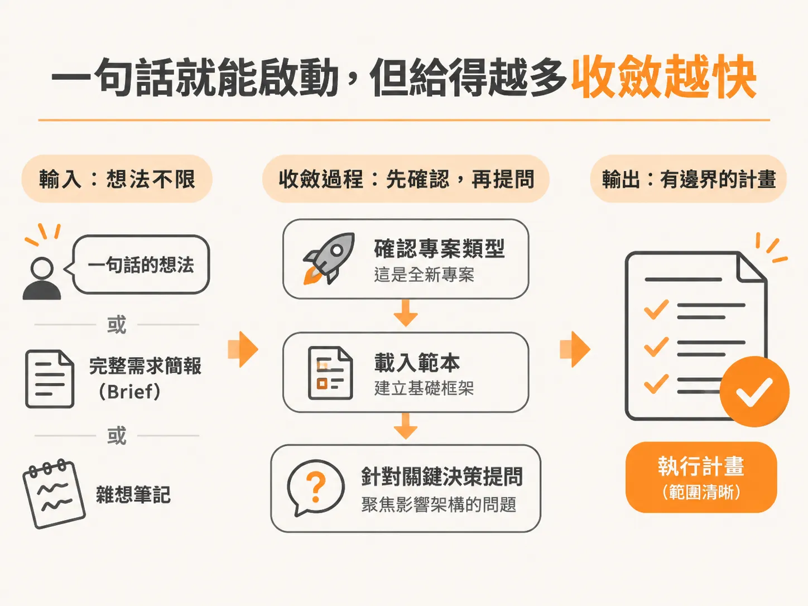
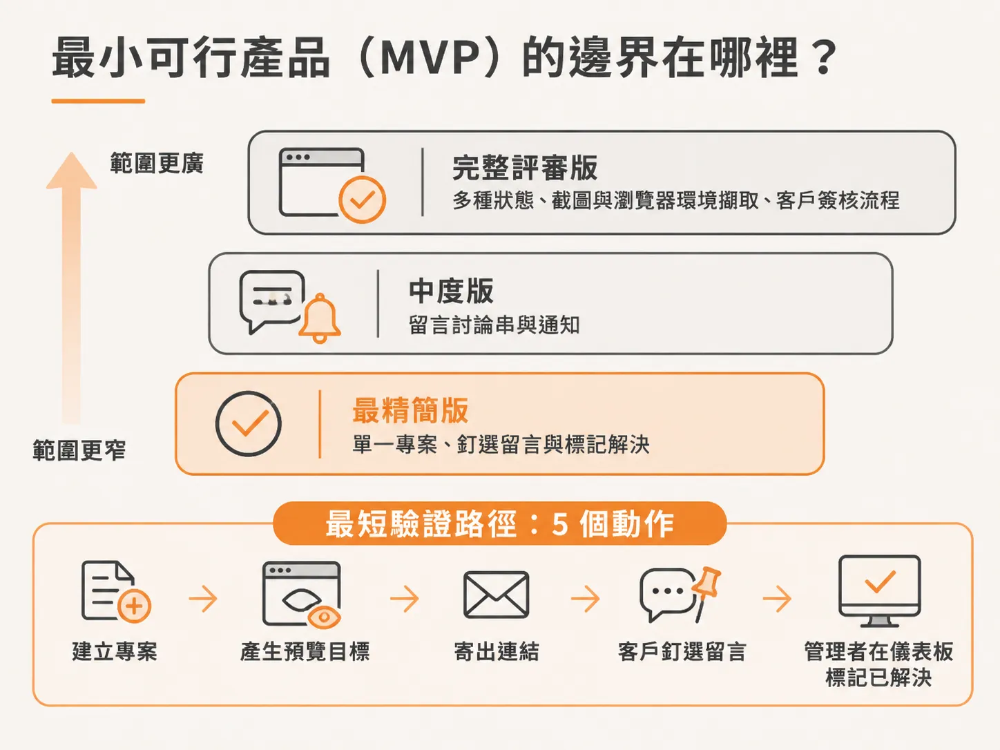
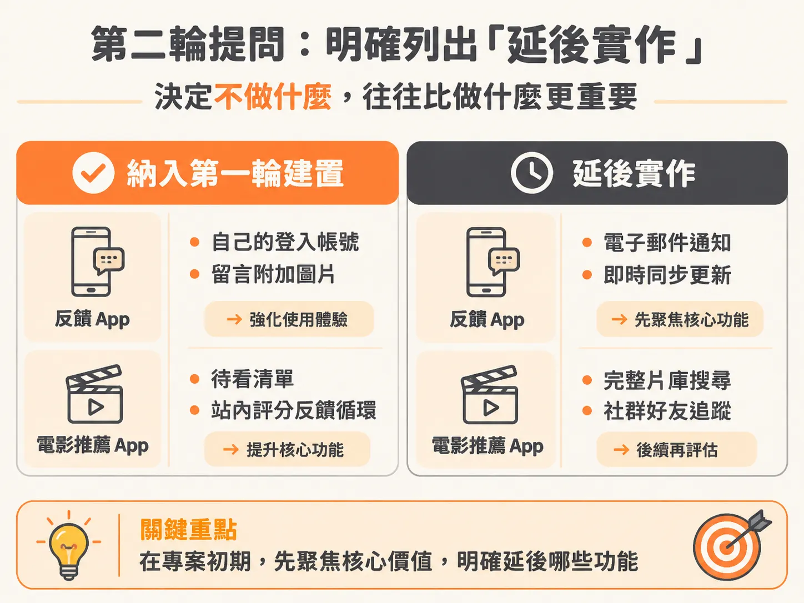
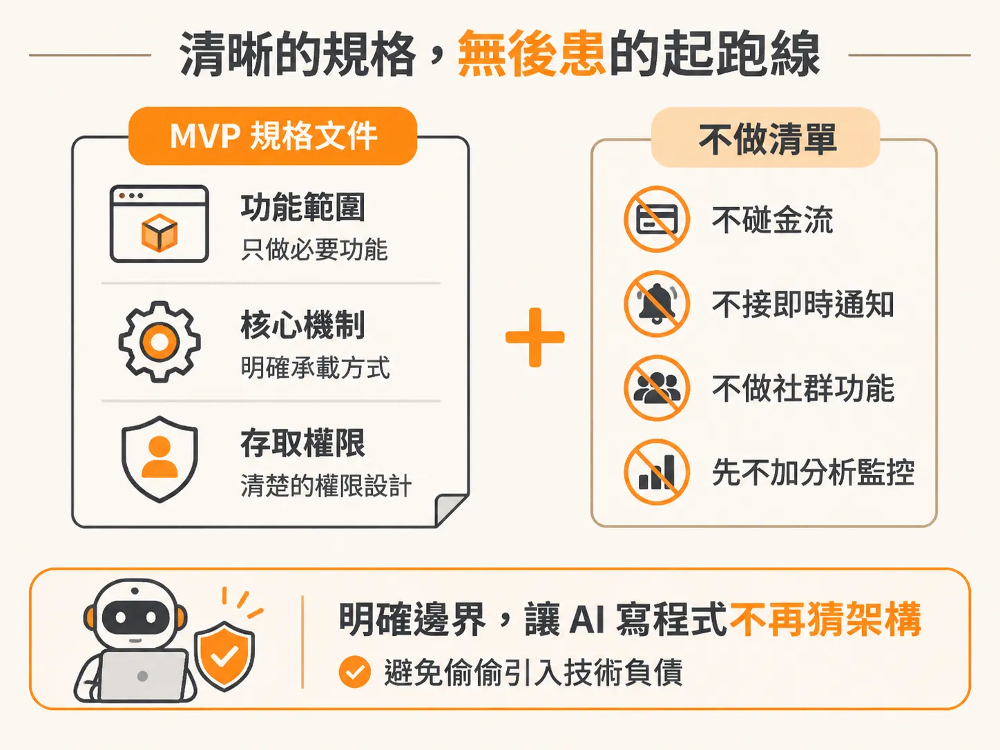

# 用 /scope 把一句話收斂成 MVP 規格與不做清單

前一節說到，vibe build 的失控來自三個沒人拍板的預設。要把這些預設拿回手上，第一步就是把腦中那句話交給 `/scope`。

開始一個新專案時，腦中通常只有一句話的想法：「我想做一個讓客戶在線上畫面釘選留言的工具」，或是「幫我做一個可以匯入評價並用氛圍搜尋的電影推薦 App」。

如果直接把這句話丟給 AI 寫程式，它往往會隨機做決定：幫你接上複雜的會員系統、自作主張選了即時通訊套件，甚至把金流與後台權限全寫進去。幾天後你才會發現，核心功能根本還沒驗證，程式碼卻已經被龐雜的週邊邏輯卡死。

在 AI 輔助開發的流程中，第一步就是執行 `/scope`。這個指令不是要你寫出一整份完整的規格書，而是透過多輪結構化的提問，把一句模糊的描述收斂成有邊界、有明確「不做清單」的執行計畫。

## 一句話就能啟動，但給得越多收斂越快

在編輯器中開啟開發介面（例如在 VS Code 按下 `Command-Shift-P` 聚焦工具視窗），只要在全新的專案目錄下輸入 `/scope` 加上你的想法即可。

輸入的內容可以非常精簡，例如：

> `scope, build a client feedback app where I share a link, the client pins comments to a live preview, and I manage them from a dashboard.`
> （做一個客戶反饋 App：我分享連結，客戶在即時預覽畫面上釘選留言，我在儀表板統一管理。）

也可以帶有更多初步規劃：

> `build me a movie recommendation app. Users can sign in, import their letterboxd CSV ratings, or swipe through movies to onboard, and then get a personalized feed with the reasons and a vibe search.`
> （做一個電影推薦 App：使用者可以登入、匯入 Letterboxd 的 CSV 評分或滑動卡片來完成新手引導，接著獲得帶有推薦理由的個人化動態牆，並支援氛圍搜尋。）

你不必在第一時間把規格寫得天衣無縫。如果你手上已經有完整的需求簡報（brief）或隨手記下的雜想，可以直接整包貼上；如果你只有一句話，`/scope` 也具備推論能力。它會讀取當前環境，確認這是一個從零開始的全新專案（greenfield project），接著載入範本，主動向你提問。

它不會問廢話。以客戶反饋工具為例，它能直接從句子推斷出系統裡必定有使用者、專案、預覽畫面與留言這幾個實體，因此不會停下來問你「需不需要留言功能」，而是只針對「這句話無法得知、卻會嚴重影響架構的決策」進行訪談。

## 第一輪提問：劃定 MVP 核心邊界與關鍵架構

`/scope` 不會丟出一個空白輸入框要你自己設計產品，而是以小批次（通常一輪最多四題）的決策面板呈現。每個問題都提供具體的選項，並附上推薦答案與原因。

### 1. 最小可行產品（MVP）的邊界在哪裡？

這是整個流程中最關鍵的問題。如果不在一開始設定限制、講清楚哪些東西先不做，功能就會無止境地膨脹。

在客戶反饋 App 的範例中，選項涵蓋不同程度的交付範圍：
* 最精簡版：單一專案、釘選留言與標記解決。
* 中度版：釘選留言、留言討論串（thread）與通知。
* 完整評審版：包含待處理、進行中、已修復、不修復等多種狀態，搭配截圖、瀏覽器環境與螢幕尺寸擷取，以及客戶簽核流程。

選擇最精簡的第一項，就能用最短路徑驗證產品價值：建立專案、產生預覽目標、寄出連結、客戶釘選留言、管理者在儀表板查看並標記已解決。

而在電影推薦 App 中，MVP 的提問則是聚焦在「核心驗證流程」：
* 只有單一引導流程（CSV 匯入或滑動卡片二選一）加推薦動態牆。
* 同時支援 CSV 匯入與滑動卡片，加上推薦動態牆。
* 前兩者再加上氛圍搜尋（vibe search）。

此時可以根據實際場景做決策：保留 CSV 匯入能照顧既有影評網站的使用者，滑動卡片則讓新用戶無痛建立品味；若認為氛圍搜尋（例如輸入「我想看類似《奧德賽》但屬於喜劇風格的片」）是產品的核心亮點，就可以在第一版把它納入核心邊界。

### 2. 核心機制的承載方式是什麼？

針對反饋 App，它會追問：客戶究竟是在什麼東西上面釘選留言？
選項可能包含「直接在 `<iframe>` 載入外部網址並覆蓋留言層」，或是「要求客戶端網站埋入追蹤 script」。選擇前者，代表任何能載入的網址都能直接使用，完全不需要客戶端工程師修改程式碼。

在電影推薦 App 中，問題則會轉向推薦演算法在第一版的智慧程度：
* 品味輪廓加大型語言模型（LLM）：把評分轉化成品味特徵，挑選候選片單，再由語言模型生成推薦理由。不需額外訓練模型，就能同時支援氛圍搜尋。
* 單純比對：只根據類型、演員與劇組比對。
* 完整的機器學習推薦系統：使用 embedding 與使用者歷史行為訓練排序模型。

顯然，完整訓練模型需要目前根本還沒有的使用者資料；第一種做法能在初期以最低成本達到足夠聰明的效果。

### 3. 最容易被忽略的存取與權限決策

許多開發者往往到了上線前夕才思考存取權限。`/scope` 會及早拋出問題：
「客戶如何在沒有帳號的情況下開啟專案？如果是透過網址開啟，如何防止不相干的人存取？」

這不是實作細節，而是重大的存取架構決策。如果在寫了三週程式碼、路由與資料庫 schema 都定型後才改動，代價極高。在初期選擇「免登入的專屬私密連結（secret link）」，客戶只要輸入一次姓名就能留言，既能維持最低使用門檻，日後也能隨時撤銷連結。

### 4. 第一版是否要包含商業模式？

要不要收費會徹底改變資料表與流程設計。無論是反饋工具還是推薦 App，除非一開始就明確要打造 SaaS，否則最健康的策略通常是「第一版不包含金流（no billing yet）」。先專注提供免費價值驗證市場，等真正有人使用後，再來規劃付費機制。

## 第二輪提問：明確列出「延後實作」與橫切關注點

進入第二輪時，通常會出現多選題，讓你決定哪些週邊功能要納入第一輪建置，哪些必須推遲。**在專案初期，決定「不實作什麼」往往比決定「實作什麼」更重要。**

### 功能能力的取捨

以反饋 App 為例：
* 自己的登入帳號：**納入**。專案與留言必須歸屬於特定管理者。
* 電子郵件通知：**延後**。初期直接用儀表板標記（dashboard badge）即可。
* 即時同步更新（Live updates）：**延後**。客戶留完言發通知即可，不需要一開始就架設 WebSocket 即時同步。
* 留言附加圖片：**納入**。方便客戶截圖補充特定區塊的替代設計。

在電影推薦 App 中也是相同邏輯：
* 待看清單與收藏：**納入**。成本低，且能持續讓動態牆推薦更精準。
* 站內評分反饋循環（在動態牆直接評分或隱藏）：**納入**。能讓推薦機制在引導結束後持續運作。
* 完整片庫搜尋與單片頁面：**延後**。它與氛圍搜尋不同，初期不需建立龐大的電影資料庫檢索。
* 社群好友追蹤：**延後**。雖然有趣，但嚴重偏離核心 MVP。

### 橫切關注點（Cross-cutting concerns）與嚴謹度

除了功能本身，軟體還有一堆容易被遺漏的周邊工程細節：
* 公開行銷頁與 SEO：如果要被搜尋引擎檢索，就可以排入第一版計畫。
* 產品分析追蹤（Analytics）、錯誤監控（Error monitoring）、無障礙支援（Accessibility）、隱私權與 Cookie 條款：初期都可以先略過或延後，避免分散精力。

最後，它會確認開發的嚴謹度（rigor）與硬性限制：
* 是一般產品開發嚴謹度（先在 App 驗證功能運作，再針對核心關鍵路徑補上測試）？
* 還是完全不做驗證的快速原型（prototype）？
* 又或是規範極度嚴格的團隊等級標準？

不同的嚴謹度是在拿「開發時間」交換「測試與審查層級」；同時，你也能註明是否有趕著展示的死線、預算上限或單人開發等硬限制。

## 產出結果：清晰的規格與無後患的起跑線

跑完這幾輪決策面板後，原本的一句話想法，已經被收斂成一份條理分明的規格文件。

你清楚知道自己的 MVP 只做哪些功能、核心承載機制是什麼、存取權限如何設計；更重要的是，你手上有了一份明確的「不做清單」——不碰金流、不接即時通知、不做社群功能、先不加分析監控。

這種提問流程保護了後續的開發工作。AI 不會在編寫程式碼的中途突然停下來猜測架構，也不會在暗地裡替你引進不需要的技術負債。帶著這份清晰的邊界進入下一階段，整個系統才能又快又準地跑起來。
