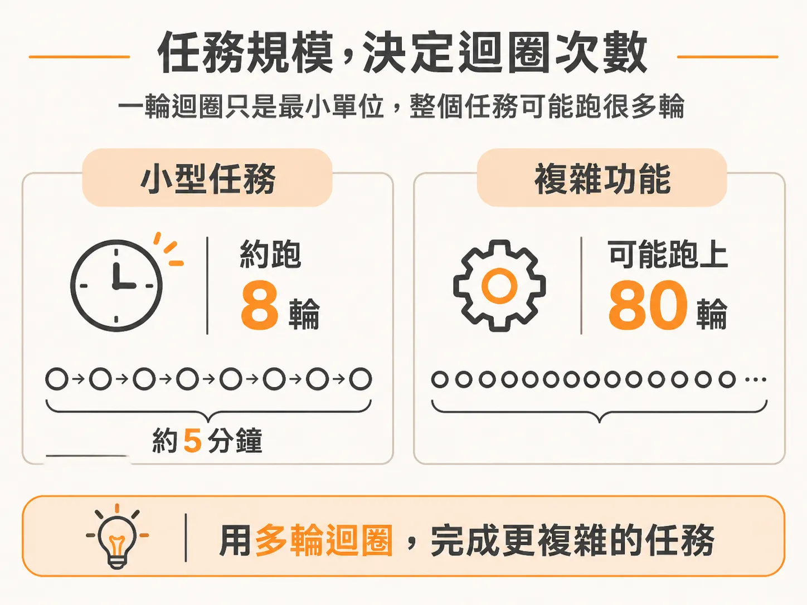
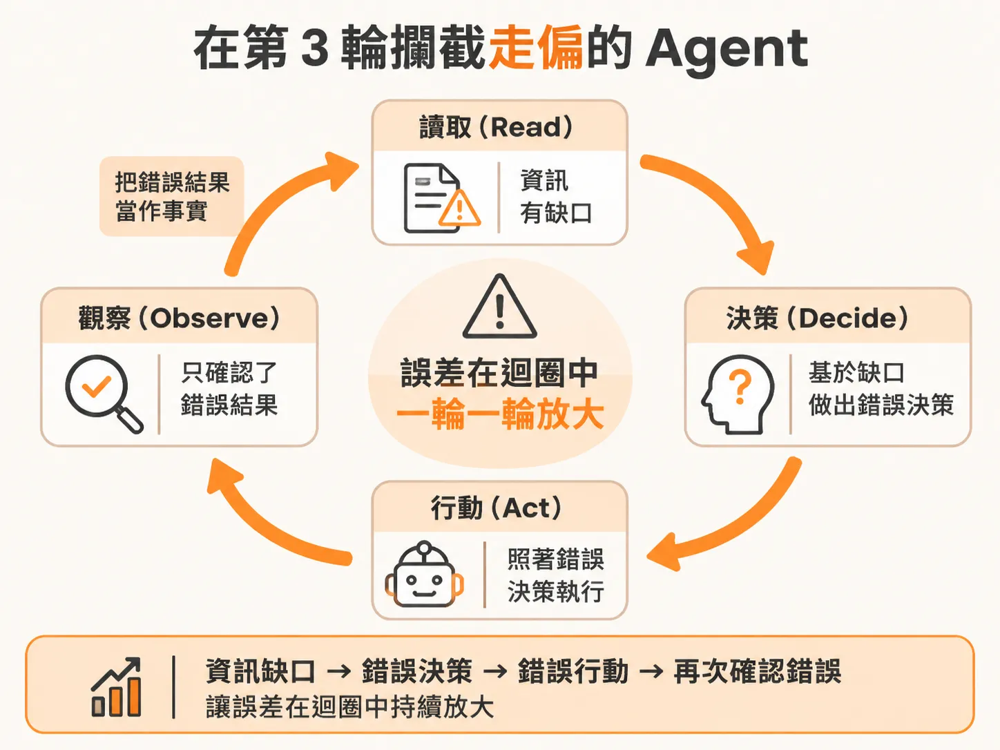
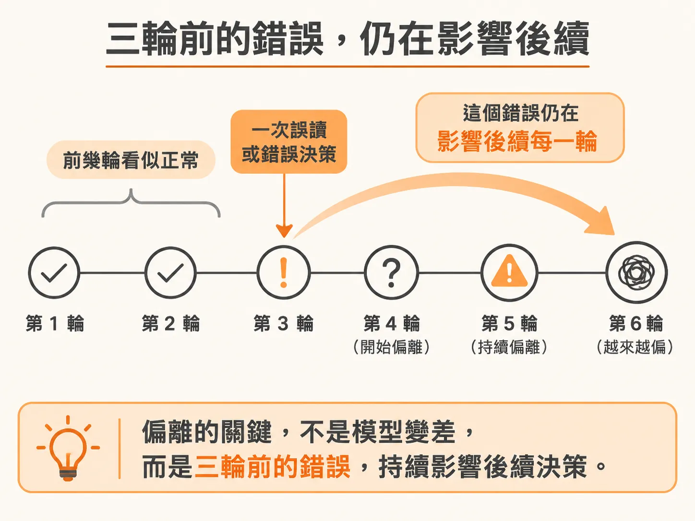
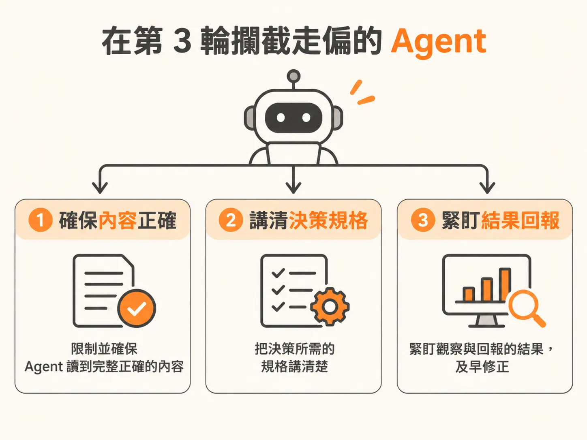

# 在第 3 輪攔截走偏的 Agent

把任務交給 AI coding agent 時，你可能會發現它前幾分鐘表現得有模有樣，但越往後做，程式碼越偏離軌道。這不是模型突然變笨，而是 AI agent 的核心運作機制導致的必然結果。

上一節拆過的那個四步驟循環——讀取（read）、決策（decide）、行動（act）與觀察（observe）——是 Agent 所做一切的最小原子單位。

<!-- derived -->
```
read ➜ decide ➜ act ➜ observe
```

一個只要五分鐘的小任務，這個迴圈可能跑 8 次；若是實作一個複雜的功能，它可能在背後跑上 80 次。



對負責架構系統的工程師來說，關鍵在於：每一輪迴圈，都是它做對的機會，也是它出錯的機會。

如果 Agent 在 read 階段讀到的資訊不完整，後續的 decide 階段就會建立在資訊落差之上。接著它照著錯誤決定去 act，在 observe 階段看到的結果，只不過是確認了前一步的錯誤，並把這個錯誤結果當作事實，原封不動餵進下一輪迴圈。



錯誤不會自己消失，而是會像複利一樣一輪接著一輪放大。因為每一次循環，都是以前一次循環的產出為基礎繼續堆疊。

這也是為什麼很多任務在剛開始幾輪看似一切順利，之後卻不知不覺越走越偏。這並不是模型本身突然失去水準，而是三輪之前的一次誤讀或糟糕決策，直到現在都還在左右後面的每一個步驟。



面對 Agent，不能只是把任務丟出去然後祈禱它會做好，而是要主動引導。你或許無法時時刻刻盯著它跑過的每一輪，但你可以從三個地方下手掌控：



1. **控制 read 的範圍**：限制並確保它能讀取到的內容是完整且正確的。
2. **釐清 decide 的準則**：提供足夠清楚的情境與規格，降低它做出錯誤判斷的機率。
3. **盯緊 observe 的回饋**：密切檢視它觀察到的狀態與回報的資訊，確認它沒有誤判現場狀況。

這就是接下來駕馭 Agent 的核心守則：保持足夠的警覺，離這個迴圈夠近。當 Agent 開始走偏時，你應該在第 3 輪就把它拉回來，而不是等它跑到了第 30 輪才發現整座系統已經面目全非。

掌握了這個循環之後，下一步需要看得更深：不僅是看它如何行動，還要探究它在當下究竟看到了什麼。因為「讀取到了什麼」和「真正理解了什麼」完全是兩回事，而大多數失敗，往往就始於這個看似微小的落差。
