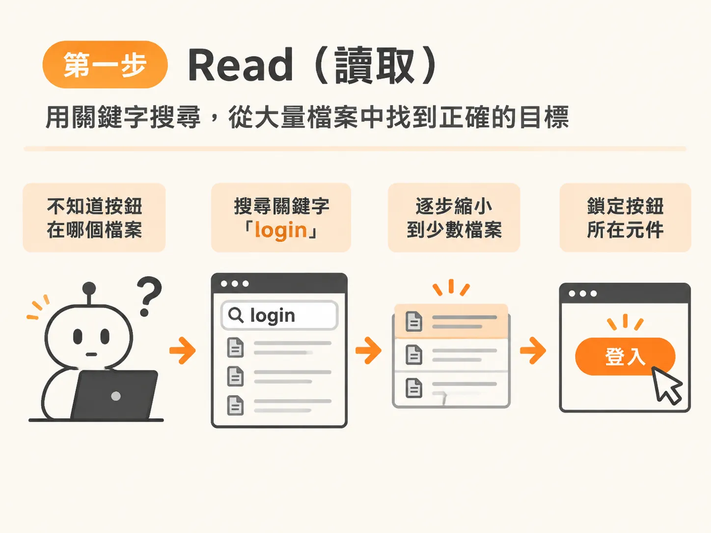
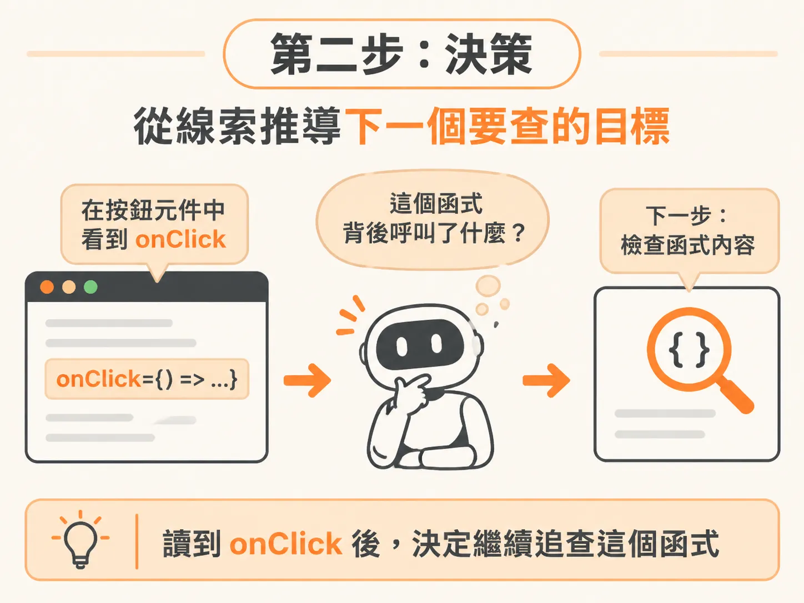
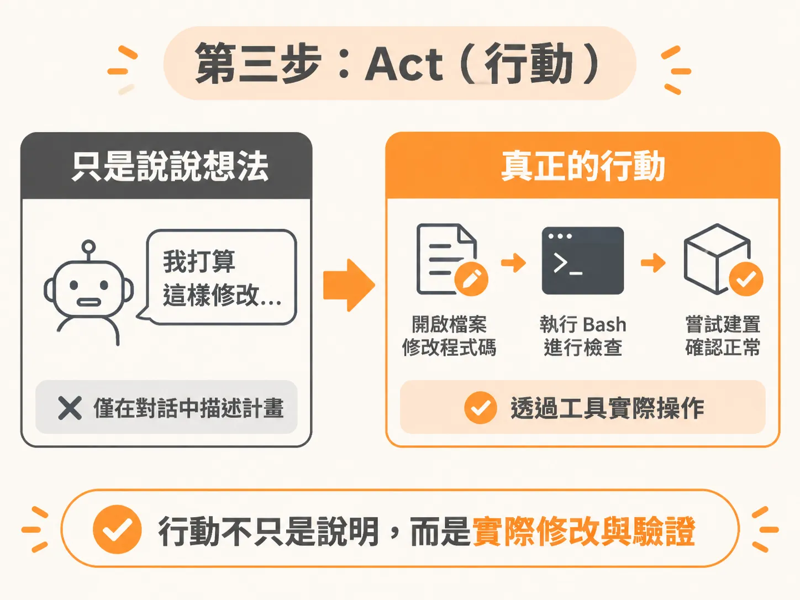
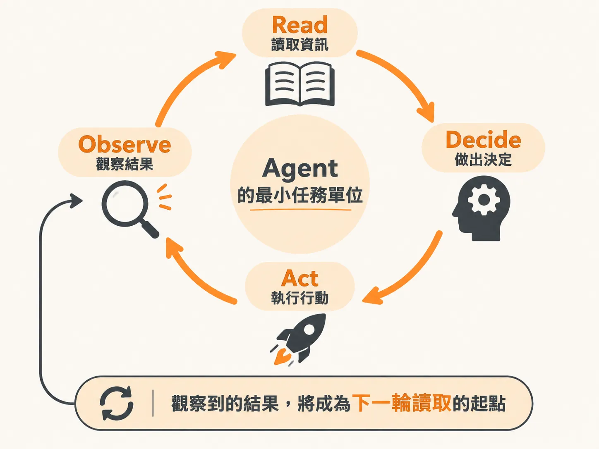

# 拆解 Coding Agent 的運作核心：Read、Decide、Act、Observe 迴圈

使用 AI coding agent 時，你的角色是架構者與指揮官，而不是只能雙手合十祈禱它把程式寫對。要指揮得好，就得先弄懂每次按下 Enter 鍵後，工具底層究竟在忙些什麼。這不需要鑽研太高深的底層技術，只要理解它的運作節奏就足夠。

事實上，無論你使用的是哪一款 coding agent，背後運行的都是同一個基本迴圈：讀取（Read）、決策（Decide）、行動（Act）、觀察（Observe）。這個四步驟迴圈會不斷循環，直到任務完成為止。你看過所有讓人驚豔的 AI 自動寫程式表現，本質上都是這個機制在運轉。

## 一個點了沒反應的登入按鈕

用一個具體情境來拆解最清楚。假設手邊有一個極簡的應用程式，介面上只有一個登入表單和一份待辦清單。這時登入功能出了問題：輸入 Email 和密碼後按下登入按鈕，畫面上卻毫無反應。

這時打開 Claude Code（無論是透過終端機 CLI 還是編輯器擴充功能），輸入提示詞：

「這個應用程式的登入按鈕點了好像完全沒反應，能幫我找出原因嗎？」

按下 Enter 之後，Agent 的基本迴圈就開始即時運作了。

## 第一步：Read（讀取）

Agent 一開始完全不知道登入按鈕寫在哪個檔案裡。因此它的第一個動作是搜尋：在專案中全文檢索 `login`，把找到的元件一個個打開。

它會持續閱讀相關檔案的內容，直到真正鎖定按鈕所在的程式碼。

## 第二步：Decide（決策）

讀完相關檔案後，Agent 手上有了線索。它在按鈕元件裡看到了 `onClick` 事件處理函式，接著做出決定：下一步要去檢查這個函式背後到底呼叫了什麼。

## 第三步：Act（行動）

在一般的自動修復情境下，四個步驟會在同一個迴圈裡一口氣跑完。不過因為剛才我們只是問它「能不能幫忙找出原因」，它在完成讀取與決策後，先停下來詢問：「要我套用這項修改嗎？」

當你回答「好」，它就會繼續推進到行動階段。

這裡的行動是真正的工具呼叫（tool call），而不是單純在對話框裡描述「我打算怎麼改」。Agent 會實際開啟檔案、修改程式碼。修改完成後，它還會透過終端機執行 Bash 指令，替專案做型別檢查，甚至嘗試打包建置（build），確認剛才的修改有沒有在過程中弄壞其他地方。

## 第四步：Observe（觀察）

迴圈的最後一步是觀察工具執行的反饋結果。

以這個例子來說，Agent 發現剛才按鈕呼叫的函式根本已經不存在——它在先前的程式碼重構中被改名了，但呼叫端卻從未同步更新。

觀察到這個問題後，Agent 其實立刻開啟了下一輪循環：

- **Read**：檢查原本的函式被搬移到哪裡、改成什麼名字。
- **Decide**：確認找到的函式確實是原本需要呼叫的那一個。
- **Act**：提出修復程式碼的方案。
- **Observe**：停下來等待你確認核准或拒絕。

當你核准修改後再次回到應用程式測試，輸入帳號密碼並點擊按鈕，畫面立刻跳出提示「此帳號尚未在平台註冊」。這代表按鈕已經正確呼叫後端驗證，行為完全符合預期。

這整個 Read → Decide → Act → Observe 的循環，就是 Agent 執行所有任務時的最小基本單位。弄懂這四個步驟，你在看著終端機輸出的紀錄時，就能精準掌握 Agent 當下的進展與狀態。

不過，這個迴圈不會只跑一次。真正決定成敗的，往往是它究竟跑了多少輪，以及誤差在輪與輪之間怎麼累積。

