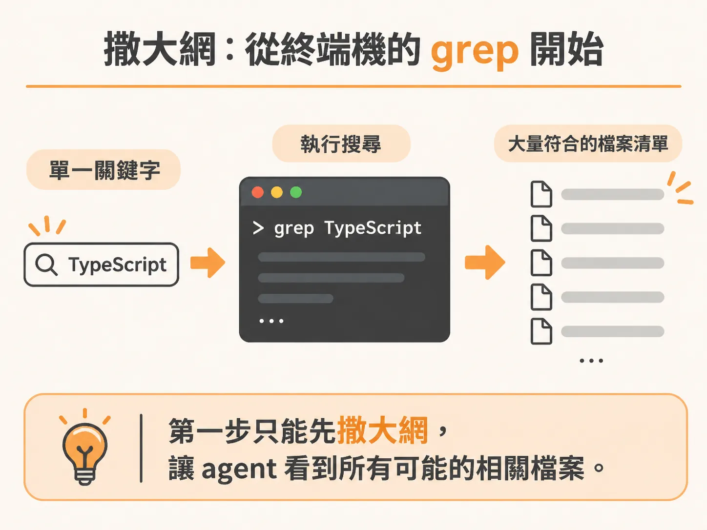
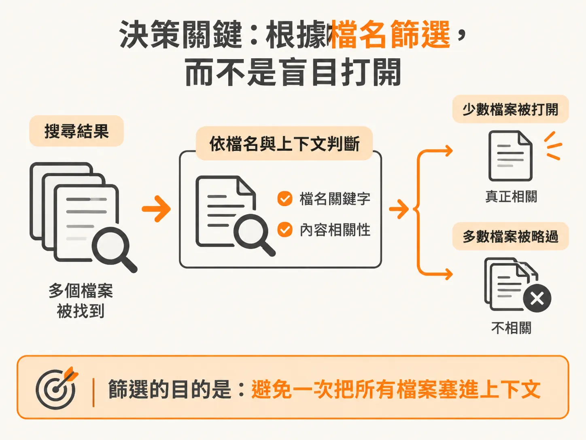
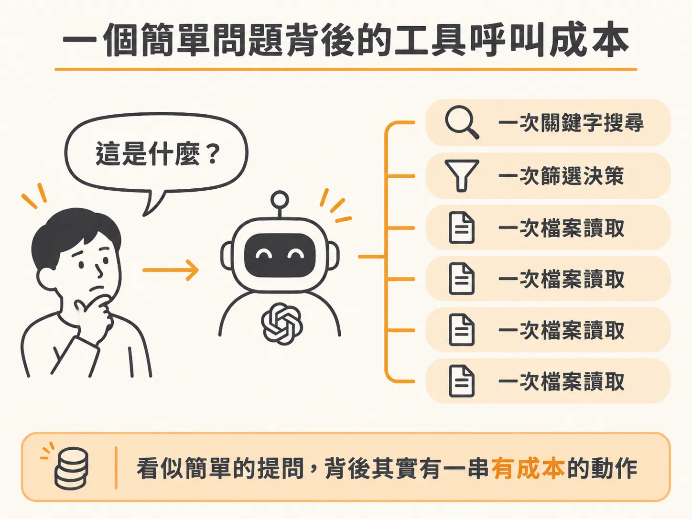
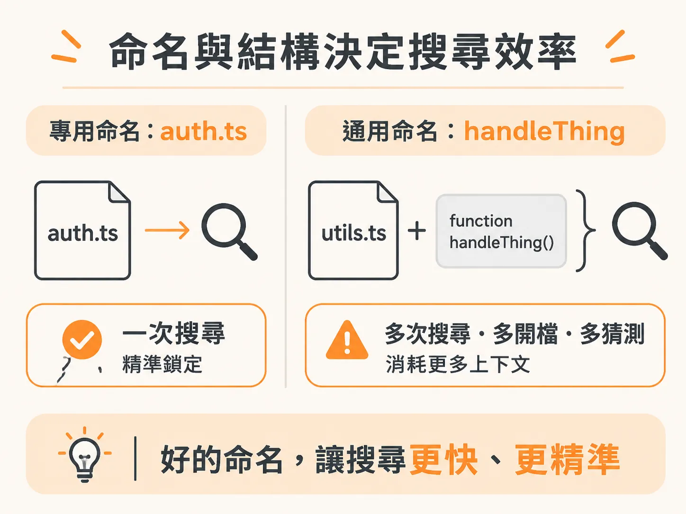

# AI Agent 如何閱讀你的程式碼：從 grep、篩選到檔案讀取的真實成本

當你在全新的對話視窗中，把一個 AI agent 丟進剛拉下來的專案程式庫，並問它一個從未提過的問題：「這個專案的認證（auth）在哪裡處理？」這時，AI 背後究竟做了什麼？

如果你仔細觀察它的操作，會發現它並不是立刻給出答案，而是先展開搜尋。

### 撒大網：從終端機的 grep 開始

AI agent 在一無所知的情況下，會先使用終端機指令來找檔案。深入檢視它執行的 bash 指令，其實就只是最基礎的 `grep`，在終端機裡搜尋關鍵字 `auth`。

因為一開始完全不知道該看哪裡，它只能撒下一張大網。它大概能猜出目標會是 TypeScript 或 JavaScript 檔案，於是執行指令後，終端機回傳了一大長串符合條件的檔案清單。

如果把終端機指令的輸出展開，會發現符合條件的檔案數量相當驚人。

### 決策關鍵：根據檔名篩選，而不是盲目打開

面對長長一串搜尋結果，agent 並沒有立刻把所有檔案全部打開。如果把每個檔案都讀進來，上下文視窗（context window）很快就會被塞爆。

這時 agent 會先進行篩選：根據檔名以及搜尋比對到的上下文，判斷哪些檔案才真正相關。

接著它決定開啟第一個檔案：`auth.ts`。這個猜測相當精準，因為認證機制的核心實作正好就在這個檔案裡，而不僅僅是程式碼某處恰好出現了 `auth` 這個單字。

打開 `auth.ts` 之後，agent 會繼續研讀這份檔案，並順著裡面提到的其他關聯檔案接續追查。也正是從這一步開始，agent 的狀態從「找到可能相關的片段」，跨越到了「真正理解這段程式碼在做什麼」。

### 一個簡單問題背後的工具呼叫成本

最終，agent 產出了完整的回覆。它指出這個範例專案的認證邏輯分散在四個層次：認證憑證（credentials）與處理器註冊表（handler registry）位於它剛才讀取的 `lib/auth.ts`，此外它還一併讀取了處理 sessions、actions 以及 proxy 的相關檔案。

這個最終回覆既精確又具體，明確點出了實際的檔案與函式位置。

但回頭檢視它為了回答這個看似簡單的問題，總共付出了多少成本：

1. 一次關鍵字搜尋（grep）
2. 一次篩選決策
3. 四次檔案讀取（file reads）

僅僅回答一個「認證在哪裡」的問題，就用掉了好幾次工具呼叫（tool calls）。

### 命名與結構決定搜尋效率

這項機制對開發者至關重要，原因在於 AI agent 面對程式庫時，通常沒有預先建立好的索引可用。在缺乏索引的情況下，檔案命名與目錄結構承擔了實質的導航工作。

如果你的認證邏輯老老實實放在叫做 `auth.ts` 的檔案裡，agent 只需要一次 grep 就能精準鎖定。

但如果這段邏輯被塞在名為 `utils2.ts` 的檔案裡，裡面匯出的函式還叫做 `handleThing`，agent 就得大費周章：它必須執行更多次搜尋、打開更多不相干的檔案、做出更多猜測，並在尋找你早就知道在哪裡的東西時，白白燒掉大量寶貴的上下文空間。

清晰的命名與符合預期的結構，從來就不只是個人的程式碼風格偏好。它們能直接減少 agent 所需的搜尋次數，帶來更快速的回答，減少上下文浪費，並降低中途猜錯方向的機率。

今天寫程式，對象已經不只是團隊裡的其他人類同事，還包含一位靠著「搜尋與閱讀」來探索專案的 AI。它就像第一天報到的新進員工，差別在於，每一次開啟新的對話階段，AI 都必須從零開始重新摸索整個程式庫。
