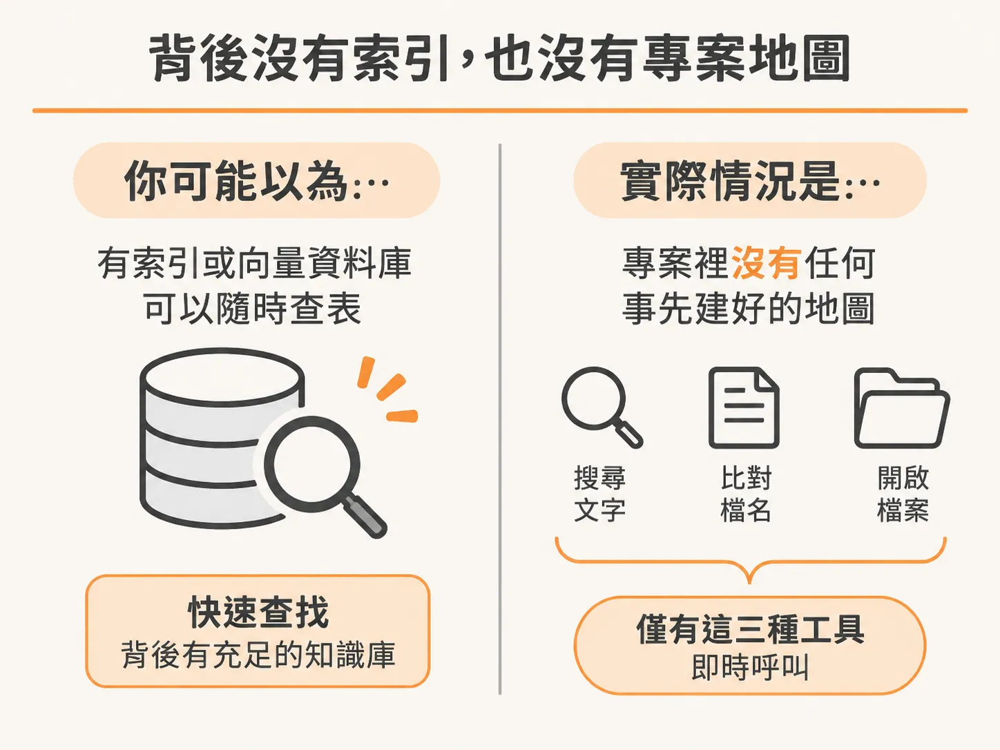
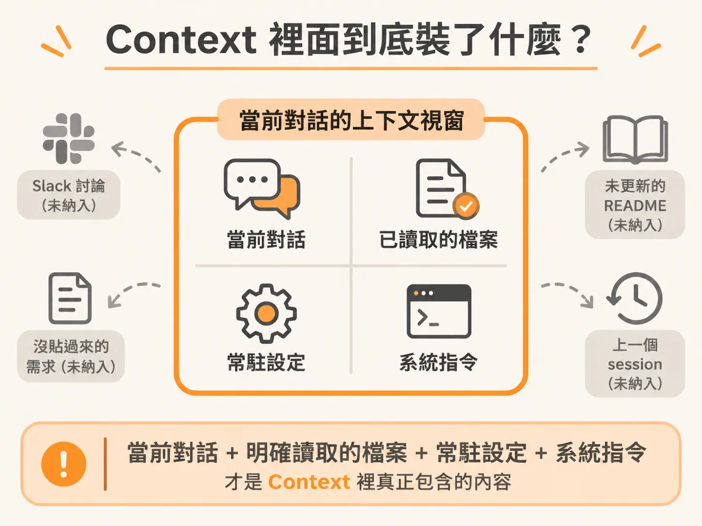
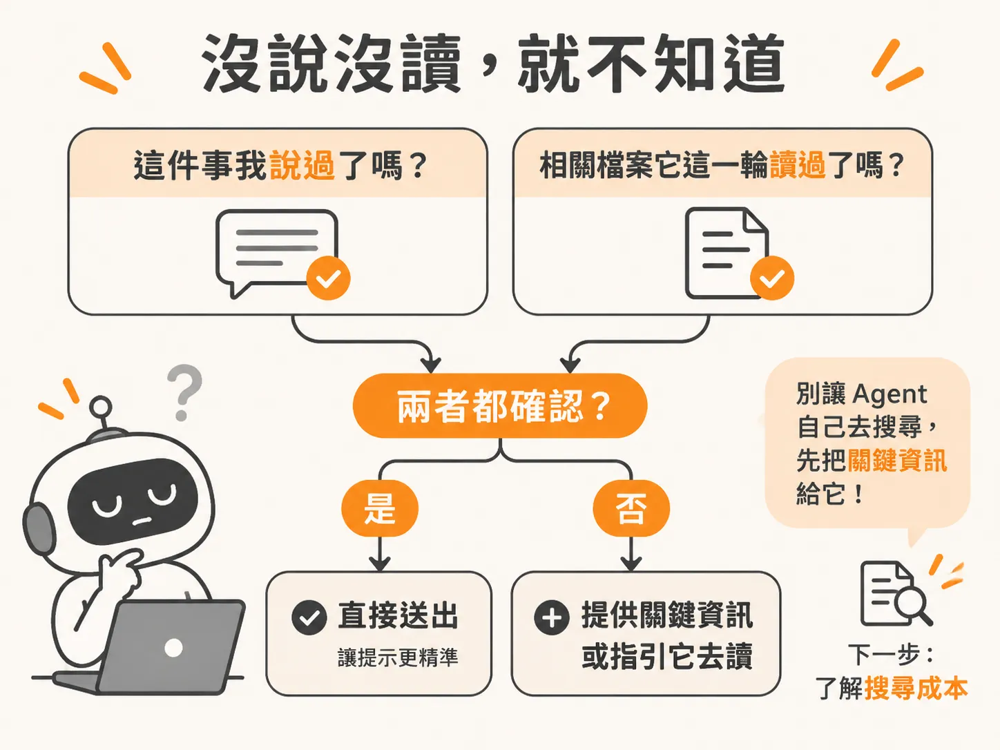

# Agent 怎麼讀你的程式碼：沒有索引，沒說沒讀就不知道

上一節留下的問題是：Agent 在每一輪迴圈裡，到底看到了什麼？要回答這個問題，得先知道它對你的程式庫其實一無所知。

很多人在使用 AI 寫程式的 agent 時，常常會有一種挫折感：「這件事在專案裡明明很明顯，它怎麼會不知道？」

你可能已經在專案裡打滾了幾個星期甚至幾個月。你清楚登入驗證是怎麼走的、命名慣例是什麼，也記得這週二才剛決定把金流串接換成另一家廠商。在你的腦袋裡，這些全都是理所當然的共識。但對 agent 來說，它腦中完全沒有這些記憶。

這種認知落差，往往來自於開發者對 agent 運作方式的誤解。

## 背後沒有索引，也沒有預先建好的專案地圖

大多數工程師直覺以為 agent 找程式碼就像 Google 搜尋：在對話框輸入問題，背後就會有某個索引資料庫， agent 只要在後台查一下表格、比對關鍵字或向量（embeddings），就能立刻把相關程式碼抓出來。

但現實是：背後根本沒有索引，沒有預先算好的 embeddings 資料庫，也沒有任何事先建好的專案地圖。

agent 探索專案的方式，其實就像一個第一天加入團隊、從來沒打開過這份程式碼的新人工程師。新人走進專案時會怎麼做？他只能自己去搜尋關鍵字、找檔案，然後一個一個打開來看。

agent 也是完全一樣。它手上的工具箱非常樸實，大致上就這幾樣：

- **grep**：在多個檔案之間搜尋特定文字。
- **glob**：根據檔名樣式（pattern）找出對應的檔案路徑。
- **read**：真正打開某個檔案，閱讀裡面的內容。

大致上就是這樣而已。沒有捷徑，也沒有魔法，每一次它獲取資訊，都是在當下隨需求呼叫這些工具。

## Context 裡面到底裝了什麼？

既然沒有背景資料庫隨時供它翻閱，agent 在任何一個當下能看到的範圍，就只有當前的上下文視窗（context window）。

嚴格來說，此時此刻它能知道的東西，只有以下這份清單：

1. **當前的對話內容**：這輪對話裡你輸入的每一句話、工具回傳的結果，以及 agent 自己的回應。
2. **它明確讀取過的檔案**：不是整個程式碼庫，只有它透過工具（如 `read`）真正打開過的檔案內容。
3. **常駐設定的脈絡**：例如專案根目錄下設定正確的 `CLAUDE.md` 這類全域設定檔。
4. **系統指令（System instructions）**：工具本身預設的底層行為規範。

清單以外的東西，對它來說完全不存在。你在 Slack 裡跟同事討論架構的決定、你在 Issue 裡寫了一大串但沒貼過來的需求描述、你本來打算更新卻還沒動筆的 README，甚至是上週你們在另一個 session 聊過的內容，它通通看不到。

## 檢查每個提示的準則：沒說沒讀，就不知道

如果這份檔案在這輪對話裡沒有被讀取過，agent 就不知道它存在；如果你沒有在對話框裡打出來，它也不可能通靈猜到。

每一次下提示詞（prompt）時，都可以用這個原則檢查一遍：這件事你說了嗎？相關的檔案它這輪有讀過了嗎？如果這兩個答案都是否定的，就不要預設它應該明白。把關鍵資訊直接給它，或者指引它去讀對應的檔案，才是讓 agent 精準完成任務最穩妥的作法。

而當你什麼都不給，它就只剩自己搜尋這條路。下一節要拆解的，就是它實際怎麼搜：一次 grep、一次篩選、幾次檔案讀取，各自要付出多少成本。

