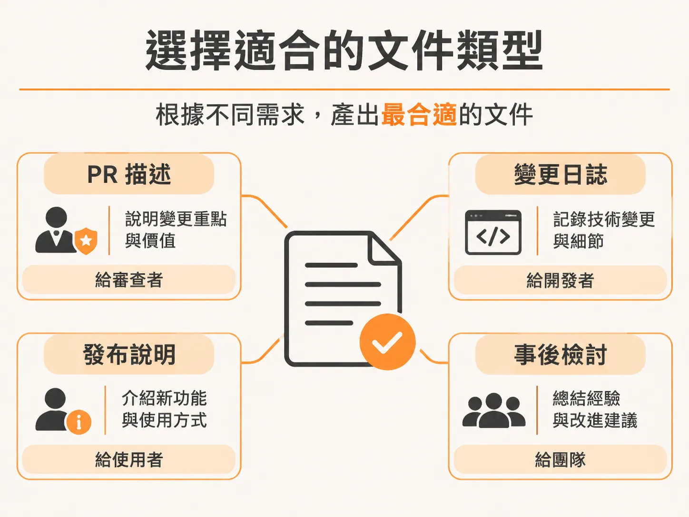
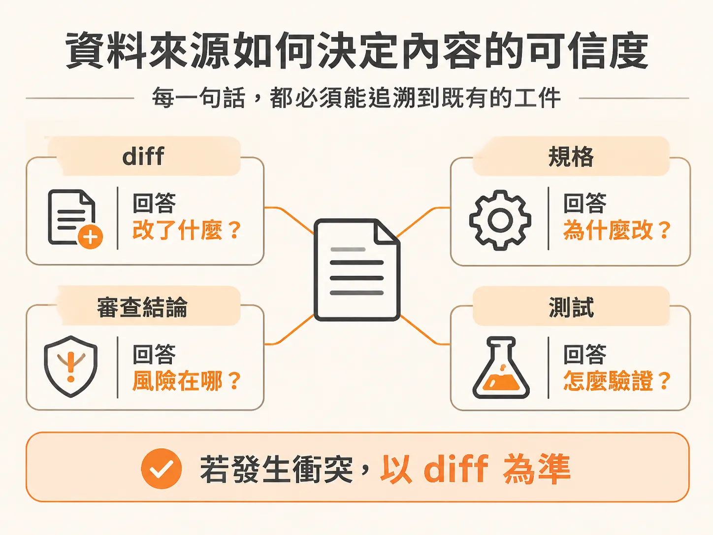

# 用 /document 寫出可追溯的變更紀錄

功能寫好、測試跑過、審查也改完了，準備開 PR。多數人在這一步會停在空白的 PR 描述框前發呆，或者隨手把剛才打的幾句 commit 訊息拼湊貼上。審查者打開 PR 時，只看得到改動的檔案列表，卻看不出為什麼要改、哪裡有潛在風險、又該如何驗證。

`/document` 技能要解決的正是這個落差：它不靠憑空想像，而是從真實的變更紀錄提取事實，替你的程式碼寫出能跟著變更一起流轉的文件。

## 選擇適合的文件類型

執行 `/document` 記錄資料模型（Data Model）的變更時，系統首先會詢問要產出哪一種文件類型（Doc Type）：

1. **PR 描述（PR description，推薦）**：目前分支在 `feed-data-model`，進度比 `main` 分支超前 3 個 commit，而且尚未開啟任何 PR。這種情況下，直接根據分支的 commit 紀錄與 diff 來撰寫 PR 標題與內文最為合適。
2. **變更日誌項目（Changelog entry）**：適合應用程式已經公開上線、需要讓其他開發者了解變更內容的情境。
3. **發布說明（Release notes）**：適合告知終端使用者新版本帶來了哪些功能或改動。
4. **事後檢討報告（Postmortem）**：當線上發生事故時，用來客觀記錄已知事實與時間軸。

這次的資料模型改動一切順利，沒有發生事故，因此直接選擇產生 PR 描述就綽綽有餘。

## 資料來源如何決定內容的可信度

AI 寫 PR 描述並不稀奇，但多數工具常犯兩個毛病：只讀 commit 訊息的工具，會把中途早就被推翻的嘗試當成事實；只看 diff 的工具，能列出改了哪些行，卻完全看不出改動背後的脈絡。

`/document` 的原則是：**每一句話都必須能追溯到已存在的工件（Artifacts）**：

- **Commits 與 Diff**：提供「改了什麼」。但只要程式碼與 commit 訊息不一致，永遠以 diff 呈現的事實為準。如果 commit 寫「改善效能」，但 diff 裡沒有任何量測或相關改動，這個宣稱就會直接被捨棄。
- **規格（Spec）**：提供「為什麼要有這項改動」，讓審查者理解要解決的產品問題。
- **審查結論（Review findings）**：提供改動過程發現的潛在風險，以及後續修正了什麼。
- **測試（Tests）**：提供具體可執行的驗證步驟，而不是事後編造的檢查清單。

在分析時，`/document` 走訪了 PR 脈絡、讀取審查結論、審視並驗證範疇，精準掌握改動的核心。它擬好 PR 內文後先輸出在下方供確認，不會默默推送到遠端。在真正開啟 PR 前，如果工作目錄還有一個未提交的檔案，只要將它 commit 進去，PR 內文就會完整呈現。

最終產出的 PR 描述清楚標示了主題（Feed：新增資料模型、1 個 migration 與限定範圍的 query helper），並附上詳盡說明：
- 完整實作內容與設計推論（Design reasoning）。
- 驗證紀錄、整體改動與串接方式（Wiring）。
- 具體的測試與手動驗證流程。
- 特別寫給審查者參考的注意事項（Notes for reviewers）。

確認內文無誤後，同意送出指示，系統便會提交剩餘改動、建立 PR，並合併回 `main` 分支。

## 檢視交付成果與後續工作

隨著 PR #2 合併回 `main` 分支，開發分支也一併刪除，程式庫回到最新狀態。這次功能三（Feature 3）正式關閉，總共交付了：

- 4 個 commits
- 33 個檔案
- 9 張資料表與 5 個 enums
- 手寫的 migration SQL
- 限定範圍的 query helper
- 資料填充腳本（Seed script）與 Drizzle 串接設定

過程中審查曾提醒 Vercel functions 的部署區域設定，以及一項特定的驗收準則；這兩項都不是大問題，後續的功能六會負責驗證。

完成了資料模型，下一步的範疇包含標記為「待決策（needs a decision）」的功能四（電影目錄與快取，Movie catalog and cache），以及接在後面的功能五（設計系統與 UI 基礎建設）。兩者都屬於基礎建設階段。

由於目前的啟動卡牌庫（starter deck）是直接吃專案內的靜態檔案，功能四是阻擋真實資料串接的關鍵。因此在規劃切片時，必須先針對電影目錄進行架構設計（跑 architect）。

電影目錄的規格重點在於：電影資料從哪裡來（片名、年份、海報、類型等）、如何用片名與年份進行比對匹配，以及如何做好本機快取，避免應用程式受制於外部來源的速率限制或緩慢回應。當系統能透過片名與年份查詢並匹配電影、將紀錄快取於本機，且重複查詢時能直接由快取回傳，這項功能就算完成。先完成資料來源與快取架構，再去碰可視化的設計系統，能確保畫面出現時底層已經有穩固的真實資料支撐。
