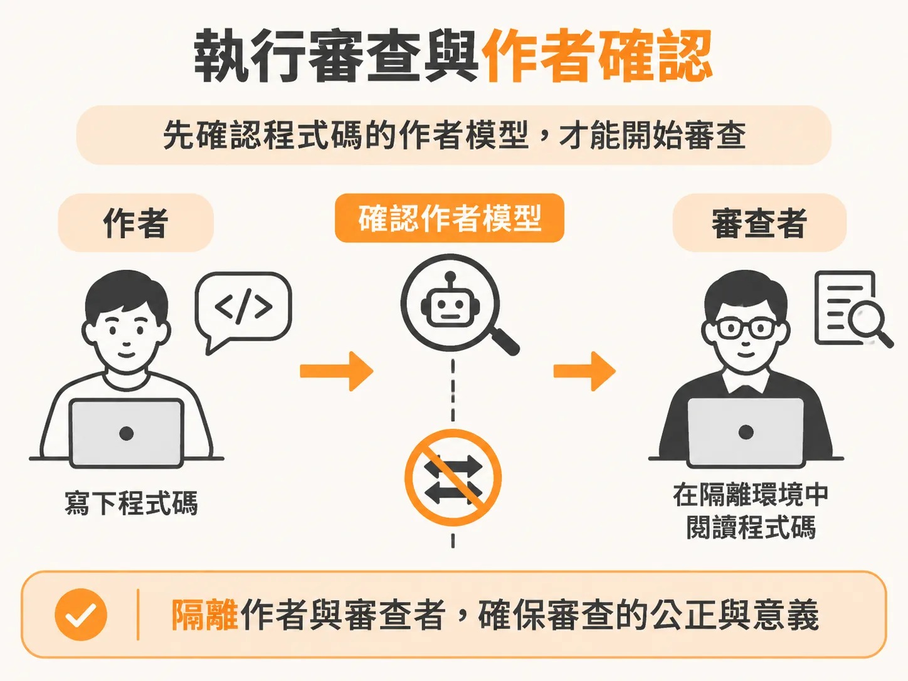
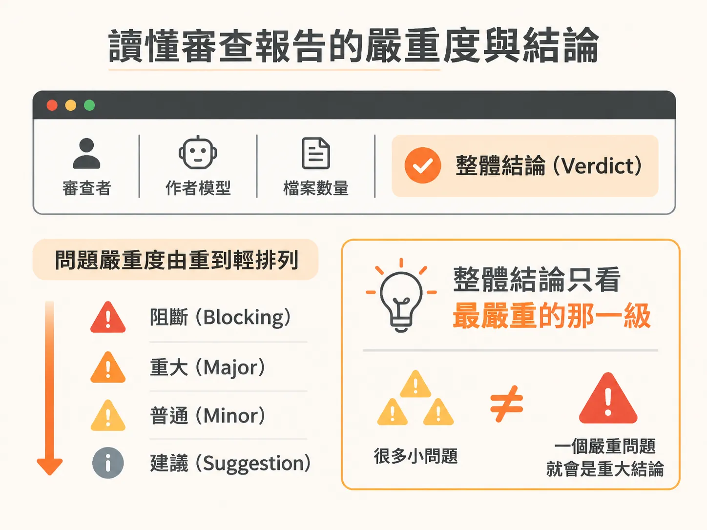
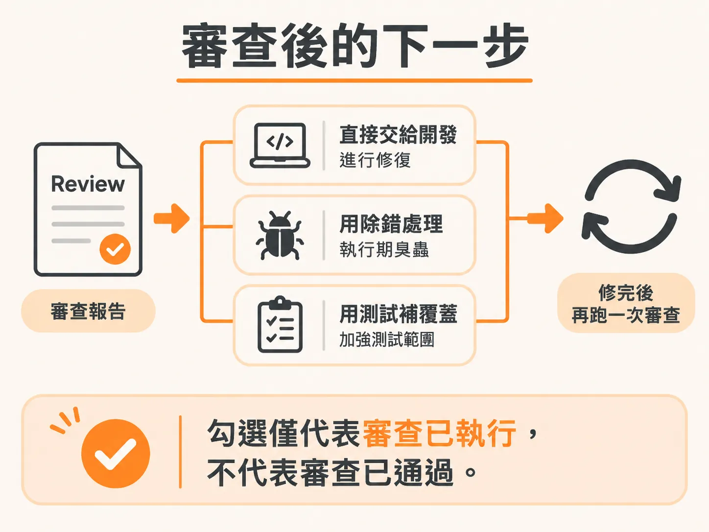

# 用 `/check review` 進行非作者模型審查

測試守住的是已經驗證過的舊行為；但程式碼本身寫得好不好、有沒有結構性風險，測試看不出來。這正是 review 要補的缺口。

當同一個模型負責寫功能、補測試，最後又讓它自己檢查時，常會出現一個盲點：它在每一輪都會帶著原本的假設去讀程式碼，把自己寫錯的地方當成理所當然。換成更強的模型也沒有用，只要是同一個思考脈絡，就容易對剛做完的決定產生偏袒。

工程團隊在上線前一直有一道必備流程：讓沒寫這段程式碼的人來讀。在智能體工程工作流程中，這就是 GA（General Availability，正式發布）等級的驗證。從 Prototype（自己檢查）、Alpha（確認功能能跑）、Beta（加入測試防護）到 GA，檢查的視角逐步遠離寫程式的作者。這一步不是為了重新跑應用程式，也不是重複跑測試，而是讓一個全新起點的非作者模型，站在可維護性、架構設計與潛在安全風險的角度，評估功能到底寫得好不好。

## 執行審查與作者確認

在終端環境中，只要呼叫檢查指令並指定目標範圍即可啟動審查。例如審查應用程式最核心的資料庫架構：

<!-- derived -->
```text
/check review data model
```

在開始讀取任何程式碼前，系統必須確認「這段程式碼是哪個模型寫的」，因為如果把程式碼交回作者手裡，整場審查就失去了意義。



系統不會直接詢問當前的對話模型「你是誰」，因為對話中的模型名稱可能不準確，也會隨著切換模型而過期。它會讀取專案設定來推測作者模型，並主動向你確認：

<!-- derived -->
```text
"Which model wrote this code? I'll review on a different one."
  header: "Author model"
  options:
    - label: "sonnet (detected, recommended)"
      description: "I'll review with opus for a fresh perspective"
    - label: "opus"
      description: "Review will run on sonnet"
```

只要確認作者（例如 Sonnet），系統就會自動指派對比的模型（例如 Opus）作為審查者。整個審查會在獨立的唯讀輔助程序中運作，檔案讀取與差異比對不會污染你原本的對話紀錄，而且審查模型在架構上完全無法直接修改程式碼。

## 全檔讀取與審查範圍

審查模型接手後，除了看變更差異（diff），還會完整讀取每一個受影響的檔案。因為單看改動的那幾行，往往無法判斷改動是否安全，周圍的上下文才是關鍵。

以資料模型審查為例，審查模型會逐一檢查相關的檔案：

* 資料庫結構定義目錄（如 `src/db/` 或 `drizzle/`）
* 伺服器端商業邏輯（如 `src/server/`）
* 功能規格文件（spec）

即使整個專案範圍多達二、三十個檔案，讓審查模型一口氣讀完，也能在程式碼合併到主分支前替你攔截掉作者模型完全沒察覺的結構性問題。

## 讀懂審查報告的嚴重度與結論

審查結束後，結果會儲存在 `docs/reviews/` 目錄中，就像留在 pull request 上的留言紀錄。報告頂端會註明審查者、作者模型、檔案數量與整體結論（Verdict），下方則依照問題的嚴重度（Severity）由重到輕排列。



### 四級嚴重度（Severity）

審查模型會依照上線後可能帶來的損害評定層級：

| 嚴重度 | 代表意義 | 對合併的影響 |
|---|---|---|
| 🔴 **Blocker** | 會導致功能異常、安全性漏洞或資料遺失的重大缺陷。 | 合併前必須修復 |
| 🟠 **Major** | 明顯的正確性、效能或可維護性問題，近期內必定引發錯誤。 | 合併前應該修復 |
| 🟡 **Minor** | 確實存在但非緊急的小毛病，例如漏掉的極端情境或結構模糊。 | 需盡快處理，但不阻擋合併 |
| ⚪ **Nit** | 命名風格、小細節或個人偏好。 | 由作者自行決定是否採納 |

誠實的嚴重度評定是這套流程的核心價值。如果審查模型把所有小問題都標成 Blocker，團隊最後只會選擇忽視它；若是把真正的臭蟲降為 Nit，危害更大。

### 四種審查結論（Verdict）

審查結論完全由最高嚴重度的發現決定：

* **Approve**：沒有任何 Blocker 或 Major，只有 Nit 或甚至沒有問題。
* **Approve with nits**：沒有 Blocker 或 Major，但有 Minor 或 Nit 供作者斟酌修飾。
* **Changes requested**：包含一個或多個 Major 問題，但沒有 Blocker。
* **Blocked**：只要包含任何一個 Blocker。

此外，報告中還會記錄程式碼結構的優點（Strengths）以及測試覆蓋狀況（Test coverage）。

## 實際案例：非作者模型抓到了什麼？

在實際審查資料模型時，換上全新視角的模型經常能指出深層的規格衝突與環境風險：

1. **依賴套件配置錯誤（Major）**：`@supabase/supabase-js` 被放在 `devDependencies`，但它實際上是 `@supabase/ssr` 的執行期 peer dependency。在生產環境下執行 prune 安裝時，會直接導致身分驗證崩潰。
2. **規格未落實的安全漏洞（Major）**：用戶端身分識別 JWT 沒有設定過期時間。規格明確要求 90 天到期，作者模型卻遺漏了這個邏輯，導致外洩的權杖永久有效。
3. **未受保護的交易例外（Major）**：伺服器動作中的資料庫交易沒有攔截錯誤，遇到衝突會直接拋出例外，而非依約定回傳 `{ ok: false }`。
4. **無效的測試保護（Major）**：看似有寫測試，但整個測試區塊標記了 `describe.skipIf`，實際上根本從未執行過。
5. **資料庫約束遺漏（Major）**：在評分資料表中，分數是否為 null 的商業約束只寫在應用程式程式碼中，資料庫底層缺乏對應限制。

當看到這些發現時，修復方式不是手動去改過去的遷移檔，而是產生新的 migration 來修正約束；因為資料庫遷移工具依賴時間戳記運作，直接修改既有檔案容易在上線時默默失效。

## 審查後的下一步

審查完成後，規格清單中的 review 項目會被勾選，這代表「審查已經執行過」，而不代表「審查已經通過」。



審查模型本身不會動手改你的程式碼。拿到這份報告後，你可以把報告內容直接交給代理人執行修復，或者搭配除錯與測試工具修補問題：

* 若報告指出單純的實作缺陷，直接交給開發代理人依序修改 Major 與 Minor 項目。
* 若涉及執行期臭蟲，可以呼叫除錯技能（`/debug`）深入追蹤。
* 若測試覆蓋被點出缺漏，可以用測試技能（`/test`）補齊保護網。

修復完成後，再次執行 `/check review`，直到報告給出 Approve 為止。
