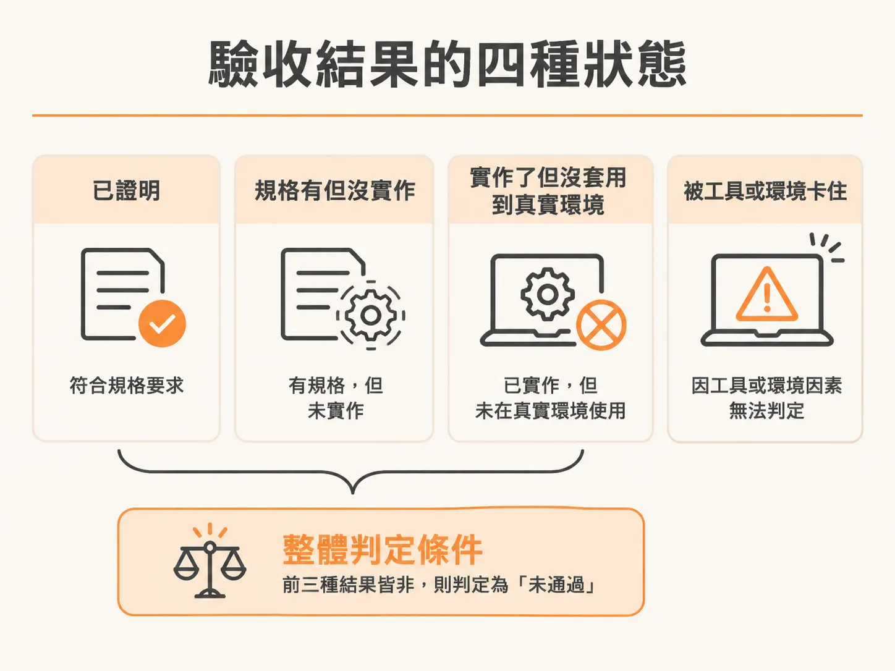
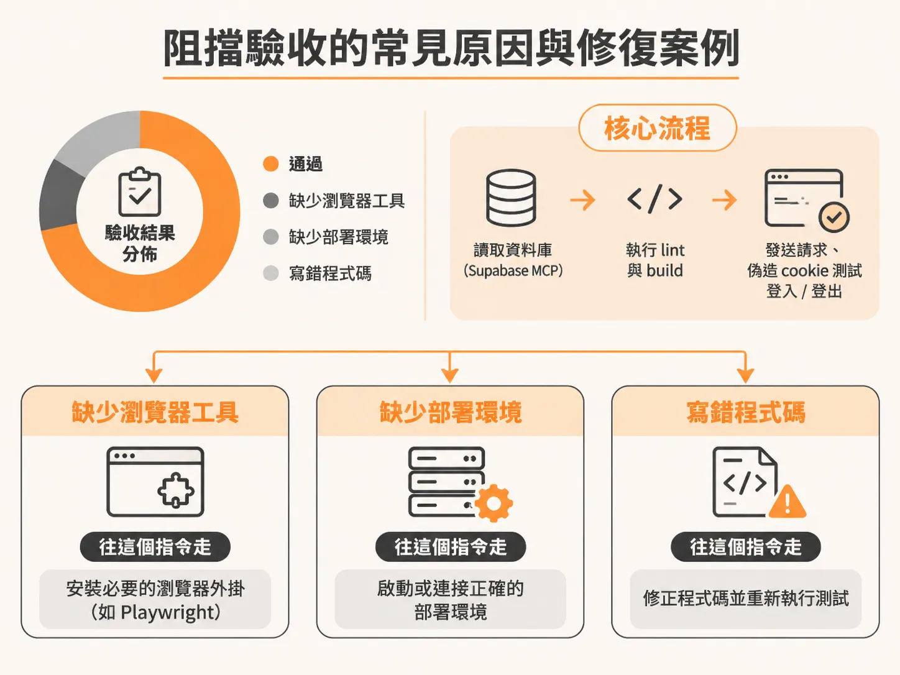
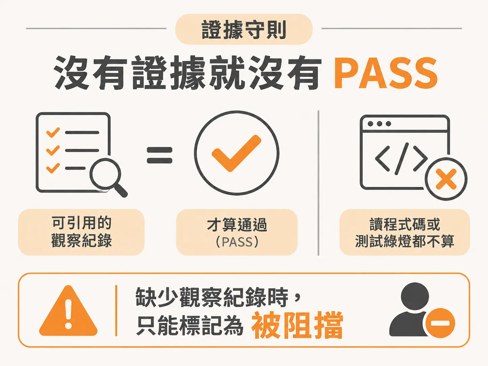

# 用 `/check verify` 逐條驗收功能

上一節的結論是先 verify、再 test。這裡先看 verify 實際上怎麼跑。

開發指令通常能幫我們把功能寫出來，甚至自測也顯示正常。但「它現在會動」跟「它符合當初開的規格且經得起考驗」是兩回事。AI 自己寫完程式碼再自己宣稱寫好了，並不能當作證明。

要確認一個功能真的完成，必須讓它在真實環境跑起來、逐條比對規格契約，並留下客觀證據。這就是 `/check verify` 的職責。

## 從自測到真實驗收的落差

在典型的開發流程中，我們可能已經藉由 architect 與 develop 迴圈完成了資料模型（data model）、設計系統（design system）、即時預覽（live preview）以及評論釘選（comment pinning）等功能。

但在本機 `localhost:3000` 測試時，往往會撞上真實限制。例如做一個讓客戶在線上檢視網頁並標註評論的工具，當我們在儀表板（`localhost:3000/dashboard`）新增專案，並輸入外部網站（如 `https://jsmastery.com`）作為預覽目標時，瀏覽器會直接跳出「Website refused to connect」。

這不是程式碼寫壞了，而是目標網站送出了 `X-Frame-Options` 或 CSP `frame-ancestors` 等 HTTP 標頭，拒絕被嵌入在 iframe 中。要繞過這個限制，通常有兩種解法：

1. **後端無頭瀏覽器截圖**：透過 Puppeteer 等服務在伺服器端抓取靜態圖片，再讓使用者在圖片上釘選評論。雖然少了即時互動性，但是成本最低的替代方案。
2. **客戶端嵌入腳本**：讓客戶在自己的網站貼上一小段像 Marker.io 或 UserSnap 的 embed script，讓評論功能以同源（same-origin）方式運作。

如果在開發展示階段想先看 iframe 功能，可以把目標暫時設為 `http://localhost:3000`。此時若系統原本限制只能輸入絕對網址（HTTPS），只要請 agent 移除限制即可快速驗證。接著你可以在釘選視窗留下評論（例如留下一筆「rename to How」），回到儀表板也能看到這筆新留言。

但這只是人工點擊的展示。要確保這個功能與資料庫架構未來不會被改壞，就必須走入嚴格的驗收流程。

## 什麼是 `/check verify`

`/check` 指令是程式碼合併前的守門員，它具備兩種互不干擾的模式：

- **`verify`（執行期證明）**：在主執行緒上跑起真實應用程式，直接觀察變更的實際行為。它的目的是證明功能會動，且符合規格中定義的每一個驗收準則（Acceptance Criteria, AC）與介面表面（surfaces）。此模式對程式碼為唯讀，不產生永久檔案。
- **`review`（跨模型審查）**：交由另一個不同的模型來審查 diff，避免「同一個模型審查自己的程式碼，繼承了同樣的盲點」，並依嚴重程度輸出報告。

如果只單獨輸入 `/check`，系統會停下來詢問你要執行 `verify`、`review` 還是兩者都要，並問你要針對哪個功能。通常我們會明確帶入參數：

<!-- derived -->
```bash
/check verify <feature>
```

以驗證資料模型為例，指令為 `/check verify data model`。

### 載入規格契約與 `verify.md`

執行 `/check verify` 時，它第一步做的是讀取「契約（contract）」。這份契約來自該功能目錄下的驗收清單（例如 `specs/0003-data-model/verify.md`，由 `/develop` 建立）。

這份清單會把每一項具體驗收步驟與對應的 `AC-N` 綁定在一起：
- 檢查 pin 寫入的斷言（assertion）。
- 檢查 smoke test 中的 check constraints。
- 檢查每筆評論僅允許一張圖片附件（以 reference 方式儲存）。
- 確認 live schema 與 migration 一致，沒有結構漂移（schema drift）。

## 驗收結果的四種狀態

在執行期間，驗收工具會對每一個 `AC-N` 與規格要求的實體給出四種結果之一：



| 狀態 | 意義 | 後續處理 |
| :--- | :--- | :--- |
| **Met ✅** | 行為確實發生，且擷取到了執行證據。 | 通過，不需額外動作。 |
| **Specced but missing 🚫** | 規格有要求，但完全沒寫實作（從未建立）。 | 回到 `/develop` 補齊。 |
| **Specced but not applied ⚠️** | 程式碼已存在，但未套用到真實環境（例如 migration 未執行）。 | 套用它（跑 migration、補環境變數或修正設定）。 |
| **Blocked ⚠️** | 因缺少環境變數、憑證或外部工具，導致無法執行觀察。 | 修復工具或環境後重新執行。 |

將「Missing」與「Not applied」分開非常關鍵。很多測試工具會把兩者一律報為 failed，但它們的本質完全不同：Missing 是根本沒做（漏掉範圍），Not applied 是程式寫了但沒有在 runtime 生效（接線出錯）。

整批驗收要拿到整體的 **PASS**，前提是**每一個驗收準則都達到 Met，且所有規格定義的表面都存在**。只要有一個 migration 沒套用，即使專案裡現有的單元測試全綠，驗收整體結果依然是 FAIL。

## 阻擋驗收的常見原因與修復案例

驗收過程中最常見的阻擋（Blocked）與失敗，往往跟環境依賴有關。以下是兩個實際驗證場景：

### 案例一：環境變數遺失與連線字串配置

在執行 `/check verify data model` 時，工具需要執行 `pnpm db:migrate` 與 `pnpm db:seed`。如果專案中缺少 `.env.local`，流程會立刻中斷。

此時它會停下來詢問 runtime 步驟該如何處理。在 Supabase 這類後端服務中，通常需要四組核心變數：
- `NEXT_PUBLIC_SUPABASE_URL`
- `NEXT_PUBLIC_SUPABASE_ANON_KEY`
- `DATABASE_URL`（連線集區位址，例如 Transaction pooler，預設 port 6543）
- `DIRECT_URL`（直接連線位址，Direct connection，預設 port 5432）

透過 MCP，驗收工具通常可以直接取得公開的 URL 與 anon key，並自動填入 `.env.local`。但帶有資料庫密碼的兩個連線字串則需要工程師手動至 Supabase Dashboard 取得並貼上密碼。切記不可把真實密碼填進 `.env.example`。

在環境變數就緒後告知繼續，工具可能會在連線時發現本機環境沒有全域 IPv6 位址，進而自動切換為 IPv4 session pooler 作為備援。接著它會跑過完整流程：更新個人資料、設定 onboarding 完成、測試刪除 auth users，驗證完畢後再將資料庫清回乾淨狀態（clean slate）。當 11 項準則全數為 Met、0 個 blocked、0 個 fails，驗收才算正式通過。

### 案例二：缺少工具存取權導致 Blocked

在驗證核心審查迴圈（`core review loop`）時，工具會利用 Supabase MCP 讀取資料庫，同時執行 lint、build，並透過 curl 發送請求、偽造 cookie 測試登入/登出邏輯。



但在該次測試中，報告顯示了 15 項行為中有 9 項 Met、1 個 bug、3 個 Blocked、1 個 Not ran：
- **3 個 Blocked**：原因在於驗收環境當時缺少瀏覽器工具（Browser tool），無法驅動端對端頁面觀察。
- **1 個 Not ran**：該項目依賴 Vercel 部署環境。
- **1 個 Bug**：系統先前為了在本機測試而放寬了 HTTP 限制，違反了原先規格書要求的 HTTPS 網址限制。

如果驗收工具沒有瀏覽器或資料庫存取權，那些需要對應工具的項目就只能標記為 `Blocked`，不能因為「看程式碼覺得對」就標記為 Met。

## 證據守則：沒有證據就沒有 PASS

`/check verify` 的核心在於不可捏造的客觀證據：



1. **沒證據就沒有 ✅**：只有在能具體引述操作依據（例如執行的 bash 指令與輸出、實際造訪的 URL 與渲染結果、SQL query 的回傳值）時，該項目才能算 `Met`。
2. **沒啟動就絕不 PASS**：若整個流程連 dev server 都沒開、沒有任何指令被執行，所有項目一律為 `Blocked`。
3. **工具無法使用視同 Blocked**：缺少 MCP 或瀏覽器，就坦白標記 Blocked，絕不降級成「檢查程式碼看起來沒問題」。

當驗收確認全部通過（PASS）後，工具才會在 `verify.md` 將對應的步驟勾選（`- [ ]` 轉為 `- [x]`），並在 `docs/scope/` 中將該功能的驗收框打勾。若未通過，則保留未勾選狀態，並引導工程師使用 `/debug` 修正問題或 `/develop` 補齊實作。

若專案採用 Prototype 等級開發，範圍清單上或許沒有格子可以打勾，但依然可以手動執行 `/check verify` 來驗證特定功能；而在進行重構時，比對修改前後的驗收結果，更是確認系統沒有發生無預警退化（regression）最有效的方式。
