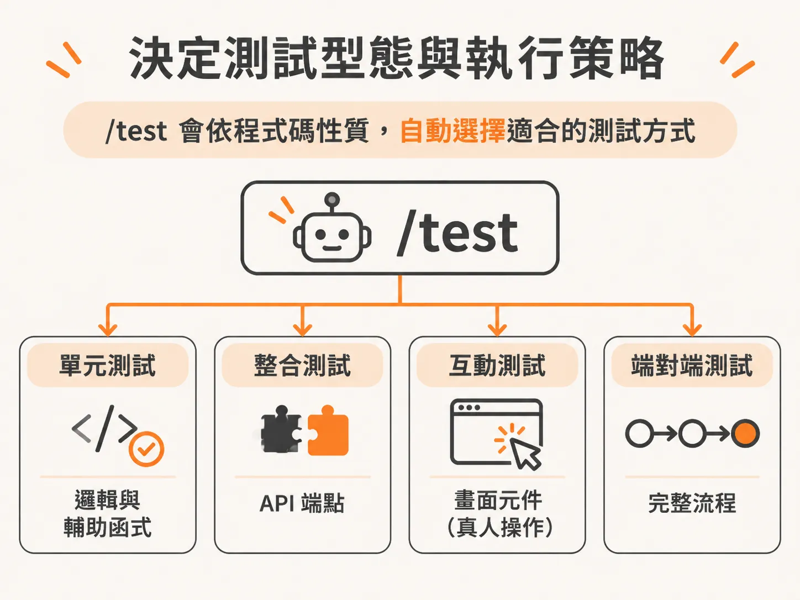
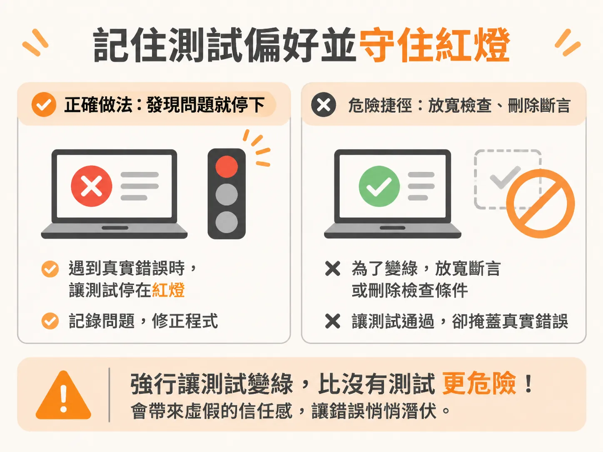

# 用 `/test` 把驗收成果變成回歸測試

在開發新功能時，你可能剛透過 `/check verify` 用真實操作與實際證據，證明了功能目前運作正常。但這個證明只代表「今天它能動」。下一週你在同一個專案加入新功能、改動了底層邏輯，很可能在不知不覺中改壞了原本正常的程式碼，而且沒有任何機制會立刻提醒你。

`/check verify` 負責確認「此時此刻能跑」，而 `/test` 技能則是把這份一次性的驗證成果，轉化成長期守護程式庫的回歸測試。

## 鎖定測試範圍

在 Cloud Code 視窗中輸入 `/test`。一般情況下，你可以直接帶入參數指定要測試的目標；如果只輸入 `/test`，它會先盤點專案內的所有檔案，評估現有測試套件的完整度，甚至確認專案是否根本還沒建立測試。

當它掃描完整個專案後，如果發現檔案量過大（例如 40 個檔案），它會停下來詢問該如何聚焦：

- 優先測試商業邏輯與 API
- 分批測試所有內容
- 讓你手動指定檔案來縮減範圍

比較實務的做法是明確指定範圍，例如直接指名特定功能，輸入 `test data model`，讓工具只針對資料模型（Data Model）這一切片撰寫測試。

## 決定測試型態與執行策略

鎖定目標為資料模型後，`/test` 會準備替資料邏輯模型、指派下一個 pin 編號、計算未讀 pin 等邏輯撰寫測試，並詢問寫完後是否要直接執行測試套件。

這時選擇「執行並修復至綠燈」（run it and fix it to green），系統在產生測試檔後，會自動在背景執行 `pnpm test`。它的原則很明確：如果測試檔本身寫錯，它會自行修正語法；但如果測試抓到的是應用程式本身的真實臭蟲，它會如實回報，絕不會擅自竄改你的業務邏輯程式碼來硬湊出綠燈。

在產生測試的過程中，`/test` 不會詢問你要跑哪種測試，而是依據程式碼的性質自行判斷：

- **商業邏輯與輔助函式（Helpers）**：配置單元測試（Unit Test）。例如資料模型裡的邊界條件（Invariants）、客戶端編輯邏輯，以及分享權杖（Share Token）的建立與解析，都會建立獨立的單元測試。而像 pin 的重新產生、撤銷與刪除等涉及資料庫的操作，若冒煙測試（Smoke Test）已經覆蓋，就不會無端重複。
- **API 端點**：配置整合測試（Integration Test）。
- **畫面元件（如 Thread 組件）**：以使用者實際操作的方式進行渲染與互動測試。

## 記住測試偏好並守住紅燈

測試撰寫完畢並執行後，如果看到「15 passed, 0 failed」，代表資料模型這一切片的測試已全數通過。`/test` 也會建立一份測試偏好設定檔（test preferences），記錄專案目前使用的測試工具。下次再執行 `/test` 時，它就不會重複詢問環境設定，而是直接進入測試撰寫階段。

這時在任務清單上，資料模型切片的測試工作就能標記為完成。雖然前一步的驗證檢查表（verify box）可能還需要除錯流程來收尾，但測試防護網已經就定位。

在協同開發中，對 AI 代理人下達「讓測試變綠燈」是非常危險的指令。如果遇到真實的程式錯誤，最快讓測試變綠的方法往往不是修好程式，而是放寬斷言（assertion）甚至刪除檢查條件。一個被強行安撫成綠燈的測試套件，比完全沒有測試還要糟糕，因為它會給你虛假的信任感。

真正的防護在於：測試必須追蹤已驗證的驗收條件，一旦發現預期外的行為，就必須停在紅燈，把問題記錄在待修清單中，絕不削弱檢查標準。

除了指定特定規格，`/test` 的彈性很大：你可以不帶參數測試全專案、針對特定規格檔執行，或是只針對某個規格中的一小項特定功能。只要把驗收過的功能交給它，後續每次改動程式碼時，這套回歸測試就能第一時間告訴你舊功能有沒有被改壞。
