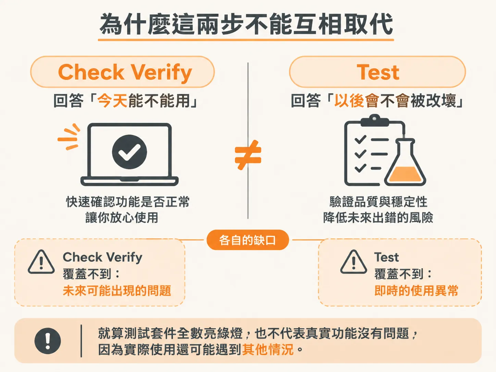
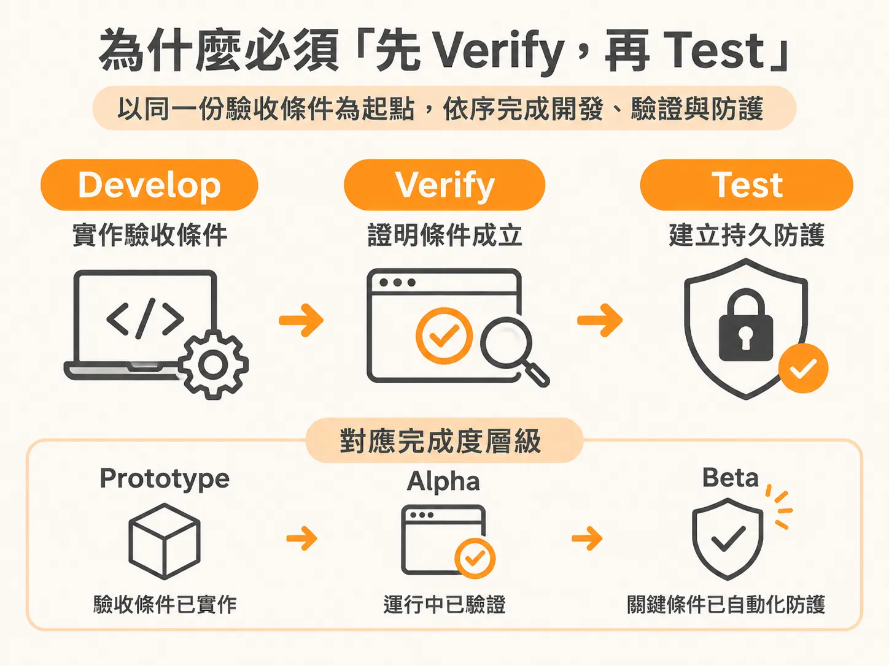

# 兩種證明：今天能用與以後不被改壞

`/audit` 把專案慣例寫進 `AGENTS.md` 後，功能可以持續動工了；但每一項功能交付前，還得回答兩個問題。

在軟體開發的原型（Prototype）階段，所謂的「完成」，通常只代表 Agent 實作出了功能，並且自己檢查過自己的程式碼。但要交出真正可靠的軟體，我們必須提高標準，加入「證明」（proof）。

證明分成兩種，分別回答兩個完全不同的問題：

1. 這項功能今天能正常運作嗎？
2. 以後它還能繼續正常運作嗎？

回答第一個問題的是 `check verify`。它會直接打開運行中的真實應用程式，對照驗收條件（acceptance criteria）來檢驗功能。它不只是確認程式碼能不能編譯通過，或者某個測試檔案有沒有跑過，而是親自確認承諾的使用者行為，是否真的在運行的產品中發生。能做到這一點，就達到了 Alpha 階段。

回答第二個問題的則是 `test` 技能。程式碼日後會不斷修改，未來的某次更動，很可能在不知不覺中破壞原本正常的功能。透過自動化測試來守護既有行為，正是工程團隊保護軟體質量的標準做法。做到這一步，就進入了 Beta 階段。

### 為什麼這兩步不能互相取代

這兩個步驟無法彼此取代。

就算測試套件全數亮綠燈，也不代表真實功能一定沒有問題。因為測試本身可能不夠完整、可能測錯了重點，或者根本漏掉了真實使用者會走的操作路徑。

反過來說，就算你證明了功能今天在畫面上完全正常，也無法保證下個月的某次程式碼重構不會把它改壞。

### 為什麼必須「先 Verify，再 Test」

正因如此，執行的順序非常關鍵：一定要「先 verify，後 test」。

如果順序顛倒，先寫測試再驗證，就等於在為一段你根本還沒確認運作是否正確的行為寫保護。正確的流程是：

1. 先執行 `check verify`，在真實運行的系統中，即時證明功能確實符合預期。
2. 再執行 `test`，撰寫自動化測試，保護剛剛才被證實有效的行為。

這兩項技能，都是以架構師（architect）當初寫下的驗收條件為基準：
- `develop` 負責實作這些驗收條件。
- `check verify` 在運行中的應用程式裡證明它們確實成立。
- `test` 則把其中重要的條件轉化為持久的自動化防護。

這三層標準清楚劃分了軟體的完成度：
- **Prototype**：做完，且自己檢查過（built and self-checked）。
- **Alpha**：做完，且經過即時證明（built and proven）。
- **Beta**：做完、經過證明，且受到長期保護（built, proven, and protected）。
