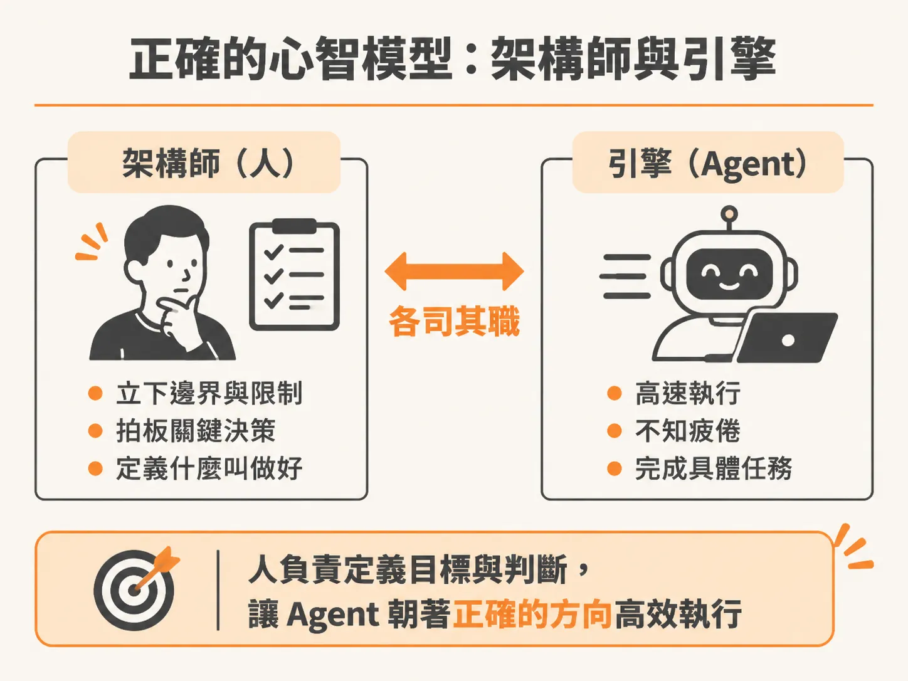
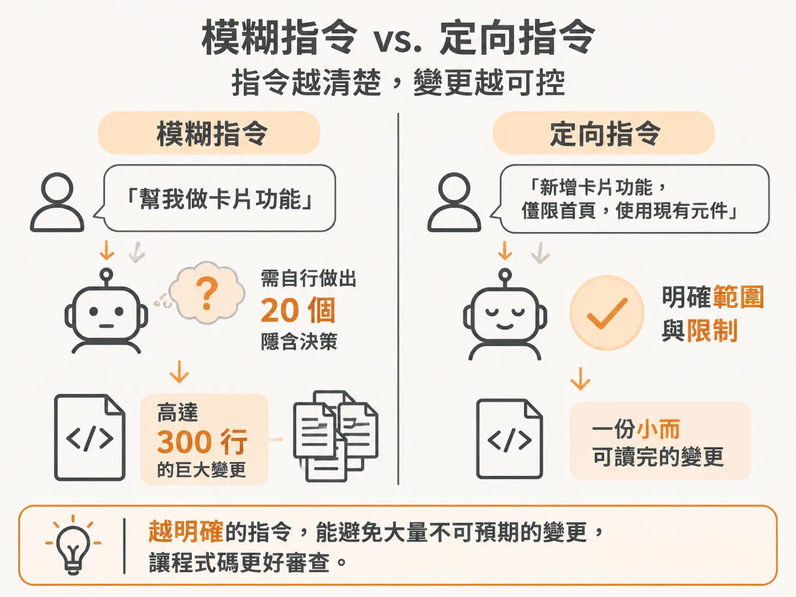

# 人是架構師，Agent 是引擎：別再用「許願」跟 AI 寫程式

當你叫 AI 寫程式時，是不是經常做這樣的事：輸入一段提示詞，按 Enter，接著雙手合十，祈禱它吐出來的程式碼剛好符合你的想像。

如果結果不如預期，你就換個方式重寫提示詞；如果還是不對，就把提示詞改得更長、加更多形容詞。這個「許願、祈禱、落空、再改願望」的循環會一直卡住你，直到你徹底換掉腦中的心智模型為止。

## 提示詞越寫越長，就像跟精靈鑽漏洞

大多數開發者本質上都把 AI agent 當作神燈精靈。這讓人想起喜劇創作者 Chris Jack 拍過的一支短片：主角 Jeff Brooker 想要智取精靈，於是在第一個願望許下「先讓精靈替後續的願望做漏洞審查（wish audit）」，確認沒有陷阱才正式鎖定願望。

即便防成這樣，精靈依然能把每個願望扭曲成完全不同的模樣：
- 他想「飛」，精靈說會給他小型單引擎飛機的商用駕照。
- 他改口要「用自己的身體像鳥一樣自力飛行」，精靈直接把他變成一隻只有 24 小時壽命的家蠅。
- 他最後許願「讓我能飛，而且你要完全明白我說的飛是什麼意思」，精靈說這在技術上算兩個願望：第一個願望依然讓他變成家蠅，第二個願望則是精靈心裡知道他原本希望的是什麼。

許多工程師在調整提示詞時，做的事跟這部短片幾乎一模一樣。你試圖用更多的字句防堵 AI 的隨機發揮，但只要互動模式還是「許願與祈禱」，你就永遠在防堵漏洞。

## 每次出錯時的診斷清單

AI 寫程式會垮掉，從來不是因為提示詞寫得不夠神，而是工作流程根本沒有建立。你需要的不是神奇小技巧，而是一個能刻意建構脈絡（context）、先規劃再動手、並讓掌控權留在你手上的扎實流程。

當任務搞砸時，不必怪罪模型能力不足，先問自己這兩個問題：
1. 是 agent 缺乏完成任務所需的上下文脈絡？
2. 還是 agent 替你做了「本該由你親自決定」的架構決策？

絕大多數的翻車現場，原因都逃不出這兩點。

## 正確的心智模型：架構師與引擎

要跳出許願迴圈，你得把心智模型切換過來：**你是架構師，AI Agent 是引擎。**

架構師不做祈禱。架構師是決定「什麼才叫做優秀成果」的那個人。你負責立下邊界與限制條件，負責拍板關鍵決策；當產出偏離軌道時，你要能明確指出「不要這樣寫，改用這種方式處理」，並且清楚明白背後的每一次技術取捨。

AI 則是那具驅動執行的引擎。它速度極快、不知疲倦，一個小時內吐出的程式碼可能比你手打一整天還要多。但引擎沒有判斷力（judgment）。軟體工程中最關鍵的「判斷力」，自始至終都是你的職責。

這就像優秀的資深工程師在帶領初階工程師：
- 他們不會替初階工程師逐行寫完所有程式碼。
- 他們也絕對不會丟下一句「去把這個 App 做出來」就拍拍屁股走人。
- 他們會給予充足的脈絡、指明架構方向、逐一審查送回來的內容，並在系統即將出問題前搶先攔下錯誤。

你與 AI agent 之間的合作，正是這種資深帶初階的關係——只是你手底下的這個初階助手，打字速度高達每分鐘一千字，而且永遠不會喊累。

## 模糊指令與定向指令的數字差距

心態上的轉變，會直接反映在 Git diff 的數字上。

如果你只丟出一句模糊的「幫我做卡片功能（build the card feature）」，agent 就必須在缺乏指引的情況下，在暗中替你做出 20 個未經說明的架構決策。最後它丟回一個高達 300 行的巨大變更（diff），牽涉一堆莫名其妙的檔案，你根本無從審查起。

同樣的任務，若由架構師來指揮，你會先界定清楚：
- 這張卡片是什麼、包含哪些欄位與行為？
- 它會觸碰哪些既有的模組與 API？
- 做到什麼程度才算完成（Definition of Done）？
- 更重要的是，這次任務明確「不需要」實作哪些東西？

當 agent 拿到一個範圍清楚、帶有嚴謹限制的任務，它回傳的會是一段乾淨的 40 行變更。這 40 行程式碼，你只要花兩分鐘就能完整讀懂並審查完畢。

模型還是同一個模型，agent 也還是同一個 agent，差只差在身處流程核心的人類做了完全不同的引導。

## AI 是放大器，它只放大你給的方向

你可以把 agent 視為一個放大器。它會原封不動地放大你給出的所有訊號：
- 模糊空泛的方向，會被放大成一場無法收拾的混亂。
- 清晰嚴謹的指示，會被放大成一套立即可用的軟體。

這也是為什麼擔心被 AI 取代的開發者往往把因果搞反了。那些只會丟出模糊願望並祈禱好運的人，確實很容易被取代，因為任何外行人都懂得輸入空泛的句子。

相反地，能夠梳理模糊需求、將其拆解成清晰技術約束、並指揮引擎高效執行的人，身價只會越來越高。這才是所有企業都在搶著留下的核心工程師。

從現在起，只要發現自己又想草率送出提示詞、靠運氣等待結果，請立刻停下來，問問自己：「如果是資深工程師，現在會怎麼下指令？」你是專案的工程總監，請拿出方向，不要把決定權交給運氣。
