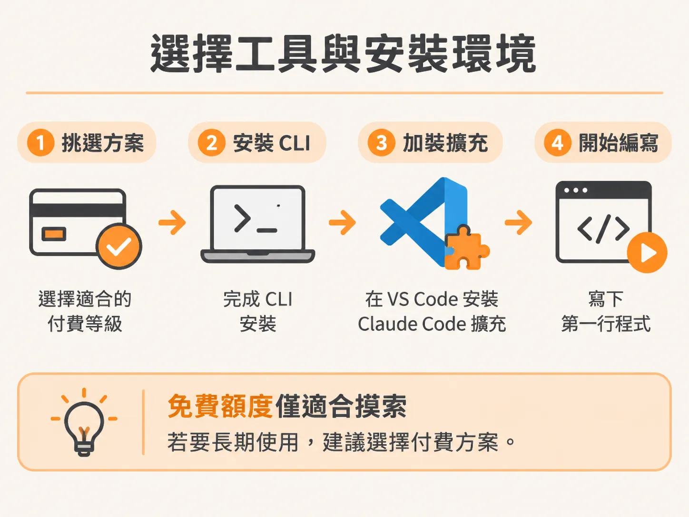

# 安裝 Claude Code 與掌握學習節奏

弄清楚自己會在哪些場景動手、要練的是什麼判斷力之後，下一步就是把工具裝好，讓 AI 真的成為日常開發夥伴。

在開始之前，必須先把工作環境準備好，並弄清楚接下來的學習路徑。這是一門著重「工作流程」而非純理論的實作課程，如果不親自動手跑過一次，看再多示範都很難真正內化。

## 選擇工具與安裝環境

整個課程會直接在編輯器中使用 Claude Code。

這裡要先說明選擇這套工具的原因。課程中探討的工作流程、各項技能以及掌握上下文（context）的思考方式，本質上都是跨工具適用的（tool-agnostic）。無論你偏好 Cursor、Codex 或其他任何工具，背後的觀念都能直接遷移。與其用抽象的概念空談，不如在單一工具中具體操作，同時指出每個環節如何對應到其他編輯器，避免被特定廠商綁死。事前調查也顯示，絕大多數人都希望以 Claude Code 作為示範工具。

在安裝之前，先談談方案選擇。要執行真正的代理人（agentic）開發工作，免費方案並不足夠。免費額度適合初步摸索，但無法支撐實際開發。建議的做法是先從最低階的付費方案開始，直到頻繁撞到額度上限再考慮升級。如果有預算願意投資，則可以直接選擇最高階的 Max 方案，這也是目前多數進階開發者使用的設定；考量到這類代理人所能帶回的生產力效益，這筆投資相當值得。

決定好方案後，第一步是安裝 CLI。如果你使用 VS Code，請一併安裝 Claude Code 的擴充套件。安裝完成後，環境準備就告一段落。

## 課程結構與學習節奏

要從這門課獲得最大效益，必須隨時保持編輯器開啟，跟著節奏邊看邊做。光看示範所能吸收的內容，大概只有親自動手做的十分之一。

整個學習路徑的設計有其先後依據：

1. **底層核心觀念**：先了解代理人在底層究竟如何運作，以及如何正確思考上下文（context）。這部分與工具無關，卻是後續所有技能的基石。
2. **體會混亂開發的痛點**：在進入成熟的工作流程前，課程會刻意展示一段未經規範、僅靠隨興提示（vibe coding）做出來的程式碼，讓你切身感受手動摸索到底會帶來哪些痛苦。
3. **引入 JSM 工作流程**：當你體會過混亂開發的瓶頸後，工作流程裡的每一項技巧，都會剛好成為解決這些痛點的解答。
4. **真實情境實戰**：學會工作流程後，再依序投入從零開始的專案、維護既有的龐大代碼庫（legacy codebase），以及處理整套系統完全崩潰時的修復策略。

請抗拒直接跳到後續實作模組的衝動。許多人買這門課是為了學如何處理老舊代碼庫或直接套用完整工作流程，但若缺少前半段對上下文層次的理解，處理舊代碼時就會處處碰壁、難以施展。前面的對比模組正是讓後面所有技術融會貫通的關鍵。

## 善用空白 Cheat Sheet 與自主挑戰

課程提供了一份隨堂速查表（cheat sheet），而它一開始刻意設計成全空白。

隨著進度推進，每次學到新技能時，課程都會提醒你在上面補上一行，用你自己的話寫下這項技能的功能與使用時機。直接下載現成筆記很難留下深刻印象，只有自己整理的字句才會真正記住。等到課程結束時，系統會提供官方的一頁總結讓你核對，但到了那個階段，你多半已經不需要依賴它了。

遇到單元挑戰題時也是相同原則。在觀看解答影片之前，務必先自己動手解題。卡關與除錯的掙扎過程才是真正的學習，解答影片只是一面用來確認思路的鏡子。

裝好工具、調整好節奏，接下來就進入下一課：用同一支電影推薦 App 建兩次，親眼看看「有沒有先把決定做出來」，最後會在程式碼與帳單上差多少。
