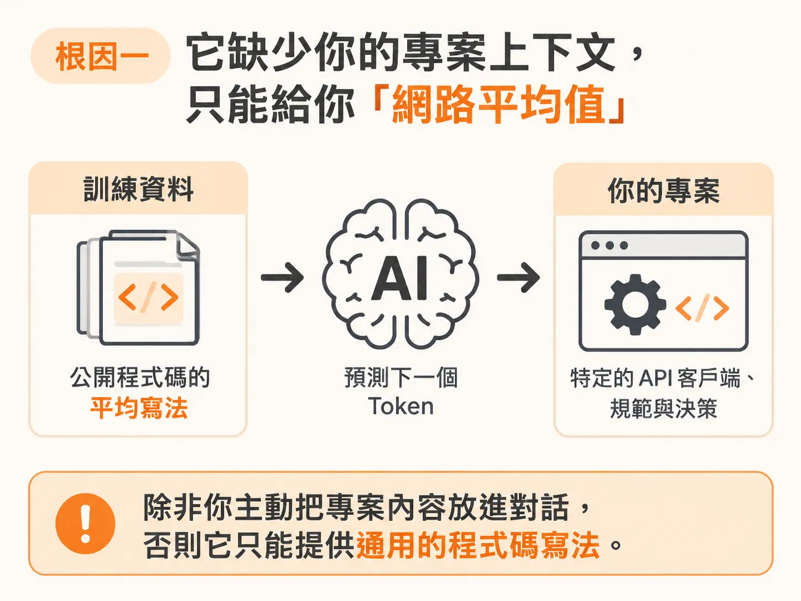
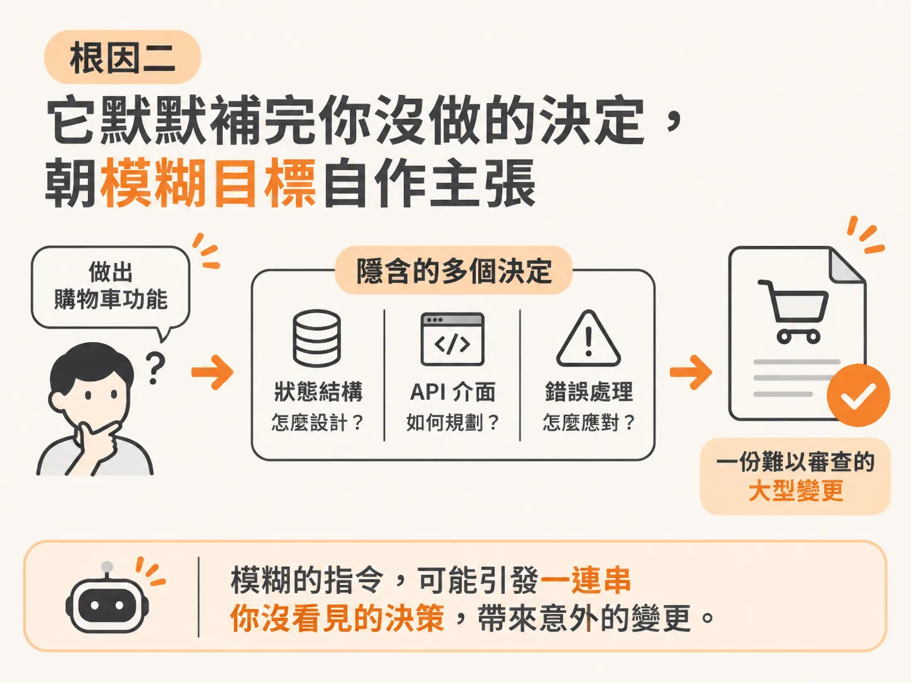
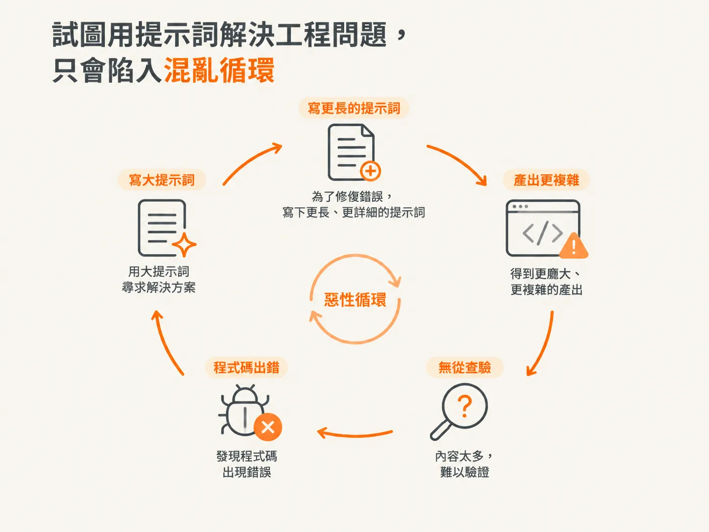

# AI 寫程式為何從驚豔走向失控？兩個讓你越寫越累的真正根因

很多人剛開始用 AI 寫程式時，都有過類似的體驗：打開一個新專案，輸入一段提示詞，AI 表現得不可思議地順暢。

它幫你搭好身分驗證架構、設定好路由，甚至在你還沒打完字之前，似乎就已經猜到你想做什麼。在最開始的 30 分鐘裡，你大概會忍不住讚嘆：這徹底改變了一切。

然而，裂痕很快就浮現了。

大約過了一個小時，它開始寫出重複的函式。你把終端機的錯誤訊息貼回去，它修好了這個 bug，卻又弄壞了另一處。你只叫它改動一個小地方，它卻自作主張重寫了三份你根本沒提到的檔案。對話紀錄變得越來越長，AI 的回應速度變慢，答案也越來越不精準。

到了第二個小時，你已經分不清楚它到底是在幫忙，還是在產出一堆聽起來很有把握、但你已經累到不想逐行檢查的程式碼。最後你受不了，開了新對話視窗想讓它重新跟上進度，結果只是把剛才解釋過的話全部重講一遍。

如果你對這個過程感到熟悉，請記住：問題通常不是你的提示詞（Prompt）寫得不夠好。這背後有兩個根本原因，而且光靠微調提示詞完全無法解決。

## 根因一：它缺少你的專案上下文，只能給你「網路平均值」

AI 寫程式工具的核心原理，是在海量的公開程式碼上訓練，藉此預測下一個 token。當你向它提出需求時，它產出的是全網公開程式碼中最常見、最普遍的寫法。

這些程式碼在大方向上沒有錯，但它天生就是「通用版」。

你的專案並不是通用的。你有特定的 API 客戶端（API Client）、特定的專案規範，以及你上週才敲定的架構決策。模型對這些一無所知——你的程式庫從未出現在它的訓練資料裡；只要你沒有主動餵給它，它眼前就看不到這些東西。

所以當你叫它呼叫 API 時，它會直接寫出一段原生的 `fetch`，並附帶一套它自己隨機挑選的錯誤處理邏輯。因為在公開網路上，呼叫 API 的平均寫法就是長那樣。它不是故意無視你的封裝模組，而是它根本不知道那個模組存在。

你以為自己在跟一位熟悉整個專案的資深工程師合作，但實際上，你面對的是一個剛走進辦公室的外包承包商。他對你專案唯一的認識，僅限於你在眼前這場對話裡透露的隻字片語。

缺少真正的專案上下文，就是導致一切偏離軌道的第一個根因。

## 根因二：它默默補完你沒做的決定，朝模糊目標自作主張

你可能會以為問題出在 AI 不會規劃。過去大家確實這麼認為，但現在的 Agent 早就具備規劃能力：它能瀏覽你的多個檔案、規劃實作路徑、執行測試，甚至在測試失敗時自我修正。這個迴圈確實能運作。

真正的問題在於：它的規劃到底朝向什麼目標？

Agent 是朝著你給的目標去規劃，而所有你「沒有明說的事情」，它都會自動用最可能的預設值補齊。

當你下達「做出購物車功能」時，它在背後默默做了十個你從來沒看過的決定：狀態結構（State shape）該長怎樣、API 介面如何設計、錯誤該怎麼處理。它不會停下來問你，而是直接挑了它覺得合理的做法動手做。

因為程式碼跑得動，而且它自己寫的測試也全部通過，表面上看起來毫無破綻。直到這些未經討論的決定不斷累積，最終演變成一份動輒 300 行、牽涉到一堆無關檔案的變更（Diff）。

這時你根本無法有效審查，也無法進行乾淨的測試；當某個功能壞掉時，你也找不出原因，因為所有地方都被改過了。

它並不是沒有規劃，而是朝著一個定義不足的目標前進，並用它自己的猜測填滿空白。那都是它的猜測，不是你的決定。

## 試圖用提示詞解決工程問題，只會陷入混亂循環

當這兩個根因疊加在一起，多數開發者就會掉進同一個惡性循環：

寫出一段大提示詞，得到一份龐大的產出；因為內容太多而無法驗證，接著程式碼出錯；於是又寫了一段更長、更詳細的提示詞去修復，產出變得更複雜，你也更無從查驗。

面對失控，很多人的直覺反應是繼續加長提示詞：寫更多細節、換更強的模型、開新的對話。但一段更長、規定更嚴格的文字，無法教會模型它從沒讀過的程式庫架構，更不可能強行把一個模糊的目標變精準。

你是在試圖用一句話去解決系統性的工程問題。

問題從來就不在提示詞寫得好不好，而在於缺乏一套嚴謹的工作流程。要打破這個循環，不是靠提示詞技巧或花招，而是建立工作流程：有意識地設計並提供上下文、在動工寫程式碼之前先把規劃定下來，讓你始終掌握主導權，而不是碰運氣。

往後只要遇到 AI 寫程式失控的狀況，隨時用這句話來診斷：

「是 Agent 缺少上下文，還是它越俎代庖，替我做了本該由我決定的事？」

幾乎所有失控的場面，都脫離不了這兩個核心問題。
