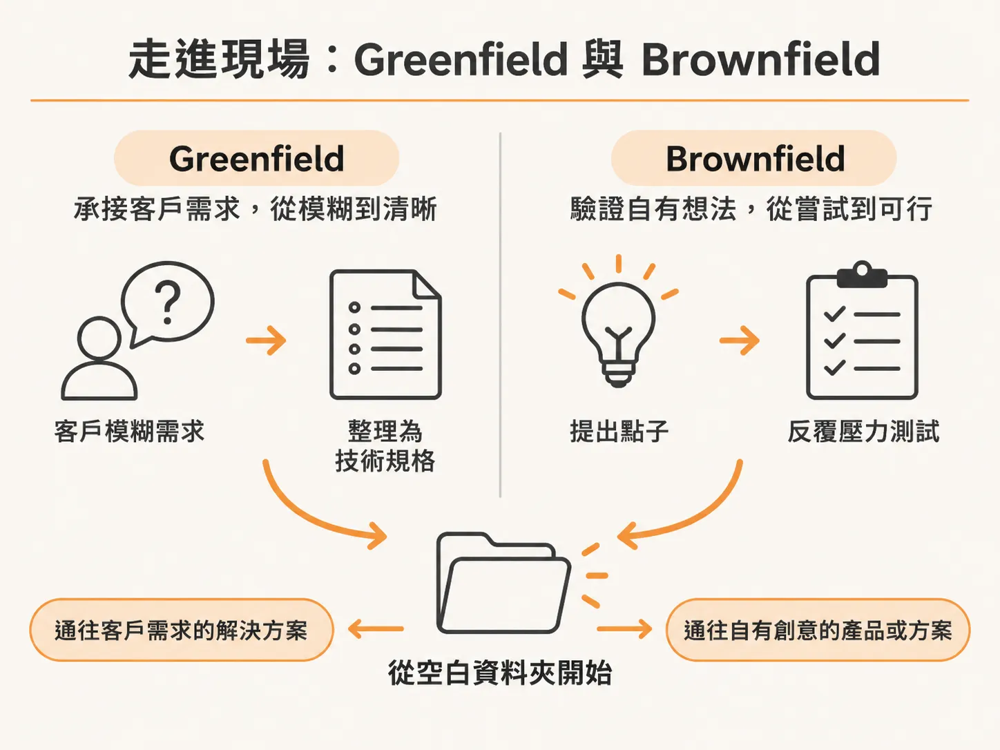
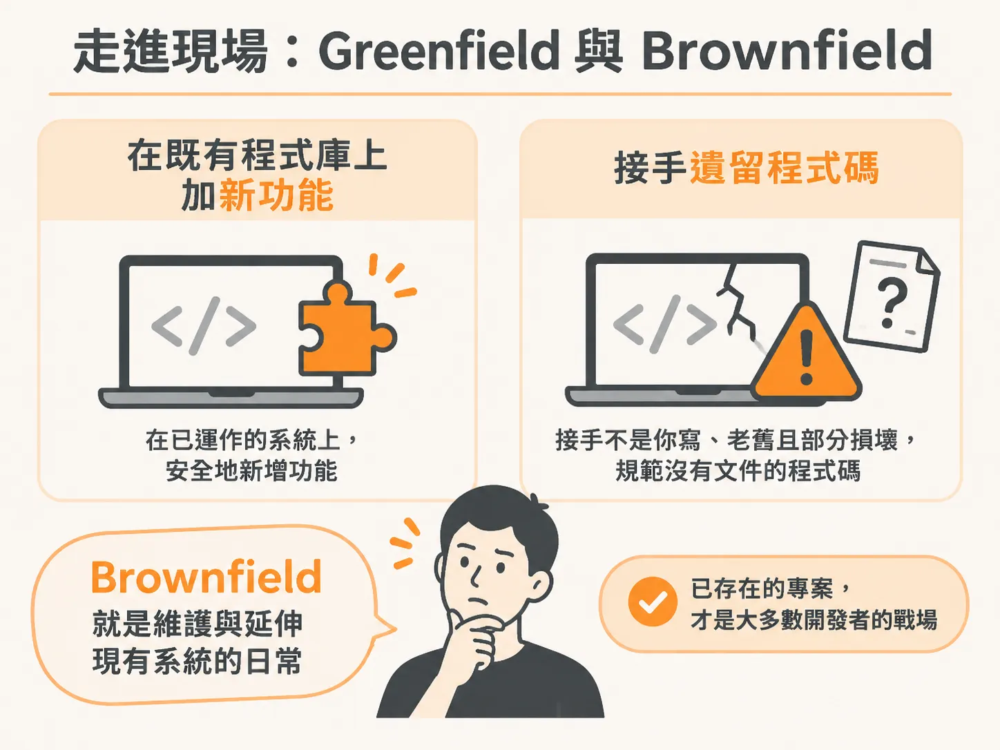

# 寫程式不再是難事，工程師該練的是「判斷力」

用白話寫下幾句需求，咖啡還沒涼，AI 就能端出一段能跑的程式碼。這不是誇大，而是現在寫軟體的日常。

我們花了幾年時間苦練的語法與刻程式碼技巧，已經變成唾手可得的大眾商品。如果任何人都能靠 AI 生出程式碼，那企業為什麼要僱用你？

幾個月前，我在社群上寫過一段話：「AI 拿走了我討厭的寫程式部分，把真正享受的部分還給我。」資深工程師紛紛點頭，但很多初階工程師卻十分生氣：「你已經功成名就，當然講得輕鬆；這東西在我們還沒起步時，就打算搶走我們的工作。」

我想了好幾天，不得不承認這是一個令人難受的事實：他們說得對，我當時確實沒有給出真正的解法。我只有十年的經驗和個人觀點，卻拿不出一套具體的東西交到他們手上。

這門課就是我的答案。而且這個答案絕不是「更好的 prompt（提示詞）」。

如果 AI 已經聰明到可以幫你寫程式碼，它同樣聰明到能幫你寫 prompt。目前在這一波浪潮中脫穎而出的工程師，從來不是什麼 prompt 魔法師，而是擁有「判斷力」的人。

他們清楚知道該做什麼，並把 agent（自主代理程式）導向那個目標；他們審查 agent 回傳的程式碼，就像資深工程師審查後輩的 Pull Request 一樣細膩；他們交付出經得起考驗的系統。AI 不會平白送你判斷力，相反地，當你缺乏判斷力時，AI 會讓出錯的代價變得更高。

但好消息是：判斷力是可以被訓練的。

職缺並沒有消失，而是正在改變形態。這門課不會教你靠著下 prompt 拼湊出自己看不懂的程式碼，而是剛好相反：你依然是掌控全域的工程師，AI 只是團隊裡動作最快、最不知疲倦的初階或中階同事，而你的責任是領導它、指出正確的方向。

---

## 這門課適合誰？先做個確認

如果你從來沒寫過任何一行程式碼，這門課不適合作為起點。與其浪費你的時間，我寧願一開始就坦白。

這門課是為「已經會寫程式」的人設計的。你不需要是資深專家，但至少要能在沒有人一步步帶領的情況下，獨立做出一個元件、寫一支 API 路由或拼出一個小型應用程式。

如果你符合以下幾種情況，這門課就是為你量身打造的：

1. **你用過 AI 寫程式，但僅限於對話視窗**：在 ChatGPT 或 Claude 裡貼上問題、複製答案回來改，報錯了再貼回去。這方法在小型任務勉強能跑，但專案一旦變大就徹底崩壞，而你找不出原因。
2. **你嘗試放了規範檔，卻撐不久**：你可能照著教學影片在專案加了 `CLAUDE.md`，第一週覺得很神奇，接著 agent 就開始在對話中途失憶、狂吃 token，甚至直接推翻它自己讀過的檔案規則。這不是你的問題，而是光靠單一說明檔根本撐不起真實世界的專案。

你缺的不是更完美的說明檔，而是一套完整的工程工作流程（workflow）。

在技術要求上，門檻非常低：具備基本程式碼撰寫能力、會用終端機、能操作程式碼編輯器即可，不需要精通特定框架或任何 agent 工具。唯一需要的實體工具，是 coding agent 的付費方案，從最低門檻的等級開始就夠用。

比起技術，更重要的是心態：你必須願意改變自己工作的方式。有二十年資歷的工程師若抗拒調整習慣，很容易卡住；相反地，入行才半年的新人若願意轉換思維，成長速度會非常驚人。

如果你已經是每天指揮 agent 的資深工程師，前面的單元可以快速帶過，但請不要全部跳過；到了後續的「舊系統維護與錯誤復原」單元時，務必放慢速度，因為那是多數老手也還在靠運氣摸索的地方。

---

## 走進現場：Greenfield 與 Brownfield

很多課程只給你一套工作流程和客製指令，接著就放手不管，從不告訴你這套做法放進真實職場到底能不能活下來。

我們會先展示「什麼是不該做的方式」——無論是徒手硬刻還是完全不經思索的 vibe coding。這兩種方式看似輕鬆，最後往往變成最難走的彎路。親身體會過問題後，我們再帶入正確的工作流程，並讓這套流程經歷開發者在實務中必然面對的兩種場景：

### 1. Greenfield：全新打造的專案

這類專案是從零開始的空白資料夾，通常源於兩種情境：

- **接案或客戶委託**：客戶遞來一份模糊不清、半調子甚至有點荒唐的需求。你的工作是將這團混亂梳理成明確的技術規格（spec），讓 agent 能對準目標建置。這對自由接案者或建立軟體工作室至關重要。
- **打造自己的點子**：例如想做一套自己的 SaaS。在敲下任何一行程式碼之前，你會用特定方法對點子做壓力測試，反覆切磨確認它值得做，再把它收斂成規格。

起點都是空的，但一條路通往更高品質的接案服務，另一條路通往將自己的點子化為現實。

### 2. Brownfield：現有專案與舊程式碼

在真實職場中，這才是絕大多數開發者每天生活的核心場景：

- **既有專案**：程式碼庫已經在運作，你只是要加上一個新功能。我們的工作流程有專門切入這類專案的路徑，直接省去不必要的初期規劃步驟。
- **遺留代碼（Legacy Codebases）**：這通常是最讓人頭痛的日常。程式碼不是你寫的、年代久遠、部分功能早已損壞，甚至毫無文件紀錄團隊習慣的開發規範，而你剛被分派要接手它。

這門課的核心，就是拿同一套以「工程師的判斷力」為核心的工作流程，貫穿 Greenfield 與 Brownfield 兩種環境。讓你學到的不是散落各處的零碎技巧，而是確切知道在每一種職場場景下，該在什麼時機拿出哪一把工具。
