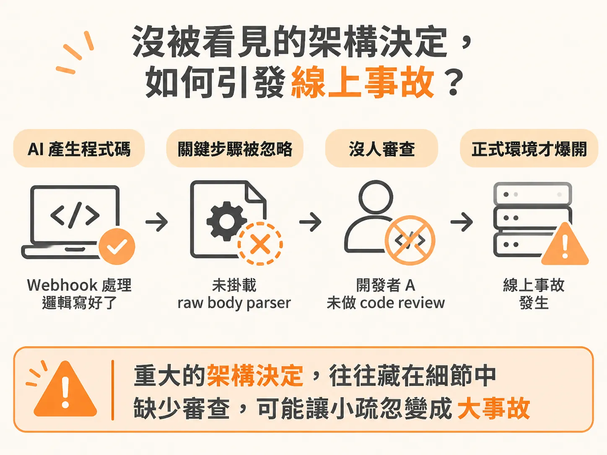
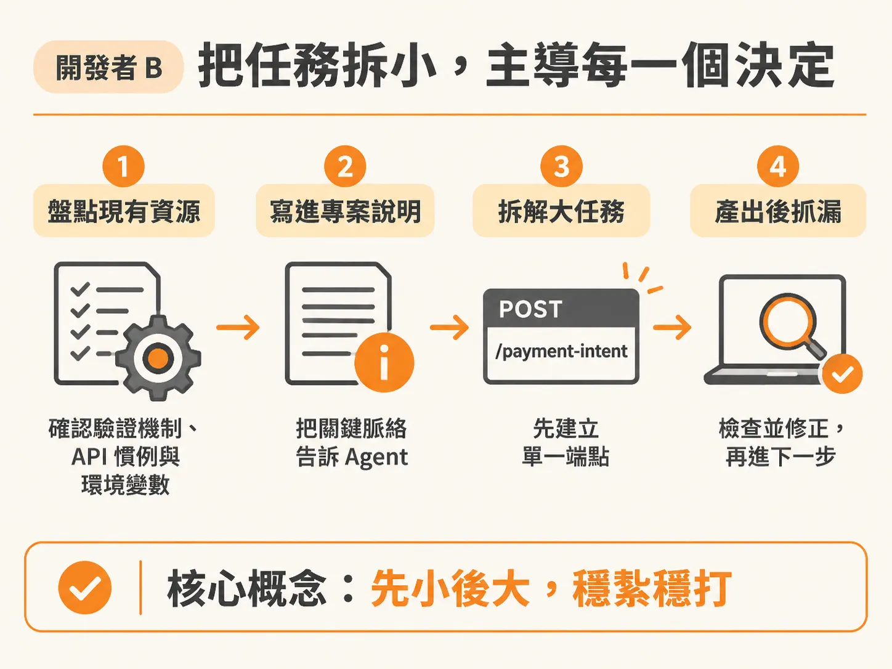
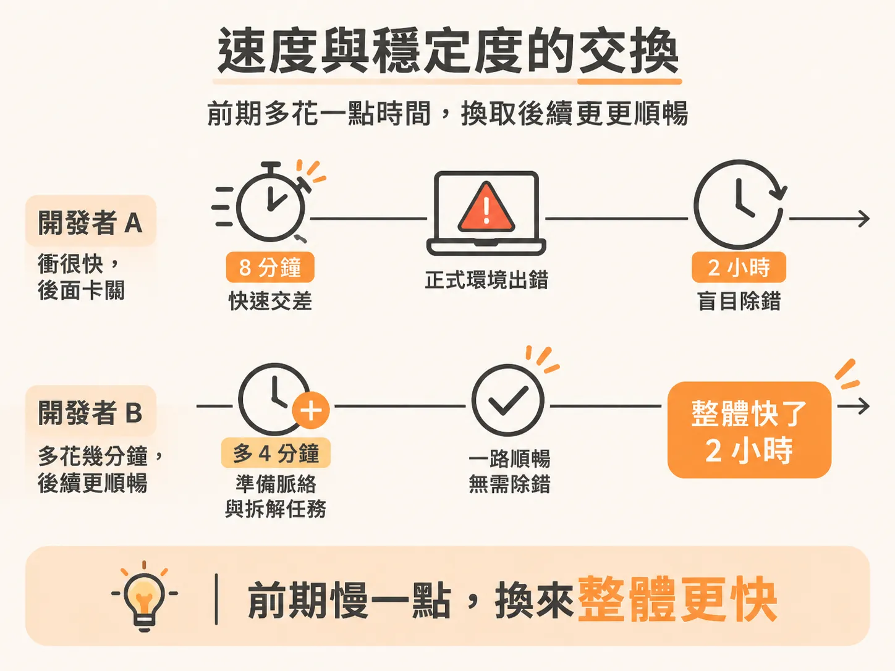

# Vibe Coding 與 Agentic Engineering：決定權在誰手上？

同樣是串接 Stripe 結帳功能，同樣使用當前最頂尖的 AI 模型，兩位工程師從接下任務到部署上線，走出了完全不同的結果。

這不是工具優劣的問題，而是兩人在開發過程中，究竟把「做決定的權力」交給了誰。

## 開發者 A：憑感覺產生的 240 行程式碼

開發者 A 打開全新的對話視窗，輸入了一行 prompt：「幫我用 Stripe 做一個結帳功能。」

AI 的反應極快，立刻開始搭建 Payment Intent、建立 API 路由、加入 Webhook 處理常式，甚至幫忙安裝了需要的 npm 套件。短短 8 分鐘內，開發者 A 就拿到了 3 個新檔案、共 240 行程式碼。

畫面上看起來一切正常。開發者 A 雖然沒辦法真正讀懂整個 git diff 到底改了什麼，但既然跑得起來、外觀沒問題，他就直接推上了正式環境。

兩小時後，正式環境的 Webhook 觸發，系統噴出一個從沒見過的簽章驗證錯誤（signature verification error）。

問題出在哪裡？Stripe 驗證 Webhook 簽章時，強制要求使用未經解析的原始請求內容（raw request body）。AI 確實寫好了處理邏輯，卻完全沒有掛載 raw body parser。這是一個重大的架構決定，但 AI 靜悄悄地做出了錯誤的選擇。開發者 A 根本沒做 code review，自然不可能提早抓出這個漏洞。

最後，開發者 A 只能在一個完全沒有前次對話紀錄的新視窗裡，狼狽地除錯自己根本沒寫過的程式碼。

## 開發者 B：把任務拆小，主導每一個決定

面對完全一樣的任務，開發者 B 在寫下任何 prompt 之前，先停下來做了幾件事。

他先盤點專案既有的架構：專案裡有沒有身分驗證中介軟體（auth middleware）？現有的 API 命名慣例是什麼？環境變數裡是否已經設定好 Stripe 金鑰？

接著，他更新了給 Agent 參考的專案說明文件（例如 `.cursorrules` 或專屬的 context markdown 檔），把關鍵資訊填進去：使用的 SDK 版本、專案採用的路由規格，以及 Stripe Webhook 必須使用 raw body parsing。

做好這些準備後，開發者 B 才開始界定任務範疇。他沒有直接丟出「做結帳功能」這種模糊又龐大的需求，而是拆解步驟：第一步，只建立 Payment Intent 端點。

就只做這一件事。在充足的專案脈絡下，Agent 產出了 60 行程式碼。開發者 B 逐行看過產出，立刻發現路由漏掉了身分驗證防護（auth guard），而團隊專案規定所有受保護的端點都必須加上。他隨即發送訊息要求 Agent 補上防護。

測試確認無誤後，開發者 B 完成 commit，接著才進入第二步：處理 Webhook。

同樣是單一目標、完整脈絡、產出完全在掌控與可審查的範圍內。

## 速度與穩定度的交換

表面上看，開發者 A 衝得很快，8 分鐘就交差，結果把正式環境搞砸；開發者 B 一開始雖然多了幾分鐘準備脈絡與拆解任務，但後續完全不需要花兩小時盲目除錯。一開始慢了 4 分鐘，整體反而快了 2 個小時。

這兩位開發者的差別不是技術高低，也不是使用的模型不同，而是控制權在誰手裡：

- **開發者 A 是被動反應（reacting）**：把整包需求丟給 AI，祈禱 AI 自己猜對所有細節。
- **開發者 B 是主動主導（directing）**：清楚界定規格，只給 AI 做好單一任務所需的精準資訊。

過去當「打字速度」是寫程式的主要瓶頸時，這兩種開發風格看起來差不多，大家都卡在鍵盤輸入的速度上。AI 出現後，打字瓶頸一夕之間消失，你究竟是真正理解系統架構，還是一路憑感覺碰運氣（vibe coding），差距立刻顯露無遺。AI 沒有創造這個差距，它只是把原本被掩蓋的落差放大並赤裸地攤開。

## 建立掌控系統

這種落差會持續累積。一個沒有方向的 AI 工作階段持續越久，產出就越容易脫軌；程式碼累積得越多，就越難被認真審查；而無法審查的程式碼，最終就是在正式環境裡頻繁出錯。

憑感覺寫程式（vibe coding）不是新手專屬的錯誤，而是一個人在缺乏明確工作流程時，自然會走上的阻力最小之路。

要擺脫這種混亂，關鍵在於建立工程化的主導系統。而這套系統的核心其實不是更強的工具，而是那個始終握有主導權的人。工具會換、模型會更新，但「由誰來決定」這件事不會跟著改變。

既然如此，下一個問題就很自然了：當 AI 讓寫程式本身變得便宜，工程師真正該練的到底是什麼？
