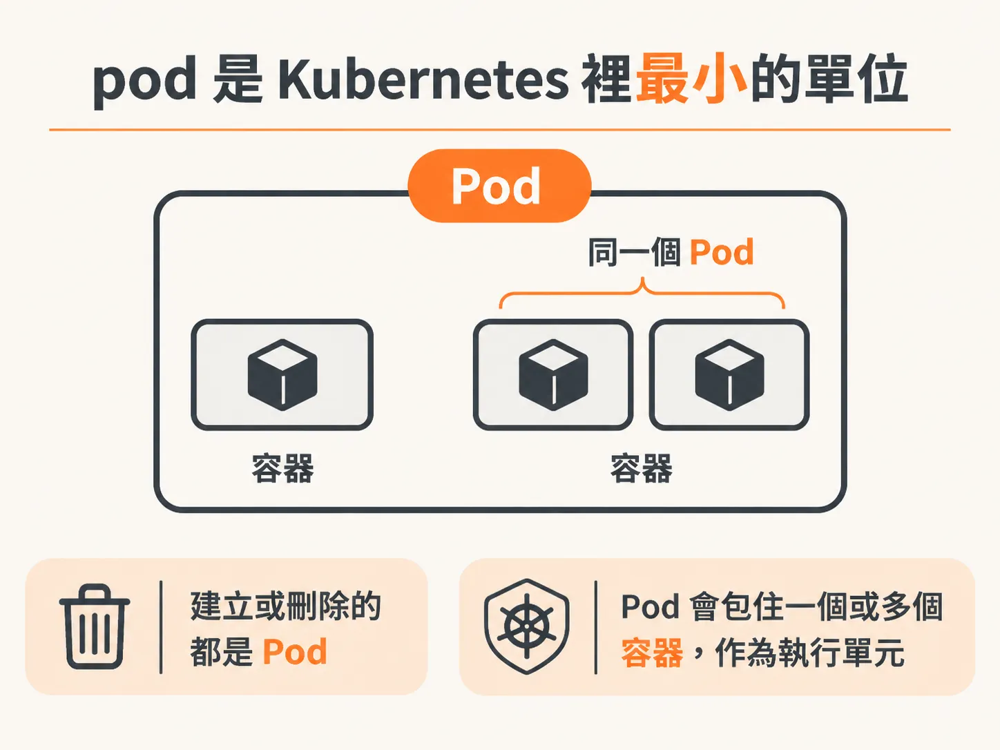
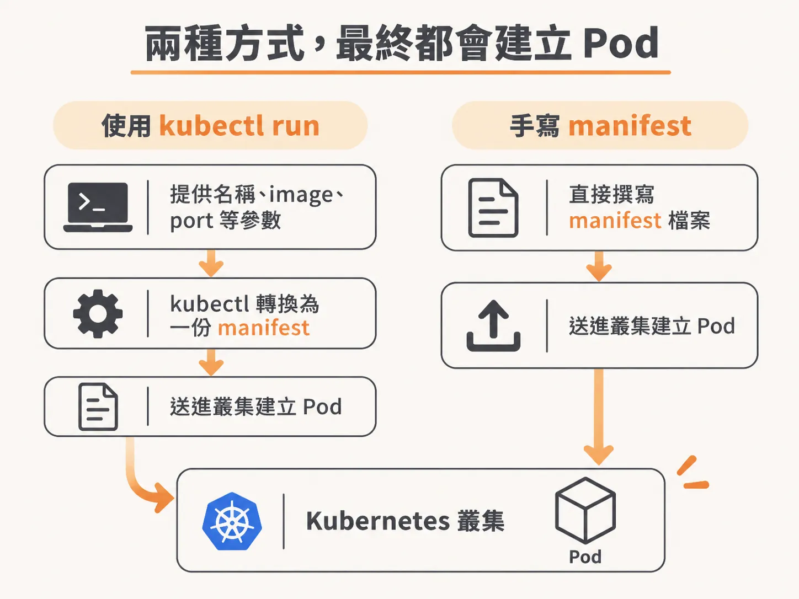
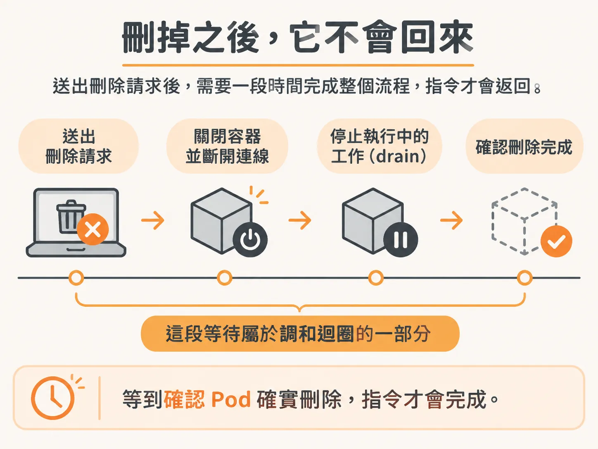
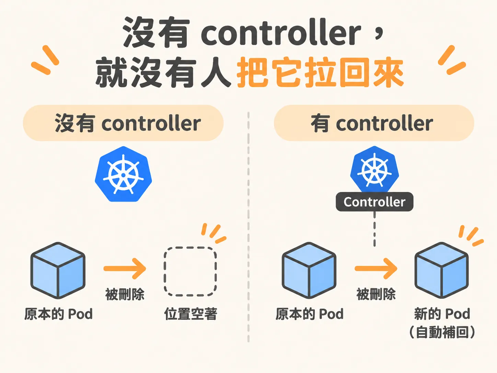

# 沒有東西控制 pod，它就會直接消失

你輸入 `kubectl run`，pod 就建立了；用 `kubectl get pods` 查詢，也看得到它。接著輸入 `kubectl delete pod`，畫面停了一下。等指令跑完再查一次，pod 不見了。

如果你用過 Docker，可能會覺得這很熟悉，於是很快就略過了。但先別急著跳過：在 Kubernetes 裡，沒有 controller 管的裸 pod，刪掉就真的消失了，沒有東西會把它補回來。

## pod 是 Kubernetes 裡最小的單位

先把名詞說清楚。pod 是 Kubernetes 裡最小的單位，你建立的是 pod，刪掉的也是 pod。它像是包在容器外的一層：一個 pod 可以只跑一個容器，也可以同時跑好幾個容器。



`kubectl get pods` 的 READY 欄位寫 `1/1`，不代表一個 pod 只能塞一個容器。那個數字是 pod 裡有幾個容器已經就緒。pod 本來就能裝多個容器，這也是為什麼狀態會寫成幾分之幾。

反過來說，如果你想要「一個容器算一個單位」，就建立多個 pod，而不是試著把一個 pod 拆開。Kubernetes 裡的單位就是 pod，沒有更小的切法。

## 這行指令其實是幫你生一份 manifest

`kubectl run` 看起來像是直接叫 Kubernetes 做事，其實中間還有一步。你提供名稱、image 和 port 等參數，kubectl 會先把它們組成一份 manifest（資源設定檔），再送進叢集建立 pod。



<!-- derived -->
```bash
kubectl run sample-app --image=<image> --port=<port>
```

換句話說，manifest 能設定的內容，技術上也能透過 CLI 參數設定。直接下指令的方式叫 imperative（命令式）；先寫好 manifest 再套用，則叫 declarative（宣告式）。不管走哪條路，最後送進 Kubernetes 的都是 manifest，兩種都該會。

CLI 特別適合除錯。想快速進入叢集，開一個能用 shell 連線、方便到處查看的容器時，這行指令很好用。但它不適合拿來部署，除錯和部署是兩件不同的事。kubectl 適合用來探索，不是用來營運。

這次建立的 pod 位在 default namespace。namespace（命名空間）本來很單純，就是拿來分類，像資料夾一樣；換了 namespace，不代表網路或權限就會自動隔開。若要更細的權限控制，得另外設定 RBAC。RBAC 預設沒有啟用，所以實務上也可能遇到「這個 namespace 不准刪任何東西」的策略，讓 delete 指令直接失敗。

## 刪掉之後，它不會回來

刪除 pod 的指令很簡單：

<!-- source: sources/kubernetes/20261031/5-running-deleting-an-app.txt#L342-L343 -->
```bash
kubectl delete pod sample-app
```

按下 Enter 後，你可能會發現指令沒馬上回來。有人等一秒，有人等十秒。這不是當機；指令會等到確認 pod 確實刪除，才會完成。



這段時間是在做收尾工作：等容器關閉連線、停止還在執行的工作，也就是 drain（排空），接著才真正結束。這是 reconciliation loop（調和迴圈）的一部分。Kubernetes 不會送出刪除請求就撒手，它會持續看狀態，確認實際結果符合你的要求。

等指令返回後，再用 `kubectl get pods` 查詢，就會發現 namespace 裡沒有 pod 了。你可以再建立一次、再刪一次，流程都一樣。

## 沒有 controller，就沒有人把它拉回來

pod 消失的樣子，有點像卡通角色講完話就下台。聽起來像玩笑，但這說的是真的：如果沒有東西管理它，它就會直接消失，和一般容器沒兩樣。



所以，如果你希望服務「掛了就自己重啟」或「出事後能自己恢復」，單靠 pod 做不到。pod 啟動、執行，接著停止，事情就結束了，沒有後續。它會這樣消失，正是因為沒有 controller 管理；pod 之所以是 Kubernetes 裡最低階的單位，就是這個原因。

自癒不是 pod 內建的功能，要有別的東西管著它，這件事才會發生。如果你需要這種效果，就要讓 pod 交由某個 controller 管理，而不是手動用 `kubectl run` 建一個孤零零的 pod，再期待它自己回來。下一篇就從最常用的那個 controller 開始：Deployment。
