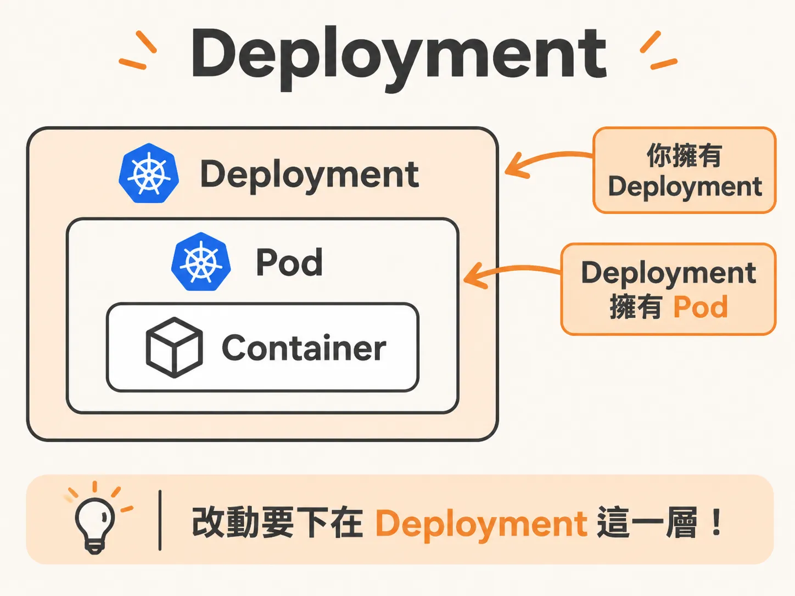
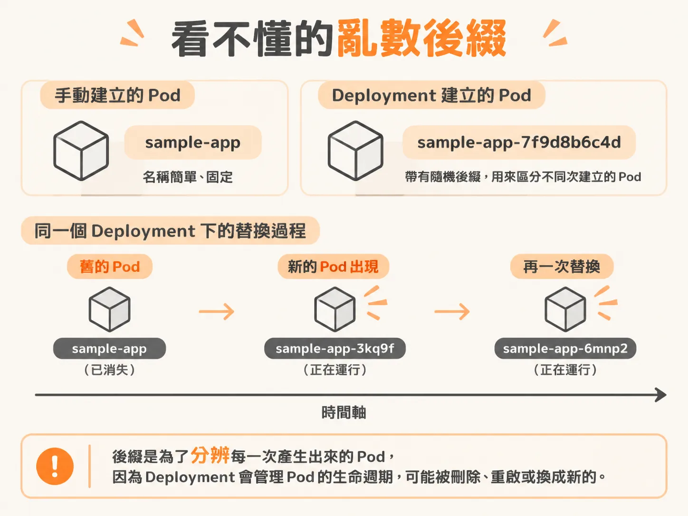
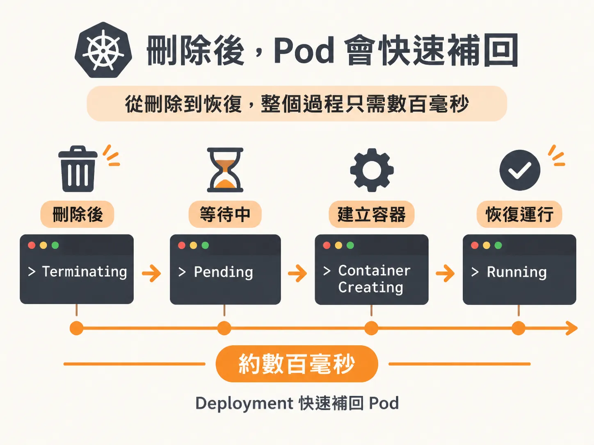

# Deployment 就是 Pod 的定速巡航

你剛建立一個 pod，它順利跑起來了。接著你把它刪掉，它就消失了，不會自己回來。

單獨的 pod 是一次性的：工作結束就結束，掛掉也不會自動恢復。測試時這很方便，但放到正式環境就麻煩了。你不會希望服務只要故障一次，就再也回不來。

Deployment 就是為了解決這個問題。你告訴它需要幾個 pod，它就會持續確認數量，少了就補上。

可以把它想成汽車的定速巡航：你設定好速度，它負責維持。

## 先建一個 Deployment

建立 Deployment 的指令，和建立 pod 時幾乎一樣：

<!-- source: sources/kubernetes/20261031/6-creating-deployments.txt#L51-L73 -->
```bash
kubectl create deployment sample-app --image=<你的映像檔>
```

為什麼參數差不多？因為 Deployment 管理的是 pod。它得知道 pod 裡要跑什麼容器，所以需要同一組資訊，例如映像檔。

差別在於誰負責管理。剛才建立的 pod 是自己運作，結束後就不會再回來；現在建立的這個，則是負責管理 pod 的資源。

你可以把 Deployment 想成包在容器外面的一層殼。它負責盯著 pod 的數量，不夠時就補上。



## 一次看兩種資源

同一個 kubectl 指令，其實可以一次查看兩種資源。

<!-- source: sources/kubernetes/20261031/6-creating-deployments.txt#L76-L79 -->
```bash
kubectl get deployments, pods
```

只寫 deployments，就只會看到 Deployment；只寫 pods，就只會看到 pod。兩種都寫，畫面上就會同時顯示兩者。

同時查看，是為了確認兩件事：pod 有沒有在跑，以及 Deployment 有沒有就緒。pod 和 Deployment 代表的是不同層級的狀態。

pod 那一列顯示的是基本狀態，例如 READY 和 STATUS。STATUS 是 running，就是 pod 正在執行。

Deployment 那一列則顯示它管理的數量：`1 out of 1` 代表目標是 1 個，目前也有 1 個。後面還會顯示 up to date、available，以及它已經運作多久，例如 42 秒。

## 看不懂的亂數後綴

看看 pod 的名稱。你手動建立的 pod 就叫 `sample-app`；Deployment 建立的 pod 則叫 `sample-app-6575…`，後面多了一串亂數。

這串後綴不是 bug。Deployment 管理 pod 的生命週期，而 pod 可能被刪除、重啟或換成新的。既然 pod 會更換，就需要新的名稱，才能分辨是哪一次建出來的 pod。



因此，真正的關係是：Deployment 擁有 pod，你管理的是 Deployment。

想修改內容，就改 Deployment，讓它去更新 pod。那個由 Deployment 管理的 pod，你不要直接動它。

## 刪掉，看它長回來

想親眼看看這件事，可以在另一個終端機加上 watch：

<!-- source: sources/kubernetes/20261031/6-creating-deployments.txt#L139-L141 -->
```bash
kubectl get pods -w
```

加上 watch 後，這個命名空間裡 pod 的每個事件都會即時顯示。畫面會一行一行更新，不再是一張靜止的表格。

接著回到另一個終端機，把 Deployment 建立的 pod 刪掉：

<!-- source: sources/kubernetes/20261031/6-creating-deployments.txt#L148-L150 -->
```bash
kubectl delete pod <pod-名稱>
```

複製名稱時，記得連後面那串亂數一起複製。

刪除後，另一個終端機的畫面就開始變化：先是 terminating，接著出現 pending、container creating，最後又回到 running。



從 terminating 到 running，整個過程是在毫秒內完成的。你只是模擬了一次故障：刪掉 pod，什麼都不用做，它就自己長回來了。

再查一次，你會看到新 pod 有全新的名稱和 ID，而 Deployment 仍是 `1 out of 1` 就緒。

## 除了帥，還能幹嘛？

我自己的叢集會跑 Plex。只要放進一個大檔案，pod 的記憶體就可能被吃光，接著一直當掉。

不過，因為它由 Deployment 管理，至少 pod 會回來。當下我可能只想繼續看節目，不想立刻處理問題；這樣就先夠用了。

但自我修復不是萬靈丹。這個迴圈會一直嘗試把 pod 拉回來；如果叢集被塞爆，迴圈本身也可能卡住，變成類似死鎖的狀態：叢集檢查的速度，跟不上它想啟動東西的速度。

斷電就是一種典型情況。電力恢復時，所有東西同時啟動。我的叢集大約有 300 個 pod，只跑在 6 個節點上，等於七十幾個容器同時開機。

要避免這種情況，就得讓啟動有節奏，不要一次把系統打垮。

自我修復很好用，但它只是盡力而為的迴圈，不是魔法。
