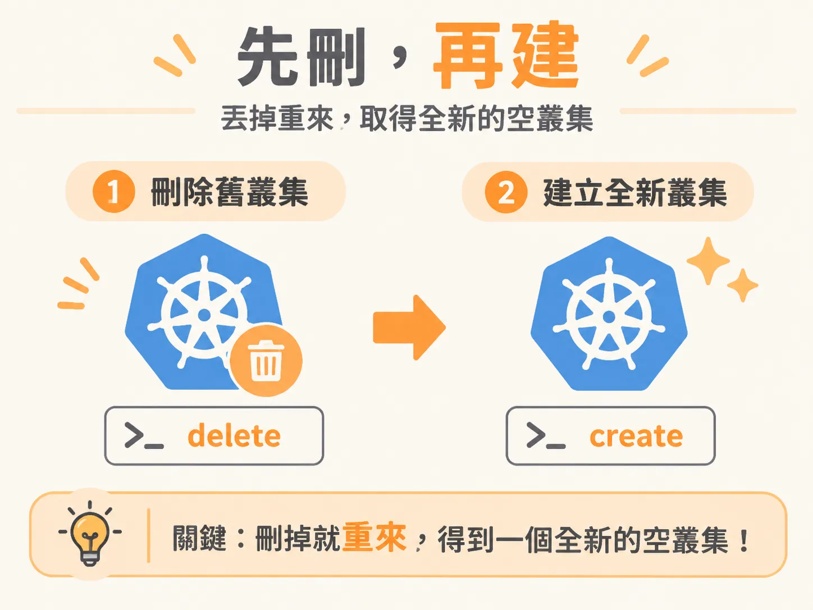
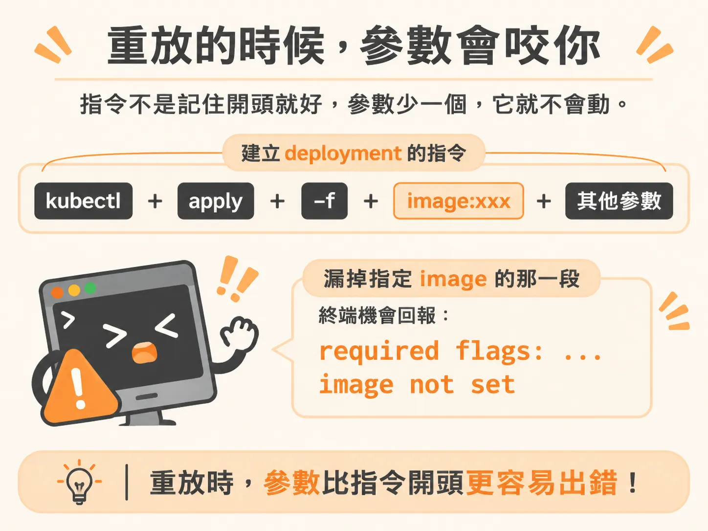
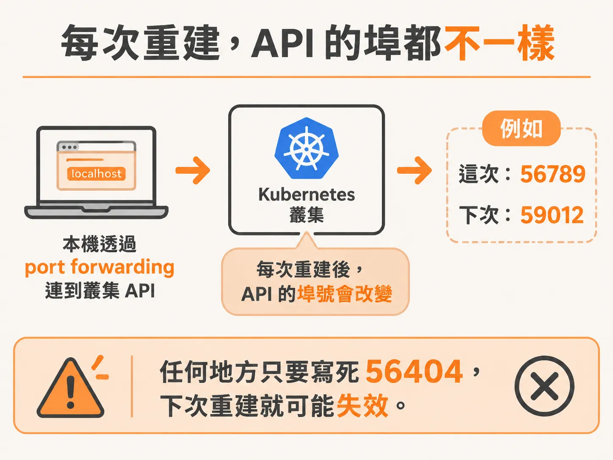
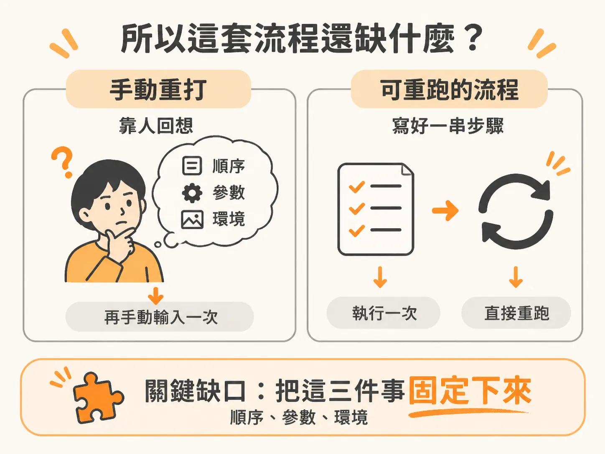

# 從零重建叢集

reconciliation loop 再怎麼修，也只修得到它看得見的 desired state。當你把整個叢集刪掉，那份 desired state 也跟著一起沒了。

練習用的叢集裝了一堆東西、改了一堆設定，現在想全部清掉重來；或者像我一樣，只是想換掉一個 container image。

不管是哪種情況，最省事的做法都一樣：刪掉叢集、重新建立，再把之前做過的每一步重跑一次。

下面就照這個順序走一遍，順便看看這套流程還差什麼，才不用一直靠腦子記指令。

## 先刪，再建

刪除叢集只要一行：

`kind delete cluster`

執行後，終端機會印出一些訊息。如果看到 `deleted nodes` 之類的字，代表原本確實有節點，而且已經刪掉了。「現在是空的」和「從來就沒有東西」是兩回事。

接著重建，指令也很簡單：

`kind create cluster`

跟 Docker 一樣，刪掉之後重新執行 `create`，就會得到一個新的叢集。逐字稿裡那次重建花了 21 秒。

## 回來的是空殼

建好之後先執行 `kubectl get pods`，你會看到一個乾淨的叢集：乾淨到裡面什麼都沒在跑。

這是預期結果。kind 建出來的是全新的空叢集；deployment、資料庫和設定，都跟著舊叢集一起消失了。

所以真正花工夫的地方在後面的重放：你得先找出之前下過哪些指令，再照原本的順序重打一遍。

## 重放的時候，參數會咬你

先重新建立 deployment，再重做 Postgres。順序不能顛倒：deployment 要先啟動，資料庫才有東西可以連。

逐字稿裡有個很典型的例子。重打建立 deployment 的指令時，終端機回覆 `required flags`、`image not set`。原因是他忘了第二行，也就是指定 image 的那一段。

指令不是記住開頭就好，參數少一個，它就不會動。

Postgres 也不是一個指令就能全部搞定。要先建立資料庫，再執行一個修復資料庫的指令。建立 deployment、建立資料庫、修復資料庫，在逐字稿裡是三個分開的步驟，得一個接一個完成。

## 指令放在 repo 的 docs 裡

那要去哪裡找這些指令？不用抄在便條紙上，repo 裡就有。

`docs workshop` 底下有一份份 guide，列出建立叢集、取得節點、查看叢集資訊等操作。逐字稿裡他一度找錯資料夾，最後確認這次要用的是 `foundations` 那份。

所以，實際上的「重放」流程是：打開 repo、找到對應的 guide，再複製、貼上。你記住的不是指令，而是「指令在哪一頁」。

## 每次重建，API 的埠都不一樣

還有一個很容易忽略的變動：執行 `kubectl cluster-info` 時，顯示的是 `localhost`。因為叢集跑在自己的電腦上時，只能透過 port forwarding，把本機的一個埠轉接到叢集 API。

而且這個埠每次都不一樣。逐字稿裡這次是 56404，但那時候只有一個叢集。再開另一個叢集，就會分到另一個隨機埠號。kind 會自己安排，不用手動設定；但也不能假設它永遠是同一個號碼。

任何地方只要寫死 56404，下次重建就可能失效。

## 所以這套流程還缺什麼？

你已經完整走過一遍：刪掉叢集、重新建立、把 deployment 和資料庫放回去，再確認 pods 都正常運作。多練幾次確實會變快；逐字稿最後也提到，熟悉之後，用 Kubernetes 會順很多。

但變快是因為你熟了，不代表流程可靠。目前還缺三樣東西。

第一，沒有記下步驟順序。建立 deployment、建立資料庫、修復資料庫，這三步只存在於你的印象，以及一份寫給人看的 guide 裡。

第二，沒有固定參數。少了 image，你就會在重建到一半時卡住，而且要做到那一步才會發現。

第三，沒有固定環境。每個新叢集拿到的埠號都可能不同，依賴位址的設定也會跟著變。

現在的重建是「把指令再打一次」，不是「執行一件已經寫好的事」。

下一步要做的，是把這串指令從文件裡搬出來，整理成刪掉叢集後可以直接重跑的流程。做到這一步，才算真正不用靠腦子記指令。
