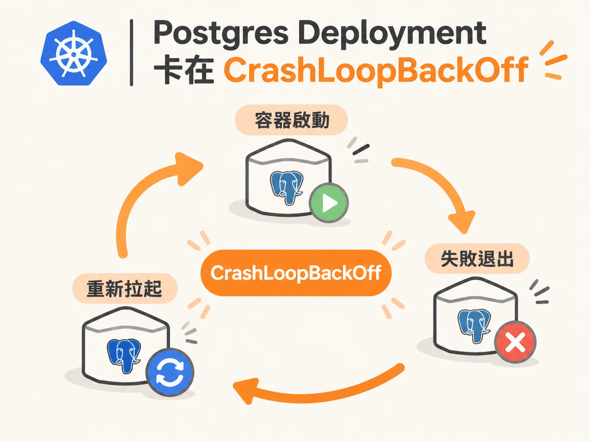
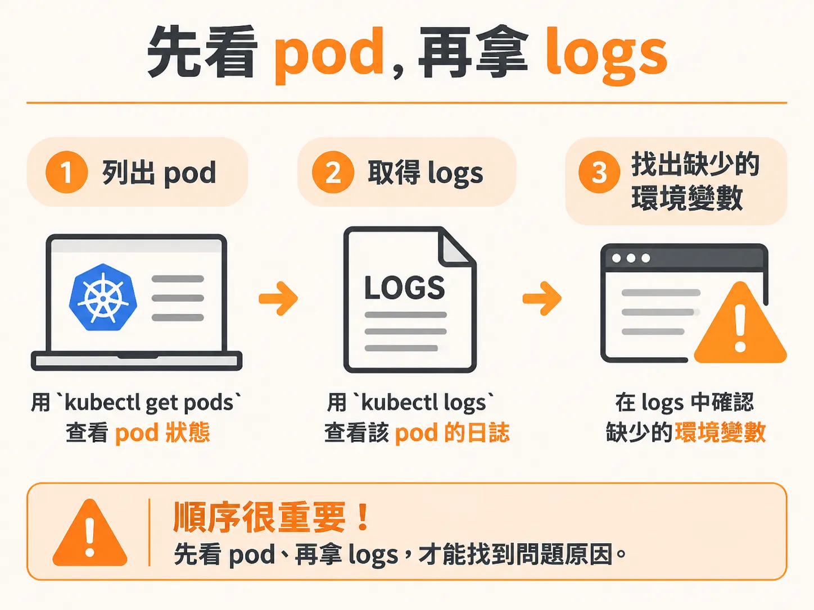
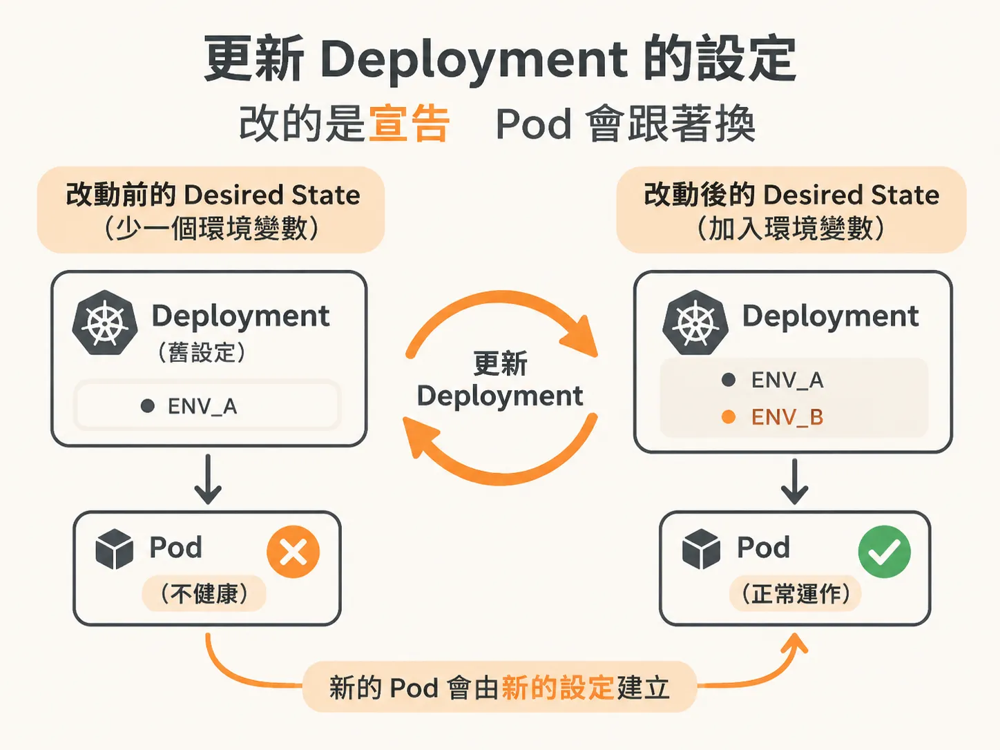
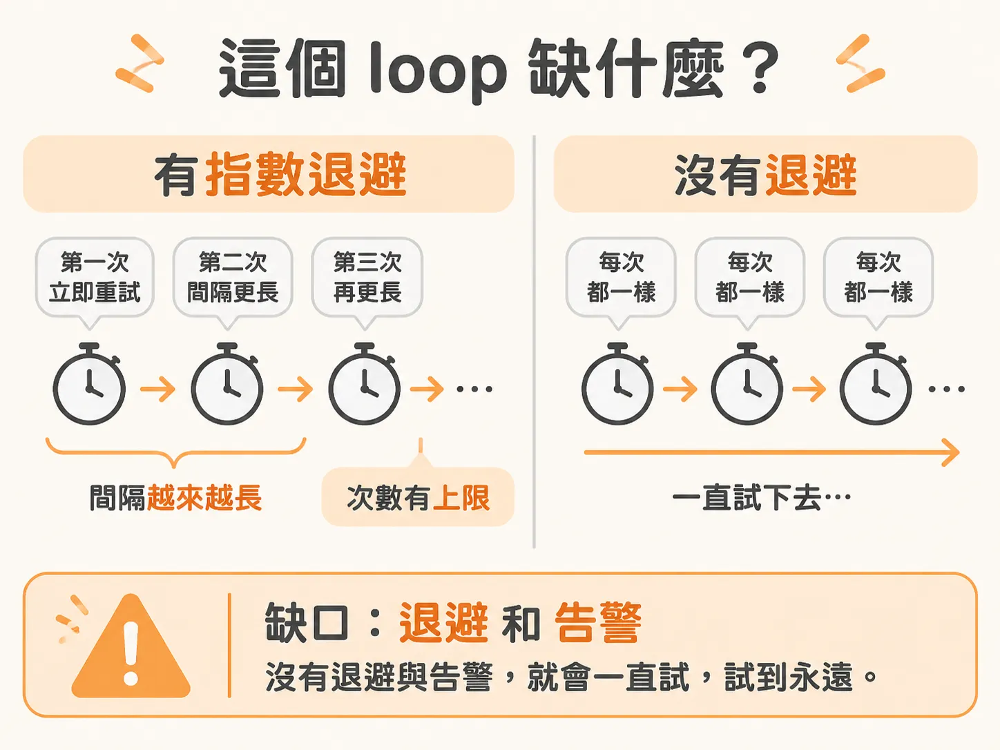

# Reconciliation Loop：修好壞掉的地方就好

知道 pod 落在哪個 node 之後，下一個問題是：它跑起來了，卻一直壞掉。

你想跑一個 Postgres，做法和跑自己的應用程式一樣：送出一行指令。

<!-- derived -->
```bash
kubectl create deployment postgres
```

pod 很快就出現了。你打開 K9s 一看，狀態卻是 CrashLoopBackOff。

前面看過 pod 和 Deployment：一個是實際執行工作的單位，一個是負責維持數量的宣告。這裡多出來的是第三個詞：CrashLoopBackOff。它講的是一種反覆失敗的狀況，容器啟動後退出，Kubernetes 再把它拉起來，接著它又退出。

它不是沒動，它是動了又死。



## 先看 pod，再拿 logs

遇到這種狀態，先別急著猜原因，先去檢查。

用 `kubectl get pods` 列出 pod，就能看到它目前的狀態。接著把 logs 拿出來。這也可以用 kubectl 做，指令用法和 Docker、Docker Compose 很像：你可以查看 logs，也可以直接在容器裡執行指令。



這也是為什麼 kubectl 用起來比較像實驗工具，不像正式的管理方式：它很有彈性，什麼都做得到。但什麼都做得到，不代表管 Deployment 就該什麼都靠它。

這個 Postgres 的 logs 會指出問題：它啟動後就失敗，因為我們沒有設定資料庫密碼。

## 改的是 desired state，不是 pod

知道原因後，下一步是修改 Deployment，補上環境變數：

<!-- derived -->
```bash
kubectl set env deployment postgres <KEY>=<VALUE>
```

先說清楚：把 Postgres 密碼直接打在 CLI 上、讓它留在那裡，是個警訊，不該這樣做。這裡只是示範 CLI 操作，先把問題修到能用；正常情況下不會這樣處理密碼。

指令送出後，回到 K9s，會看到一件有意思的事：舊的 pod 消失了，接著新的 pod 自己恢復正常。

把剛才的過程拆開來看：我建立了一個 Postgres Deployment，接著因為沒有設定資料庫密碼的環境變數，pod 一直失敗。後來我只做了一件事，在 Deployment 的定義裡補上這個環境變數。我沒有重啟任何東西，也沒有碰那個 pod，只是補上它預期要有的值。

那麼，只是設了一個值，為什麼資料庫就活了？

因為我們更新的是 Deployment 的設定。Deployment 發現 pod 不健康，就用新的環境變數重新建立了一個 pod。



## 它怎麼知道自己該長什麼樣子

那個環境變數是從哪裡來的？

答案是你建立 Deployment 時交給 Kubernetes 的 desired state，也就是「期望狀態」：一份描述你希望系統變成什麼樣子的設定。建立 Deployment 時，你等於是在告訴 Kubernetes：Postgres 要一直執行、要使用這些環境變數，也要使用這個進入點。

但我們漏掉了一個環境變數，所以 Postgres 一啟動就失敗。

我們不必重新觸發部署，因為 reconciliation loop（調和迴圈）會持續檢查。到了下一輪，它會再確認一次：「這次那個變數有了嗎？」有了，那就啟動吧。

這就是為什麼你只要修好壞掉的地方，剩下的事情它會自己處理。

## 這個 loop 缺什麼

這個機制很好用，但有幾個常被忽略的缺口。

它沒有指數退避（exponential backoff），也就是失敗後把重試間隔逐漸拉長的機制。重試間隔不會變長，它就一直試：失敗、失敗、再失敗，沒完沒了。

它就是一直試，試到永遠。



另一件事是告警。沒設定的話，得等到出事才會知道。它會繼續照常運作，直到你接上 Slack webhook、Discord 通知，或其他能傳送訊號的管道。Kubernetes 像一個黑箱，你得自己想辦法把訊號送進去、再把訊號送出來。在那之前，它只會安靜地做它認為正確的事，因為這就是這個 loop 的運作方式。

能不能加上退避？可以，但得自己設定。Kubernetes 的哲學是「電池全包，但不強迫」：你沒要求的事，它不會自己幫你做。

## 知道問題在哪時，它真的很好用

反過來說，如果你清楚知道問題在哪（例如只是少了一個值），這個 loop 就非常好用。改一個小設定，系統就恢復正常。不必跑一大堆指令，也不用為了回到正常狀態，把整套部署流程重走一遍。

它會一直檢查，直到系統回到你想要的樣子。
