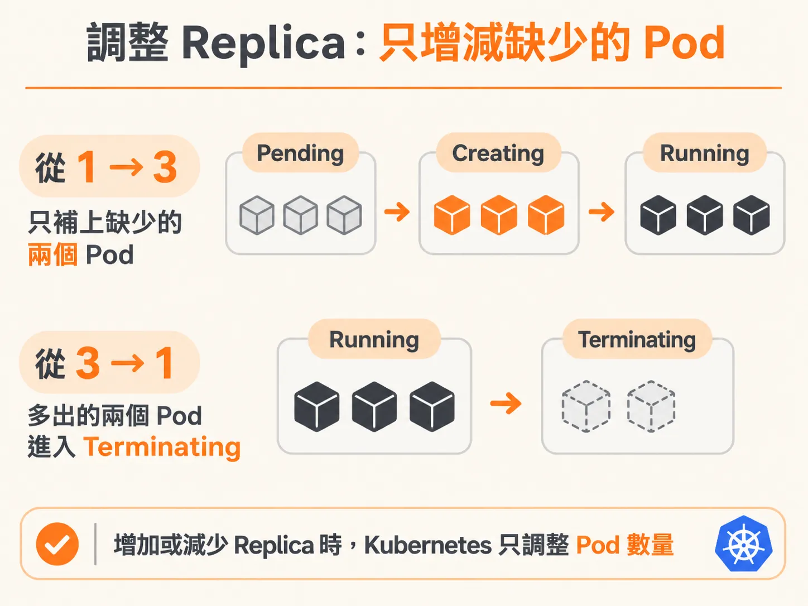
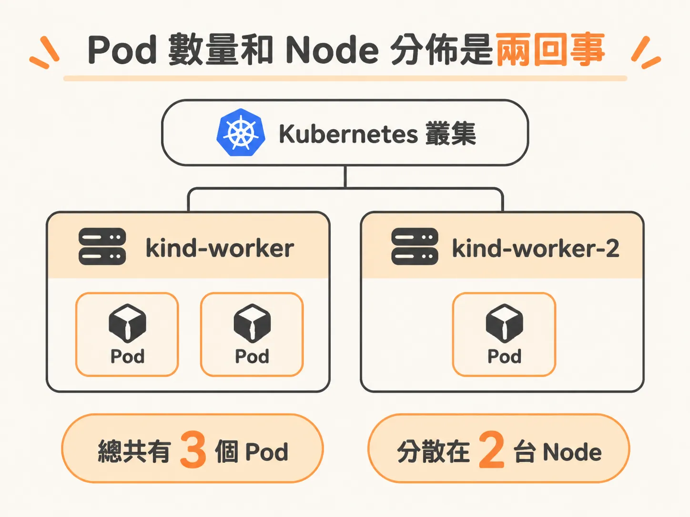
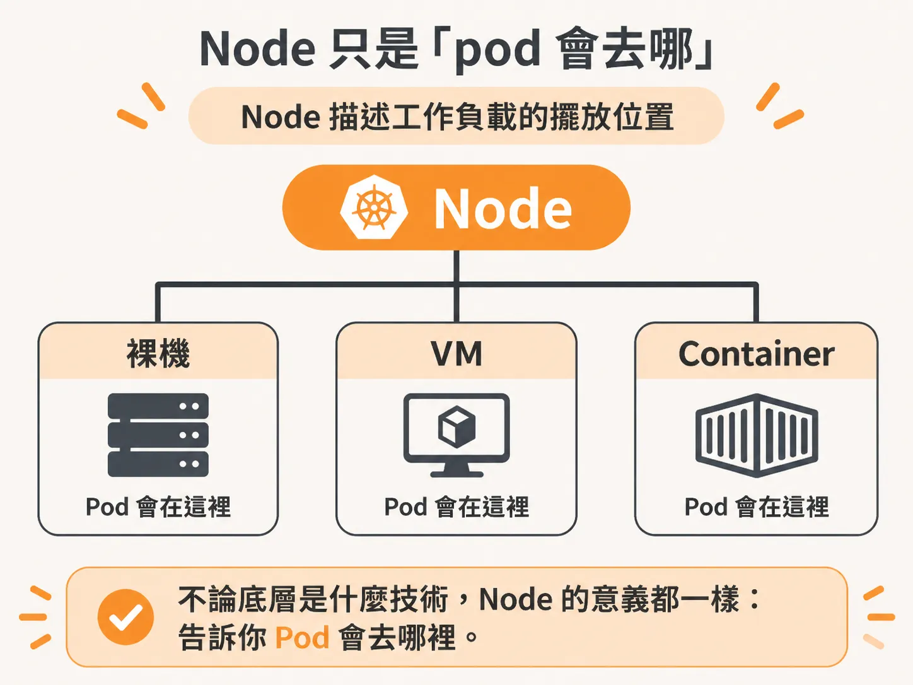

# 擴縮只是一個參數，而 node 只是說明 pod 跑在哪

自我修復讓 pod 會回來，但回來幾個、又落在哪裡，還是另一回事。Deployment 已經跑起來了。這時輸入 `kubectl get pods`，看到的是 1/1，也就是目前只有一個 pod。你希望它變成三個。

在 Docker Compose 裡，你得先 `docker compose up`，再調整規模。Kubernetes 也有對應的做法。

## 從 1 到 3，一行指令

<!-- derived -->
```
kubectl scale deployment sample-app --replicas=3
```

你不需要先停掉 Deployment，Kubernetes 會自己補上缺的兩個 pod。

反過來也一樣：把 replica 調回 1，多出來的兩個 pod 就會開始進入 terminating 狀態。

狀態大概會依序變成 pending、pending、pending，接著 creating、creating、creating，最後 running、running、running。往上增加 replica 時，Kubernetes 只補上缺少的 pod，不會把原本的 pod 全部重來。



## 停止時出現的那些 error

pod 進入 terminating 狀態時，畫面上可能會出現 error，不用太緊張。

pod 停止時確實出了狀況：它試著離開 container，卻沒有成功。作者提到，大約十秒後，它會出現錯誤，接著才真正關閉。

他補充，對開發者來說這有點煩。每次調整 replica 數，都得看著一排紅字跑過去。

## 打開 K9s，看 3 個 node 和 3 個 pod

作者用的是 K9s。它是一種 TUI，也就是在終端機裡操作的 Kubernetes 管理工具。

K9s 底下執行的，仍是平常會用到的 kubectl 指令，只是換成比較好操作的介面。輸入 `:nodes`，畫面會列出三台 node；輸入 `:pods`，則會列出三個 pod。

這時就能看出 pod 數量和 node 分佈是兩回事。如果叢集真的有高可用性，也就是確實有另一台 VM 或 instance 在執行，pod 就可能分配到不同的 node。兩個 pod 跑在 kind-worker，另一個跑在 kind-worker-2。



Kubernetes 會盡量把 pod 分散開來。不過，如果叢集故障後重新啟動，它不會自動「重新平衡」pod。

## 分散，但不重新平衡

重新平衡有成本：大致上得先停掉工作，再重新啟動。Kubernetes 不想破壞你的 Deployment，所以不會主動這麼做。

如果想讓叢集恢復平衡，就得自己想辦法。例如設計一套讓 Deployment 滾動調整的方式，或用其他做法，讓 pod 不要全擠在同一台大型 node 上，而是分散到別台去用資源。

預設的分散方式，像是一台 node 放一個 pod。所以，如果只在筆電上執行，三個 pod 看起來都在同一台機器上；有多個 node 時，分散的情況才看得出來。

## node 只是「pod 會去哪」的說法

Kubernetes 需要描述東西「在哪裡執行」以及「在哪裡被排程」；這個位置，就是 node。

node 只是描述 pod 會去哪。



它的意思也可以理解成「工作負載可以擺在哪裡」。有人會把它叫作 instance，名稱不是重點；node 回答的是位置，不是裡面跑了什麼。

所以，不要把 node 直接想成一台實體機器。在 Amazon 上，node 是 EC2 instance，也就是由實體機器提供的 VM，不是實體機本身；在家用實驗室裡，node 則可能是一台大型裸機（bare metal）。同一套 Kubernetes，在這兩種環境裡都會把它們稱為 node。

container 也可以當 node：把 container runtime 掛進 container 裡，就能在 container 裡啟動其他 container。資源是在 node 這一層計算的；相關 API 會查看可用的 RAM 和 CPU，再決定能不能接下更多工作。假設建立一個有 4 GB 記憶體、2 核心的 container，當它啟動成 node 時，看到的就是 2 核心、4 GB 記憶體，不會知道自己其實是個 container。

所以 Kubernetes 是一種 orchestrator，也就是負責安排工作的位置與方式的工具。它可以編排 container，也可以編排 VM；技術上，也能編排 cloud function。作者使用 KubeVirt 在 Kubernetes 上執行 VM，理由很實際：以前 VM 和 container 分開管理，但他想要的是「我要 2 核心、4 GB 記憶體，不管它是 VM 還是 container」。

## 兩個問題，分開看

replica 數回答的是「要幾個」，用 `kubectl scale` 調整一個參數就能處理。

pod 要落在哪個 node 是另一個問題。Kubernetes 會盡量分散，但不會為了重新平衡而重啟工作。

而 node 只回答一件事：跑在哪裡，不是跑什麼。

知道 pod 落在哪之後，下一個問題是：它跑起來了，卻一直壞掉。那時你要改的是哪一層？
