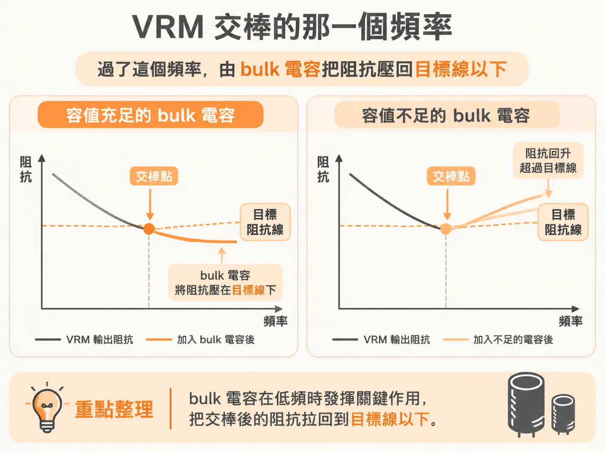
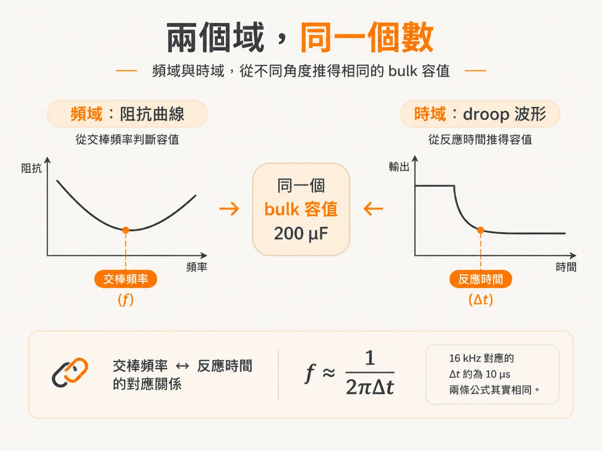
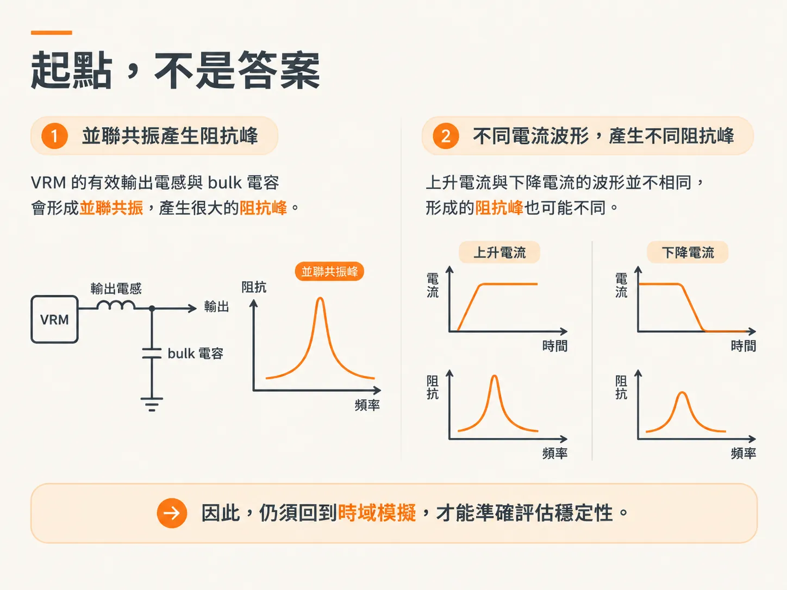

# 多少電容才夠？

## 前言

「要放多少 bulk 電容？」大概是 PDN 分析裡最常被問到的問題，卻不是最重要的問題。真正決定答案的是兩個數字：VRM 從哪個頻率開始追不上，以及在那個頻率上，阻抗必須壓到多低。容值只是這兩個數字推導出來的結果。

你可能會遇到這樣的情況：手上有一條新的電源軌，Ztarget 已經由 ΔV/ΔI 定好，VRM 的迴路頻寬也寫在規格書裡，接下來要決定該買幾百 µF 的電解或鉭質電容，還是用陶瓷電容就夠了。另一種情況是檢視別人的設計：曲線在 10 kHz 到 1 MHz 之間鼓起一個包，卻沒人說得清楚究竟是 VRM 太慢，還是電容不夠。

這篇文章會依序回答幾個問題：要多少容值才能把阻抗壓在 Ztarget 以下？買回來的電容，標稱容值能不能相信？有了 C 之後，ESR 從哪裡來，又為什麼會隨頻率變化？只有規格表時，該怎麼估算 ESR，又該如何用 q 判斷並聯後會不會共振？最後，什麼時候該刻意選擇較高的 ESR，而不是一味挑最低的？讀完之後，你手上會有兩個設計變數：C 和 ESR，而不只是一張採購清單。

這篇先回答第一個問題：給定 Ztarget 與 VRM 追不上的頻率，bulk 電容究竟需要多大？

## VRM 交棒的那個頻率

先看 VRM 的能力邊界。低頻時，VRM 會把輸出阻抗壓在 target 以下。頻率升高後，迴路增益下降，輸出阻抗便會超過 target。這個交棒點由 target 和 VRM 內部的回授特性決定，通常落在 10 kHz 到 1 MHz 之間。

越過這個頻率後，維持低阻抗的責任就交給板上的總電容。這些電容在低頻時發揮主要作用，且容值較大，因此稱為 bulk capacitance。它們的任務不是把整條曲線壓平，而是在 VRM 已經力有未逮的頻段，把阻抗拉回 target 以下。

如果 bulk 電容太小，阻抗就會在交棒點上方開始上升。把 target 線、VRM 阻抗和幾種不同容值的電容畫在一起，就會看到容值不足的那條曲線在交棒點一過後，便高於 target。

bulk 電容的容值通常較大，實作上多採用電解或鉭質電容。當需求降到 100 µF 等級時，陶瓷電容也能勝任。這裡有個簡單的趨勢：VRM 的回授頻寬越高，交棒點就越往高頻移動，所需的 bulk 電容也越小。

## 兩個域，同一個數字

頻域的估算方式很直接。在 fVRM-max 這個頻率，電容阻抗必須不高於 Ztarget。將理想電容的阻抗寫成 1/(2πfC)，並令它等於 Ztarget，就能得到 Cbulk = 1/(2π·fVRM-max·Ztarget)。這是一階估算，未納入 ESR 與 ESL。

代入一組數字：Ztarget = 50 mΩ，fVRM-max = 16 kHz，則 Cbulk ≈ 1/(2π × 16k × 0.05) ≈ 200 µF。這個 200 µF 是用同一條公式算出來的，不是從書上的表格查來的。

時域也可以用另一種方式估算，得出的答案應該相同。VRM 還來不及反應的 Δt 內，bulk 電容會替晶片提供電荷。隨著電荷流出，電容電壓便會下降。電容的壓降為 ΔV = I·Δt / C，整理後可得 C = I·Δt / ΔV。

ΔV 的預算通常取 5% 的容差。這表示在 VRM 尚未補足負載電流之前，電容電壓允許下降多少。以 5% droop、ΔV = 50 mV 為例，若負載 step 為 1 A、VRM 反應時間為 10 µs，則 C = 1 × 10 µs / 0.05 = 200 µF。

兩種方法得出相同的數字，並非巧合。頻域的交棒頻率和時域的反應時間，其實是在描述同一件事：f ≈ 1/(2πΔt)。16 kHz 對應的 Δt 約為 10 µs，因此將 f 換算成 Δt 後，兩條公式實際上相同。

5% 這個數字也是由此而來。它描述的是 VRM 補足電流之前，電容所能承受的電壓下降幅度。將 ΔV 設為 5%，再以 VRM 的反應時間作為 Δt，容值便隨之確定。

## 起點，不是答案

這 200 µF 只是絕對最小值，也只是一階估算。真正的設計還得考量 VRM 特性與系統的其他部分；要得到準確答案，必須模擬整個 PDN 生態系。

更嚴格地說，只有包含 VRM 的時域模擬，才算得上正確答案。SMPS 與 LDO 的大訊號轉換本質上具有非線性與時變特性，因此頻域分析並不嚴格適用。實際設計應先遵循 VRM 供應商的建議。

此外，還有另一個原因讓這項估算不能直接當作答案：VRM 的有效輸出電感會與 bulk 電容形成並聯共振，產生很大的阻抗峰。這個峰可能導致 VRM 不穩定。上升電流與下降電流的波形並不相同，形成的阻抗峰也可能不同，因此仍須回到時域模擬。

所以，200 µF 是起點。它能告訴你所需的數量級，也能指出哪些參數變動時，需求會往哪個方向改變。但它還沒回答下一個問題：這幾百 µF 買回來後，標稱值能信嗎？
