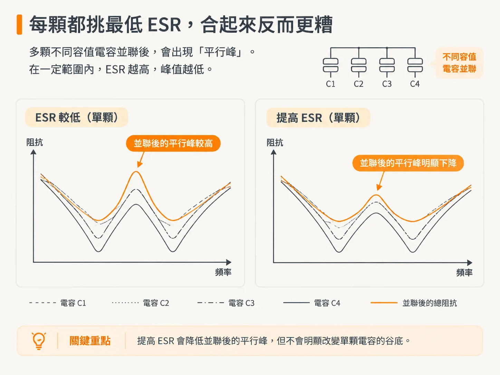
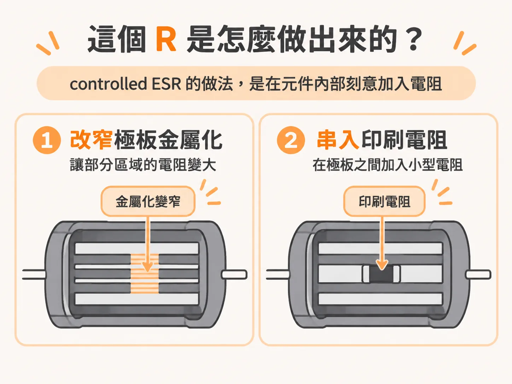
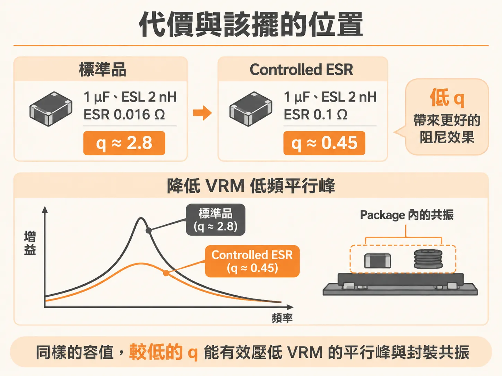

# Controlled-ESR 電容

上一步的結論有點反直覺：q 幾乎不隨容值變化，所以增加容值並不會讓平行峰變平。那能不能反過來，直接買一顆 ESR 較高的電容？可以，這就是 controlled ESR。

## 每顆都挑最低 ESR，合起來反而更糟

不同電容並聯時，ESR 會影響平行峰的高度。在一定範圍內，ESR 越高，峰值越低。這和一般選料的直覺相反。

原因是陶瓷電容的 ESR 本來就很低。單看一顆電容，低 ESR 是好事，SRF 的谷會更深；但多顆並聯後，谷與谷之間的峰值可能因阻尼不足而升高。每顆都挑最低 ESR，合起來的曲線反而更糟。

因此，判斷標準不是單顆電容的谷有多深，而是整組並聯後，最高的那個峰有多高。

## 這個 R 是怎麼做出來的

controlled ESR 的做法，是在元件內部刻意加入電阻。實作方式有兩種：一是改窄極板的金屬化結構，讓部分區域的電阻變大；二是在極板之間串入一個小型印刷電阻。

不同廠商提供的阻值不盡相同，範圍約為 100 mΩ 到 1.2 Ω，而且與容值無關。這一點很重要：它不是透過增加或減少容值來調整 R；R 是獨立的設計參數。

Murata 有一個系列採用 0816 的 reversed aspect ratio body，容值為 1 µF，提供 0.1 Ω、0.22 Ω、0.47 Ω 和 1 Ω 四種 ESR。相同容值的標準品，典型 ESR 則是 0.016 Ω。controlled ESR 的 ESR 從 0.1 Ω 起，最高可達 1 Ω。

## 代價與適合擺放的位置

controlled ESR 的優勢，不是讓單顆電容在 SRF 的最低阻抗變高，而是降低多顆並聯後的最大平行峰。選料時，真正該看的指標是這個峰值。

它也有幾個代價：容值通常只做到 1 µF 以上，沒有小容值版本；在相同 body size 下，容值也比標準品小；此外，q 也遠低於傳統電容。

q 較低，是因為 ESR 被固定住，不會隨容值變化而下降。當 C 變大、ESL 與 R 不變時，q 就會跟著下降。對高容值電容來說，這種低 q 正是我們想要的。

什麼時候值得使用？一種情況是抑制 VRM 的低頻平行共振；另一種是用在 package 上，抑制 on-die capacitance 與 package inductance 之間的共振。這兩種情況的共同點是：峰值高、q 大，因此需要阻尼。

最後用一個例子收尾。Murata 的 1 µF 電容，ESL 為 2 nH；標準品的 ESR 是 0.016 Ω，q = √(2 n / 1 µ) / 0.016 ≈ 2.8。換成 ESR 為 0.1 Ω 的 controlled ESR，q ≈ 0.45。同樣的容值，阻尼效果相差約六倍。若把 controlled ESR 換回標準品，同一組並聯電容的平行峰就會再次升高。

電容選好之後，下一個 node 要問的是：把它放上板子後，還剩下多少 mounting inductance。
