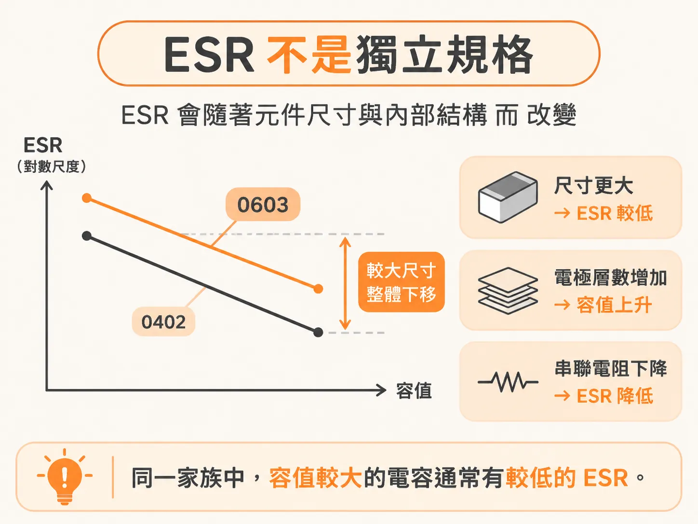
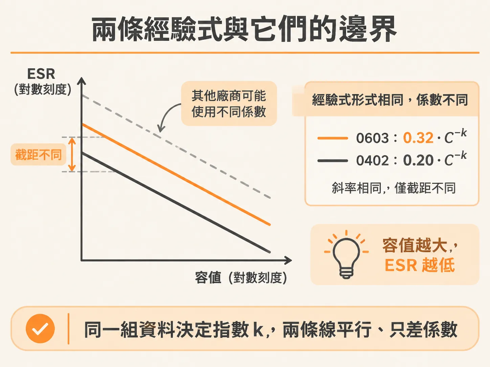
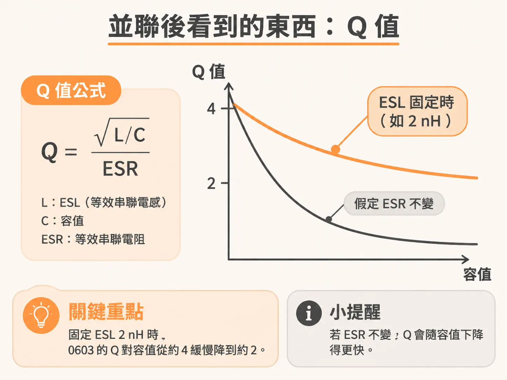

# 從規格表估 ESR

量測曲線不是人人都有。多數時候，手上只有 spec sheet 上的一行 ESR 數值，甚至根本沒有 ESR 欄位。這一步要做的，就是推估出 ESR，再用 q 判斷它是否夠用。

## ESR 不是獨立規格

ESR 不是電容本身固定不變的常數，而是與本體尺寸和內部電極層數有關。電極層數增加，容值會上升，串聯電阻則會下降。因此，在同一家族中，容值較大的電容通常有較低的 ESR。

這種關係讓我們可以把 spec sheet 上的 C 和 ESR 連結起來。與其每次查表，不如找出一條經驗式，直接用 C 推估 ESR。

要注意的是，這是從資料中反推出來的關係，不是物理定律；它描述的是特定資料集中的趨勢。

## 兩條經驗式與它們的適用範圍

書中根據 AVX 的 SpiCAP 資料反推出兩條關係式：0603 X5R 的 ESR ≈ 0.32 × C^−k，0402 X5R 的 ESR ≈ 0.20 × C^−k。C 以 nF 為單位，ESR 以 Ω 為單位。

兩條式子的形式相同，差別只在係數：0603 為 0.32，0402 為 0.20。指數 k 由同一組資料決定，這裡不另行假設。從式子可以看出，容值越大，ESR 越低。

適用範圍必須說清楚。資料只來自 AVX，而且可能是由 AVX 自己的一條解析式生成。其他廠商的量測結果或許也符合相同的趨勢，但係數可能不同。因此，把 0.32 套用到其他廠商的 0603 電容上，只能作為估算起點。

另一項限制是，這些資料只涵蓋 0603 和 0402 尺寸、X5R 介電材料的電容。對於其他本體尺寸或介電材料，沒有理由直接沿用這些式子。

儘管如此，這些式子在建模時仍相當方便。你可以直接將它們放進 SPICE，為每一個候選容值估算 ESR，不必逐顆查表。

## 並聯後，真正重要的是 q

估算出 ESR 後，還要回答一個問題：這顆電容的自諧振有多尖？這可以用 q 值表示。q = √(L/C) / ESR，其中 L 是 ESL，C 是容值。

先假設所有容值的 ESR 都相同。若 C 增加四倍，q 就會減半，因為 q 與 √C 成反比。也就是說，容值越大，阻尼越強。

但實際上，ESR 並非常數，而是會隨著 C 增加而下降，只是下降幅度小於 C 的增幅。因此，q 不會像 √C 那樣大幅下降，只會略微降低。書中的估算是：當 ESL 約為 2 nH 時，0603 電容的 q 值約從低容值時的 4，降至高容值時的 2。

用一個具體例子來看：若 ESL 為 2 nH、ESR 為 0.05 Ω、C 為 100 nF，則 q = √(2 nH / 100 nF) / 0.05 Ω ≈ 2.8。若將 C 增加為原來的四倍，並先假設 ESR 不變，q 就會降至約 1.4。

實際情況不會降到 1.4，因為 ESR 也會隨 C 增加而下降，所以 q 只會略微降低。重點不變：換成容值稍大的電容，q 不會從 2.8 大幅降到很低。容值並不是調整阻尼的有效槓桿。

既然 q 幾乎不隨容值變化，能不能直接選用 ESR 較高的電容，來壓低並聯諧振峰？
