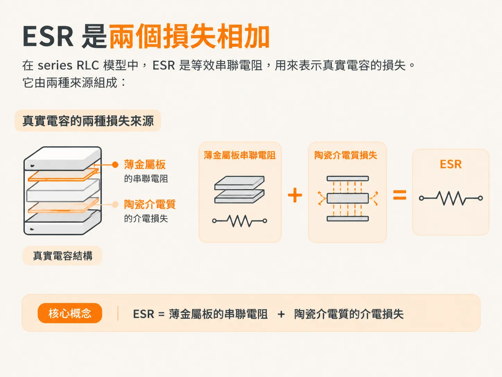
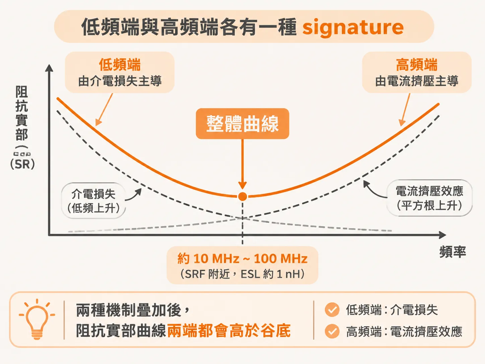
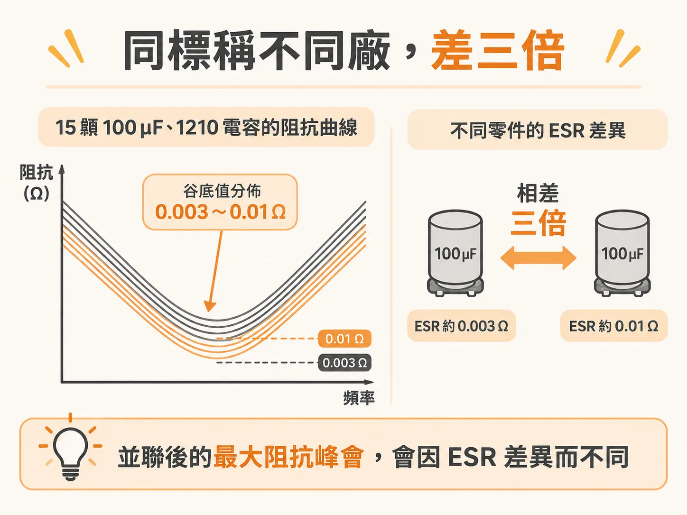

# ESR 是兩種損失加起來

C 的部分有了，還缺一個參數，才能知道並聯後的峰值有多高。這個參數就是 ESR。它不是從規格表上挑一個數字就能定案：真實電容的 ESR 會隨頻率變化，而且不同零件之間可能相差三倍。

## ESR 是兩種損失的總和

ESR 是 series RLC 模型中的等效串聯電阻，用來表示真實電容的損失。它由兩種來源組成：一是電容內部薄金屬板的串聯電阻，二是板間陶瓷材料的介電損失。

最簡單的模型會把電容表示成 series RLC，並假設元件參數固定。在這個模型裡，阻抗的實部就是 R，且不隨頻率變化。因此，在一階近似下，ESR 會被視為常數。

真實電容的 ESR 則會隨頻率略有變化，原因就在於上述兩種機制：介電損失會在低頻端推高阻抗實部，而高頻時電流重新分佈，也會使阻抗實部上升。因此，ESR 的最低點會落在兩者之間。

## 低頻端與高頻端各有一種特徵

先看介電損失。它可以用一個並聯 RC 電路表示，其中 R 對應介電質的電導 G。G = 2πf·C·Df，Df 則是 dissipation factor。在一階近似下，除了頻率 f 之外，其餘項都可視為常數；因此，並聯電阻的頻率依賴性只來自 f 這一項。頻率升高時，並聯電阻會下降；反過來說，頻率降低時，阻抗實部會升高。這就是介電損失的特徵。

再看高頻端。頻率越高，電流越不容易深入電容內部。板上的電流會傾向靠近 mounting pad 附近的 return current，因為這樣能讓 loop inductance 最小。電流因此集中在靠近焊墊的底層板子上，使有效導體截面變小、電阻升高。這種行為類似 skin effect，R 會隨 √f 上升。

把兩種機制疊加起來，阻抗實部曲線的兩端都會高於谷底：低頻端由介電損失主導，高頻端則由電流擠壓效應主導。ESR 的最低點大約落在 10 MHz 到 100 MHz，也就是這類電容的 SRF 附近；此時 ESL 約為 1 nH。

高頻端 ESR 的上升有助於壓低平行共振峰，但書上指出，這只是二階因素。若要真正設計阻尼，不能只依賴 ESR 在高頻端上升的這個尾巴。

## 標稱值相同，不同廠商的零件也可能相差三倍

書上提供了一組很直接的數據：15 顆標稱相同、容量為 100 µF 的 1210 MLCC，來自不同廠商。從阻抗曲線的谷底讀出的 ESR，分佈在 0.003 Ω 到 0.01 Ω 之間。

兩者相差三倍。並聯後的最大阻抗峰會直接受到這個差異影響。用 0.003 Ω 預測的峰值，和用 0.01 Ω 預測的峰值，高度並不會相同。

該怎麼辦？有兩種做法：一是量測每一種可能用到的電容，並將參數存入資料庫；二是用常數 R 近似，讓它在 SRF 附近符合最低阻抗。

在 10 MHz 到 100 MHz 之間，常數 R 模型的結果與頻率相關模型相當接近，誤差也小於不同零件之間的差異。換句話說，沒有量測資料時，使用常數 R 是可以接受的；但不要假設兩顆標稱相同的電容會有相同的 ESR。

舉個具體的例子：同一組 100 µF 電容並聯時，只要把 ESR 從 0.003 Ω 改成 0.01 Ω，最大平行共振峰的高度就會相差約三倍。這就是下一步要處理的阻尼問題。

如果手上只有 spec sheet，沒有量測曲線，ESR 要怎麼估算？
