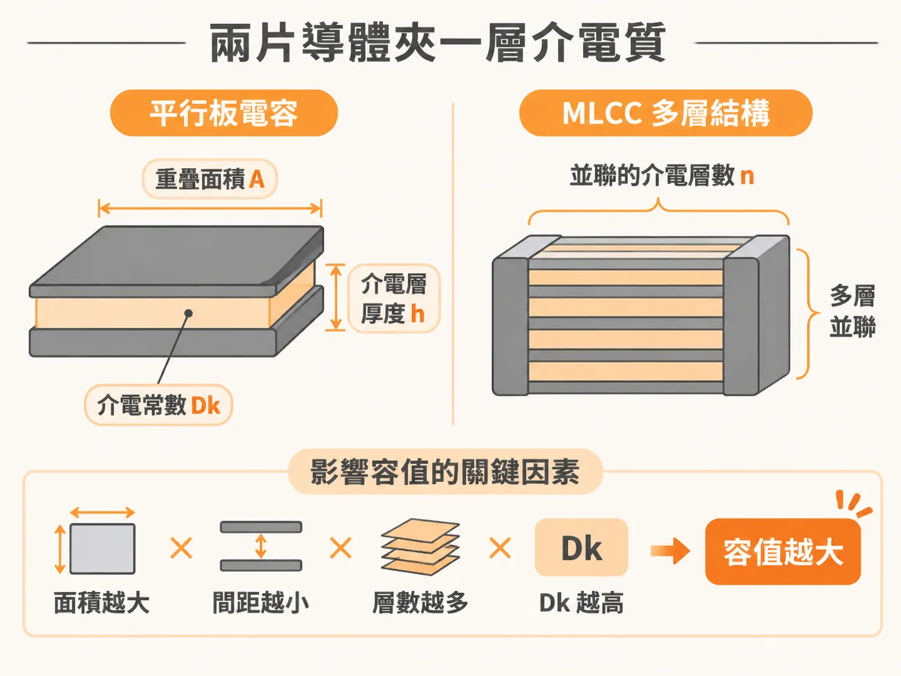
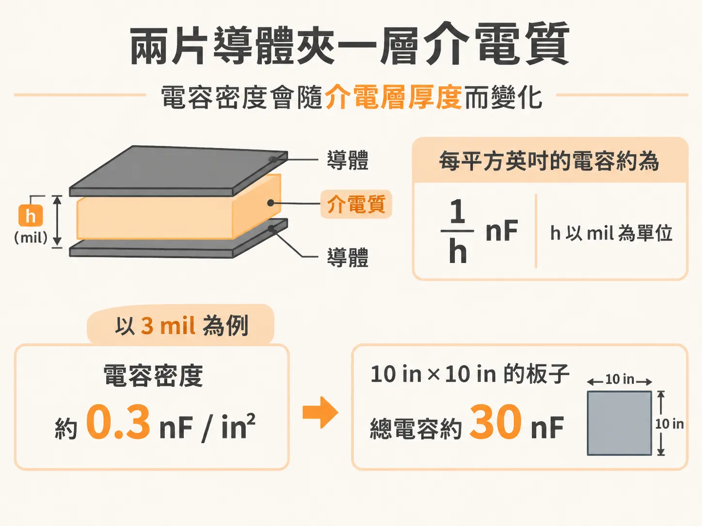
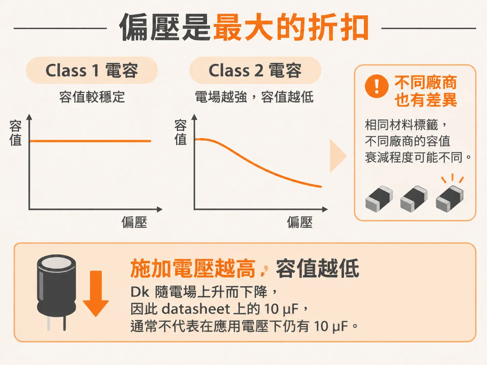

# 兩片導體，夾一層介電質

上一篇算出了幾百 µF 的 bulk。現在把料號翻過來，看看標稱值。datasheet 上印著 10 µF，不代表它在你的電路板上、你的工作電壓下，仍然有 10 µF。

## 兩片導體夾一層介電質

電容的基本結構很簡單：兩片導體，中間夾著一層介電質。MLCC 並沒有改變這個結構，只是把許多層導體與介電質並聯疊在一起。

平行板電容由四個因素決定：介電常數 Dk、重疊面積 A、介電層厚度 h，以及並聯的介電層數 n。面積越大、間距越小、層數越多、Dk 越高，容值就越大。

板級電容可以直接用這個模型估算。兩片平面之間，每平方英吋的電容大約是 1/h nF，h 以 mil 為單位。介電層厚度為 3 mil 時，電容約為 0.3 nF/in²。一塊 10 in × 10 in 的板子，總電容也只有 30 nF。

與上一篇算出的 200 µF 相比，30 nF 差了將近四個數量級。板級電容無法撐起 bulk。這並不是說平面沒有用，而是它的價值不在容值。

## Class 1 與 Class 2 的取捨

MLCC 使用高 Dk 材料和極薄的介電層來提高容值密度，代價是材料內的電場很強。有些高 Dk 材料具有鐵電性，極化與電場並非線性關係；電場越強，Dk 越低。Dk 也會受到溫度影響。

電容依特性分成三類，材料則決定其穩定性。Class 1 最穩定，Dk 約為 20 到 40，常見的 designation 是 NP0。NP0 的溫度係數小於 30 ppm/degK，容值對溫度與電壓都相當穩定。但由於 Dk 不高，不容易做出大容值，主要用於需要穩定 SRF 的濾波器。

Class 2 是 decoupling 的主力。它的 Dk 約為 200 到 14,000，材料通常是添加了其他物質的鈦酸鋇。同樣的體積可以做出更大的容值，但鐵電特性也讓它對溫度與電壓更敏感。Class 3 的有效 Dk 很高，卻不適合用於多層電容，因此不會用在 decoupling。

Class 2 的標籤由 EIA 定義。X5R 表示在 −55 °C 到 +85 °C 之間，容值變化不超過 ±15%；X7R 則把溫度上限提高到 +125 °C。R 代表的就是 ±15% 這項容值變化範圍。這些標籤只描述溫度特性，並不保證電容在偏壓下的表現。

一般來說，真實電容的容值會落在標稱值的 ±20% 以內。這是常見的情況，不是保證值。材料、偏壓與溫度都可能讓容值偏離標稱值。

## 偏壓是最大的折扣

偏壓是最大的折扣。施加的電壓越高，板間電場越強，Dk 就越低，容值也會跟著下降。datasheet 上標示的 10 µF，通常不代表它在應用電壓下仍有 10 µF。

更麻煩的是，即使是相同的 material designation，不同廠商生產的電容，其電壓敏感度也可能不同。因此，不能只憑 X5R 這幾個字，就推斷某顆電容的偏壓曲線。

要建立準確的模型，只能查閱特定料號的規格，並在應用電壓下量測樣品。書上的建議很直接：選值時，應以應用電壓下的量測結果為準。

回到上一篇算出的 200 µF。如果電容在應用電壓下的實測值低於標稱值，就不能直接把採購清單上的標稱值加總。這也是為什麼估算只停留在「一階」：它提供的是下限，不是採購數量。

有了比較可信的 C，下一個要看的參數就是 ESR。並聯後的電壓峰值有多高，主要取決於它。
