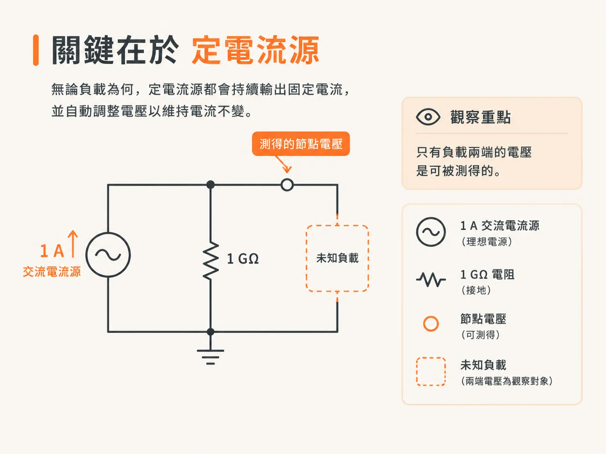
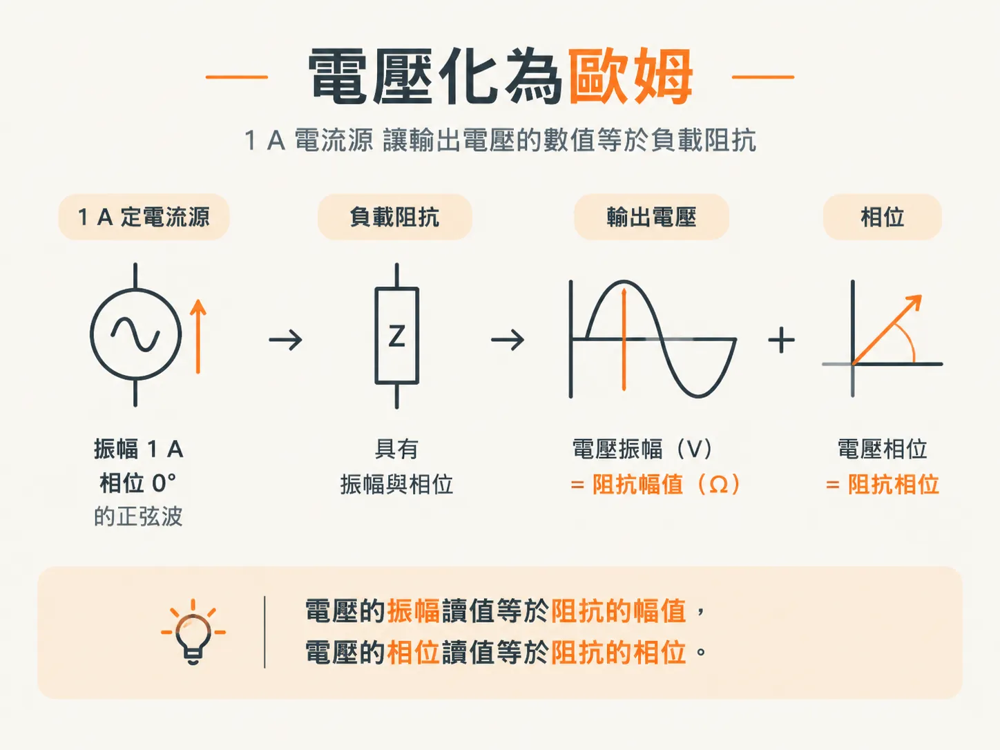
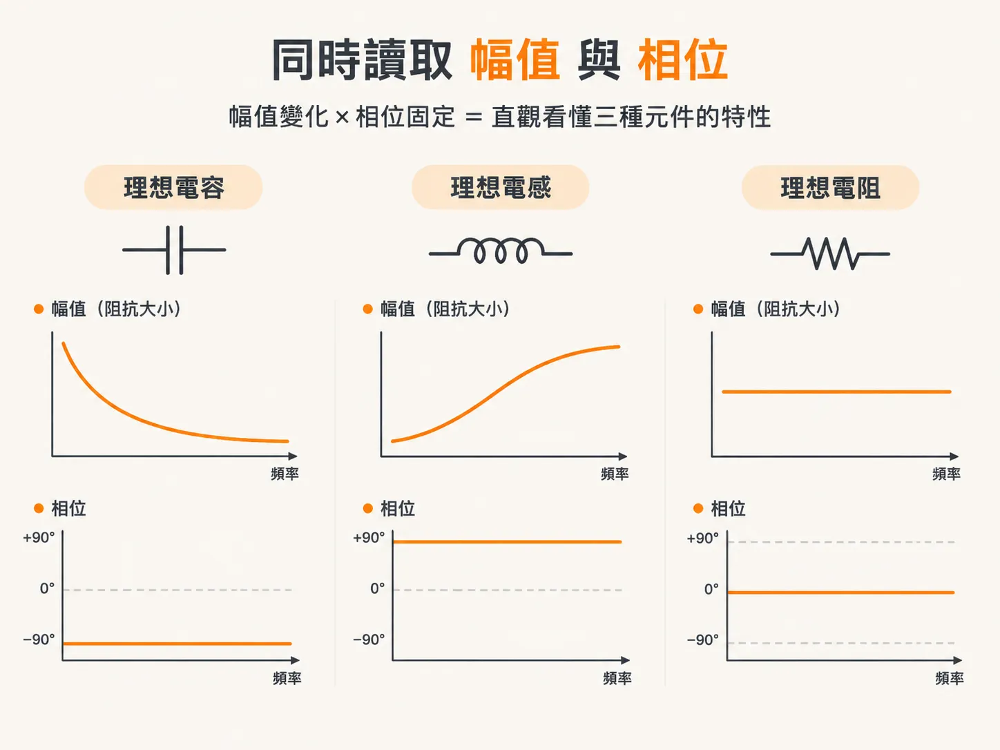

# 計算或模擬阻抗

上一篇文章介紹了曲線的形狀：頻率每增加一個 decade，電容的阻抗就下降 20 dB，電感的阻抗則上升 20 dB。這只是對曲線形狀的描述，並非實際測量。你仍然需要知道眼前這個電路的 `Z(f)`。

電路只有一個元件時，用紙筆就足以完成計算。把數值代入 `Z = 1/(jωC)` 或 `Z = jωL`，就大功告成。但電路裡一旦多出第二個元件，麻煩就開始了。

## 紙筆很快就不夠用

在頻域中手算阻抗時，電路裡每多一個元件，計算就會變得愈來愈繁瑣。實際的 PDN 不只有兩個元件，而是由平面、過孔、電容和封裝寄生效應層層構成；隨著設計逐步成熟，元件數量也會不斷增加。

幸好，你不必自行推導這些代數式。我們可以使用 SPICE 或類似 SPICE 的模擬器，計算任意組合理想線性時不變電路元件的阻抗。

這類模擬器通常容易上手、免費，而且能在各種主流作業系統上執行。它們也提供圖形化的輸入與顯示介面，這正是它們用途廣泛的原因。

## 同一種工具的兩個端點

QUCS（Quite Universal Circuit Simulator）是一套免費、開放原始碼、功能強大且容易使用的電路模擬器。你可以把它當作阻抗計算器或分析器使用。本書中的幾個範例，就是用 QUCS 建立的。

另一端則是 Keysight Technologies（前身為 Agilent Technologies）推出的 Advanced System Design，簡稱 ADS。它是目前頂級的電路模擬工具之一。

兩者任選一套都可以。模擬結果完全相同，因此差別在於使用便利性，而非準確度。

## 關鍵是定電流源

在 SPICE 中為任意電路建立阻抗分析器，關鍵在於使用 AC 定電流源。

在 SPICE 中，定電流源是一種理想電源，無論接上什麼負載，都會持續輸出固定電流。它會輸出所需的電壓，以維持電流固定。

在 AC 模式下，定電流源會輸出正弦波電流，而且無論負載如何，電流振幅都保持不變。在頻域中，所有波形都以正弦波表示；正弦波的頻率、振幅和相位，足以完整描述該波形。

因此，電流源會讓電流往復變化，而負載兩端的電壓則由負載本身決定。測量原理就是這麼簡單。

## 伏特數就是歐姆數

AC 定電流源輸出的正弦波電壓，永遠與流經它的正弦波電流符合 `V(ω) = I(ω) × Z(ω)`。

其中，`V(ω)` 是各個頻率下正弦波電壓的振幅與相位，`I(ω)` 是各個頻率下正弦波電流的振幅與相位，而 `Z(ω)` 則是負載在各個頻率下的阻抗大小與相位。這三個量都是複數。

模擬得到的複數電壓，是在電流源接上負載後測得的；其數值就是負載的複數阻抗。模擬電壓的振幅就是阻抗大小，而模擬電壓的相位就是負載阻抗的相位。

將電源設定為振幅 1 A、相位 0 度的定電流正弦波，就不必再進行換算。輸出電壓的振幅以伏特表示，其數值就是以歐姆表示的阻抗；模擬電壓的相位，也就是阻抗的相位。

只要模擬輸出電壓的振幅與相位，就能取得負載在掃描範圍內各個頻率的複數阻抗。

## 一顆電阻就能讓模擬器正常運作

要讓分析器正常運作，還需要再加一個元件：在阻抗分析器電路中，定電流源左側接著一顆 1 GΩ 的電阻。

這顆電阻的作用是避免模擬器出錯。許多模擬器都要求每個節點必須有一條通往地的直流路徑。即使電流源的輸出端開路，或是接上電容性負載，這顆電阻仍能為電流源的輸出端提供這條路徑。

這顆電阻也設定了阻抗上限，將可模擬的最高阻抗限制在 1 GΩ。對所有 PDN 應用來說，這個上限都綽綽有餘。

## 同時看阻抗大小與相位

把結果畫在雙對數座標上，就會看到上一篇文章提到的規律：頻率愈高，理想電容的阻抗愈低；理想電感的阻抗則隨頻率升高而增加。頻率每增加一個 decade，兩者的阻抗都會變化 20 dB。

阻抗對頻率的圖表最適合使用雙對數座標，因為它能讓你一眼看出電路在哪些頻率下呈現電容性，在哪些頻率下呈現電感性。

相位則以另一種方式呈現相同資訊。理想電容的阻抗大小下降時，相位會維持在 −90 度；理想電感的阻抗大小上升時，相位會維持在 +90 度。理想電阻的阻抗大小維持不變，相位則維持在 0 度。

這兩種現象同時出現並非巧合。Kramers-Kronig 關係指出，若要讓描述頻域特性的複數函數對應到符合因果性的時域響應，其實部與虛部之間就必須存在特定關係。這裡所說的因果性，是指響應一定會在刺激之後才發生。

實際上，結論很簡單：阻抗大小每 decade 下降 20 dB 時，相位會接近 −90 度；阻抗大小每 decade 上升 20 dB 時，相位會接近 +90 度；曲線若不隨頻率改變而保持平坦，相位就會接近 0 度。

知道阻抗大小，就能推知阻抗相位。因此，這類圖表通常只顯示阻抗大小，而且多半使用雙對數座標。從曲線斜率就能推知其他資訊。

## 元件數值不是阻抗

有個常見的混淆值得先釐清：不要把理想元件的電容值或電感值，和它們的阻抗混為一談。

根據定義，理想電容的電容值不會隨頻率改變。理想電感的電感值不會隨頻率改變，理想電阻的電阻值亦然。

它們的阻抗可能會隨頻率變化，但電容值和電感值不會。100 nF 的電容在 1 kHz 和 1 MHz 時都是 100 nF，但它的阻抗在這兩個頻率之間會下降三個 decade。

## 理想分析器無法呈現的現象

以上內容完全正確，但都只適用於理想元件。真實電容畫出的曲線不會是一條乾淨的直線；曲線偏離直線，也不代表測量有誤。

下一篇文章會補上缺少的部分。真實電容還有串聯電阻和串聯電感；把這三個數值納入考量後，模擬曲線就會開始貼近實際測量結果。
