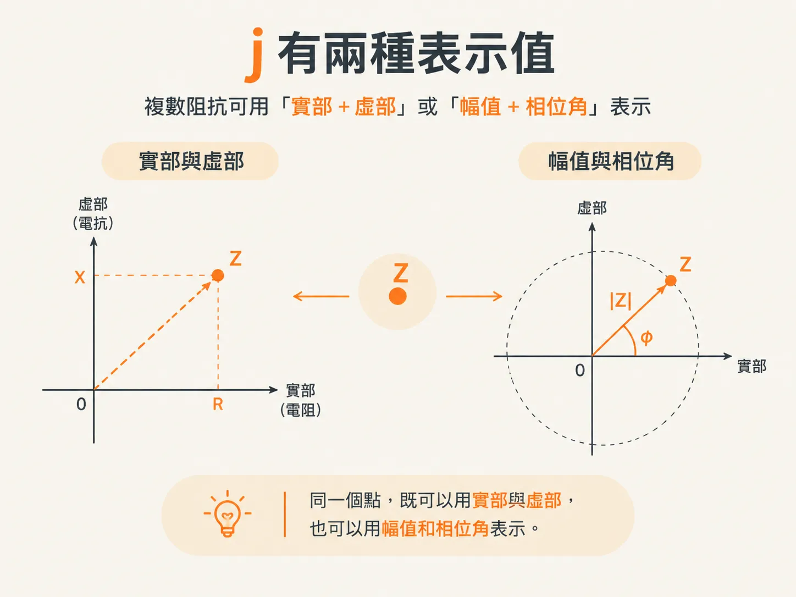
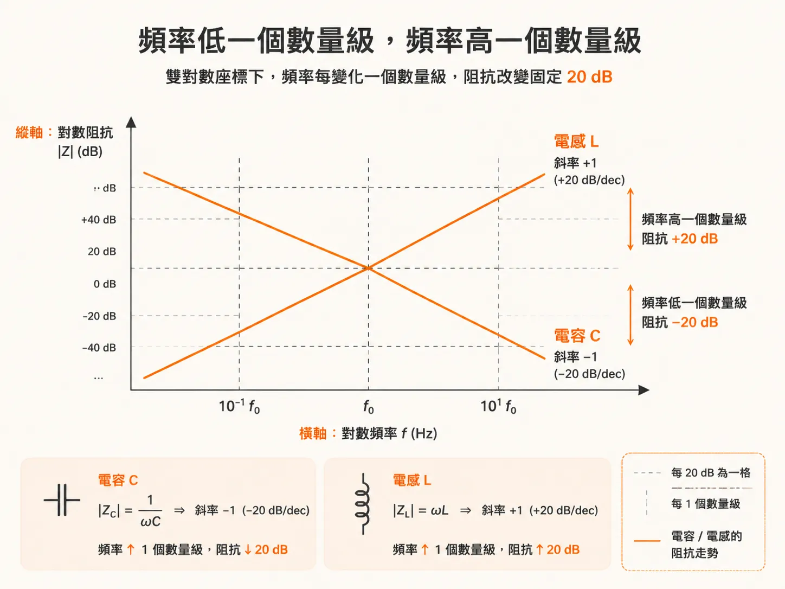

# 頻率域的阻抗

上一篇文章最後提出了一個問題：如果驗收標準是一條隨頻率變化的阻抗曲線，那麼究竟是什麼決定了曲線的形狀？

簡單來說，頻率升高時，電容和電感會使阻抗朝相反的方向變化。這兩種響應都很容易用公式表示，前提是我們不再看任意波形，而是改看正弦波。

## 阻抗永遠是一種比值

阻抗永遠指流經元件的電壓與電流之比，記作 `Z = V / I`。

其中，`Z` 是元件兩個端子之間的阻抗，`V` 是兩個端子之間的電壓，而 `I` 則是流入其中一個端子、再經過元件並從另一個端子流出的電流。

這個定義在時域和頻率域中都成立，也可以延伸至多端元件，例如位於不同位置的兩個平面之間的電壓。這種延伸就是轉移阻抗的基礎。

## 在時域中，電容有點難處理

對理想電容而言，時域中的電流為 `I = C × dV/dt`。將它代入阻抗的定義，就會得到一個取決於電容兩端電壓波形斜率的阻抗。

這種行為在物理上很合理：`dV/dt` 越大，流過電容的電流就越大，阻抗也就越低。

這個式子本身沒有錯，但在實際應用中不太方便。阻抗會以複雜的方式受到實際電壓波形形狀影響，而真實波形通常並不簡單。

## 正弦波讓事情變簡單

在頻率域中，我們只考慮正弦波。在這個條件下，理想電容的阻抗可以寫成更簡單的形式：`Z = 1 / (jωC)`。

理想電感也可以用同樣的方法處理，其阻抗為 `Z = jωL`。

這兩個式子中的 `j` 是 −1 的平方根，`ω` 是角頻率，`ω = 2 × π × f`。阻抗在時域和頻率域中都能明確定義，但在頻率域中表示和使用都更簡單。因此，我們經常在頻率域中呈現並分析 PDN 的阻抗。

此外，這樣做還有另一個好處：效能通常是在時域中評估，但有時可以改用頻率域這條捷徑，更快得到答案。對許多問題來說，這是取得所需數值最快的方法。

## 字母 j 代表兩個數值

`j` 代表阻抗是複數。在任何頻率下，阻抗都包含兩個數值，可以用大小與相位表示，也可以寫成實部與虛部。

在大多數情況下，複數阻抗最常以大小和相位表示。若將阻抗寫成實部與虛部，虛部就稱為電抗。由電阻、電感和電容組成的電路，其電抗主要由 L 和 C 的數值決定。

以電阻與電容串聯為例，其阻抗為 `Z = R + 1/(jωC)`。其中的虛數項就是電抗，按照慣例以字母 `X` 表示。電阻決定實部，電容則決定虛部。

## 頻率每增加十倍，阻抗就變化十倍

對單一理想電容而言，電抗會隨頻率升高而成反比下降。頻率增加 10 倍，阻抗大小就會下降 10 倍。

阻抗大小變化 10 倍相當於 −20 dB。因此，頻率每增加一個十倍頻程，阻抗就會下降 20 dB。這是只有一個電容元件的電路常見的行為。

理想電感則相反：頻率每增加一個十倍頻程，其電抗就會上升 20 dB。

這就是全部的讀圖規則。在雙對數座標上，單一電容會呈現斜率為 −1 的直線，單一電感則會呈現斜率為 +1 的直線。

這就是為什麼我們常把阻抗的對數值畫在縱軸，並把頻率的對數值畫在橫軸。採用這種座標後，單一元件的響應會呈現為直線，斜率也一目了然，不必再對曲線求導數。

## 這能幫上什麼忙

現在，你已經有了描述曲線的詞彙。直線向下表示電容效應占主導；直線向上表示電感效應占主導。每個十倍頻程下降或上升 20 dB，就足以指出某個頻率範圍內是哪一種效應占主導。

不過，知道曲線的形狀，還無法得知你自己的電路板呈現出什麼樣的曲線。你仍然得先把它量出來。

下一篇文章會說明如何做到這一點：我們會在模擬器中建立一個阻抗量測電路，並使用 1 A 的 AC 電流源，讓輸出電壓可以直接讀作歐姆值。
