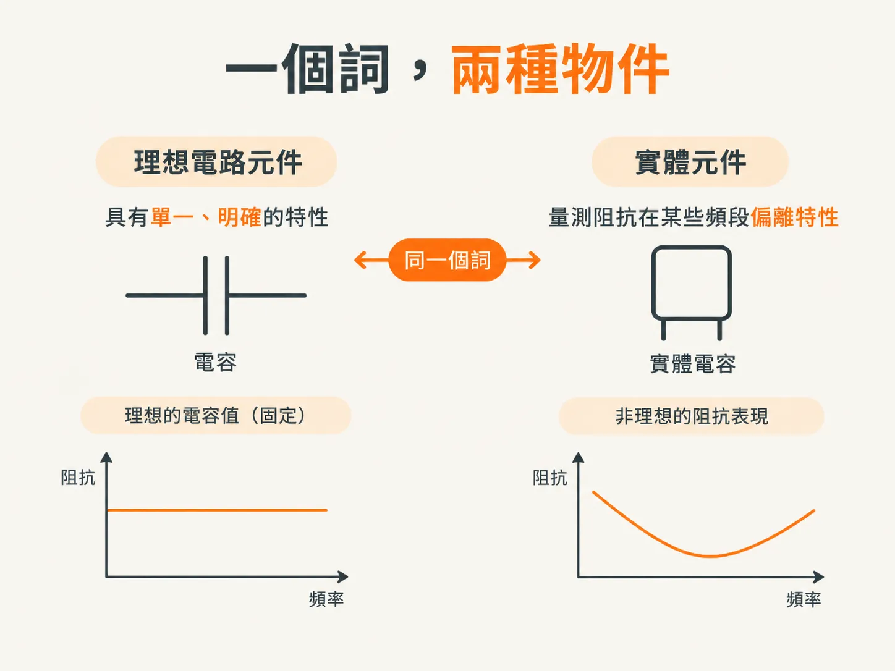
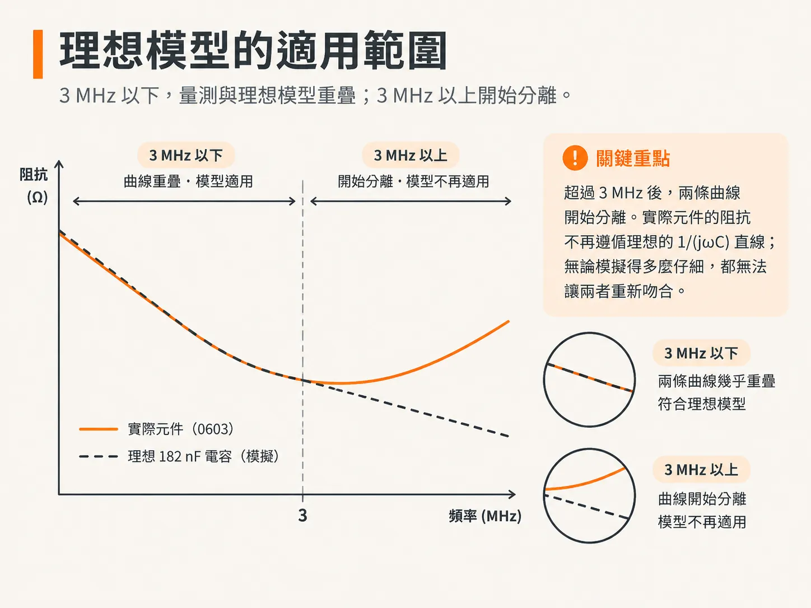
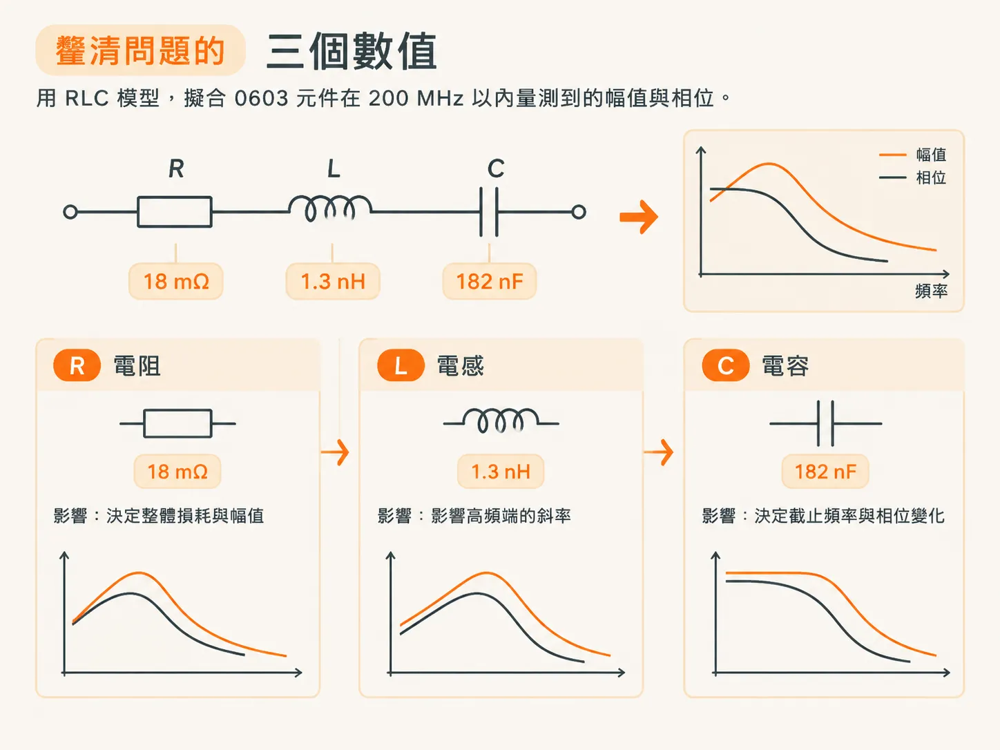

# 真實元件與理想元件

上一篇文章提到，實際電容的阻抗曲線並不像理想電容那樣呈現乾淨俐落的直線。這個差異值得認真看待，因為它不是雜訊，也不是測量錯誤，而是兩種同名事物之間的差別。

使用 QUCS 的阻抗分析電路，我們可以模擬由理想電路元件組成的電路阻抗。本文要回答的問題是：如果元件是實際存在的，模擬電路中應該放入什麼？

## 一個名稱，兩種東西

了解理想電路元件與實際電路元件之間的差別很重要。

理想電路元件具有明確定義的特性，常用於電路模擬。實際電路元件則是實體結構，具有可測量的阻抗，也會呈現寄生效應。

令人遺憾的是，我們用同一個詞「電容」來稱呼理想電路元件和實體結構。兩者的行為與特性可能大不相同。

## 寄生效應來自實體設計

實際電路元件的行為有些類似理想元件，只是還會受到寄生效應影響。這些效應來自元件的實體設計、材料特性，以及 Maxwell 方程式所描述的電磁現象。

反過來說，理想電路元件是對非理想實體裝置所做的理想化表示。

因此，我們可能會把某個結構稱為實際電容，但在某些頻率範圍內，它測得的阻抗甚至與理想電容的行為相差甚遠。這個名稱描述的是它的設計用途，而不是它在整個頻譜中的行為。

## 測量實際電容

你可以使用網路分析儀搭配雙埠測量技術，測量實際電容的阻抗。

本文以一顆 0603 多層陶瓷晶片電容（MLCC）為例。這顆電容安裝在一塊四層測試板上，並使用雙埠 VNA 進行測量。以下稱它為 0603 元件。

在低頻時，這顆實際電容的阻抗與理想 182 nF 電容相符。將實測曲線與理想 182 nF 電容的模擬曲線相比，可以看到兩者直到約 3 MHz 都吻合得非常好。

## 理想模型的適用範圍到此為止

超過 3 MHz 後，兩條曲線便開始分離。實際元件測得的阻抗不再遵循理想的 `1/(jωC)` 直線；無論模擬得多麼仔細，都無法讓兩者重新吻合。

理想電容模型並沒有錯，只是對我們關心的頻率範圍而言，它過於簡單。實際元件中的其他因素開始主導，而模型中沒有相應的元件可以表示這些因素。

## 三個數值就能改善模型

若要用涵蓋較高頻率的模型描述這顆實際電容的阻抗行為，可以使用串聯 RLC 電路。在串聯 RLC 電路中，電阻、電感和電容彼此串聯，因此流經每個元件的電流相同。

模擬電路使用的數值為 `R = 18 mΩ`、`C = 182 nF` 和 `L = 1.3 nH`。

有了這三個數值，理想串聯 RLC 電路的模擬阻抗，無論是幅值還是相位，都與實際電容測得的阻抗相符。原本只在低頻端適用的 182 nF，如今成為一個能涵蓋其餘頻率範圍的模型的一部分。

請留意哪些數值沒有改變。阻抗會隨頻率變化，但 R、L、C 這些理想元件的數值不會隨頻率改變。改變的是曲線的形狀，不是元件本身。

## 擬合模型的價值

這個例子說明，只要組合理想電路元件，就能用模擬出的阻抗，良好地近似實際結構測得的阻抗。

憑藉洞察力與經驗，我們可以選用適當的拓撲組合多個理想元件，再調整參數值，讓模型緊密近似實際元件的非理想寄生效應。拓撲是對寄生效應種類的推測；參數值則是根據測量結果調整而來。

在這個例子中，這個簡單模型與實際測量結果吻合的範圍達到測量頻寬上限，也就是 200 MHz。模型的適用頻寬可能超過 200 MHz，但僅憑這次測量無法判斷。

通常，要判斷模型的準確度，或確認它能吻合到多高的頻率，唯一的方法就是實際測量。這也是原書後續章節會專門介紹測量技術的原因。

## 大多數情況只需掌握兩種拓撲

大多數與 PDN 相關的結構，都可以用兩種簡單的 RLC 電路及其組合來描述：R、L、C 元件串聯的電路，以及 R、L、C 元件並聯的電路。

這裡所說的串聯與並聯，是指從測量或模擬的訊號源來看，L 和 C 元件彼此如何連接。R 元件則可以與其中一個反應性元件串聯或並聯。

了解這兩種電路的特性，就能更容易理解 PDN 的效能。接著，我們便能將一條測得的曲線，視為由少數幾個這類電路區塊依序組成。

還有一點值得留意：這三個數值並不是各自負責曲線中的某一個頻段。每個元件都會在某個範圍內占主導地位；曲線呈現的，正是主導權從一個元件轉移到另一個元件時的樣子。

下一篇文章會說明如何從曲線看出這個交接過程。串聯 RLC 會產生谷值，並聯 RLC 會產生峰值；而各頻率下由哪個元件主導，則能告訴你眼前看到的是哪一種電路。
