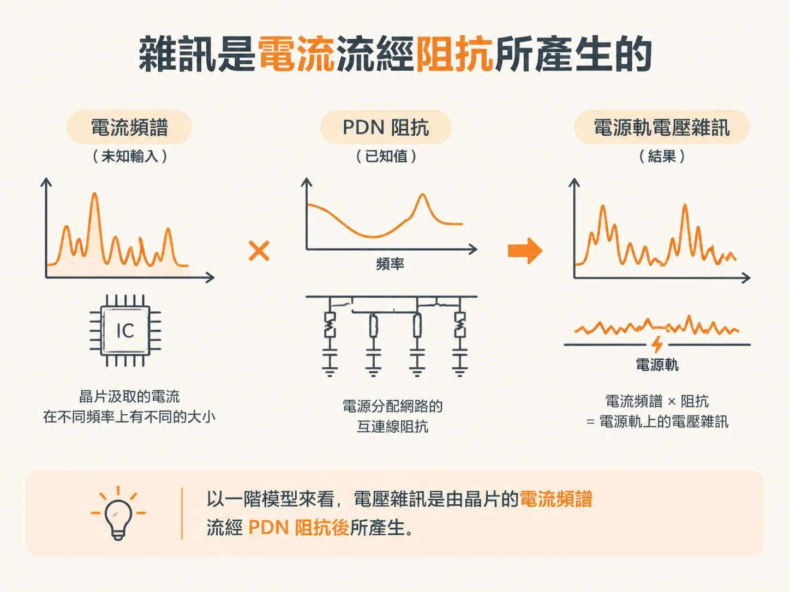
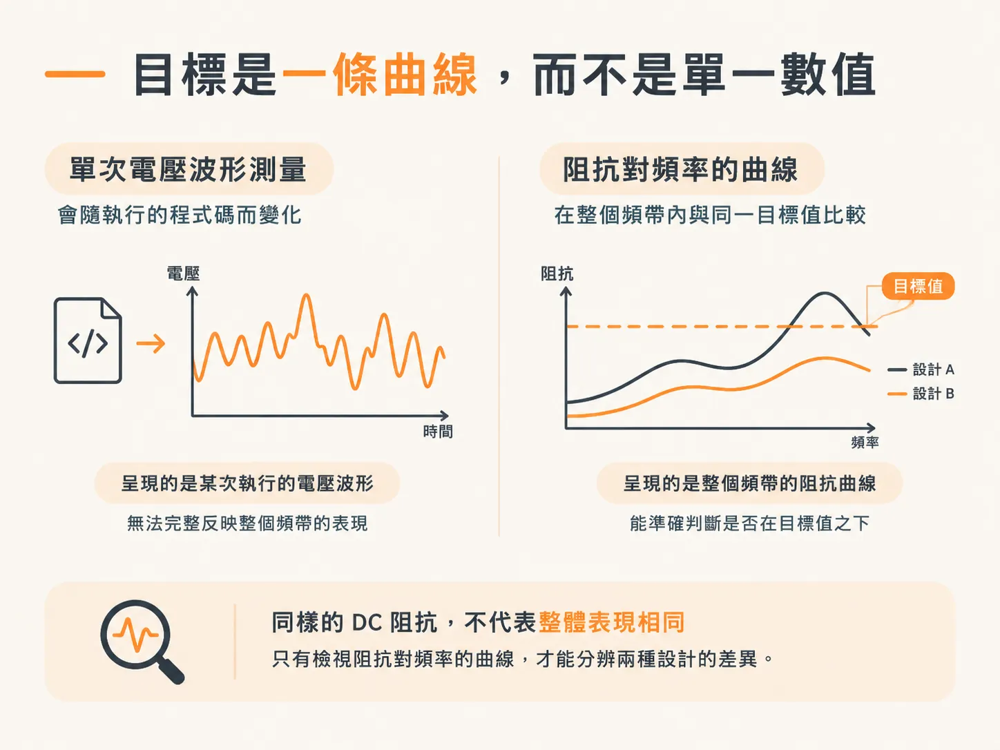

# 為什麼要在乎阻抗？

## 前言

電源分配網路（PDN）的任務只有一個：在晶片上提供符合規格的電壓。這個電壓包含平均值，以及疊加其上的 AC 漣波；兩者都必須落在規定範圍內。PDN 設計的其他工作，都是為了預測它能否做到這一點。

難處在於，你無法只靠測量就確定答案。電路板上的電壓會受到晶片當下執行的程式碼影響，因此，某塊電路板在一項效能測試中看起來一切正常，換一項測試卻可能出問題。若設計審查只根據某次恰好順利的測試結果就核准設計，產品出貨後仍可能發生問題。

你可能會在三種情境中遇到這個問題：在實驗室裡，上週測量正常的電源軌，因為換了新韌體而開始下陷；在電路圖設計階段，晶片都還沒做出來，你就得決定要放幾顆電容；以及在設計審查時，有人問你設計為什麼可靠，而你手上唯一的答案卻是某次實驗得到的波形。

本節會建立一套不必猜測程式碼也能回答問題的概念。你會了解為什麼驗收標準是阻抗曲線，而不是電流波形；阻抗如何隨頻率變化；如何用 1 A AC 電流源取得阻抗；為什麼必須將真實電容的寄生元件納入考量；以及如何讀取實測曲線上的波谷與波峰，判斷它們各自是由哪個元件造成。

本文要回答的第一個問題是：為什麼阻抗曲線能取代一項無法實際測量的指標？

## 晶片只看一件事

只要 PDN 能提供落在規定範圍內的電壓，就算合格。這個範圍涵蓋平均電壓，以及其上的 AC 漣波。

晶片看不到你的板層疊構、電容數量或佈局。它只感受到接腳上的電壓，然後正常運作，或是無法正常運作。

## 同一塊電路板一天內可能又合格、又不合格

電壓能否維持在可接受範圍內，不只取決於 PDN 設計，也取決於系統中晶片的行為：它們執行哪些功能，以及會汲取哪些頻率成分的電流。

執行某段程式碼時，在電路板某個位置測得的電壓可能符合要求。但這不代表執行其他微碼時，結果也會符合要求。

還有另一個陷阱：晶片接腳上的電壓雜訊，通常比電路板上的更大。因此，若在方便測量的測試點進行探測，原本勉強及格的設計可能看起來狀況良好。

這兩件事加在一起，就讓 PDN 設計是否合格難以測試。測試只涵蓋你碰巧產生的那種電流波形。

## 雜訊是電流流經阻抗的結果

有個方法可以解決這個問題，而起點是一個一階模型。作為第一階近似，電壓雜訊是各晶片汲取的電流頻譜流經電源分配網路互連線阻抗後所產生的。

可以把它理解成兩個已知量相乘。如果你能透過閘極使用率分析或模擬，取得晶片最壞情況下的電流消耗，就不必再猜測程式碼會如何執行。如果能透過測量、模擬或計算取得電源分配網路的阻抗，也就不必再猜測電路板的特性。

掌握這兩項資訊後，你就能計算在最壞但仍符合實際情況的條件下，預期會出現多少雜訊。這樣的預測有充分依據，足以在電路板尚未製作、甚至還要幾個月才會完成時，於設計審查中提出並加以說明。

## 以阻抗作為替代指標

電流頻譜仍是比較棘手的部分。即使我們無法在測試環境中產生終端使用者可能引發的所有電流波形，仍可透過評估 PDN 的阻抗表現，判斷設計是否合格。

阻抗可以作為衡量 PDN 設計是否合格的替代指標。如此一來，你可以保留自己能掌控的那一半問題，並盡可能將它簡化。

如果不知道晶粒汲取電源電流的實際頻譜，可以把 PDN 的阻抗曲線當作衡量設計是否合格的替代指標。請留意「曲線」這個詞：它不是單一數值。

## 設計變成一個目標

一旦以阻抗衡量 PDN 是否可靠，設計工作就可以簡化為讓 PDN 符合目標阻抗。這種做法能把模糊的目標轉化為明確的規格。

因此，阻抗成為衡量 PDN 效能時最重要的設計指標。了解阻抗的細節，以及元件選擇和實體設計如何影響阻抗，便成為 PDN 設計的重點。

阻抗是電路設計中最基本的電氣量之一；在 PDN 設計裡，它更是不可或缺的核心原則。

## 目標是一條曲線，不是一個數字

晶片汲取的電流並非固定不變，而是具有一段頻譜；頻譜中不同頻率的電流，遇到的阻抗也各不相同。因此，不能只在某個頻率檢查目標，就不再理會其他頻率。

所以，驗收標準是一條曲線：將阻抗畫成頻率的函數，並確認在電流涵蓋的整個頻率範圍內，阻抗都不超過目標值。兩種設計在 DC 下可能有相同的阻抗，但到了 100 MHz，表現卻可能截然不同；只有檢視曲線，才能分辨它們。

這就是為什麼本節接下來要討論如何讀取曲線。無法繪成圖的數字，也就無從檢查。

接下來的問題自然浮現：是什麼決定曲線的形狀？電容和電感對頻率的反應方向相反。下一篇文章會列出兩者的關係式，並說明它們在雙對數圖上呈現的樣子。
