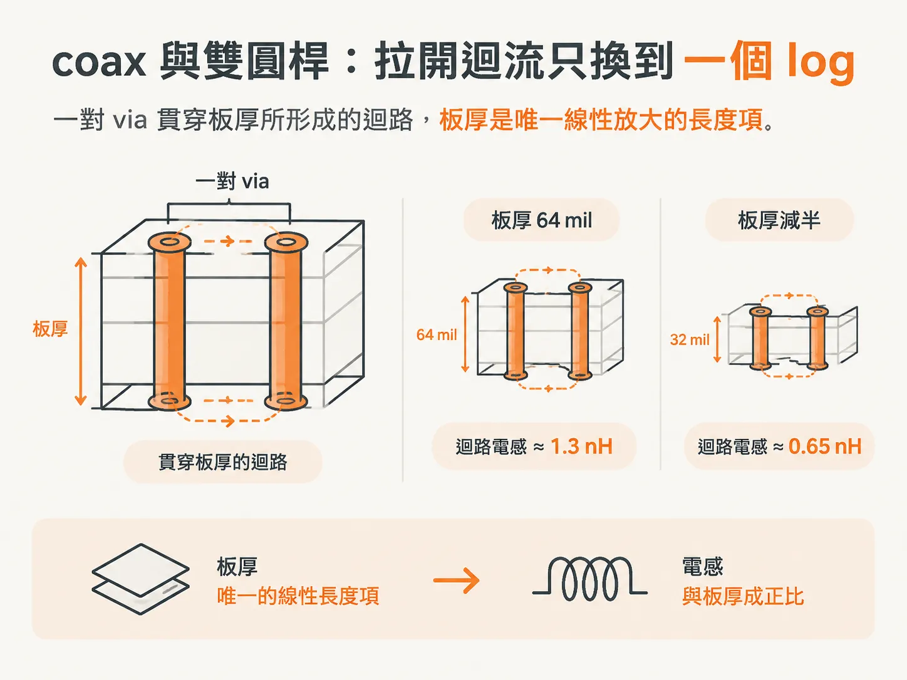
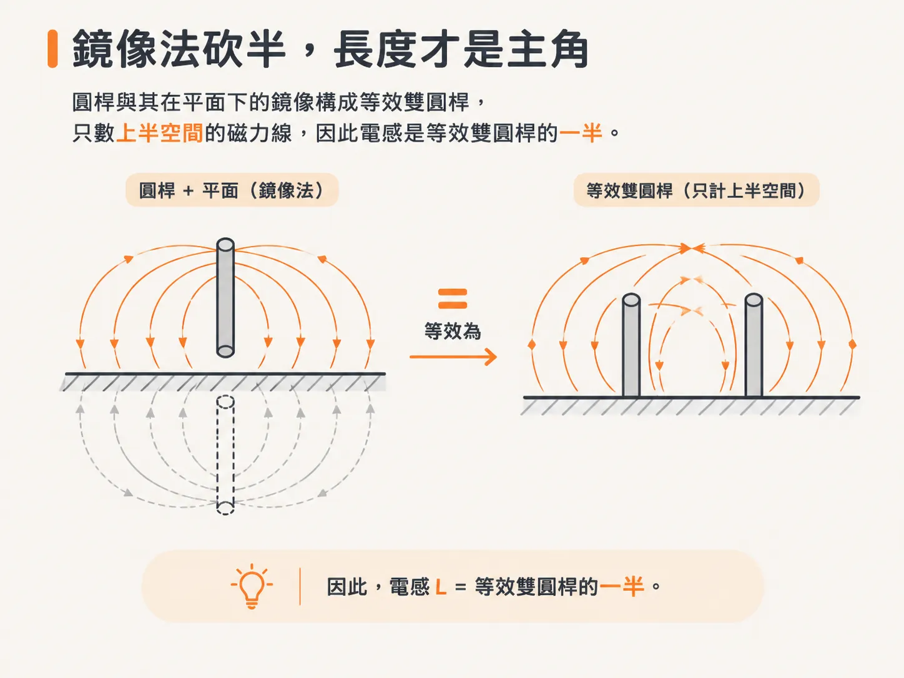

# 均勻圓導體：只有三種幾何能精確算迴路電感

## 前言

review 表格上有一欄要填「這段 via 有幾 nH」。填不出來時，多數人只好給出方向性的建議：更短、更寬、更近。方向雖然沒錯，卻無法驗算，也無法和實測曲線對照。這個章節要做的，就是把那句話換成數字，並說清楚這個數字有多可靠。

會遇到這類問題的情境很固定：一對穿過 BGA 的 via、一條 50 Ω 走線、兩片相距 2.7 mil 的 plane，或是一份從 3D solver 匯出的 S-parameter。這四種情境各自屬於不同的幾何家族，每個家族都有自己的常數和失效邊界。

本節依序回答五個問題：哪些幾何有精確解？一對 via 的電感是多少？沒有精確解時，L 會如何隨迴路大小變化？迴流就在相鄰層、兩片銅又寬又近時，該怎麼數方格？手上只剩 Z0 與 TD 時，該怎麼計算？最後，如何用 S-parameter 反推出 L，並判斷結果可信的頻寬？讀完後，你會記住三個常數：25 nH/inch、8.3 nH/inch，以及 32 pH/mil × h。

先從最有把握的部分開始：哪些結構的迴路電感可以精確算出來？一對典型的 via 又值多少 nH？

## 精確解只有三種

能用 Maxwell 方程式精確求出每單位長度迴路電感的結構，只有三種：coax、兩根圓桿（twin rods），以及圓桿對平面（rod over plane）。其他結構的公式，不論多複雜，都只是近似。


式子看起來很嚇人，不代表它就是精確解。很多時候，那只是不那麼像近似的近似。

| 幾何 | 變數 | 行為 |
|---|---|---|
| coax | 內導體外半徑 a、外導體內半徑 b | L 隨 ln(b/a) 增加 |
| 雙圓桿 | 半徑 r、中心距 s | s >> r 時，r = 5 mil、s = 40 mil 的結果為 21 pH/mil |
| 圓桿對平面 | 半徑 r、離平面高度 h | 等於等效雙圓桿結果的一半 |

這三種幾何的共同點是截面為圓形。方形 via、矩形走線，以及帶有 clearance 的 pad，都不在其中。

本節的數值都以每單位長度的迴路電感表示，單位為 nH/inch 或 pH/mil。µ0 = 32 nH/inch = 32 pH/mil。後面每個近似值都會回到這個常數。

## coax 與雙圓桿：拉開迴流，只換來一個 log

coax 中，電流由內導體流出，再由屏蔽層返回。內導體外半徑為 a，外導體內半徑為 b，每單位長度的迴路電感是 `L = (µ0/2π)·ln(b/a)`。

把 b 拉大，L 會增加，但只按自然對數增加。這是本節最實用的一句話：拉開迴流確實有幫助，但幫助有限，而且越拉越不明顯。

書上的例子是 b = 5 mm、a = 2 mm。代入後約為 4.7 nH/inch。注意，這個數字幾乎不受尺寸放大影響：如果把整條電纜放大兩倍，b/a 不變，L 也不變。真正決定 coax 電感的是這個比值。

雙圓桿則使用另一組變數。兩根半徑皆為 r 的圓桿，中心距為 s，r 和 s 都以 mil 為單位。當 s 遠大於 r 時，公式可以簡化；書上直接給出結果：r = 5 mil、s = 40 mil 的 via pair，每單位長度電感為 21 pH/mil。

這組尺寸並非隨意選取，而是 BGA 下方 via pair 的常見尺寸。因此，21 pH/mil 可以作為板上 via 的起始估值。

若板厚為 64 mil，via 從一面貫穿到另一面，迴路電感就是 64 mil × 21 pH/mil ≈ 1.3 nH。板厚減半，同一對 via 的電感也會降至 0.65 nH。



21 pH/mil 這個數值的前提是 s 遠大於 r。40/5 = 8，仍在適用範圍內。若把 via 擠得太近，間距只剩半徑的兩三倍，這個近似就會開始失準。

## 鏡像法折半，長度才是主角

圓桿對平面使用的是鏡像法（method of images）。twin rod 的磁場分布，與高度 h = s/2 的 rod over plane 完全相同。

差別在於，rod over plane 只計算上半空間的磁場，因此 L 正好是 twin rod 的一半。這不是經驗修正，而是幾何對稱直接導出的結果。



將雙圓桿的結果折半，可得 `L = (µ0/2π)·ln(2h/r)`。r 是圓桿半徑，h 是桿心到平面的高度，兩者都以 mil 為單位。

書上的例子是一條 24 AWG 的工程改線，直徑為 10 mil（r = 5 mil），鋪在板子表面，內層 plane 距離線心 20 mil。代入後得到 10.6 nH/inch，書上取整為 10 nH/inch。若線長為 1 吋，電感就是 10 nH。

真正的重點是，ln 裡面放的是 h/r 的比值。把線徑變細，同時讓線更靠近平面，只要比值不變，L 也不變。想靠「換細一點的線」來降低電感，方向就錯了。

線長減半，L 也減半。三種精確解都一樣：長度是線性項，其他變數則都藏在 log 裡。因此，「更短」永遠是第一順位；「更近」其次；在這類幾何中，「更寬」只能帶來有限的改善。

三種幾何的共同結構，可以用一支腳本確認：

<!-- derived -->
```python
import math

mu0 = 32.0  # nH/inch，也是 32 pH/mil

coax = mu0 / (2 * math.pi) * math.log(5 / 2)                 # b=5 mm, a=2 mm -> 4.67 nH/inch
rod_over_plane = mu0 / (2 * math.pi) * math.log(2 * 20 / 5)  # h=20 mil, r=5 mil -> 10.6 nH/inch
via_total = 21.0 * 64 / 1000                                  # 21 pH/mil，64 mil 板厚 -> 1.34 nH
print(coax, rod_over_plane, via_total)
```

回到 review 表格：64 mil 厚的板上，一對 via 可填 1.3 nH；32 mil 厚的板上則填 0.65 nH。這些數字現在有幾何模型作為依據，不再只是猜測。

不過，這三種精確解都要求截面為圓形。遇到方形 via、扁平走線或大面積銅箔時，就沒有精確解可用。此時，首先要問的不是公式長什麼樣，而是：沒有精確解時，L 會如何隨迴路大小變化？
