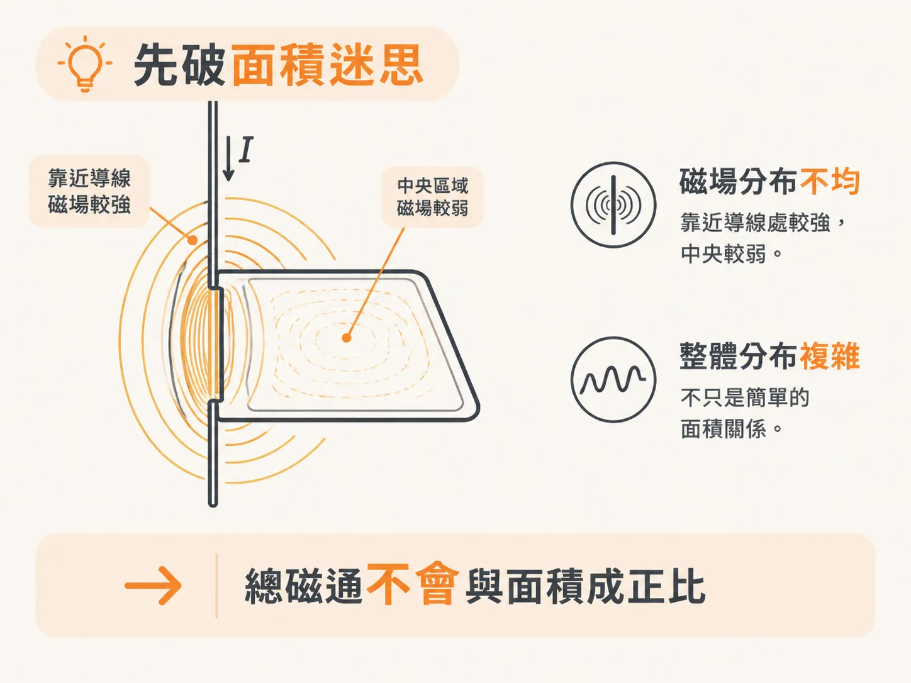
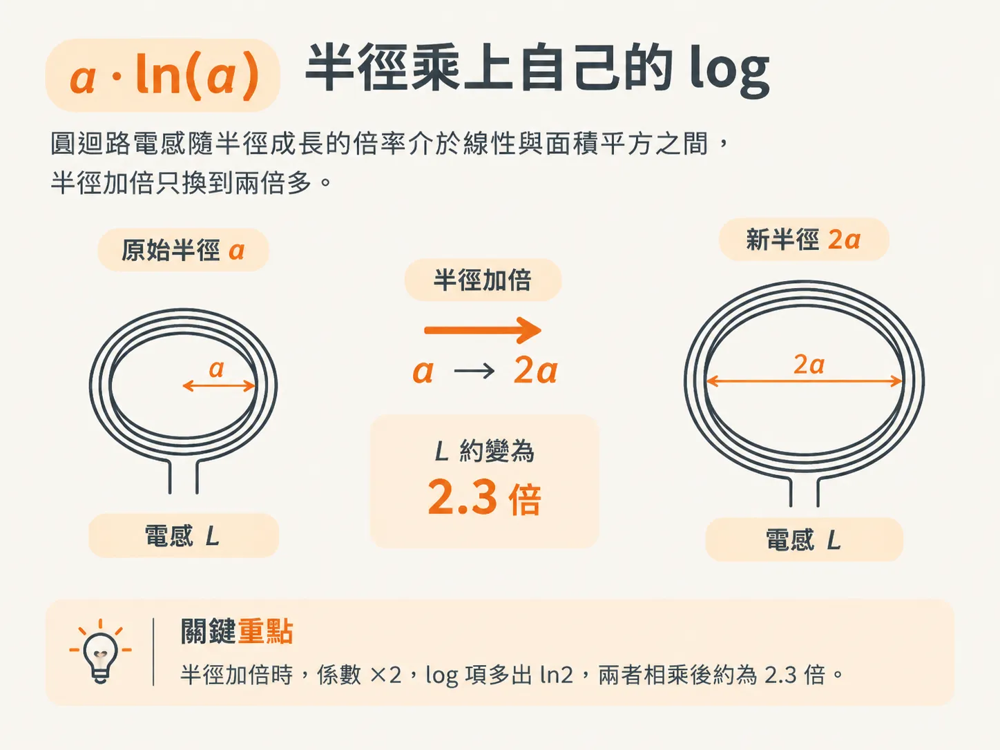
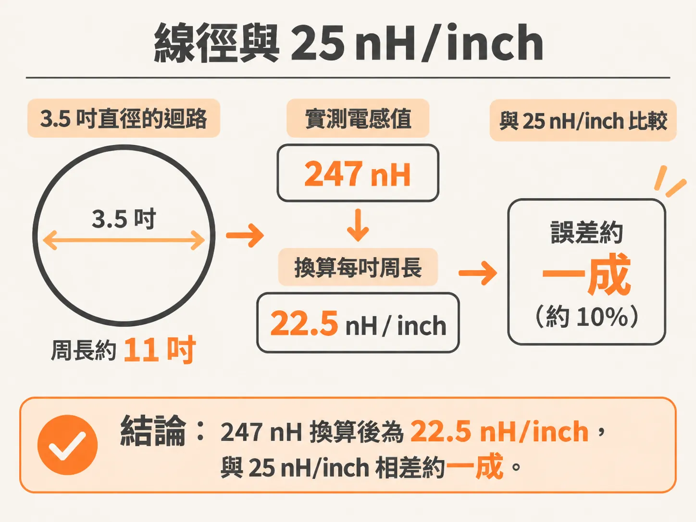

# 圓迴路的迴路電感近似：每吋周長 25 nH

上一節留下了一個問題：沒有精確解時，電感 L 會如何隨迴路大小變化？

最常見的猜法是「與面積成正比」。這個猜法不對，而且會帶來明顯的偏差：它讓人以為迴路縮小一半，電感就會降到四分之一，因而低估了縮小迴路的實際效果。

## 先破除面積迷思

要計算一個迴路的 L，得先知道迴路所圍面積內每一點的磁通密度 B，再對整個面積積分。如果 B 在整個迴路內都是常數，磁通就會與面積成正比，L 也會與面積成正比。

但 B 並非常數。迴路內的磁場分布並不均勻：靠近導線的地方較強，中央較弱，整體分布也相當複雜。因此，穿過整個迴路的總磁通，不會恰好與面積成正比。

由此可得一個容易被忽略的結論：把迴路放大一倍，L 不會增加到四倍。

面積的直覺並非全錯。面積越大，L 確實越大，只是不會與面積成正比。

## a·ln(a)：半徑乘上自己的 log

最簡單的幾何形狀，是半徑為 a、導線半徑為 WR 的圓形迴路。高頻下的近似式為 `L ≈ µ0 · a · [ln(8a/WR) − 2]`，其中 a 與 WR 使用相同的長度單位，µ0 = 32 nH/inch。

從式子的形式就能看出縮放關係：L 不與 a² 成正比，也不與周長 a 成正比，而是與 a 乘上它自己的 log 成正比。

半徑加倍，L 大約會變成 2.3 倍，而不是四倍。以 a/WR = 100 為例，a 變成 2a 後，log 裡會多出 ln2；前面的係數也加倍，兩者相乘後，結果約為原來的 2.3 倍。

這裡有個常被誤解的地方：介質的 Dk 完全不影響這個 L。磁場不與介質作用，因此迴路電感只取決於導體幾何形狀。

## 線徑與 25 nH/inch

線徑只出現在 log 項裡，影響相對有限。WR 加倍時，log 項會減少 ln2 ≈ 0.69，因此整體 L 會減少約 0.69 × µ0 × a。對半徑為 1 吋的迴路來說，這大約是 22 nH。

換句話說，把線加粗確實有用，但效果有限。它不會把一條 250 nH 的迴路降到 50 nH。

真正好用的是周長法則：當 WR = 10 mil，且迴路半徑介於 0.5 到 2 吋之間時，每吋周長的迴路電感大約是 25 nH，也就是 1 nH/mm。

注意，這裡的單位是「每吋周長」，不是每吋線長，也不是每吋直徑。周長指的是 2πa。

書上的實測例子可以用來對照：a = 1.75 吋、WR = 0.0245 吋，也就是直徑 3.5 吋的迴路，高頻下量得 247 nH。以 11 吋周長計算，247 nH 相當於每吋周長 22.5 nH。和 25 nH/inch 相比，誤差約一成。

對 review 時的估算來說，一成的誤差已經相當實用。前提是對這條迴路所知有限，只知道它大致呈圓形，而且導線不粗。

不過，電路板上很少出現這種迴路。25 nH/inch 的估算假設迴流繞了很遠才回來；實際上，最常見的情況是迴流就在相鄰層，兩片銅箔既寬又靠近。這時就該換一套算法：數方格。
