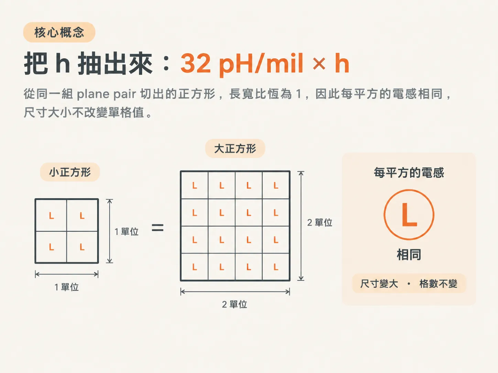
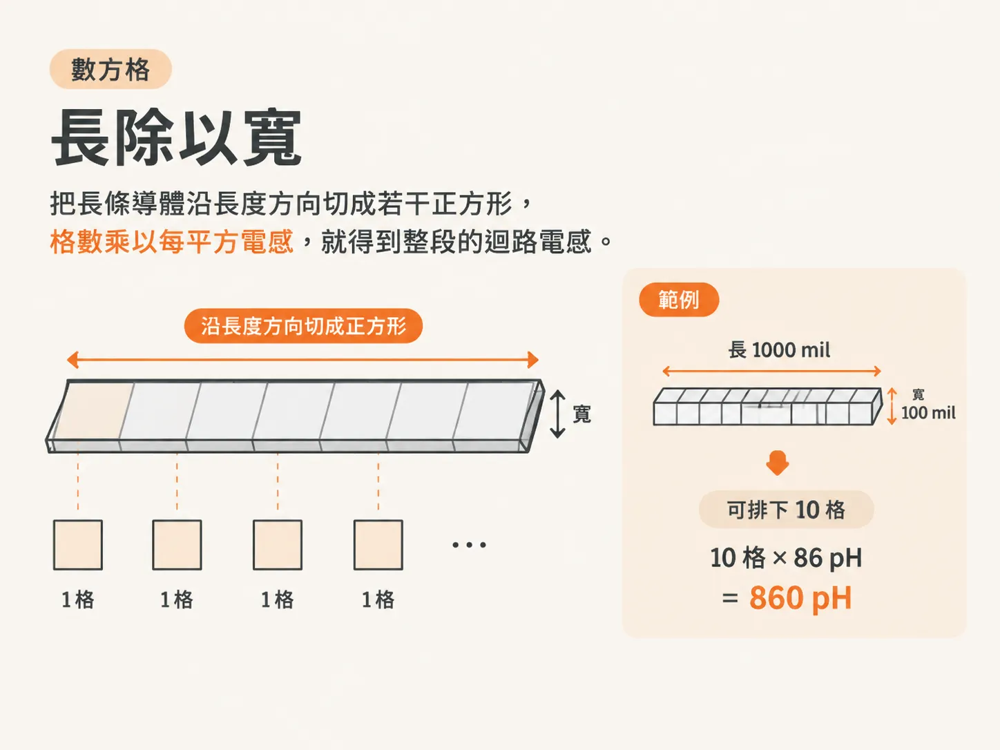
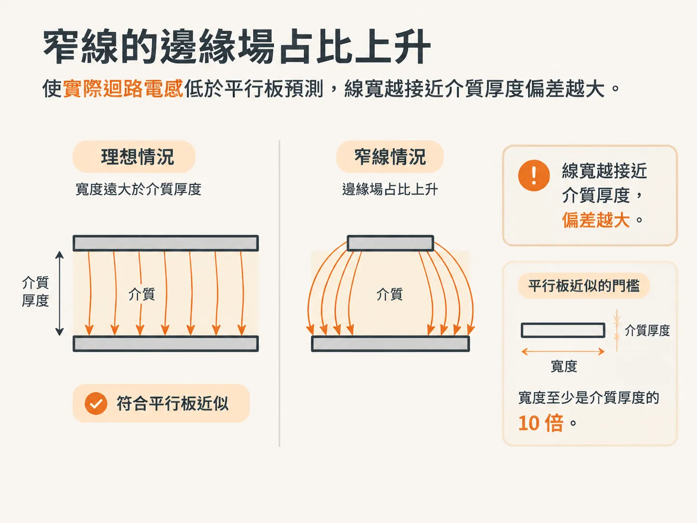

# 寬導體靠近時：sheet inductance 與數方格

25 nH/inch 隱含了一個前提：迴流路徑離得很遠，電流必須繞一大圈才能返回。但電路板上最常見的情況恰好相反：迴流就在相鄰層，兩片銅面又寬又近，中間只隔著一層薄介質。

這種幾何結構不需要用 25 nH/inch 來估算。它有自己的常數，而且更容易計算。

## 把 h 抽出來：32 pH/mil × h

兩片寬銅面相對，中間夾著一層薄介質時，迴路電感可以用一個簡單的形式表示。先計算一個正方形：`Lsq = µ0 · h`。h 是兩片銅面之間的介質厚度，單位為 mil；µ0 = 32 pH/mil，因此計算結果的單位是 pH/square。

這個關係是從平行板電容推導而來，因此稱為平行板近似（parallel plate approximation）。它的誤差來源也和計算平行板電容時一樣：忽略了邊緣場。

對同一組相鄰層而言，h 是固定的，可以直接提出來。剩下的部分是長度除以寬度，也就是沿著長度方向可以排下幾個方格。

任何正方形都算一格。因此，同一組平面上的方形，無論尺寸大小，L 都相同。邊長增加一倍，格數不變，電感也不變。

根據書上的數值，商用量產且價格不屬於溢價等級的最薄介質厚度是 2.7 mil。32 pH/mil × 2.7 mil = 86 pH。從這組平面上取出的每一個方格，電感都是 86 pH。

這也說明了薄介質為什麼重要：h 減半，整組平面上任何結構的 L 都會跟著減半。不必修改 layout，只要更換介質厚度即可。

## 數方格：長度除以寬度

實際的走線不是正方形，而是長條形。沿著長度方向把它切成方格，格數 n = 長度 / 寬度，總電感 `Lloop = Lsq × n`。

例如，一條長 1000 mil、寬 100 mil 的走線，沿著長度方向剛好可以排下 10 格。10 格 × 86 pH = 860 pH。

這種算法十秒鐘就能算完，不需要 solver，也不必記住推導過程。

它說明了兩件事：長而窄的走線格數較多，電感較高；短而寬的走線格數較少，電感較低。在這裡，長度、間距和寬度都是一階影響因素，不像圓形迴路那樣藏在 log 項裡。

此外，還有磁場抵消的效果。兩片銅面距離很近時，一片產生的磁力線會被另一片產生的反向磁力線抵消大半。因此，相同長度下，plane pair 的 L 遠低於單條走線搭配遠處迴流路徑的情況。

## aspect < 10，就別用

平行板近似假設寬度遠大於介質厚度。根據書上的說法，寬度至少要是介質厚度的 10 倍；若小於這個門檻，近似條件就不成立。

偏差並不只是「差一點」：aspect 為 10:1 時，誤差約為 30%；aspect 為 1:1 時，誤差約為 300%。

原因在於邊緣場。線越窄，邊緣場所占的比例越大，等效上就像線寬比幾何寬度更大。因此，真實的 L 會低於平行板近似的預測值；aspect 越低，兩者的差距就越快擴大。

當線寬縮小到與介質厚度相近時，導線的行為開始接近圓導體，L 對寬度的依賴也會從 1/w 轉為較緩和的 log 關係。這和上一節提到的圓桿，是同一個道理。

書上提供了一個方便記憶的基準值：當線寬等於介質厚度時，每吋電感約為 10 nH/inch。

要讓方格法失準很容易：保持 h 不變，把寬度從 100 mil 縮到 2.7 mil。對同一條長 1000 mil 的線，格數會從 10 格增至約 370 格，方格法算出的電感則是 31.8 nH。然而，此時線寬已等於介質厚度；依照上述基準值，1 吋線長的電感約為 10 nH。三倍的差距，就出現在 aspect 從 37 降到 1 的過程中。

使用方格法時，應滿足 w > 10h。一條 50 Ω 線的 aspect 常常只有 2 到 5。遇到這種情況，就不要數方格，改用另一種方法：Z0 與 TD。
