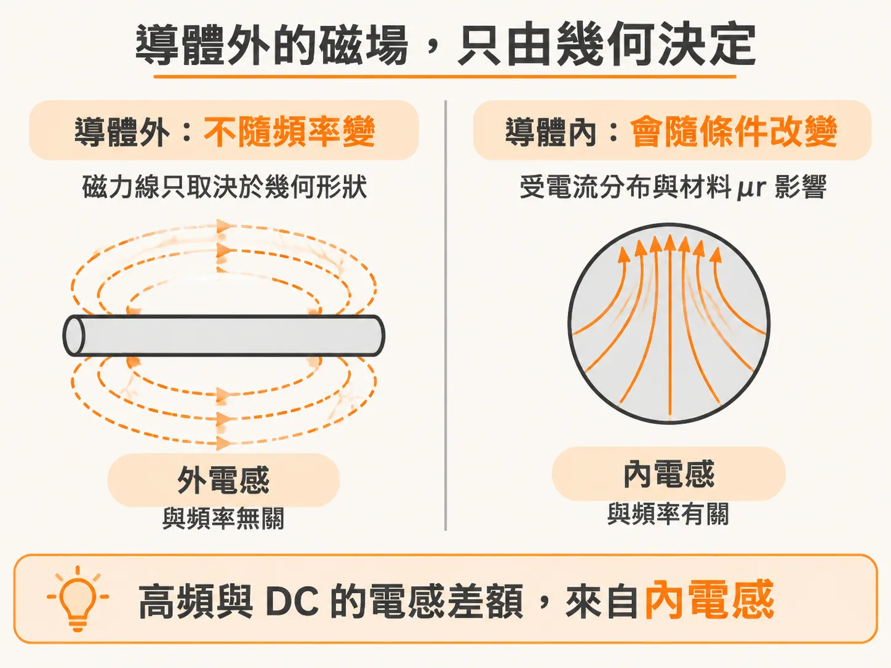
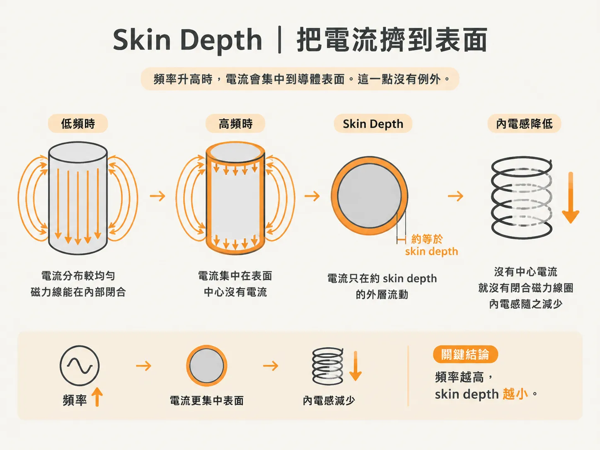
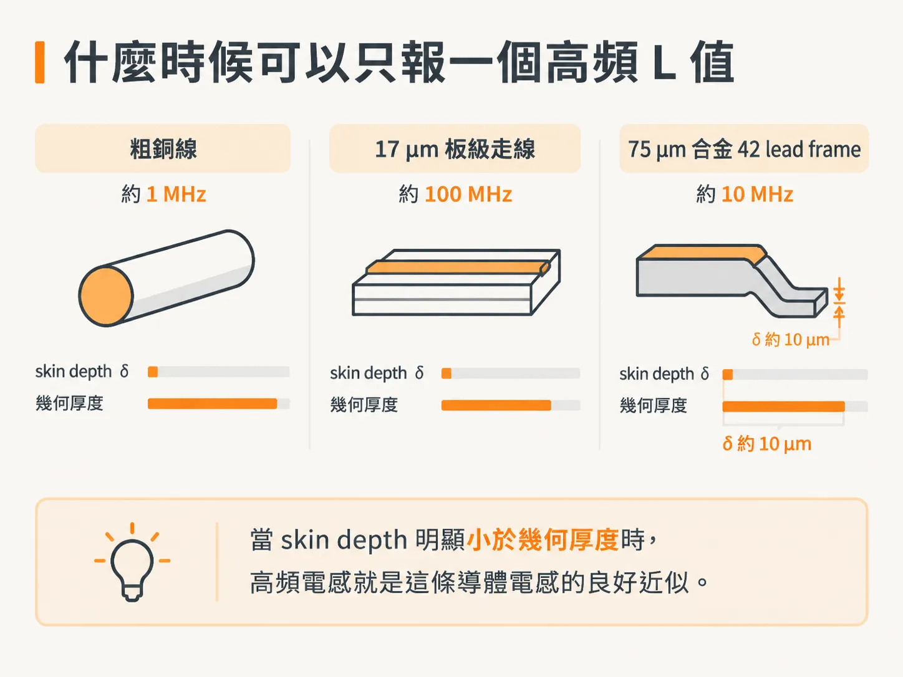

# 內電感、外電感與 skin depth

上一頁提到的三個槓桿，都建立在一個假設上：L 是純幾何量。這個假設需要稍微修正。

L 確實會隨頻率改變，只是改變的那一部分不在導體外，而是在導體內。

在實驗室量測同一條迴路時，就會看到這個現象：低頻量到的 nH 值比高頻稍大。差額不大，卻每次都會出現。模擬軟體也會先問你：要計算 DC 電感，還是高頻電感？

這篇要處理的就是這個差額：它是什麼、為什麼會消失，以及什麼時候可以忽略。

## 先修正上一頁那句話：多出來的部分藏在導體內

電感會隨頻率改變，是因為導體內的電流分布變了。電流分布一變，B 的分布也會跟著改變，因此 L 不再是常數。

這件事與波的傳播無關。只要結構仍在 quasi-static 的尺寸限制內，頻率相依性就只來自導體內部的電流與磁力線，以及導體材料的性質。上一頁提到的 quasi-static 判準仍然成立。

把磁力線分成兩群，差額就會浮現：在導體外繞行的，稱為 external field lines；在導體內繞行的，稱為 internal field lines。前者貢獻 external inductance，後者貢獻 internal inductance。

外電感很單純。導體外的磁力線不受電流分布或導體成分影響，只取決於幾何形狀。因此，外電感不隨頻率改變；高頻量到的電感就是外電感。

內電感則恰好相反：它會隨頻率改變，也對材料敏感。

在 DC 下，電流大致均勻分布於整個截面。內部的磁力線便繞著這些電流，一圈一圈地分布在導體裡。

這裡有個容易忽略的細節：圓線在 DC 下的內電感與直徑無關。直徑越大，電流密度越低，磁力線圈的密度也越低；兩者相互抵消，因此導體內部的磁力線總圈數仍然相同。

還有一點。內電感看似與材料有關，但多數金屬的 µr 等於 1。銅、銀、鋁、錫、鉛都是如此，因此這些導體的內電感與成分無關。

例外包括鐵、鎳、鈷，以及含有這些元素的合金。鎳鍍層的 µr 會依鍍層條件而異，範圍可落在 1 到 40 之間；到了約 1 GHz 以上，又會逐漸接近 1。

因此，DC 下多出來的那一截就是內電感。它藏在導體裡，而導體內部的狀態會隨頻率改變。

## skin depth 把電流擠到表面

頻率升高時，電流會集中到導體表面。這一點沒有例外。

書上有一張 100 MHz 的 microstrip 模擬圖：導體中心已經沒有電流。中心沒有電流，就沒有閉合的磁力線圈留在導體內部，也就沒有內電感。

電流往表面退，內電感就跟著減少，材料 µr 的影響也會一併減弱。

描述這個現象的長度尺度稱為 skin depth。它代表電流實際流動的有效厚度，也是磁力線實際滲入導體、受到 µr 影響的有效深度。

銅的數字可以直接記：1 GHz 時是 2.1 µm，10 MHz 時是 21 µm，略小於 1 mil。skin depth 與頻率的平方根成反比；頻率增加四倍，深度就減半。

把這個深度與幾何厚度相比，就能判斷導體內部還剩多少影響。電路板上的典型走線厚約 17 µm。到了 100 MHz 以上，skin depth 已遠小於這個厚度，電流幾乎都集中在表面，走線的電感便全是外電感。

線材的門檻更低。粗銅線的直徑可達好幾 mil；到了 1 MHz 以上，電流大多已集中在表面，電感便全是外電感。

## 什麼時候可以只報一個高頻 L 值

判準只有一句：當 skin depth 明顯小於幾何厚度時，高頻電感就是這條導體電感的良好近似。

對線材來說，這個門檻約在 1 MHz；對電路板走線來說，則約在 100 MHz。低於門檻時，就得清楚說明報的是哪一種 L。

這也是解析近似為什麼一定要標明狀態。你可以報 DC 電感，假設電流均勻流過整個截面；也可以報高頻電感，假設電流都集中在表面。兩者採用的是不同假設，並不是同一個數字的兩種精度。

合金 42 的 lead frame 是個好例子，因為它的材料常數相當極端。它的 µr 約為 200，導電率則只有銅的五十分之一。兩者相乘，乘積是銅的四倍，因此 skin depth 只有銅的一半；在 10 MHz 時約為 10 µm。

lead frame 的典型厚度是 3 mil，也就是 75 µm。到了 10 MHz 以上，電流幾乎都擠在外側的 10 µm 內，磁力線難以滲入，也就沒有多少內電感可被高 µr 放大。因此，10 MHz 以上，合金 42 的 lead frame 電感與銅製 lead frame 相同。

它的電阻則是另一回事。合金 42 的電阻約為銅的 100 倍；那是 R，不是 L。

再看一個有數據的迴路。書中提到一個由 18-gauge 線材構成的迴路，周長約 11 inch，量得的 loop L 約為 247 nH。量測頻率在 1 MHz 以上，因此這個數值代表外電感，也就是高頻電感。

它的內電感約為 1.28 nH/inch，乘上 11 inch 後約為 14 nH，不到總量的 6%。如果改在 1 Hz 下量測，讀數會比 247 nH 多約 14 nH。

一般而言，DC 與高頻之間的差額就是內電感，通常不到高頻電感的 10%。因此，同一條走線可以用一個 nH 值同時代表 1 MHz 與 1 GHz 的電感；前提是 skin depth 早已遠小於導體厚度，內電感那一部分可以忽略。

如果結構很薄，或關心的頻率很低，這個前提就不成立。此時只報一個 nH 值並不足夠，必須分別說明 DC 電感與高頻電感。

到這裡，逐段的 nH 值已經有了，也知道 GHz 下只剩由幾何形狀決定的外電感。下一步是把這條地板放回 Z(f)，決定電容要用幾顆、擺在哪裡。
