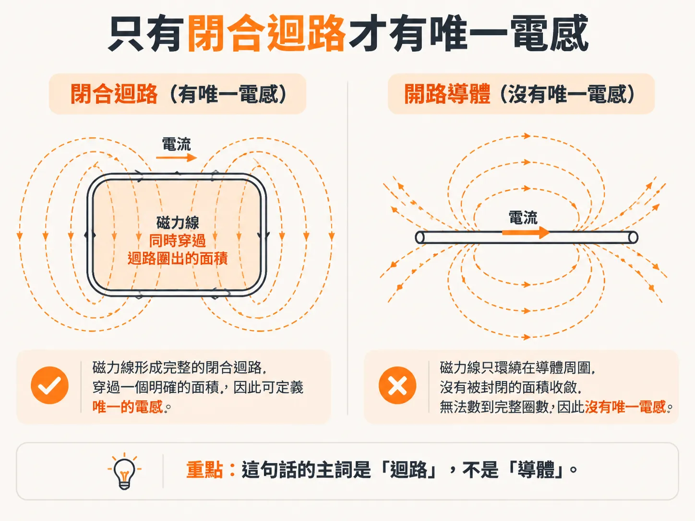
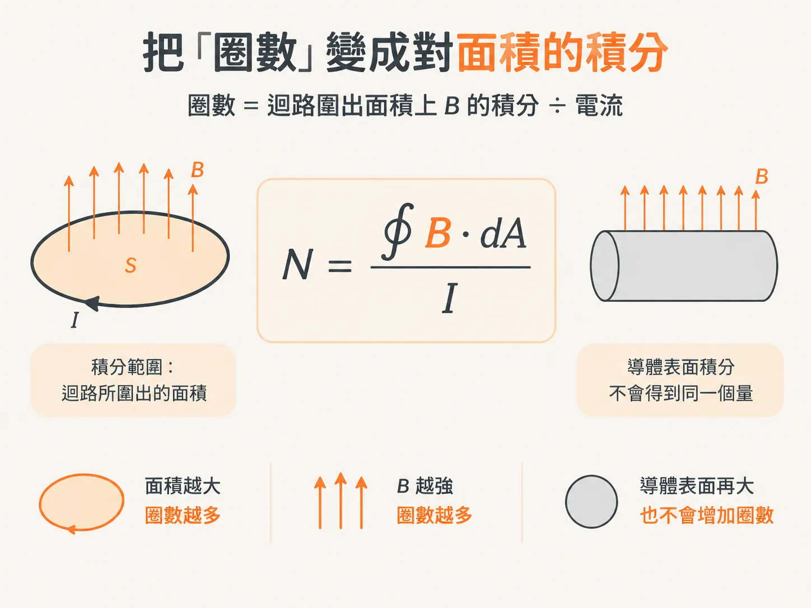
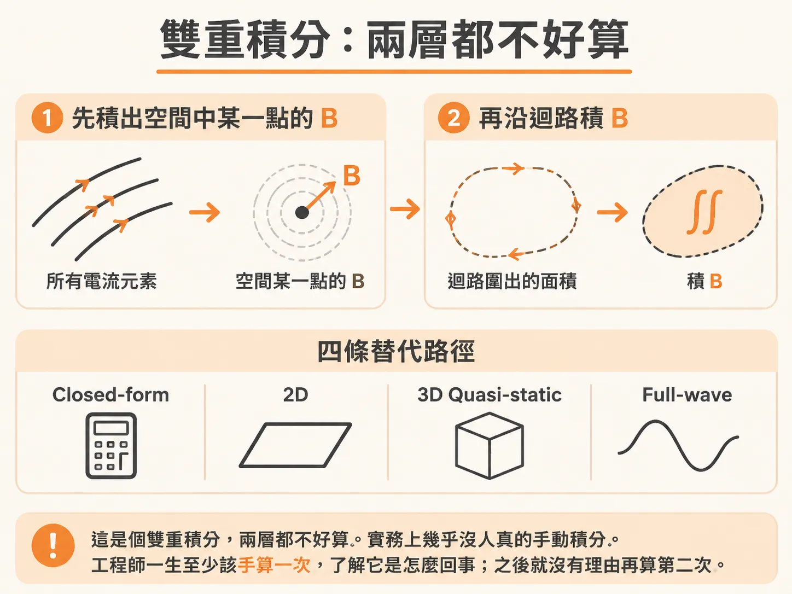

# Maxwell 方程式與迴路電感

## 前言

你在 layout review 上指著一顆 via，問：「這顆 via 有幾 nH？」對面的人翻了一下 datasheet，回你：「每 inch 32 nH。」兩邊都知道這個答案不太對，卻沒人說得清楚問題出在哪裡。

這就是這個 node 要處理的問題。高頻段的 Z(f) 地板，是由 caps、planes、vias 等結構的 loop L 撐起來的。如果 loop L 只有一個整體數字，你就只能說「電感要小」，卻說不出「這段走線的哪一部分、這顆 via 的哪一側該調整」。review 最後就變成許願。

你通常會在幾種情境下遇到這個問題：datasheet 上的 nH/inch、模擬結果中的單一 nH 數值，或封裝廠提供的 via 模型。每一次，你拿到的都是一個沒有標明範圍的數字。

這個 node 會用三個步驟拆解這個數字。第一步先問：電感要在什麼幾何條件下才有定義？為什麼單獨詢問一段開路線的電感並不成立？第二步把 loop L 拆成 partial self 與 partial mutual，讓我們有語言可以指出「該改的是這一段」。第三步則用 skin depth 說明，為什麼高頻時只剩下由幾何決定的外電感。

先回答第一個問題：為什麼單獨問一條 5 mm 走線的電感，這個問題並不成立？

## 只有閉合迴路才有唯一電感

要明確定義電感，幾何上得先滿足一個條件：導體必須構成閉合的電流迴路。

在這種幾何下，繞著迴路的每一條磁力線，也都會穿過迴路所圍出的封閉面積。這其實是同一件事的兩種看法。

因此，「數出完整包住導體的磁力線圈數」可以換成一個更直接的做法：只計算穿過迴路所圍面積的磁力線。書上把整個迴路的電感稱為 loop inductance，定義是每安培穿過閉合迴路的磁力線圈總數。

注意這句話的主詞是「迴路」，不是「導體」。

一條 5 mm 走線之所以沒有唯一的電感，是因為它沒有閉合。它的磁力線無法對應到一個明確的迴路面積，因此也無從計算「完整包住導體的磁力線圈數」。書上沒有另外為開路線段定義電感；「開路片段沒有唯一電感」是從上述定義直接推導出的結論，不是另一條定理。

同樣的推論也適用於 via。單獨看一顆 via，它只是一段導體；接上不同的 return path，就會形成不同的迴路，也就會有不同的 loop L。因此，「這顆 via 有幾 nH？」這個問題，關鍵在於沒有交代範圍，至於精度反而是其次。同一顆 via 在兩份文件中出現不同的 nH 數值，兩份都可能沒有算錯。

## 把「圈數」轉換成面積積分

數線是一種視覺化的做法，積分則是計算的方法。兩者之間的橋梁是：穿過面積的磁力線圈數，等於 B 在迴路所圍面積上的積分，再除以電流。

面上的 B 不一定均勻，因此不能只用 B 乘上面積。B 在面上各處可能不同，必須逐點積分。

這裡有個容易搞錯的地方：積分範圍是迴路所圍出的面積，不是導體表面。導體表面積再大，也不會讓圈數增加。真正決定圈數的，是面積有多大，以及面上的 B 有多強。

常數 µ0 就出現在這個式子的係數中：4π×10−7 H/m，換算成英制是 32 nH/inch，也就是 32 pH/mil。它是 free space 的導磁率，不是銅的性質。

如果你只需要估算數量級，這個常數加上面積，就能提供粗略答案。若要算得準，就得先知道面上每一點的 B。這也把問題帶到下一節。

## B 不能任意分布，而積分又難以手算

B 在空間中的分布受到限制，必須遵守兩條 Maxwell 方程式。

第一條：磁力線必須形成閉合環。空間中沒有磁場的起點或終點，磁力線不能在任何地方中止。

第二條：B 由電流密度 J 產生，方程式中的係數就是 µ0。給定一組電流，這條方程式告訴我們如何計算空間中各點的 B。實務上常用的方法是 Biot-Savart：把導體切分成小段，每個小電流元素都會在空間中貢獻一小部分 dB，再把所有貢獻加總起來。

因此，計算 loop L 會變成兩層積分。先對所有電流積分，求出空間中某一點的 B；再讓這個點遍歷整個迴路所圍出的面積，對 B 進行第二次積分。

這是個雙重積分，兩層都不好算。因此實務上幾乎沒人真的手動積分。工程師一生至少該手算一次，了解它是怎麼回事；之後就沒有理由再算第二次。

平常有四種做法：

1. 使用 closed-form 解析近似，適合幾何簡單、已有現成公式的結構。
2. 若幾何是均勻的 transmission line，可使用 2D 靜態或 quasi-static solver，計算高頻 L 或頻變 L。
3. 使用 3D quasi-static solver，計算 DC、高頻或頻變 L。
4. 使用 full-wave solver，它會將頻率相依性納入計算。

這四種方法的差別，主要在於你願意付出多少計算成本。均勻傳輸線用 2D 就夠；形狀特殊的迴路，則只能交給 3D 或 full-wave solver。

回到 review 的情境。你現在知道，調整迴路上的任何一段，都會改變整條 loop L。這句話雖然正確，卻不太實用：它無法告訴你該改 signal 還是 return，也無法指出調整哪一段最有效。

下一步，就是把這個整體拆開，讓每一段都能認領自己對應的部分。這正是 partial self 與 partial mutual 要解決的問題。
