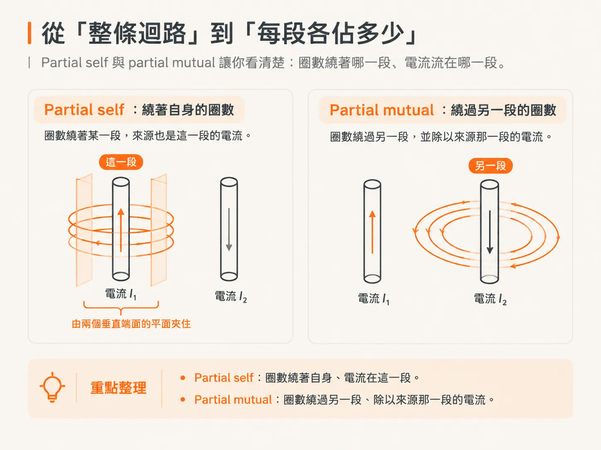
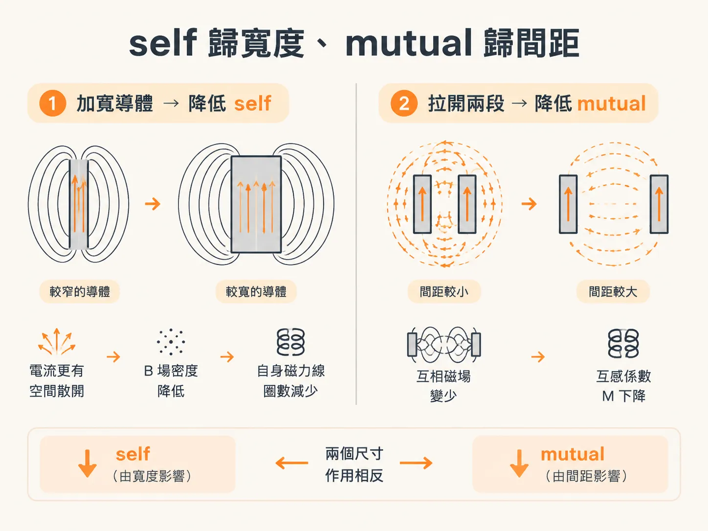
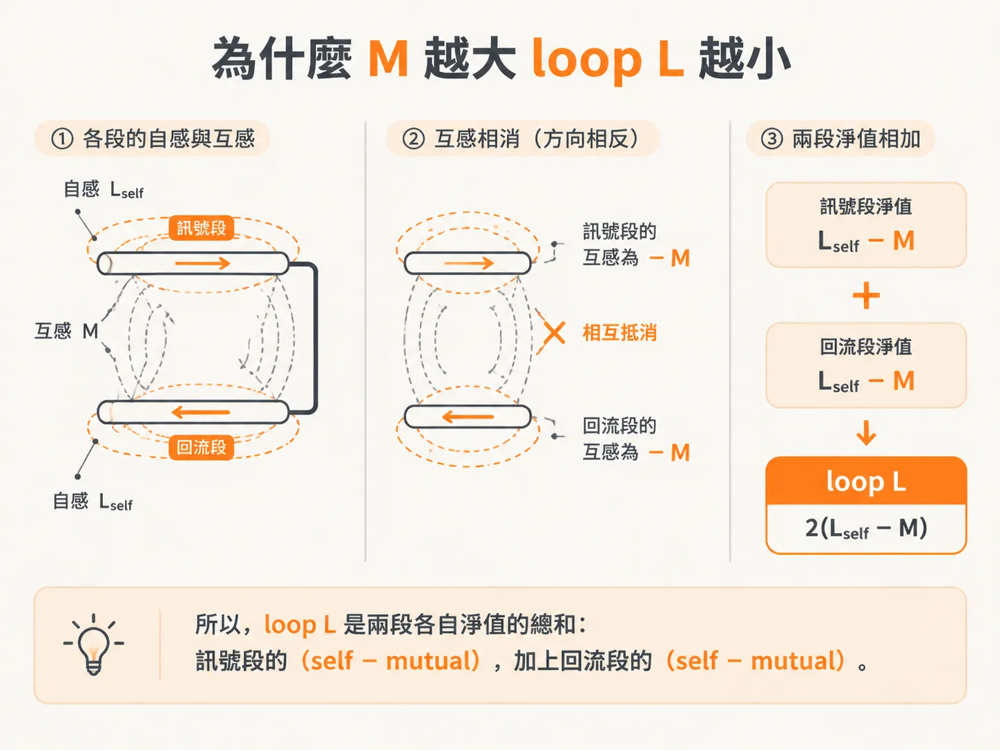

# 部分自感與部分互感：逐段設計迴路電感

上一頁的結論是：改動迴路上的任何一段，整條 loop L 都會跟著改變。這句話沒錯，但拿到 review 上卻派不上用場。

在 review 上，你不能只說「整條迴路要更小」，而得具體指出：「把這段 return 拉近 plane」，或「把這條走線加寬一倍」。

問題出在 loop L 這套語言本身。訊號段與回流段共同構成迴路，但 loop L 不區分各段的貢獻。因此，若問「這一段貢獻多少」，在 loop L 的框架裡並沒有答案。

partial inductance 提供了另一種看法。它不改變物理，只是換一種記帳方式：把同一條迴路拆成幾段，讓每一段各自認領一部分。

## 從「整條迴路」到「每段各佔多少」

partial inductance 的定義和一般電感一樣，仍是每安培所對應的磁力線圈數。不同的是，它還要求你說清楚兩件事：這些圈是繞著哪一段數的？電流又是流在哪一段？

把這兩個問題問清楚，帳就能分開來算。

先看單獨一段。繞著這段、由這段電流產生的磁力線，稱為 self-field。把這些圈數除以這段的電流，得到的就是這段的部分自感，partial self-inductance。由於它只涵蓋迴路的一部分，因此名稱中有 partial。

範圍也要說清楚。計算 self-field 的空間，受兩個垂直於導體端面的無限平面所界定。partial self 描述的是「這段導體，加上兩端切出的空間」的性質，而不是整條迴路的性質。

再看兩段之間的關係。某一段產生的磁力線，有一部分也會繞過另一段。這些磁力線稱為 mutual-field。把它們的圈數除以來源那一段的電流，得到的就是兩段之間的部分互感，partial mutual inductance。

這裡要注意主詞：partial mutual 描述的是「A 段的電流在 B 段周圍造成多少圈」，除以的也是 A 段的電流。因此，它描述的是一對導體之間的關係；交換兩段的位置，數值不變。

## self 歸寬度、mutual 歸間距

有了逐段描述的語言，三個幾何槓桿就能各自歸位。先說長度：它會影響兩者。段越長，磁力線圈數越多，self 與 mutual 都會跟著增加。這一點上一頁已經講過，這裡不再重複。

真正能區分 self 與 mutual 的，是另外兩個尺寸。

除了長度，partial self 主要受寬度影響。導體越寬，電流就越有空間散開。電流分布得越開，B 場密度就越低，繞著這段自身的磁力線圈數也越少。因此，加寬走線會降低 self。

除了長度，partial mutual 主要受間距影響。兩段導體拉得越開，來自其中一段、能繞過另一段的磁力線就越少。距離越遠，mutual-field 越弱，partial mutual 也越低。因此，把 return 拉遠，降低的就是 M。

這兩種機制對 loop L 的影響方向恰好相反。加寬走線會降低 self，對 loop L 有利；拉開 signal 與 return 的距離會降低 M，對 loop L 不利。同樣是「讓某個 partial 項變小」，結果卻不一樣。

## 為什麼 M 越大，loop L 越小

現在把兩段接回同一條迴路。訊號段周圍的磁力線總數，是它自己的 self-field 減去來自回流段的 mutual-field。回流段也一樣：它自己的 self-field 減去來自訊號段的 mutual-field。

為什麼要相減？因為回流電流的方向相反。回流段產生的磁力線，繞著訊號段時會朝相反方向旋轉，因此兩者相消。

所以，loop L 是兩段各自淨值的總和：訊號段的（self − mutual），加上回流段的（self − mutual）。

如果兩段導體完全相同，兩個 self 相等，兩個 mutual 也相等，式子就可以簡化為 2(Lself − M)。

這個 2 並不是什麼魔法，而是因為訊號段與回流段的淨值相同，兩段都要計算。訊號段少掉 M，回流段也少掉 M。

回到那個反直覺的問題：互感在其他情境裡可能是麻煩，為什麼在這裡反而有利？因為這裡的 mutual-field，來自同一條迴路中兩段共享的磁力線。訊號段與回流段靠得越近，就有越多磁力線同時繞過兩段；這些磁力線在相減時互相抵消，淨圈數便會減少。串音討論的是兩條獨立迴路之間的耦合，情境不同，別把兩件事混為一談。

於是，三個槓桿其實都是在描述同一件事：縮短導體會減少兩段的磁力線圈數；加寬走線會降低 self；拉近兩段會提高 M。三者都會減少整條迴路所產生的淨磁力線圈數。

走線鋪在 plane 上，就是一個現成的例子。這裡只做定性對照，不提供數字。把走線加寬，self 會下降；把 plane 拉近，M 會上升；把 return 繞遠，M 會下降，loop L 則跟著上升。三種改動，影響的是三個不同的項。

不過，這三個槓桿都有一個共同前提：L 是純幾何量，與頻率無關。但實際上，DC 量到的 L 卻比高頻量到的稍大一些。多出來的那一截，究竟來自哪裡？
