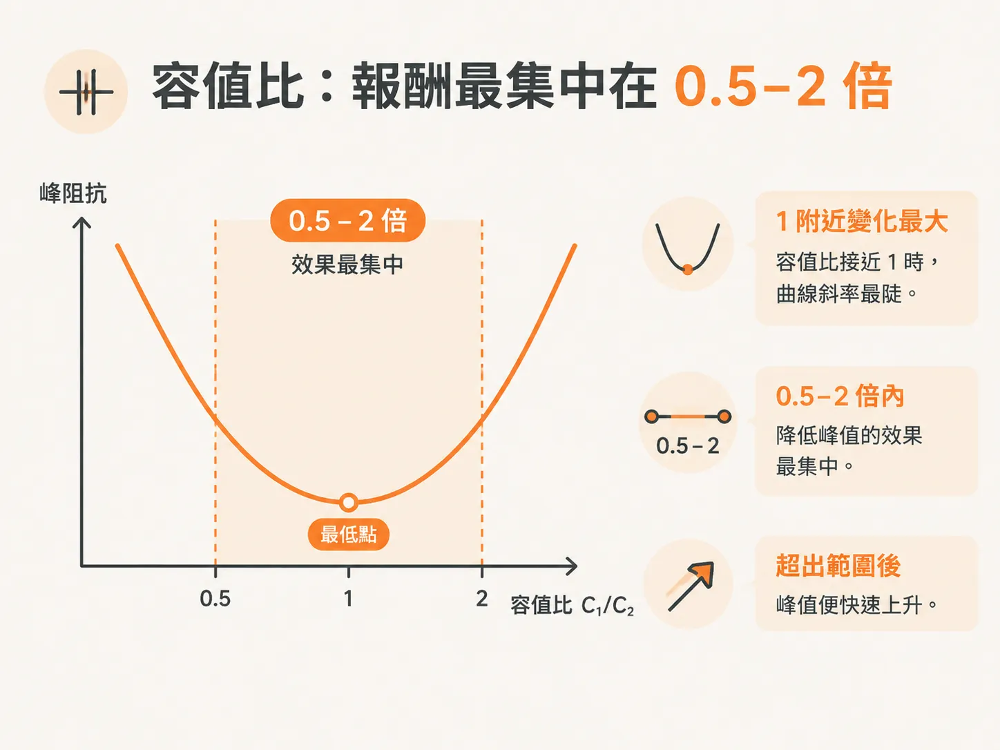
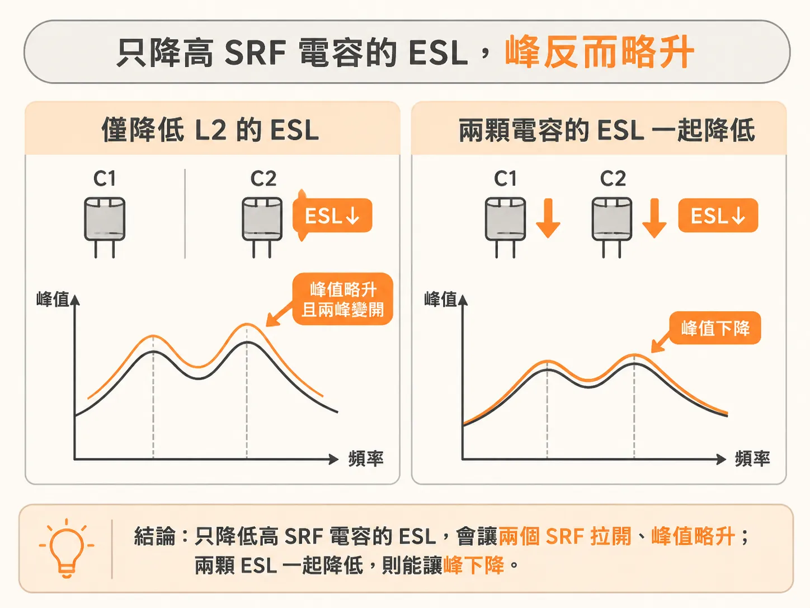

# 壓低 parallel peak 的三個旋鈕

峰值的絕對高度很難準確計算。書上說得很直接：PRF 的峰值阻抗很難用解析式精確求得，只能透過模擬估算；能分析的是它受到哪些因素影響。當兩顆電容的容值差距很大、ESL 相同時，Zpeak 由 L1、R1、R2、C2 等參數決定。

這些參數裡藏著三個調整方向：縮小容值差距、提高 ESR、降低 ESL。

## 容值比：效果最集中在 0.5–2 倍

先看容值。書上的掃描固定一顆 10 nF，另一顆則從 0.1 nF 掃到 1000 nF，也就是固定值的 1% 到 100 倍。兩顆電容的迴路電感都是 1 nH，ESR 都是 50 mΩ。

結果很明確：掃描電容的容值小於 10 nF 時，峰值會升高；小到 0.1 nF 時，峰值最高。容值大於 10 nF 時，峰值則逐漸飽和，再增加容值也無法進一步降低。

變化最陡的區間落在容值比 1 附近。當 C1/C2 落在 0.5 到 2 之間，曲線斜率最大，降低峰值的效果也最集中。超出這個範圍後，峰值便快速上升。

因此，「夠接近」的定義是容值相差不超過兩倍。兩顆電容的容值越接近，峰值就越低；最低點出現在兩者相等時。書上也將這個結果換算成選值上的建議：每個十倍容值區間安排三個值。這項建議的前提是兩顆電容的 ESL 相近。

這樣做也有代價：要縮小容值差距，就得增加容值種類。每個十倍容值區間放三個值，正是這個意思。

## 提高 ESR 反而能降低峰值；降低 ESL 則始終有效

第二個調整方向有些違反直覺：ESR 越大，峰值反而越低。Zpeak 與兩個分支的串聯電阻有關。無論 R1 或 R2，從 0.001 Ω 增加到 0.01 Ω，都會讓峰值下降。這也是 controlled-ESR 電容存在的原因：它的 ESR 比一般電容高。

但這會帶來其他影響。ESR 決定 SRF 谷底的高度；ESR 增加時，峰值雖然降低，谷底也會變淺，低頻區段的阻抗便不會那麼低。

真實電容還有一個細節：容值較小的電容，ESR 通常略高。當兩顆電容的容值相差很大時，這個效應會使實際峰值比固定 ESR 模型預測的低一半以上；若兩顆容值接近，這個效應則幾乎不明顯。

第三個調整方向是 ESL。書上明確指出，降低 ESL 始終有效，但降低哪一顆電容的 ESL，結果並不相同。

只降低 L1，也就是低 SRF、大容值電容的電感，會使它的 SRF 往上移。兩個 SRF 越接近，峰值就越低。

只降低 L2 則不同。高 SRF、小容值電容的 SRF 會往上移，使兩個 SRF 反而拉開；峰值會略微升高，最後趨近某個極限值。

實務上，若兩顆電容採用相同的安裝幾何，L1 和 L2 通常會一起降低。兩者同時降低時，峰值也會下降；至於能降低多少，無法準確計算，仍須靠模擬確認。

## 先調整哪一項？

如果手上只有一版 layout，建議先調整容值比。

理由很實際：調整容值比只需要更動 BOM，不必修改 layout；而且效果最集中在 0.5–2 倍的範圍內。以 10 nF 搭配 100 nF 為例，兩者相差十倍，峰值已落在快速上升的區段。若將 100 nF 換成與 10 nF 相差不超過兩倍的容值，峰值就會明顯降低。

第二順位是 ESR，前提是找得到合適的 controlled-ESR 零件。這種做法不必改板，但代價是谷底會變淺。

降低 ESL 始終值得考慮，但優先順序排在後面。只降低小容值電容的 ESL，會使兩個 SRF 拉開，峰值甚至可能略微升高；若要降低 ESL，最好讓兩顆電容一起降低。由於效果只能透過模擬確認，通常得等到下次改板時再處理。

峰值的位置已有計算方法，高度也有調整方向。接下來要確認的是規模：總共需要幾顆電容才夠？每顆電容的 ESR 與 mounted L 又該如何取得？
