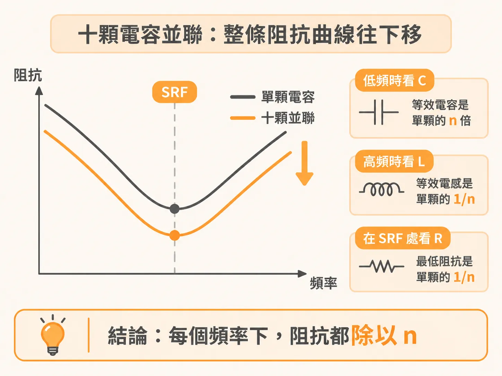
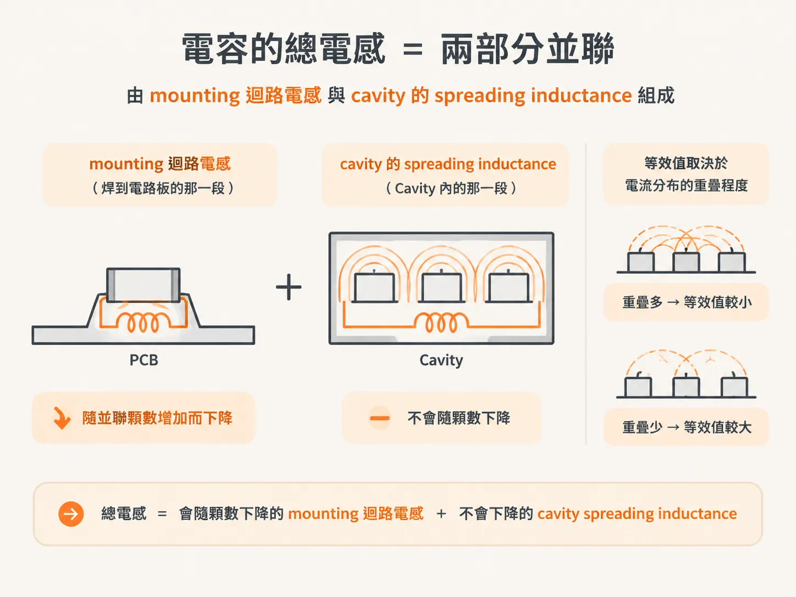

# n 顆相同電容：整條曲線往下搬

## 整條曲線往下移，形狀不變

谷底會更低，曲線形狀則不變。並聯兩顆相同的電容，新曲線就是原曲線除以 2；並聯十顆，則除以 10。

教科書的說法更直接：n 顆相同的串聯 RLC 電路並聯後，曲線形狀和單顆時完全相同，只是等效的 R、L、C 改變了。

低頻時看 C，等效電容是單顆的 n 倍；高頻時看 L，等效電感是單顆的 1/n；在 SRF 處看 R，最低阻抗是單顆的 1/n。三者合起來，代表每個頻率下的阻抗都除以 n。

SRF 保持不變，因為它由 L 和 C 決定。C 乘以 n，L 除以 n，兩者的乘積仍與原來相同。谷底的深度則由 R 決定：R 除以 n，谷底就會更低。Q 也有相同的變化。

我們可以用書上的參數算一次：R = 0.01 Ω、L = 1 nH、C = 1 nF。十顆並聯後，等效值變成 0.001 Ω、0.1 nH、10 nF。谷底阻抗從 0.01 Ω 降到 0.001 Ω，曲線的其他部分也都除以 10，因此形狀不變。

## 除以 n 的只有 mounting 那一段

真實電感的等效電感不只來自單一部分。電容的等效電感由兩部分組成：一是焊到電路板上的 interconnect 迴路電感，二是電容位置到被去耦元件之間、位於 cavity 內的 spreading inductance。

焊到電路板上的那一段稱為 mounting inductance，會隨著並聯顆數增加而下降；cavity 內的那一段則不會。它的等效值如何變化，取決於各顆電容在 power/ground cavity 中的電流分布彼此重疊的程度。

縮放律假設整個 L 都除以 n，但實際上只有 mounting 那一段會隨顆數增加而下降。並聯十顆後，高頻下的等效 L 不會降到單顆的 1/10，因此高頻區段的阻抗降幅也不到十倍。

並聯相同的電容，等於換成一顆容值更大、電感更小的電容，是壓低電感的重要方法。至於高頻能降低多少，則要看 mounting 那一段占總電感的比例。

以上討論都假設每顆電容彼此相同。那麼，如果第二顆和第一顆不同，容值小了十倍呢？曲線還會只是整條往下移嗎？
