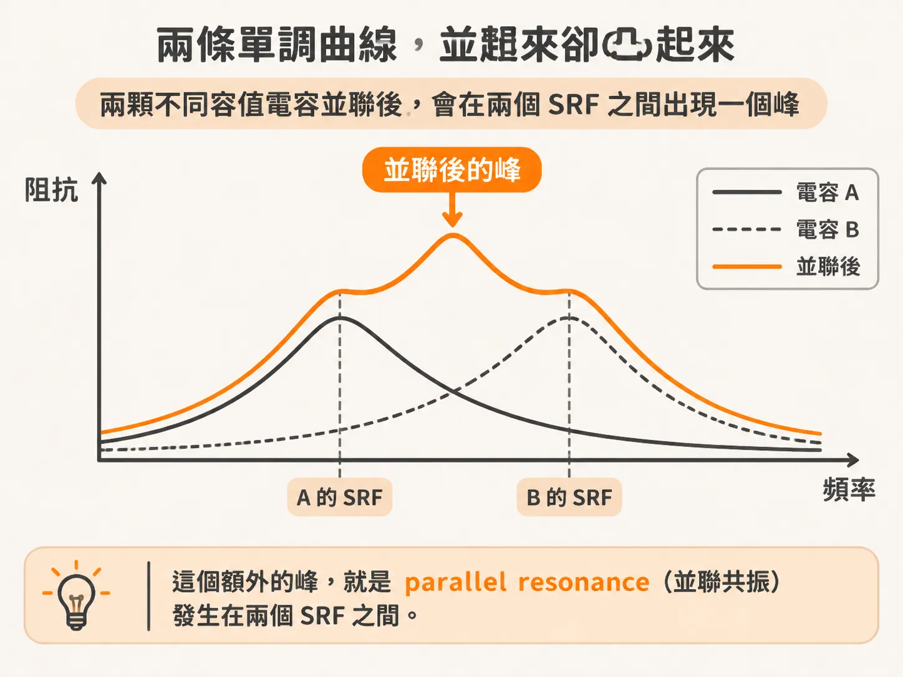
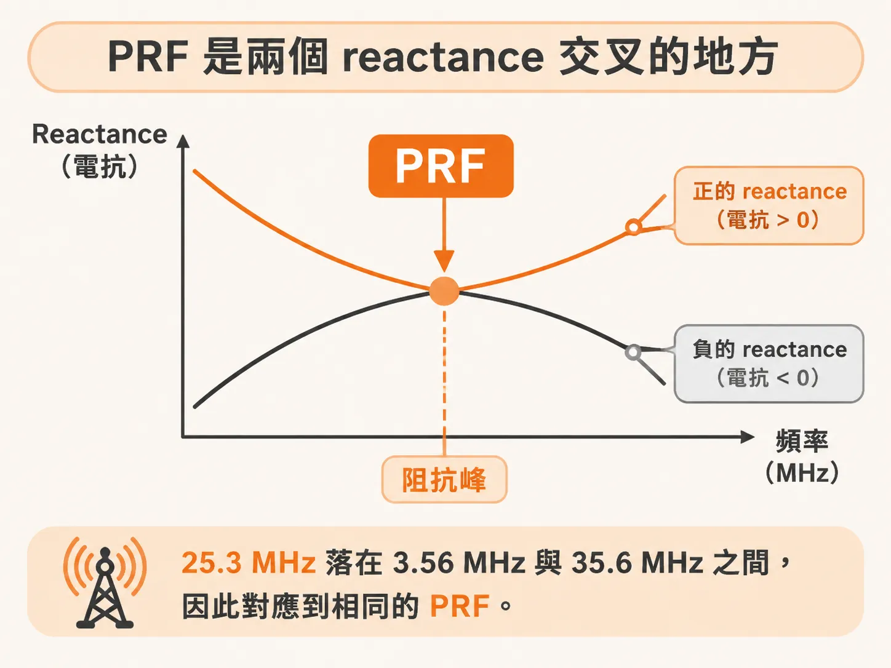

# 兩個 SRF 之間的那個峰

## 兩條各自先降後升的曲線，合起來卻凸起一個峰

合併後，曲線不只是整體往下移。兩顆電容的容值相差一百倍，阻抗曲線中間還會多出一個峰。

書上的條件是：兩個串聯 RLC 支路並聯，但 SRF 不同。兩支路的 R 和 L 相同，C 則相差一百倍。單獨看每一顆，阻抗曲線都是先降後升；兩顆並聯後，中間卻凸起一個峰。

這個峰是 parallel resonance（並聯共振）的特徵，位置落在兩個 SRF 之間。

峰為什麼會出現？低 SRF 的那顆電容較大，會把整體阻抗往上拉；高 SRF 的那顆電容較小，則會把阻抗往下拉。兩股力量在中間交會，於是形成一個峰。這個峰所在的頻率稱為 PRF。

## 峰左邊看 C 相加，峰右邊看 L 並聯

低頻時，兩顆都還在容性區。整個組合的等效電容，就像兩顆電容並聯，為 C1 + C2。

高頻時，兩顆都進入感性區。等效電感則是兩顆電感並聯，即 L1L2/(L1 + L2)，比單顆電感小。

峰夾在兩者之間：低頻端的阻抗由 C 決定，高頻端則由 L 決定；中間那一段呈現的是新的行為。

在 PRF，電流會在兩個分支之間來回流動。等效電容是兩顆電容串聯，為 C1C2/(C1 + C2)；等效電感則是兩顆電感串聯，為 L1 + L2。從電流源看進去，這組串聯的 L 與 C 又形成並聯共振，峰就是這樣產生的。

## PRF 是兩個 reactance 交叉的地方

先定義下標：大容值那顆記作 1，SRF 較低；小容值那顆記作 2，SRF 較高。

每一顆的 reactance 為 X = ωL − 1/(ωC)。在 PRF，兩條曲線交叉，也就是大小相等、正負相反：X1 = −X2。此時，低 SRF 的那顆已經越過 SRF，呈感性；高 SRF 的那顆仍在 SRF 以下，呈容性。

展開：

ωL1 − 1/(ωC1) = −ωL2 + 1/(ωC2)

移項：

ω(L1 + L2) = 1/(ωC1) + 1/(ωC2)

兩邊同乘 ω：

ω² = (1/C1 + 1/C2) / (L1 + L2)

換算成 Hz：

f_PRF = 1/(2π) × √[(1/C1 + 1/C2) / (L1 + L2)]

這個式子表示：L1 與 L2 串聯，C1 與 C2 也串聯，兩者共同形成共振。峰值頻率只由 L 和 C 決定。

用書上的數字算一次。兩顆的 L 都是 2 nH；小容值是 10 nF，大容值是 1000 nF。

先算兩個 SRF。1000 nF 那顆：

1/(2π√(2 nH × 1000 nF)) ≈ 3.56 MHz

10 nF 那顆：

1/(2π√(2 nH × 10 nF)) ≈ 35.6 MHz

再算 PRF。串聯後的 L 為 4 nH；串聯後的 C 為 1000 × 10 / (1000 + 10) nF ≈ 9.9 nF。因此：

1/(2π√(4 nH × 9.9 nF)) ≈ 25.3 MHz

25.3 MHz 落在 3.56 MHz 與 35.6 MHz 之間。原始模擬也得到相同的 PRF。

峰的位置找到了，峰值高度還不知道。要怎麼把它壓低？
