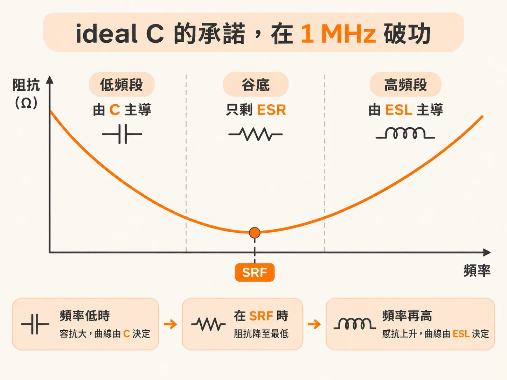
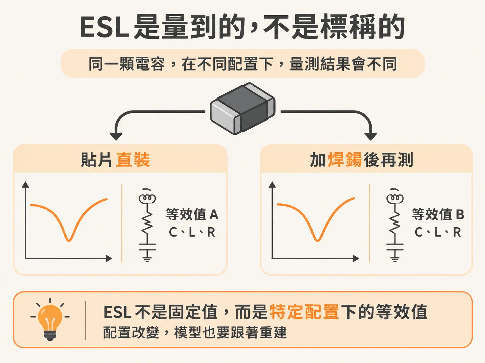

# 一顆 MLCC，就三個理想元件

## 前言

板子上的 Z(f) 有谷也有峰，而這些形狀幾乎都來自 MLCC。看不懂曲線，選值就只能照抄 reference design。別人問「為什麼選這幾顆」，也答不上來。

這種情況通常出現在兩種場合：一是手上有量測到的 1–200 MHz 阻抗曲線，想知道每個轉折是由什麼造成的；二是拿到別人的 PDN，想判斷其中的谷與峰是否合理。讀者應該已經熟悉 RLC、reactance、阻抗振幅與相位，也看過 series 的谷與 parallel 的峰。還沒把 ESL 當成主角，是很常見的起點。

這個 node 依序探討四個問題：一顆電容的曲線為什麼是「C 段、谷、L 段」？n 顆相同的電容並聯，改變了什麼，又沒改變什麼？兩顆不同容值的電容並聯時，為什麼會在兩個 SRF 之間形成一個 parallel peak，位置又該怎麼算？峰值要怎麼壓低，又該先調整哪一個旋鈕？

讀完之後，看到一條曲線，讀者應該能標出每一顆電容的 SRF，也能標出兩顆電容之間的 PRF。峰值由哪個元素主導、下一步該調整哪個旋鈕，都應該能說得清楚。

這一篇只處理第一顆電容。要回答的問題是：一顆 MLCC 的 Z(f) 為什麼會形成 C 段、谷、L 段？

## 理想電容的承諾，在 1 MHz 破功

0.1 µF 的理想電容，在 1 MHz 時阻抗約為 1 Ω。理想電容的阻抗會隨頻率上升而反比下降，Z = 1/(ωC)；容值越大，阻抗越低。

很容易因此得出一個結論：多加幾顆電容，高頻阻抗就會一路下降。對理想電容來說，這是對的。

真實電容卻不是這樣。焊在板子上的電容，只有在頻率遠低於自諧振頻率時，才近似理想電容。頻率再往上，等效串聯電感（ESL）便開始發揮作用，把低頻時的低阻抗轉成高頻時的高阻抗。因此，「多加幾顆，阻抗就會一直下降」這個推論，在這裡不再成立。

實務上，用理想的 series RLC 電路，就能相當準確地描述真實電容。把 C、L、R 三個理想元件串聯起來，便形成這個模型。量測到的 0603 MLCC 曲線，與這組模型的模擬曲線重疊時，形狀相當吻合。

曲線的三段各有主導者。頻率低於 SRF 時，容抗 1/ωC 仍然很大，曲線由 C 主導。頻率升高後，容抗下降、感抗上升；兩者在 SRF 相消，阻抗降至最低。谷底處只剩 ESR。頻率再往上，ωL 開始主導，阻抗隨頻率上升，曲線由 ESL 決定。

書上那顆 0603 X2Y 電容也是如此：R = 0.01 Ω、C = 180 nF、L = 0.43 nH。0.01 Ω 決定谷底的高度；180 nF 決定左段的阻抗有多低；0.43 nH 則決定右段上升得有多快。這三個值合在一起，就描述了曲線的三段與谷底。

## ESL 是量出來的，不是標稱出來的

series RLC 的三個值都是等效值，定義方式也一致：讓模型符合真實電容的量測行為。

C 表示「要用多大的理想電容，才能重現這顆電容的 series RLC 行為」；ESL 表示「在某種 mounted 配置與量測方式下，模型需要多大的串聯電感，才能符合量測結果」；ESR 則表示「模型需要多大的串聯電阻，才能符合量測結果」。

ESL 的定義包含兩個條件：mounted 配置與量測方式。同一顆電容，換一種焊接方式或量測方式，若要符合新的曲線，L 就必須改用另一個值。因此，datasheet 上的 ESL 不能視為零件本身固定不變的常數，而是特定配置下的等效值。配置改變，模型也要跟著重建。

這個模型不只適用於 MLCC。書上的那顆 X2Y 電容透過六根 via 焊接到板子上，同一組三個元件也能吻合量測曲線。大多數其他種類的電容也適用。

也正因如此，這組模型可以直接用來計算並聯組合；後續的推導都會以它為基礎。

一顆電容的曲線已經弄清楚了。若再並聯第二顆一模一樣的電容，谷會變深，還是變寬？
