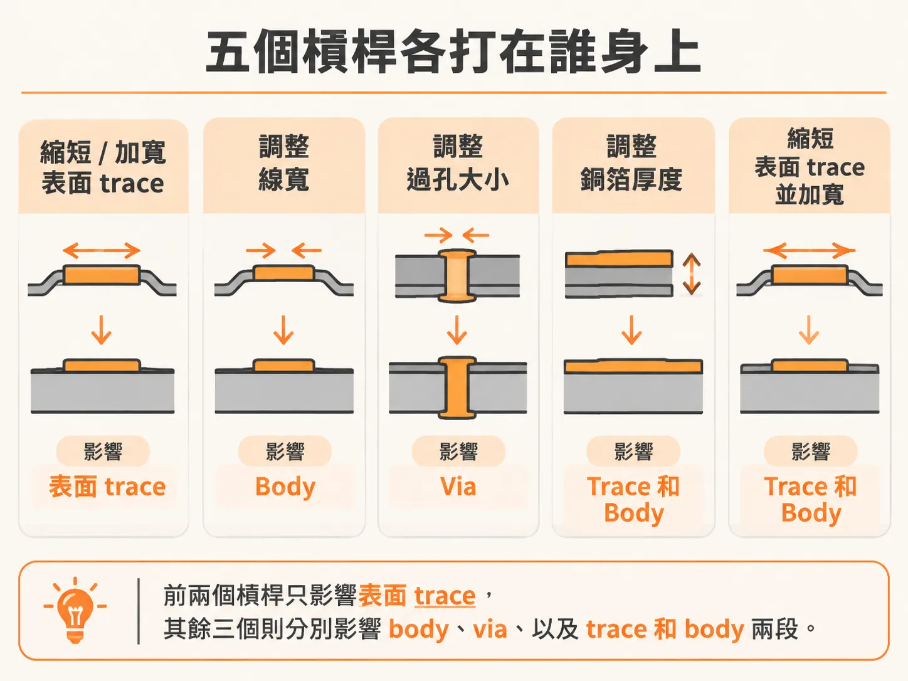
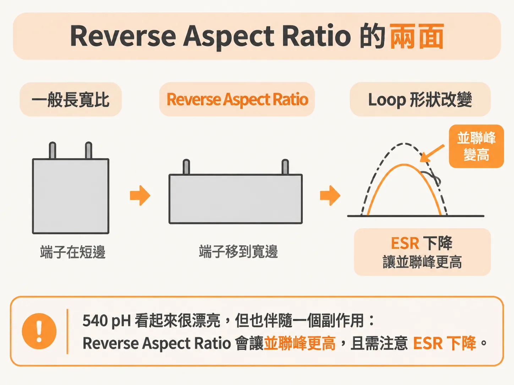
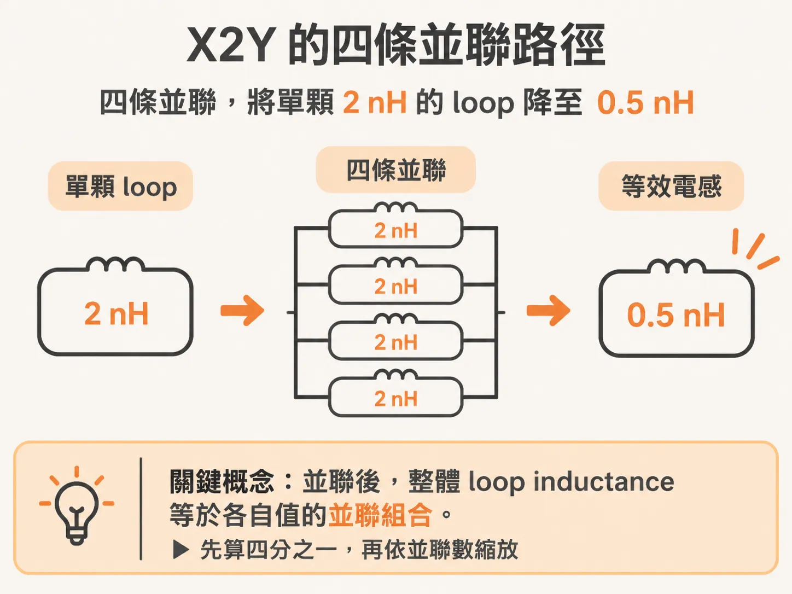
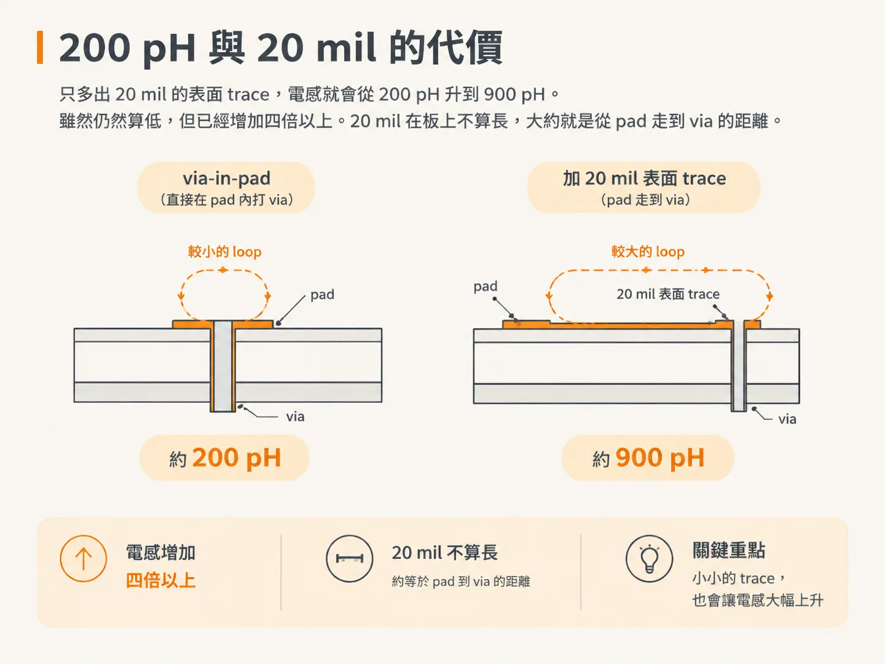

# 降低 mounting inductance 的五個設計槓桿

上一節留下的兩個數字都是 870 pH：一個來自表面 trace，另一個來自 body。via 只有 208 pH。因此，若要壓低這條 loop，得先承認一件事：在幾個可採取的動作中，把 via 拉近是最沒用的一個。

那麼，要怎麼把 2 nH 降下來？可調整的地方不多，整理起來只有五個槓桿。

## 五個槓桿各自影響哪一段

縮短表面 trace。較長的表面 trace 直接接在 loop 上，縮短它，就能降低電感。

加寬表面 trace。寬度會影響 h/w 的比例。線越寬，同一段長度的電感就越低。

讓 cavity 頂部盡量靠近板面。這個做法會同時影響兩段：trace 的 h 會變小，body 的 h 也會變小，因為 body 的高度是從板面量到極板。

改用 reverse aspect ratio 電容。端子開在長邊上，方塊數就會減少。

多顆 via 並聯。這是唯一能直接影響 via 的槓桿。

縮短與加寬表面 trace，影響的都是同一段，也就是上一節提到的 870 pH。其餘三個槓桿則分別影響 body、via，以及 trace 和 body 兩段。

如果只能先做兩件事，我會先縮短表面 trace。理由很實際：它的電感與 body 相當，但調整 trace 不必更換零件，也不必修改 stackup。這只是判斷，不是定理；如果你的板子 cavity 特別深，優先順序可能就會反過來。

## reverse aspect ratio 的兩面

reverse aspect ratio 電容會把端子設在寬邊上。同樣的容值，loop 所圍出的幾何形狀也會不同。

以一顆 0306 電容為例，典型配置如下：trace 高 5 mil、寬 60 mil、長 10 mil，且 via 直接打在 pad 上。body 的高度取 5 + 10 = 15 mil，寬 60 mil、長 30 mil。via 間距為 40 mil，直徑為 10 mil。

拆開估算後，trace 為 300 pH、body 為 140 pH、via 為 100 pH，總計約 540 pH，比 2 nH 少了將近四分之三。

540 pH 看起來很漂亮，但也伴隨一個副作用。

reverse aspect ratio 電容的 ESR 也會下降。端子之間的方塊數同時影響 ESL 與 ESR。方塊數從 2 降到 0.5 時，ESR 可能只剩標準方向的 25%。

阻尼變小，Q 值就會變高。如果 total loop inductance 沒有明顯下降，並聯峰反而可能更高。低 ESL 不等於低峰值，這是兩個不同的問題。

還要說明一個限制：540 pH 是把三段拆開後粗略估算的結果，只適合用來判斷各段的重要性。真正的 total mounted inductance 取決於整條 loop，只有 3D field solver 把所有幾何細節都納入計算，結果才會準確。

## X2Y 的四條並聯路徑

X2Y 又稱三端子電容，端子分布在兩端與中間，A、B 兩端則一起接到 power plane。

它的做法就像把好幾顆電容並聯在同一個本體裡，也就是 interdigitated capacitor。透過適當的 via pattern，through-hole via 可以直接穿過，不會佔用 routing channel。

四顆並聯，2 nH 就會降到 0.5 nH，因為並聯後的 loop inductance 等於各自 loop inductance 的並聯組合。要估算整體表現，最簡單的方法是先算四分之一，再依並聯數縮放。

它的好處不只一個：多顆電容並聯、多組 via pair 並聯、via 之間可以透過 mutual inductance 互相抵消，此外，較大的 via footprint 也能降低 spreading inductance。

但改善的關鍵不在 body。X2Y 的大部分改善來自 via 配置；本體只是把這些配置整合在一起。

## 200 pH 與 20 mil 的代價

同一顆 X2Y，量測結果可能差很多。

採用 via-in-pad 配置時，mounted loop inductance 可以低至 200 pH。

只多出 20 mil 的表面 trace，電感就會從 200 pH 升到 900 pH。雖然仍然算低，但已經增加四倍以上。20 mil 在板上不算長，大約就是從 pad 走到 via 的距離。

當 mounting inductance 很低時，一點點幾何變化就可能讓它大幅上升。這是低電感電容實際安裝到板上時，最容易失手的地方。layout 上一段看似「順手」的走線，就可能讓前面的努力白費一半。

這些 pH 數值都來自量測或模擬。那麼，vendor 提供的 S-parameter 能不能直接當作答案？
