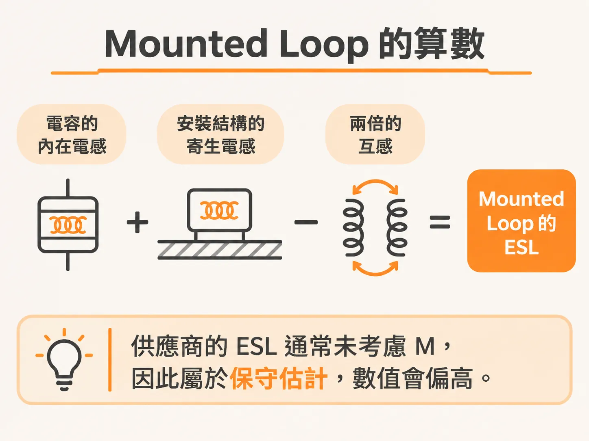
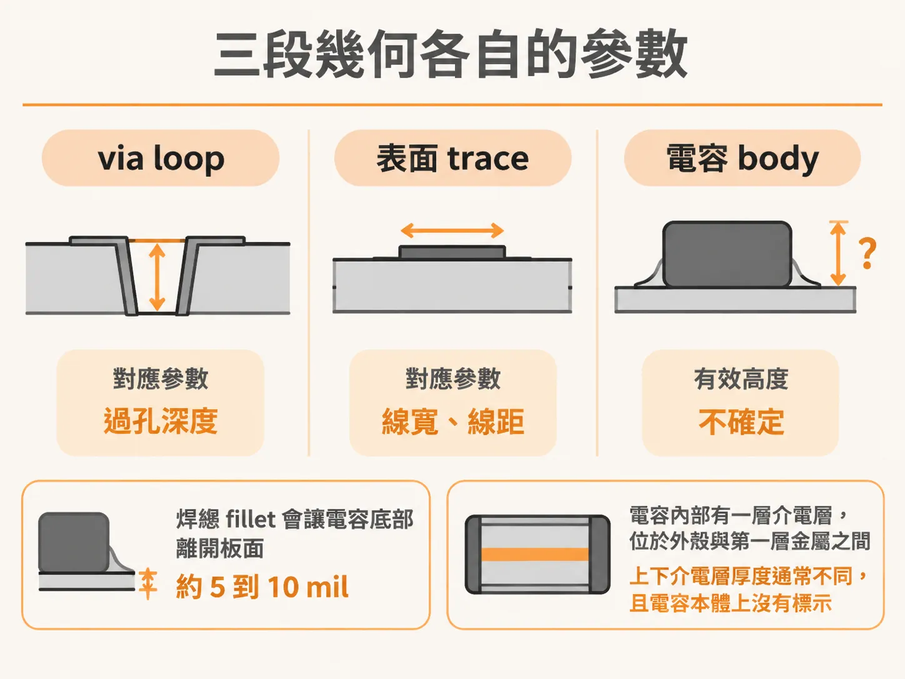
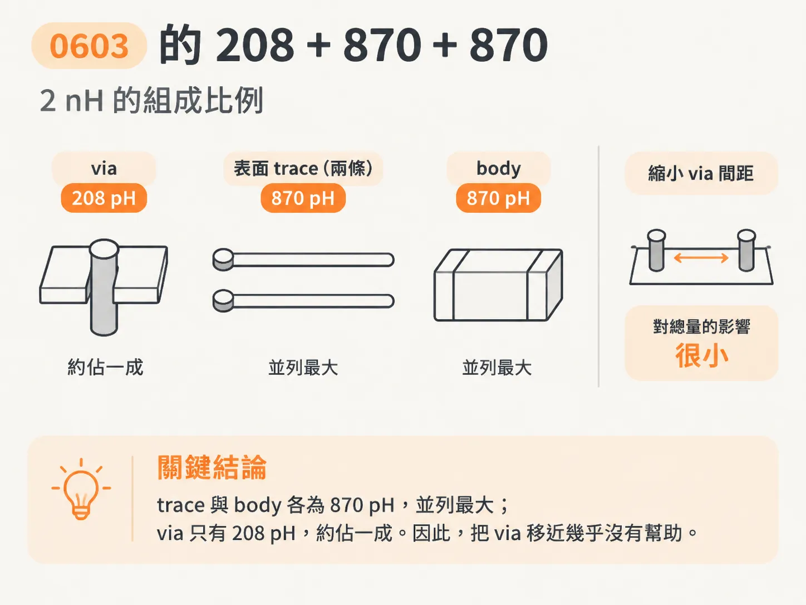
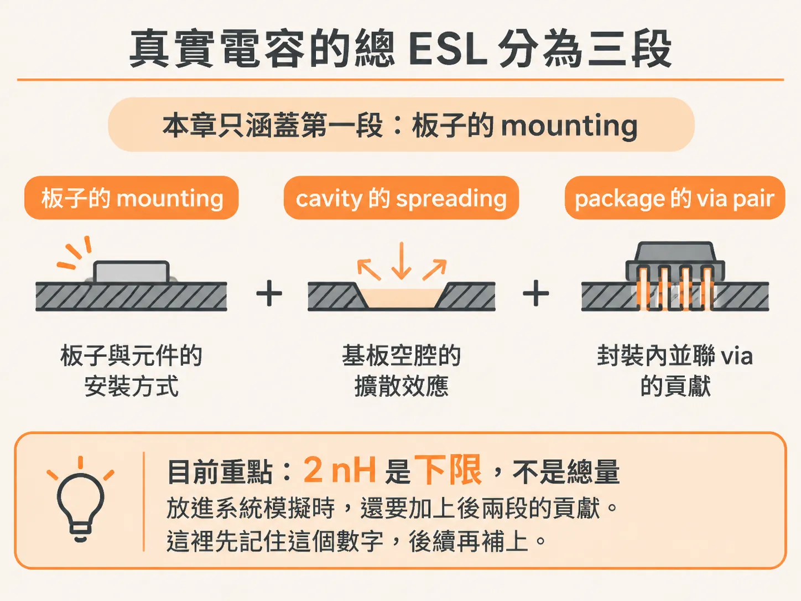

# 電容的 mounting inductance

## 前言

一顆 0603 電容放在深度 10 mil 的 cavity 上，若沒有特別設計，mounted loop inductance 大約是 2 nH。這個數字比容值更能決定它在 Z(f) 曲線上的位置。多數人選零件時只看容值，因為 datasheet 上根本沒有標示這 2 nH。

你可能會在三種情況下碰到這個問題：模擬時把供應商的 RLC 模型直接接到自己的 pad 上，曲線看起來很漂亮，結果卻和實際電路板對不上；Layout review 時看到兩顆容值相同的電容，一顆有效，另一顆卻沒什麼效果；或是高頻 noise 壓不下來，容值加了一倍，峰值卻只降了一點。

本文依序回答五個問題：2 nH 是由哪些幾何結構貢獻的？哪些設計槓桿能壓低最大的兩項？原廠提供的 S-parameter 能不能直接使用？不能直接使用時，還能從檔案中取得哪些資訊？mounted L 壓到 1 nH 以下後，RLC 模型還夠不夠用？

答案會整理成一張可逐段調整的幾何清單、一套判斷 vendor 檔案的規則，以及一條判斷何時該更換模型的界線。先從第一個問題開始：這 2 nH 究竟來自哪裡？

## 只有 mounted loop 算數

業界常見的做法，是把供應商提供的 RLC 模型接上自己的 mounting 結構，再放進系統模擬。這種做法容易誤導人，因為很少有人說得清楚 ESL 究竟包含了哪些幾何結構。

真正重要的是 mounted loop inductance，也就是電容安裝到電路板上後，電流流經 pad、trace、via 與 return path 所形成的總迴路電感。

這個 loop 由兩部分的 partial inductance 組成：一部分是電容本體的 intrinsic inductance，另一部分是 mounting 結構的 partial inductance。兩者相加後，還要減去兩倍的 mutual inductance。原因很簡單：兩段 partial 共用部分磁力線，因此在總迴路中會互相抵消。

L = L_intrinsic + L_mount − 2M

供應商提供的 ESL 通常沒有考慮 M，因此屬於保守估計。這不代表它算錯，只是數值偏高。

這項誤差什麼時候比較小？當產品從 pad 到 via 之間有表面 trace，而且電路板較厚、via 較長時。什麼時候比較大？當電容尺寸較小（例如 0201），且安裝在含有 micro via 的 pad 上時。這是手機業界常見的做法。

還有一點要先釐清：intrinsic inductance 取決於量測時使用的 fixture；mounting 結構的電感，則取決於電路板上的 via 幾何、cavity 設計，以及它在 stackup 中的位置。這兩種電感來源不同，不能混為一談。

## 三段幾何各自的參數

第一段是 via pair。這裡使用一個簡單的近似：s 是兩根圓柱的中心距，r 是半徑，Len 是長度。這個近似只有在 s 遠大於 r 時才準確。這段 loop 由兩根 via 圍成。

第二段是表面 trace。這裡以 cavity 頂面為參考，使用 FR4 microstrip 的近似。參數包括 h（trace 到 cavity 頂面的距離）、w（線寬）與 Len（線長）。

第三段是電容本體。這裡也採用相同的近似，但有效高度不太確定。焊錫 fillet 會讓電容底部離開板面 5 到 10 mil；電容內部則有一層介電層，位於外殼與第一層金屬之間。上下介電層的厚度通常不同，而且電容本體上沒有標示。

粗略取板面到極板底部的距離為 15 mil，並不算離譜。但大電流會流經極板中央，因此板面到主要電流區域的距離可能達到 20 mil。

各項參數的影響方向很固定：via 看間距與長度；trace 看 h、w 與 Len；body 看極板離板面的距離。除此之外，封裝電容的總 ESL 還有一部分來自 cavity，這部分不在本節討論範圍內。

## 0603 的 208 + 870 + 870

先算 via。假設 via 從板面延伸到 cavity 頂面，長度為 10 mil、半徑為 5 mil、中心距為 80 mil，這段的電感貢獻是 208 pH。如果把 pitch 縮到 40 mil，例如讓 via 直接從電容邊緣引出，而不是分別從表面 trace 的兩端引出，電感只會小幅下降。

接著看表面 trace。當 h = 10 mil、w = 10 mil、Len = 30 mil 時，單側 leg 的電感為 435 pH。兩側等長，合計為 870 pH。

最後是 body。取 h = 10 mil + 20 mil = 30 mil、w = 30 mil、Len = 60 mil，得到 870 pH。

三段加總為：208 + 870 + 870 = 1948 pH，約為 2 nH。這組數字的前提是 cavity 頂面位於板面下方 10 mil，表面 trace 長 30 mil、寬 10 mil。

哪一段最大？trace 與 body 各為 870 pH，並列最大；via 的 208 pH 則只佔約一成。因此，把 via 移近幾乎沒有幫助。這個結果和直覺相反，但算過一次就能看出來：最大的兩項分別來自表面 trace 與 body。

如果這顆 0603 沒有特別針對低 mounting inductance 設計，2 nH 就是常見的數值。它不算最差，只是沒有經過特別優化。

## spreading 先記著不算

一顆實際接在 BGA 旁邊的電容，其總 loop inductance 可分成三段：第一段是連接到電路板的 mounting inductance；第二段是 power 與 ground 平面 cavity 中的 spreading inductance；第三段則是一路延伸到 package 的 via pair loop inductance。

本章只計算第一段。spreading 屬於 cavity，不屬於電容的 footprint。電流從 via 擴散進平面時，會形成額外的迴路電感；這部分取決於 cavity 的幾何結構。通往 package 的 via pair 也不在這條 loop 裡。

因此，2 nH 是下限，不是總量。放進系統模擬時，還要加上 cavity 的 spreading inductance，以及並聯 via 的貢獻。那是下一層的工作，這裡先記住這個數字。

回到這條 loop：870 pH 來自 trace，另外 870 pH 來自 body。下一個問題是：哪些設計槓桿能同時壓低這兩段？
