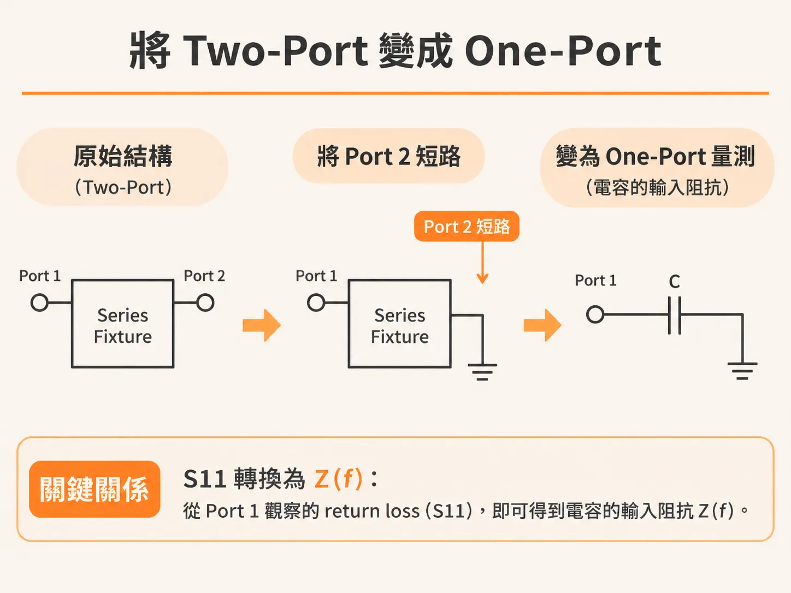
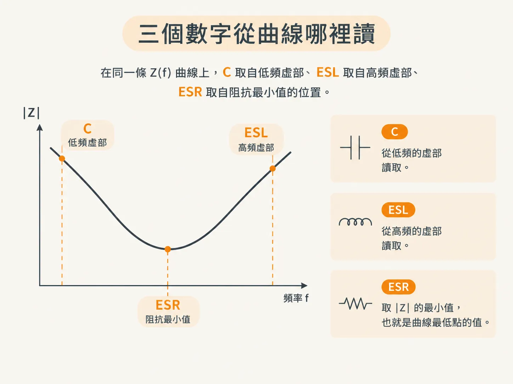
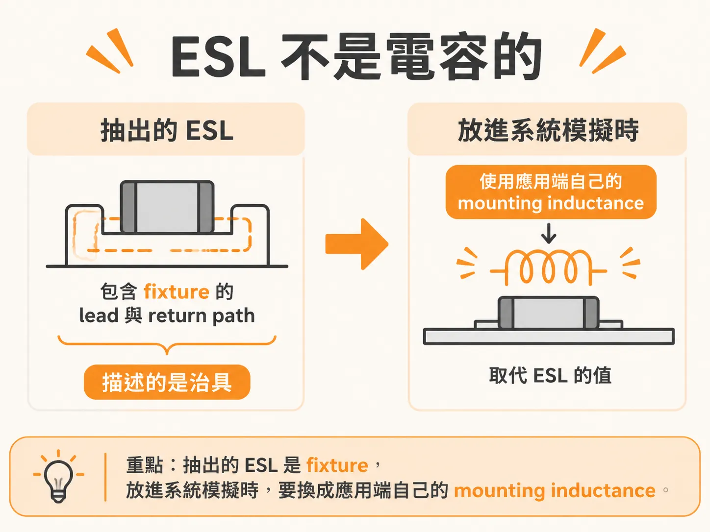
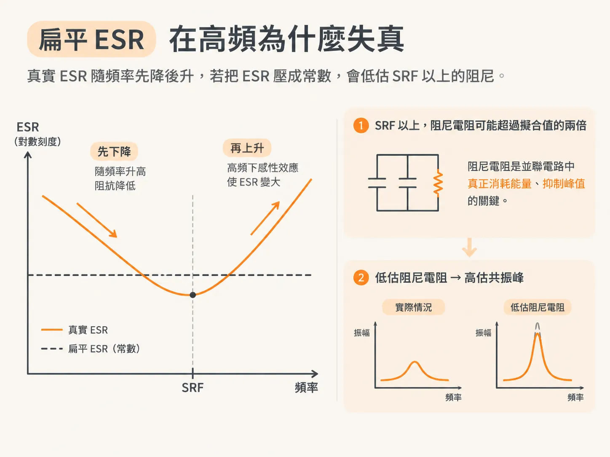

# 如何分析原廠的 S-parameter 模型

上一節的結論是：vendor S2P 檔案裡的資訊，多半只能用來取得電容值 C。本節要說明如何把這個 C 抽出來。順帶一提，ESL 與 ESR 也能一併讀出來，但要記得它們各自代表的是什麼。

先說明前提：這種做法假設檔案修正量很小，因此檔案仍能代表電容在 fixture 中的行為。如果前一節的三項檢查沒有通過，後續的計算再精確也沒有意義。

## 先把 two-port 轉成 one-port

第一步是抽出電容安裝後的阻抗曲線。

做法是將模型的一端短路，再從另一端觀察 return loss。如此一來，原本的 two-port series 量測就轉成了 one-port 量測，而這個 one-port 所呈現的，就是電容的輸入阻抗。

有了 one-port 的 S11，就能將各頻率點的數值換算成複數阻抗。務必確認 S11 是在 port 2 短路的條件下取得的。

Z(f) = Z0 (1 + S11) / (1 − S11)

書中使用 Keysight ADS 建立這個電路；你也可以用 Python 讀取 Touchstone 檔案，自行完成相同的計算。

## 三個數字要從曲線的哪裡讀？

取得 Z(f) 之後，要從曲線上的三個不同位置讀出三個數值。

C 看低頻。在低頻時，假設阻抗幾乎完全呈電容性，再根據虛部反推出電容量。

ESL 看高頻。在高頻時，虛部主要由電感造成，可直接從虛部換算出等效串聯電感。

ESR 則取 |Z| 的最小值，也就是曲線最低點的數值。

以一顆 47 nF 的 0402 MLCC 為例，抽出的數值為 C = 42.6 nF、ESL = 0.71 nH、ESR = 0.0298 Ω。用這三個數值建立簡單的 series RLC 模型，結果與量測曲線相當吻合。

但吻合的結果容易讓人忘記，這三個數值的來源並不相同：C 與 ESR 屬於電容本身，ESL 則不是。

## ESL 不屬於電容本身

抽出的 ESL 包含 fixture 的 lead 與 return path，因此描述的是治具，而不是你的電路板。

因此，將參數放入系統模擬時，正確做法是使用抽出的 C 與 ESR，再加上你為應用端估算的 mounting inductance，而不是直接把 0.71 nH 當成安裝後的電感值。

0.71 nH 代表的是 fixture 的 loop inductance。你的 0603 電容若安裝在 10 mil cavity 上，電感可能達到 2 nH。兩者相差三倍，模擬結果當然也會不同。

這就是前一節那條規則的由來：S2P 檔案可以提供 C，卻無法提供你的 mounting inductance。

## 為什麼固定 ESR 在高頻會失真？

series RLC 模型假設 ESR 不隨頻率改變，但真實電容並非如此。

低頻時，損耗主要來自介電材料，且會隨頻率上升而下降。當頻率升高到某個程度，skin depth 會使電流在電容本體內重新分布，ESR 便會開始上升。

RLC 模型將電阻簡化為一個常數，通常取 |Z| 的最小值。這會使模型在高頻低估阻尼。

在 SRF 以上，有效阻尼電阻可能超過擬合值的兩倍。阻尼電阻是並聯電路中真正消耗能量、抑制峰值的因素；低估它，就等於高估兩顆電容並聯時的共振峰。

對多數電容而言，實部最小值出現的頻率落在 1 到 10 MHz。這個頻率大致是 skin depth 開始重新分配電流的起點，也大致對應電容在測試治具中的 SRF。

因此，擬合得到的 ESR 可視為這顆電容可能達到的最低 ESR。它仍是一項 figure of merit，但屬於偏保守的數值，不適合用來描述並聯共振時的阻尼。

同樣的電流重新分布機制，也會使高頻下的感量下降。因此，在高頻時，抽出的曲線會比 RLC 模型的預測值更低一些。

若要準確描述 SRF 以上的行為，就需要使用頻寬更高的模型。這類模型會將電流重新分布納入考量，因此能預測阻尼隨頻率上升而增加、感量隨頻率上升而下降的現象。

不過，當 mounted L 降到 1 nH 以下時，連 RLC 模型本身也開始不敷使用。
