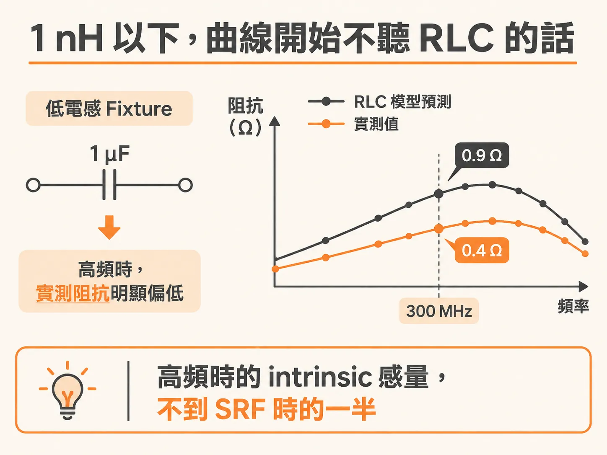
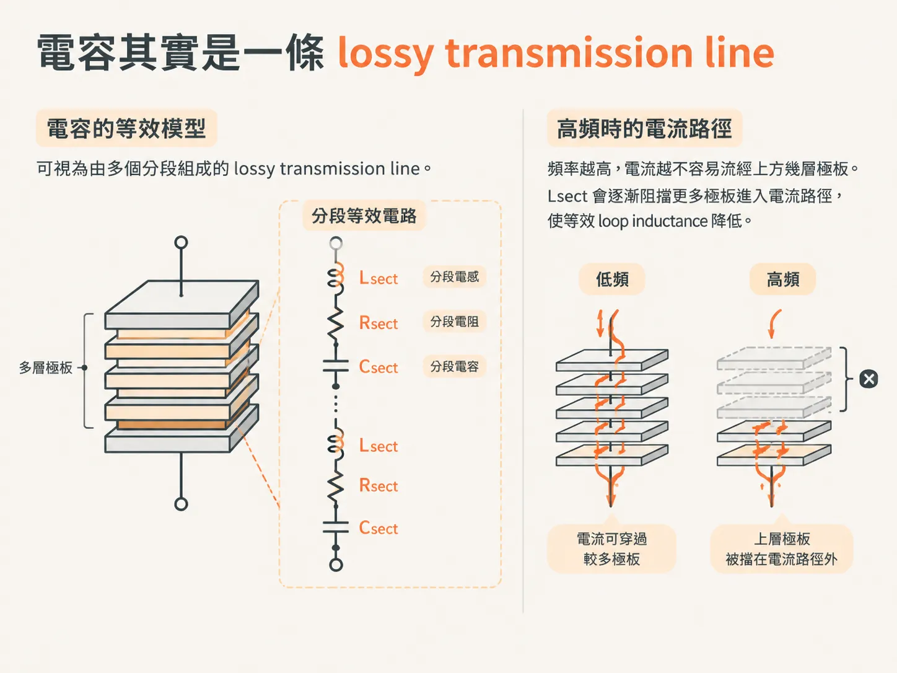
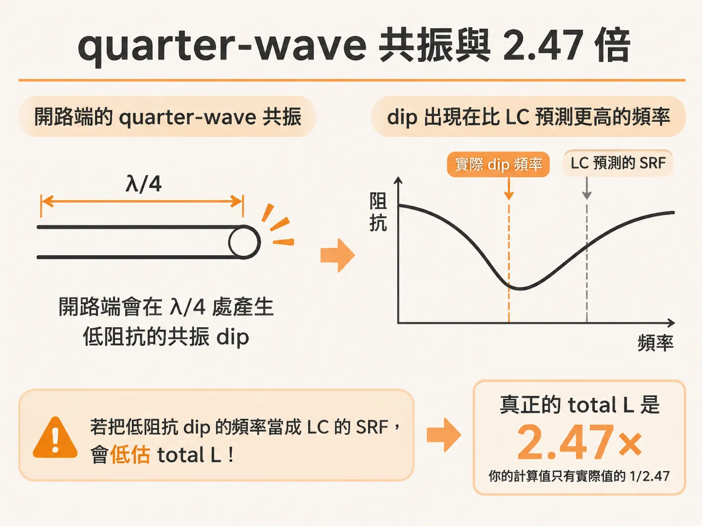
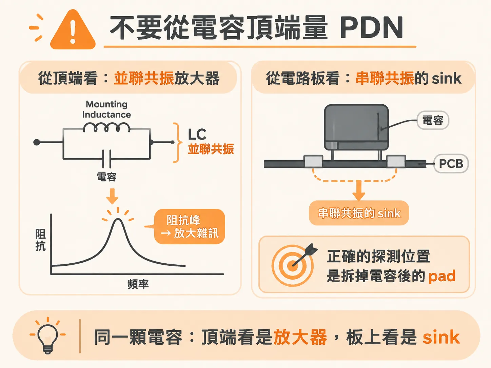

# 更高頻寬的電容模型

上一節停在一個界線上：mounted L 壓到 1 nH 以下時，RLC 模型就開始不夠用了。問題出在哪裡？

答案在於頻率。容值與 ESR 仍然符合預期，但感量會隨頻率改變。因此，阻抗曲線的高頻部分會逐漸偏離 RLC 模型的預測。

## 1 nH 以下，曲線開始不聽 RLC 的話

當 mounted inductance 明顯低於 1 nH，真實電容的阻抗就會顯現出一些平常看不到的特徵：感量與電阻都會隨頻率變化。

這種情況最容易出現在 cavity 頂部非常靠近板面的設計中。低電感設計本來就容易出現這類現象。

書中的例子是一顆安裝在低電感 fixture 上的 1 µF 電容。電容區段與 series resonance 附近的曲線，都與簡單 RLC 模型吻合得很好。

但高頻感量區段就不一樣了。到了 300 MHz，RLC 模型預測的阻抗是 0.9 Ω，實測值卻只有 0.4 Ω。這表示高頻時的 intrinsic 感量不到 SRF 時的一半。

原因可以這樣理解：在高頻下，電流會傾向流經電容較低處、靠近 mounting 結構中 return current 的位置。這有點像 skin effect：頻率越高，磁場能穿透導體的深度越小。

極板本身的串聯電阻則會把電流推向更深處，讓更多極板並聯，以降低電阻。這兩股力量互相拉扯，結果便是等效感量隨頻率變化。

要觀察到這個現象，fixture 的感量必須很低。如果 cavity 埋得太深，或表面 trace 太長，傳輸線效應只占總感量的一小部分，就很難看出來。

## 電容其實是一條 lossy transmission line

把電容的截面畫出來，會發現它的等效電路並不是一顆 C 加上一顆 L，而是一串分段結構；每一段都有自己的 Lsect、Csect 與 Rsect。

這種拓撲稱為 lossy transmission line model。實務上不必逐一計算每一對極板；用十段以內的分段，就足以描述低電感 mounting 上的典型電容。

模型中有一個 dissipation factor，用來描述極板間的介電損耗。這個值可以透過量測擬合，也可以根據介電材料估算。X5R 的 dissipation factor 約為 0.01，主要影響低頻時阻抗的實部。

頻率越高，電流越不容易流經上方幾層極板。Lsect 會逐漸阻擋更多極板進入電流路徑，使等效 loop inductance 降低。

有效電容也會隨之降低，但這不是問題：頻率升高時，電容阻抗本來就會下降。

代價則是電阻上升。並聯的極板變少，等效 ESR 也就提高。

因此，同一顆電容在高頻下會同時出現三種變化：L 下降、C 下降、R 上升。這三者都會隨頻率改變。

## quarter-wave 共振與 2.47 倍

扣除 mounting 與 bottom 的感量後，電容看起來就像一條末端開路的傳輸線。這條線有每單位長度的 L 與 C，也有自己的 time of flight。

從底端看進去，當線長相當於四分之一波長時，阻抗會降至低點，電壓也會達到最小值。這個頻率就是 series resonant frequency。

問題在於，quarter-wave stub 的共振頻率比單一 LC 電路的近似值更高。傳輸線是分散式元件，並不是單一 LC；因此在 SRF 附近，用 LC 模型近似並不準確。

不過，兩者之間仍有關聯。量出低頻的 C，再量出 quarter-wave 共振頻率，就能推算整條傳輸線的 total L。

反過來說，如果把低阻抗 dip 的頻率當成 LC 的 SRF，就會算錯。真正的 total L 是那個 ESL 的 2.47 倍；手上算出的數字只有實際值的 1/2.47。

另一種做法是直接擬合：利用量到的 S-parameter，調整 lossy transmission line 模型的參數，讓模擬結果貼近量測值。

以一顆 47 nF 電容為例，只需要調整五個參數：dissipation factor 為 0.011、mounting inductance 為 0.570 nH、每段感量為 0.03 nH、每段電阻為 0.0028 Ω，總容值為 42.6 nF。

在這個例子中，大部分感量都來自 mounting。每段極板的感量只有 30 pH，足以說明 intrinsic loop inductance 可以低到什麼程度。

把這個模型套用到 100 µF 加 1 µF 的系統，差異就很明顯。RLC 模型在 3 MHz 與 60 MHz 預測出兩個很高的並聯峰；實測峰值只有預測高度的 20%，而且頻率更高、峰形也沒那麼尖。

lossy transmission line 模型則能把這兩個峰修正到接近實測結果。關鍵在於，電容安裝在極低電感的 mounting 上。只有當 mounting 的感量小於電容本身的感量時，這個模型才開始派上用場。

## 不要從電容頂端量 PDN

在 SRF，電容 pad 端的電壓最小，頂端（開路端）的電壓則最大。這是 quarter-wave 共振的特性。

因此，量測 PDN 時，絕不要從電容頂端下 probe。

從頂端看，電容與 mounting inductance 呈並聯關係。兩者形成 LC 並聯共振，在共振頻率上產生阻抗峰。量到的 noise 會被放大，尤其在 SRF 附近最明顯；其他頻率的 noise 則會被壓低，導致 noise 的頻譜形狀失真。

從板子一側看，情況正好相反：電容與 mounting inductance 串聯，形成 series resonance。對 power plane 而言，這條分支在 SRF 時呈現低阻抗，能吸收 noise。

同一顆電容，從頂端看是共振放大器，從板子看則是 noise sink。兩種觀點都正確，只是觀察方向不同。

正確的做法是先拆下電容，再把儀器接到 pad 上。板子的 PDN 電壓就應該在這裡量測。

到這裡，電容本身的部分就告一段落了。不過，via 散入 cavity 的那段 spreading 還沒計入；那就是 Tier 4 的起點。
