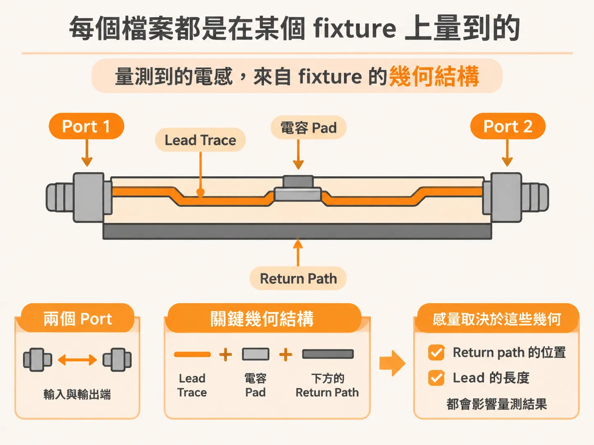
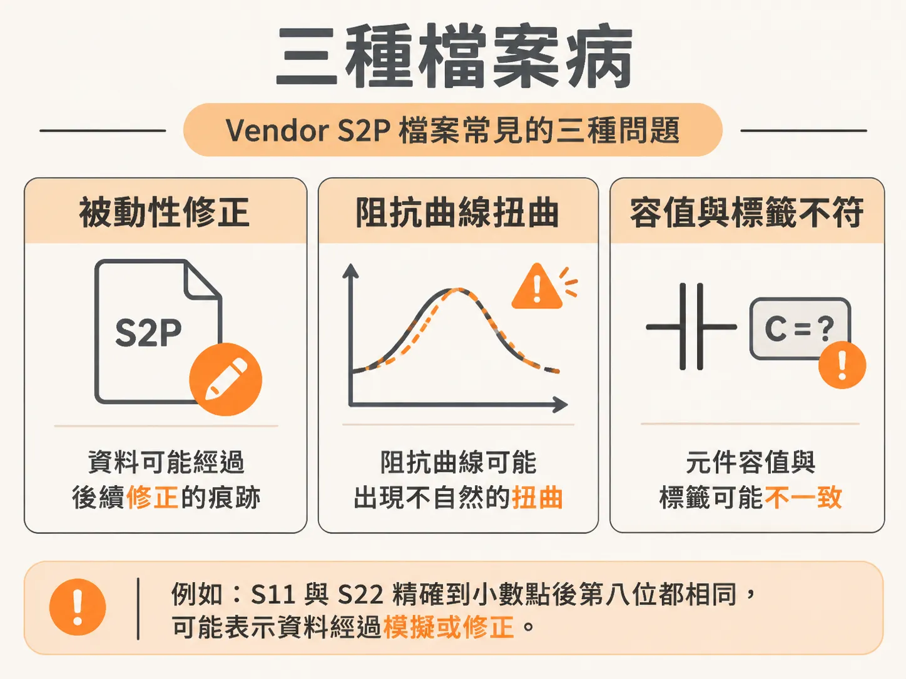
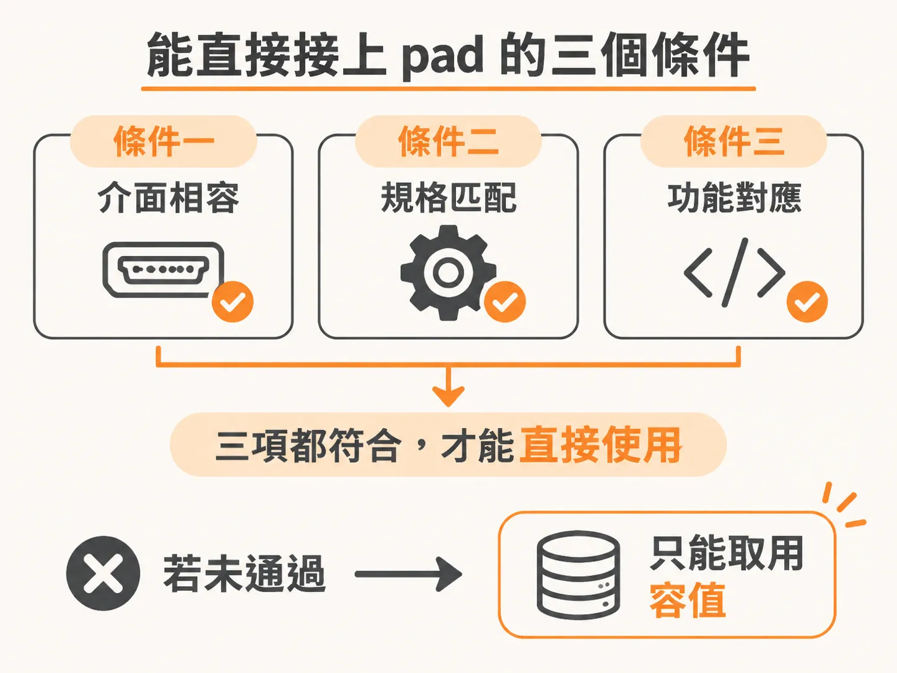

# 使用原廠提供的 S-parameter 電容模型

上一節提到的 200 pH 與 900 pH，都是實際量測的結果。那麼，vendor 附上的 S2P 檔能不能直接當作答案？

簡短的答案是：不能，除非你知道它是怎麼量出來的；而多數檔案並未提供這些資訊。

## 每個檔案都是在特定 fixture 上量得的

電容廠商提供 S-parameter 模型，是很常見的做法。這些檔案幾乎都是用同一種方式量得：將電容裝在 series fixture 上，進行 two-port 量測。

fixture 看起來像一條 microstrip。電容串接在 VNA 的兩個 port 之間，而從 port 的參考平面到電容 pad 之間，還有一段 trace。電容下方則有一條 return path。

量測到的電感來自 fixture 的幾何結構，而不是電容本身。return path 的位置、lead 的長度，都會影響結果。

很多人並不是這麼想的。廠商與客戶常把 S2P 檔直接放進系統模擬，因為他們以為 S-parameter 一定準確。畢竟，檔案的頻寬到了 3 GHz。

但頻寬不代表準確度，只表示檔案涵蓋了那個頻率範圍。

## 接上板子，就等於把 fixture 一起帶進來

在去耦模擬中，常見的接法是把模型的一個 port 接到板上的電容 mounting pad，另一個 port 短路接地。

問題很直接：S2P 描述的是電容在特定量測環境中的特性，其中也包含 fixture 的 lead，以及 return path 的位置。這些條件可能與你的 mounting 結構完全不同。

在你的應用環境中，mounting inductance 可能比量測時大很多，也可能小很多。兩者的差異會讓系統模擬結果產生誤導。

因此，判斷重點不是「這份檔案好不好」，而是「這份檔案描述的是誰的 mounting L」。答案是 fixture 的，不是你的。

## 三種檔案病

第一種：檔案經過修正，卻沒有說明修正方式。廠商通常會對量測資料進行 passivity 與 reciprocity 修正。被動性代表系統不能憑空產生能量；互易性則要求 S12 與 S21 相等。

修正演算法通常不會公開。書上的推測是：先從絕對值大於 1 的 S-parameter 中扣除一個偏移量，再將每一對項目替換成它們的平均值。

檔案裡可能會留下修正痕跡。例如，S11 與 S22 精確到小數點後第八位都相同。這種情況可能表示資料經過模擬或修正。

如果修正幅度很小，提供修正後的檔案並沒有問題。問題在於，使用者不知道修正前的資料有多糟。不了解原始資料的品質，就無從判斷手上的檔案能不能用。

第二種：資料明顯有問題，卻仍然上架。將 S-parameter 轉換成阻抗後，可能會看到非常誇張的扭曲；若與另一組行為正常的資料並列比較，差異會相當明顯。這種檔案不該被釋出。

如果量測工程師看過結果，通常會發現異常，接著重測或不發表。這也是不能盲目相信廠商量測結果的原因之一：使用前應該先自行檢查。

第三種：容值與標籤不符。曾有一個標示為 10 nF 的檔案，抽出的容值卻只有 5.8 nF。

原因不難猜。廠商可能是用 100 或 120 Hz 的阻抗橋量測容值，也就是電源線頻率。對需要在幾十 MHz 頻段進行 PDN 去耦設計的工程師來說，這個數字參考價值很低。MHz 頻段的 VNA 量測才更有意義。

多數 vendor 的 S-parameter 檔案都是批量產生，未必有資深工程師逐份檢查。因此，使用前要自行評估。

## 判斷規則

能直接使用的條件，比多數人想像的還嚴格。

第一個條件：fixture 的幾何結構要接近你的 mounting，包括 lead 長度與 return path 的位置。不能只說「差不多」，而要能說清楚差異有多大。

第二個條件：檔案必須乾淨。若 S11 與 S22 精確到小數點後第八位都相同，代表資料可能經過處理；若轉換成阻抗後出現明顯扭曲，則代表資料可能有問題。任何一項不符合，就應該放棄使用。

第三個條件：抽出的容值必須符合標籤。若對不上，可能表示標示的數值來自 100 Hz 量測，而不是你需要的頻段。

三個條件都符合，才有資格考慮直接把模型接到 pad 上。只要少一個，這份檔案就只能用來取得容值；ESL 與 ESR 則要依照你自己的幾何結構重新計算，或自行量測。

實際上，我很少遇到三個條件都符合的檔案。多數時候，S2P 檔的價值只在於提供那個 C。

既然不能直接接上去，那麼還能從檔案裡取得什麼？
