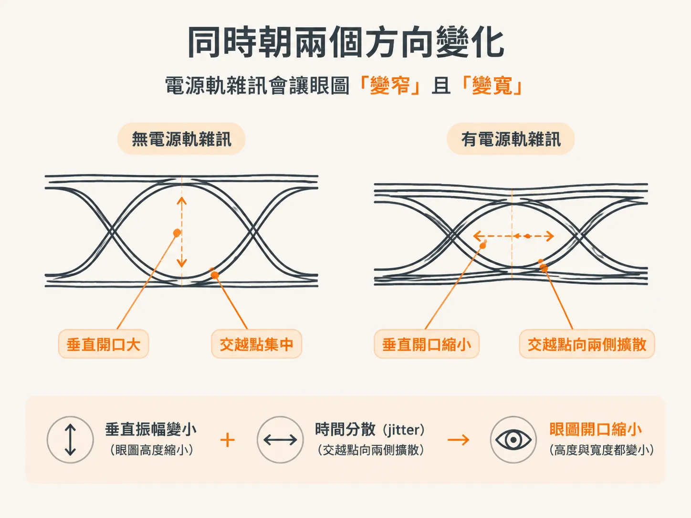
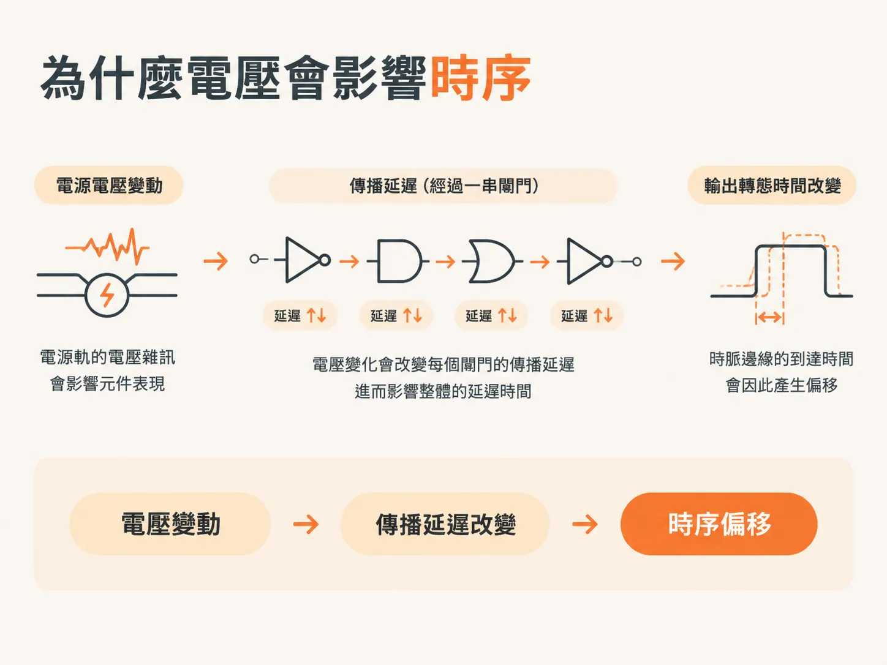
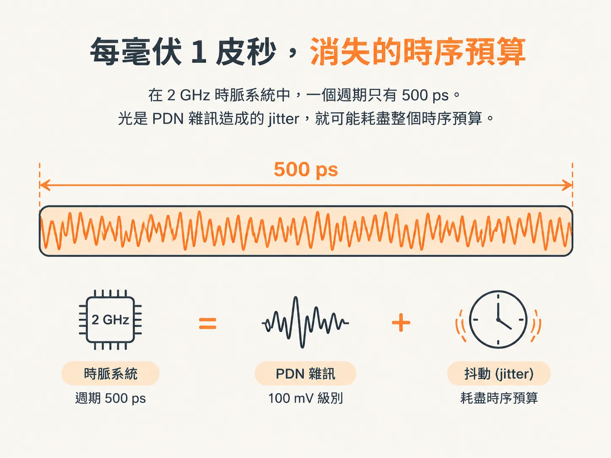

# PDN noise 的代價：eye 收縮與 1 ps/mV 的 jitter

## 同時沿兩個方向發生

前一篇中，PDN 被描述為一條路徑：從 VRM 接腳、平面、線纜和連接器，經過電容，最後一路延伸到晶片。我們最後提到，電源軌雜訊會付出代價。這裡要談的就是這個代價，以及它如何反映在眼圖上。

PDN 的雜訊控制失效時，任何訊號的眼圖都可能收縮。這種影響可分為兩類：一類發生在垂直方向，另一類發生在水平方向。

電壓雜訊會縮小眼圖的垂直振幅；訊號穿越參考電壓的時間則會在水平方向分散，而這種時間上的分散就是 jitter。眼圖的高度和寬度都變小，代表眼圖開口也跟著縮小。

眼圖縮小不代表連線一定會失效。即使雜訊單獨還不足以造成位元錯誤，也會使眼圖開口縮小。若再加上同一條連線上的其他雜訊來源，總雜訊就可能超出容許範圍，導致連線失效。

## 雜訊出現的位置：TX、RX，或兩者都有

依切換閘門的電路特性而定，PDN 雜訊可能會疊加到發射器（TX）送出的訊號上，也可能表現為接收器（RX）端參考電壓上的雜訊。

這兩種情況最後都會造成相同結果：PDN 雜訊會占用原本就要由其他來源共同爭用的雜訊裕度。連線本身並沒有變差，只是可用的預算變少了。

晶片內部也可能發生類似問題。內部核心電路可能出現 setup 或 hold time 錯誤，造成實際的功能失效，而不只是示波器上看到的眼圖變差。

## 實測數據：125 mV

一個已發表的案例，讓我們能更具體地了解雜訊的規模。研究人員在一顆以 300 MHz 時脈運作的微處理器晶片上，量測核心電源軌與接地軌（Vdd 和 Vss）之間的電壓。

量測涵蓋晶片上的三個位置，以及兩條不同的電源軌。該案例量得的電壓雜訊為 125 mV。

有兩點值得留意。第一，相較於連線需要判讀的訊號擺幅，這個數值相當大。第二，在許多電路中，這些雜訊有很大一部分會疊加到接收器端的訊號上。

因此，即使 VRM 輸出端看起來沒有問題，電源軌仍可能造成麻煩。當雜訊傳到 RX 的參考電壓時，它就不再只是供電問題，而成了訊號的一部分。

## 為什麼電壓會影響時序

晶片電源軌上的電壓雜訊也會改變時序。造成這種影響的機制是傳播延遲，也就是輸入轉態經過一串閘門後，產生輸出轉態所需的時間。

在 CMOS 中，傳播延遲取決於當下 Vdd 和 Vss 之間的電壓。汲極與源極之間的電壓較高時，通道中的電場較強，延遲也會縮短；Vdd 與 Vss 之間的電壓較低時，延遲則會變長。

因此，晶片上的電壓雜訊會直接轉變為輸出訊號的時序變化，而這種變化就是 jitter。Vdd 電源軌電壓升高時，時脈邊緣會提早；電源軌電壓降低時，時脈邊緣則會延後。

## FPGA 時脈案例

原文中的圖 1.3 顯示，在一顆高階 FPGA 測試晶片上，PDN 有雜訊時所量得的 jitter。測試配置相當常見：時脈分配網路與其他數個閘門共用 Vdd 電源軌。

這些閘門以偽隨機位元序列（PRBS）切換，從 PDN 抽取大量電流，並產生很大的暫態電壓雜訊。雜訊接著傳到時脈分配網路中的閘門，讓時脈邊緣的位置發生變化。

這次量測的是週期 jitter，也就是相鄰兩個時脈邊緣之間的時間變化。結果顯示，晶片上的電壓雜訊與時脈 jitter 之間有直接關聯。

## 每 mV 雜訊帶來 1 ps jitter，時序預算就此耗盡

在這個案例中，靈敏度約為每 1 mV 電壓雜訊帶來 1 ps jitter。原文將這個數值視為許多裝置可能出現情況的粗略估計，因此它是實用的經驗法則，而非規格值。

把數字代入看看：100 mV 峰對峰的 PDN 雜訊，會帶來 100 ps 峰對峰的 jitter。

在 2 GHz 時脈系統中，一個週期只有 500 ps。光是 PDN 雜訊造成的 jitter，就可能耗盡整個時序預算。

請留意這代表什麼：不是「大部分裕度都用掉了」，而是在計入任何其他來源之前，裕度就已經全部耗盡。若雜訊更大，或週期更短，設計在紙面上就已經不合格。

## 留下來的問題

直覺上的解法是讓穩壓器更安靜。只要讓輸出電壓維持穩定，雜訊應該就會消失。

事情沒那麼簡單。下一步會說明，為什麼即使穩壓器能讓輸出完全穩定，也救不了你；同時也會指出，造成問題的電流究竟從哪裡來。
